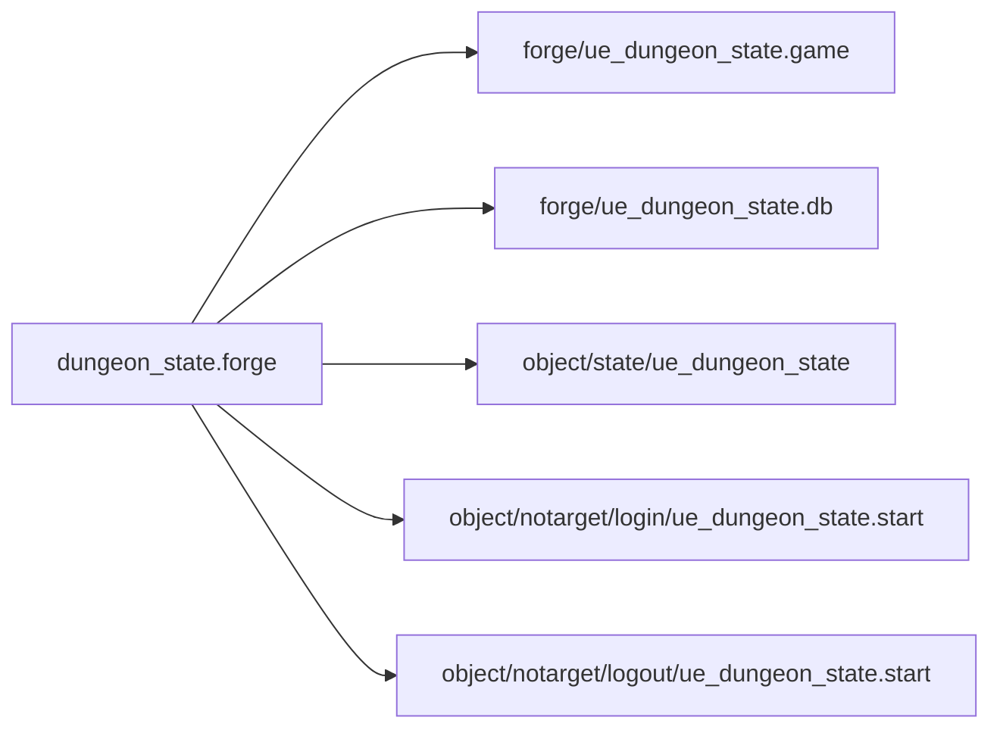
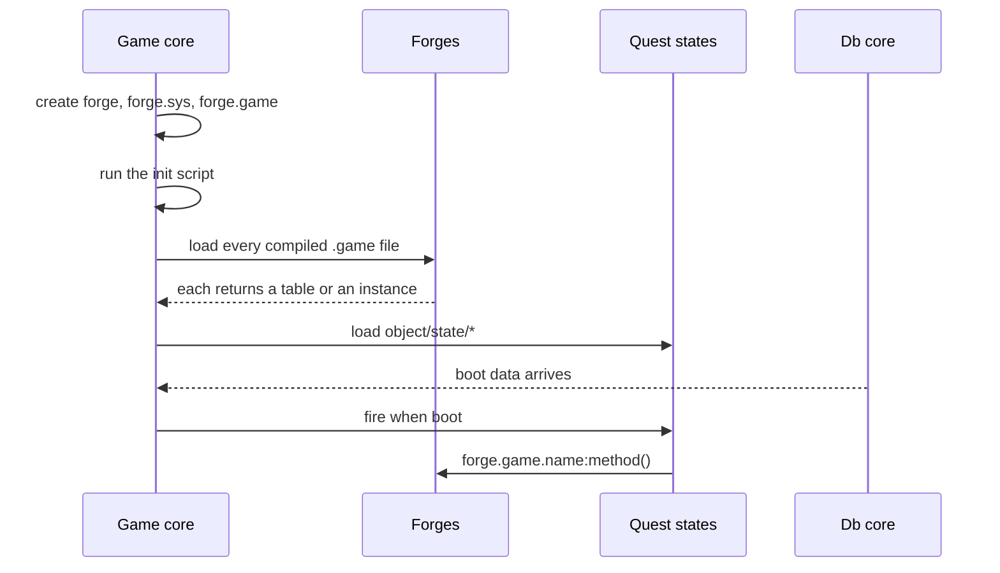

# Forge API reference

A `.forge` file defines a stateful Lua module that lives for the whole life of a core. Its code sits in `environment game` and `environment db` blocks. The same file can also carry classic quest `state` and `when` blocks, so the module and the quest hooks that drive it (`when login`, `when logout`, `when boot`) are written together. You reach for a forge when a subsystem needs state, synchronization between cores, or a client interface. For how the pieces fit and why, read [How Forge works](/foundations/luna/forge/).

## Quick start

One file, one name, a module on the game core, a module on the db core, and the two quest hooks that connect a player to them. `visit_counter.forge` counts logins across all cores in an event flag stored on the db core.

```forge
forge visit_counter begin
    environment game begin
        local forge_helper = require("forge_helper")

        local Counter = {}
        Counter.__index = Counter

        function Counter:new()
            return setmetatable({ online = {} }, Counter)
        end

        function Counter:on_login(pid)
            self.online[pid] = true

            local ch = forge.sys.game.char_manager.find_by_pid(pid)
            if ch then
                ch:chat_packet(forge.sys.game.CHAT_TYPE.INFO, "Welcome back")
            end

            local res, ok = forge_helper.coro.with_timeout(2000,
                forge_helper.sys.game.yield_db, "visit", tostring(pid))
            if not ok then
                sys_err("visit_counter: no answer from the db for pid " .. pid)
                return
            end
            sys_log(0, "visit_counter: login number " .. res)
        end

        function Counter:on_logout(pid)
            self.online[pid] = nil
        end

        return Counter:new()
    end

    environment db begin
        local _M = {}

        function _M.on_visit(peer, message, handler_id, receipt)
            local total = forge.sys.db.get_event_flag("visit_total") + 1
            forge.sys.db.set_event_flag("visit_total", total)
            forge.sys.db.answer_peer(peer, tostring(total), receipt)
        end

        forge.sys.set_peer_processor("visit", _M.on_visit)
        return _M
    end

    state start begin
        when login begin
            local pid = pc.get_player_id()
            bridge.coro.create_with_player_owner(
                function() forge.game.visit_counter:on_login(pid) end,
                pid
            )
        end

        when logout begin
            forge.game.visit_counter:on_logout(pc.get_player_id())
        end
    end
end
```

Add the file to the compiler list (`quest/qc/quest_list`) next to the `.quest` files, run the compiler, restart the cores. Every login shows the player a `Welcome back` line in the chat and writes `visit_counter: login number <n>` to the game core log, and the number keeps growing across cores and restarts. `self.online` is the per-player state: it lives in the module, one entry per player id, and the logout hook removes it.

## Files and setup

### One file, one name

A `.forge` file is a sequence of top-level blocks. Each block starts with `quest` or `forge`; any other first word aborts the compile with `must start with 'quest' or 'forge'`.

```text
forge <name> begin
    environment <env> begin ... end     -- any number, any order
    state <name> begin ... end          -- any number, any order
end
```

- The name is a plain word or a string. It must follow `forge` directly, and `begin` must follow the name (`need 'begin' after forge name`). A forge has no `with` start condition.
- The compiler always creates a quest and a forge from the same name token. The forge name is the quest name: every `state` in the block registers on the quest of that name, the module is published at `forge.<env>.<name>`, and messages the forge sends carry that name as their routing key. The game half and the db half of one forge find each other through it.
- The file name plays no role. `dungeon_state.forge` declares `forge ue_dungeon_state`, and everything it produces is named `ue_dungeon_state`.
- `forge` and `environment` are not reserved words, they are plain names the parser compares as text.
- `state` and `environment` blocks may come in any order. Inside `state` the grammar is the classic quest one: `when <event> [or <event>...] [with <condition>] begin ... end` and `function <name>(args) ... end`.
- `define NAME value` lines are allowed only before the first line that starts with `forge ` or `quest `. The substitution is applied to the whole file, environment bodies included.

All forges in the repository keep their `state` blocks inside the `forge` block. Two files that declare the same forge name are compiled independently and the later one silently overwrites the outputs of the earlier, so keep names unique.

### What the compiler emits

One compiler run builds `.quest` and `.forge` files together (they sit in the same list). The outputs of one file:



The environment bodies go to the forge side, the `state` blocks go to the quest side. A forge without an `environment db` body produces no `.db` file.

| Part of the file | Output | Content |
| --- | --- | --- |
| `environment <env>` with a body | `<out_forge_<env>>/<forge name>.<env>` | The body text verbatim, without the `begin` and `end` lines. |
| `environment <env>` with an empty body | nothing | Skipped. |
| Any `state` (once per quest) | `object/state/<name>` | A Lua chunk that assigns the global table `<name>` with the state ids (`["start"]=0`) and the quest functions. Written only if the quest has at least one state. |
| `when <event>` without argument | `object/<target>/<event>/<name>.<state>` | The body. Several `when` blocks for the same event and state are appended into one file. |
| `when <target>.<event>` | `object/<target>/<event>/<name>.<state>` | Target is the part before the dot. An event without a dot gets the target `notarget`. |
| `when <event>` with an argument | `object/<target>/<event>/<name>.<state>.<index>.script`, `.when`, `.arg` | One set per block. |
| `function` inside `state` | the state table | Emitted as `<name>.fn`, so a quest function is called as `<forge name>.fn(...)`. |

For `visit_counter.forge` above that means `forge/visit_counter.game`, `forge/visit_counter.db`, `object/state/visit_counter` (`visit_counter={["start"]=0}`), `object/notarget/login/visit_counter.start` and `object/notarget/logout/visit_counter.start`.

The quest table `visit_counter` (global, states and quest functions) and the forge module `forge.game.visit_counter` (your returned value) are two different tables that share a name.

A `when` block with a `with` condition compiles to `if <condition> then <body> return end`. Because blocks for the same event are appended in file order, when the first `when login` block has a `with` condition and it holds, the later `when login` blocks of that forge do not run. Keep conditioned blocks last or put the condition inside the body.

### Compiler flags

The deployment calls the compiler like this:

```bash
qc_args="--cwd=locale/italy/quest --out_forge_game=./forge --out_forge_db=./forge --out_forge_auth=./forge --out_quest=./object"
./bin/qc $qc_args --clean --do_file=qc/quest_list
```

| Flag | Meaning |
| --- | --- |
| `--out_forge_<env>=<dir>` | Where the compiled body of environment `<env>` goes. An environment with a body and no matching flag aborts the compile: `No output defined for forge environment <env>`. |
| `--forge_envs=a,b` | Restrict which environments are emitted. |
| `--out_quest=<dir>` | Where `object/` is written. |
| `--source_map_out` | One JSON source map per source file, one entry per compiled chunk, forge chunks included. |

The compiler does not validate calls: a typo in `forge.game.<name>` inside a `when` block compiles and fails at runtime.

### Where the compiled files go and how they load

All environments go into one flat folder (`./locale/italy/quest/forge` in the deployment). A core loads the files of that folder whose extension equals its own environment: the game core loads `*.game`, the db core loads `*.db`. The loader does not recurse, skips directories, and takes the part of the file name before the last dot as the forge name.

A missing folder is not fatal. The core logs `Forge::LoadSources Directory does not exist: <dir>. NO FORGE HANDLERS WILL BE REGISTERED` and starts without forges.

| Setting | Core | Meaning |
| --- | --- | --- |
| `server.luna.forge.base_directory` | game | Folder with the compiled forge files. Deployed from `luna.forge.path`. |
| `server.luna.forge.init_script` | game | Init script, deployed from `luna.forge.init_script`. |
| `server.luna.bridge.libs_path` | game | Lua library path of the bridge. |
| `LUNA_FORGE_PATH` | db | Folder with the compiled forge files. Required: the core exits with `LUNA_FORGE_PATH not set`. |
| `LUNA_FORGE_INIT` | db | Init script. Optional. |
| `LUNA_BRIDGE_LIB_PATH` | db | Lua library path of the bridge. Required. |

The init script runs before the forges load, whatever its name suggests. In the deployment the game core uses `locale/italy/libs/forge_extensions/game_init.lua` and the db core uses `db_init.lua`. It is the place to load shared extensions and define globals that every forge sees:

```lua
load_modules("locale/italy/libs/forge_extensions/global")
load_modules("locale/italy/libs/forge_extensions/game")

game_log = forge.sys.game.log
```

The Lua search path is set in the libs init, relative to the core's working directory (`locale/italy/libs/?.lua`, `locale/italy/system/?.lua`), so `require("augments.configs")` resolves to `locale/italy/system/augments/configs.lua`.

The generated stubs for the Lua API live in `Locale/italy/quest/meta`. This page documents `forge.sys`, `forge.sys.game` (the messaging part), `forge.sys.db`, `forge_helper` and `bridge.coro`. The rest of `forge.sys.game.*` (the character manager, dungeon manager, command, cron and the other sub-namespaces, several hundred functions) is documented by the stubs: one `forge.sys.game.<namespace>.lua` file each.

## API

### Environments

| Environment | Loaded by | Lua state | Notes |
| --- | --- | --- | --- |
| `game` | every game core | Shared with the quest manager | Sees `forge.game.*`, `forge.sys.game.*`. |
| `db` | the db core | Its own | Sees `forge.db.*`, `forge.sys.db.*`. `forge.game.*` does not exist there. The halves talk only through messages. |
| `auth` | nobody | none | The compiler accepts `--out_forge_auth`, no core loads these files. Not supported. |

Any other environment name compiles if you give it an `--out_forge_<name>` flag, and is never loaded.

### What an environment must return

Each environment body is a chunk. It must return a table or a class instance. The value is stored as `forge.<env>.<forge name>`, with no copy and no wrapper. If the name contains dots, the loader nests the tables (`a.b` becomes `forge.game.a.b`).

The body runs with its own environment: reads fall through to the globals, writes to undeclared names land in the forge's own table and are invisible to quests and other forges. Three keys are set on it: `__forge_ns` (the forge name), `__forge_id` and `__forge_file`. The engine uses `__forge_ns` to know which forge a call comes from.

### forge.sys

Available in both environments.

| Function | Signature | Description |
| --- | --- | --- |
| `forge.sys.set_main_processor` | `(header: string, processor: function) -> boolean` | Handle client messages with this header for this forge. Called as `processor(ch, message, client_handler)`. |
| `forge.sys.set_peer_processor` | `(header: string, processor: function) -> boolean` | Game: handle messages from other game cores, called as `processor(d, message, receipt)`. Db: handle requests from game cores, called as `processor(peer, message, handler_id, receipt)`. |
| `forge.sys.set_db_processor` | `(header: string, processor: function) -> boolean` | Game only in practice. Handle replies from the db core, called as `processor(d, message)`. |
| `forge.sys.log` | `(verbosity: number, message: string)` | Log with the prefix `[Forge-<name>]`. Verbosity 0 to 5. |
| `forge.sys.err` | `(message: string)` | Error log with the same prefix. |

Registration rules:

- The call must come from code that carries the forge environment: the environment body, or a function defined in it. From a quest `when` block it fails with `Forge::SetInputHandler called from a non-forge script` and returns `false`.
- A handler is keyed by input type, forge name and header. Registering the same header twice fails with `Forge::SetInputHandler trying to double set input handler` and returns `false`.
- Registering from `when boot` is safe. The handler is anchored on the global state, not on the short-lived quest thread.
- A message with no handler logs `Forge::InvokeMainInputHandler no handler registered for forge [<name>] header [<header>]` (and the peer and db variants).
- Processors run on the main thread, not in a coroutine. A processor that has to wait must start a coroutine. The value a processor returns is ignored.
- An error in a processor is printed to the error log with a stack trace, and the server keeps running.

### forge.sys.game

Messaging functions. They are the transport; each needs a forge environment on the caller, otherwise they log `ForgeGame::Send<X>Packet called from a non-forge script` and return `false`. An empty header is refused as well.

| Function | Signature | Description |
| --- | --- | --- |
| `forge.sys.game.send_client` | `(ch: LPCHARACTER, header, message, client_handler?: number = 0, receipt?: string)` | Send to one player's client. Needs a character with a descriptor (`null ch or null desc`). The packet must fit 65535 bytes (`message of N bytes does not fit a packet`). `client_handler` selects the client window that gets the answer. |
| `forge.sys.game.send_p2p` | `(header, message, receipt?: string)` | Send to every other game core. |
| `forge.sys.game.send_desc` | `(desc: LPDESC, header, message, receipt?: string)` | Send to one game core. |
| `forge.sys.game.send_db` | `(header, message, desc_handler?: number = 0, receipt?: string)` | Send to the db core. |
| `forge.sys.game.answer_p2p` | `(desc: LPDESC, message, receipt: number)` | Answer a request that arrived with a receipt. |

`send_client` is not a chat line. It delivers a header and a payload to a handler on the client side. To put a line in the player's chat, call `ch:chat_packet(type, text)` on the character, with a type from `forge.sys.game.CHAT_TYPE` (`INFO` for a plain system line). It needs no forge environment, so a hook may call it directly.

The enums `forge.sys.game.CHAT_TYPE`, `forge.sys.game.DAMAGE_TYPE` and `forge.sys.game.WEAR` are in the same stub. Receipts are passed as strings and parsed as unsigned numbers. The namespace on the wire is the sender's forge name, so the receiving forge of the same name gets the message.

Everything else under `forge.sys.game` (for example `forge.sys.game.char_manager.find_by_pid`, which every login hook uses) is described by its own generated stub.

### forge.sys.db

Db environment only.

| Function | Signature | Description |
| --- | --- | --- |
| `forge.sys.db.broadcast_peers` | `(header, message, channel?: number = 0, except?: CPeer, except_channel?: number = 0)` | Send to all game cores, optionally one channel, optionally skipping one core. |
| `forge.sys.db.send_peer` | `(peer: CPeer, header, message, desc_handler?: number = 0)` | Send to one game core. |
| `forge.sys.db.answer_peer` | `(peer: CPeer, message, receipt: number)` | Answer a request that arrived with a receipt. Answer once: a second answer finds the receipt used and is dropped. |
| `forge.sys.db.get_event_flag` | `(flag) -> number` | Value of an event flag, 0 if unset. |
| `forge.sys.db.set_event_flag` | `(flag, value)` | Persist the flag and broadcast it to all game cores. |

`forge.sys.db.sql`, `forge.sys.db.log` and `forge.sys.db.priv` have their own stubs.

### forge_helper

A Lua module that wraps the transport and the coroutine machinery. Require it inside the forge environment, never in the main state:

```lua
local forge_helper = require("forge_helper")
```

If the main state requires it first, every forge gets the cached copy built outside any forge environment, which has no forge name, and every send fails.

Processor registration. The helper binds `self` for you, so a processor can be a method.

| Function | Signature | Registers on |
| --- | --- | --- |
| `forge_helper.sys.game.set_main_processor` | `(header, self, processor)` | `forge.sys.set_main_processor`. Processor called `(self, ch, message, client_handler)`. |
| `forge_helper.sys.game.set_p2p_processor` | `(header, self, processor)` | `forge.sys.set_peer_processor`. Processor called `(self, d, message, receipt)`. |
| `forge_helper.sys.game.set_db_processor` | `(header, self, processor)` | `forge.sys.set_db_processor`. Processor called `(self, d, message)`. |
| `forge_helper.sys.db.set_peer_processor` | `(header, self, processor)` | `forge.sys.set_peer_processor` on the db core. Processor called `(self, peer, message, handler_id, receipt)`. |

All four drop the boolean result, so a double registration is not visible to the caller.

Waiting. A yielding function sends a message with a receipt that names the coroutine, then yields. It returns when the answer arrives, the timeout fires, or the owner is closed.

| Function | Signature | Receipt owner | Resumes on |
| --- | --- | --- | --- |
| `forge_helper.sys.game.yield_client` | `(ch, header, message, client_handler?, ...)` | `PLAYER`, the character's player id | The client's answer. |
| `forge_helper.sys.game.yield_db` | `(header, message, desc_handler?, ...)` | `PEER`, 0 | The db core's `answer_peer`. |
| `forge_helper.sys.game.yield_p2p` | `(header, message, ...)` | `PEER`, 1 | The first answer from any core. |
| `forge_helper.sys.game.yield_desc` | `(desc, header, message, ...)` | `PEER`, 1 | The answer from that core. |
| `forge_helper.sys.game.yield_auth` | `(username, password, hwid, client_ip)` | none | A JSON string with the authentication result. |

Timeouts wrap a yielding function:

| Function | Signature | Returns |
| --- | --- | --- |
| `forge_helper.coro.with_timeout` | `(timeout_ms, yielding, ...)` | `(result, ok)` as the yielding function returns them. |
| `forge_helper.coro.collect` | `(timeout_ms, yielding, ...)` | After the full timeout, `(results, true)` where `results` is an array of `{owner_type, owner_id, args}`, one per answer. Without answers, the array is empty. |

Every yielding function must run inside a bridge coroutine. See the calling context below.

### bridge.coro

Owned coroutines. An owner is a pair `(owner_type, owner_id)`. When an owner is closed, every coroutine it holds is resumed with failure and removed.

| Function | Signature | Description |
| --- | --- | --- |
| `bridge.coro.create` | `(entry) -> id, thread` | Create a coroutine and run it right away until its first yield. Returns `0, nil` if `entry` finished without yielding or raised an error. |
| `bridge.coro.create_with_player_owner` | `(entry, player_id) -> id, thread` | Same, owned by the player. It is closed when the player disconnects. |
| `bridge.coro.adopt` | `() -> id` | Register the running non-main thread as a bridge coroutine. Fails on the main thread (`trying to adopt main thread`). |
| `bridge.coro.add_owner` | `(coroutine_id, owner_type, owner_id)` | Add an owner to a coroutine. |
| `bridge.coro.close_by_owner` | `(owner_type, owner_id)` | Close every coroutine of that owner. The generated stub lists a leading `coroutine_id`; the binding takes only the two. |
| `bridge.coro.close_by_owner_exact` | `(owners: {{owner_type, owner_id}, ...})` | Close the coroutines that have exactly this set of owners. |
| `bridge.coro.get_current_id` | `() -> number` | Id of the running bridge coroutine. 0 outside a bridge coroutine, never nil. |
| `bridge.coro.generate_receipt_token` | `(coroutine_id, owner_type, owner_id) -> string` | Token an answer must carry to resume this coroutine. A zero id raises `Invalid coroutine_id: cannot be 0`. |
| `bridge.coro.enable_timout` | `(ms)` | Arm a timeout on the running coroutine. Outside a coroutine: `with_timout outside a coroutine`. A second timeout before the resume is ignored with `coroutine [id] has already a timeout`. |
| `bridge.coro.enable_collect` | `(ms)` | Arm collect mode. Outside a coroutine: `collect outside a coroutine`. |
| `bridge.coro.COROUTINE_OWNER` | enum | `PLAYER`, `QUEST`, `PEER`, `AUTH`. The generated stub does not list `AUTH`. |

The spelling `enable_timout` (no second `e`) is the real identifier.

What the yielding code sees when it resumes:

| Cause | Values returned |
| --- | --- |
| An answer with a valid token | `(message, true)` |
| The timeout fired | `(nil, false)` |
| The owner was closed | `(nil, false)` |
| `collect`, at the timeout | `(table, true)` |

An answer must come from the owner it was issued for (`ValidateCoroReceiptToken` checks type and id). A late answer, after a timeout, is dropped and logged as `token invalid/expired`. After a timeout or a close resume the coroutine is removed, so code that waits a second time after a failed wait is not resumed again.

### Quest side: the events your hooks answer

A `state` block in a `.forge` file takes any event the quest system fires. The ones a forge uses most:

| Event | Fires | Notes |
| --- | --- | --- |
| `when login` | When the player is in the game phase on a core and the quest data is loaded. | Again on every core change. It must run to the end: a block that suspends (a dialog, a wait) is closed and logged as `QUEST NOT END RUNNING on Login/Logout`. |
| `when logout` | In the disconnect sequence, after the player is saved. | The character still exists. Fires when the player leaves a core as well as on a real disconnect. |
| `when boot_init` | When the db core announces boot, before the boot data is processed. | Runs before `when boot`. |
| `when boot` | After the db core has sent its boot data. | All forges and all quest states are loaded. |
| `when <target>.<event>` | For example `when global_rankings.season_change`. | The target is the part before the dot. |

There is no local login or logout event on the event bus. The hooks are the `when` blocks of the forge file.

## Behaviour

### Boot order



Read it top to bottom: every forge has run before any quest state table exists and before any `when` fires. A `when boot` block can call any forge.

- The init script runs first, then the forges, then the quest states, then `when boot`.
- The load order among forges is the order the file system lists the compiled files. It is not sorted and not guaranteed. A forge must not touch `forge.<env>.<other>` while its environment body runs. Cross-forge calls belong in methods called later, or in `when boot`.
- If one environment fails to load, the load of the whole folder stops. On the game core `CQuestManager::Initialize` returns false and the core exits. On the db core the process returns 1. A load error takes the service down.
- A body that returns nothing compiles and fails at boot with `Forge::ExcecuteSources result is nil for forge[<name>]. Each environment should return a table or a class instance`. Always return a table, even if it is `{}`: a refused db half crash-loops the db core, which takes the cache and every login with it.
- A syntax or runtime error in the body fails with `Bridge::LoadCode Error loading code [<path>]: <error>`.
- There is no reload. Changing a forge means restarting the core. There is also no per-forge teardown hook.

### Isolation and require

Each forge gets its own `require`. Its module cache starts as a copy of whatever the global `package.loaded` held when that forge loaded, and every module first required inside a forge is loaded once per forge.

- Two forges that require the same module get two tables. Top-level globals of that module go into the requiring forge.
- Modules the main state loaded before the forges (the Penlight modules `pl.dir`, `pl.path`, the protobuf runtime) are the same table everywhere.
- Shared state across forges goes through `_G`. Reads fall through to the real globals, so a table anchored on `_G` is one physical table for everyone:

```lua
-- Stored on _G so the registry is invariant to any per-forge module-cache
-- scoping: writes from a consumer (avatar.augment_extension) and reads from
-- the engine forge always reference the same physical table.
_G._AUGMENT_CONFIGS = _G._AUGMENT_CONFIGS or {}

local M = {}
M.configs = _G._AUGMENT_CONFIGS
```

- A plain global assignment inside a forge (`function dispatch_notification_event(...)`) lands in that forge's environment. Quests and other forges do not see it.
- `forge_helper` must be required inside the forge, for the reason given in its section.

### Calling context

A forge file runs code in three kinds of place, and what you can do depends on which.

| Where your code runs | Thread | `get_current_id()` | May wait (yield) | May send (`forge.sys.game.send_*`) | May register processors |
| --- | --- | --- | --- | --- | --- |
| Environment body, at load | Main thread | 0 | No | Only through a method | Yes |
| A processor or an event-bus callback | Main thread | 0 | No | Yes | Only if the function was defined in the forge |
| A quest `when` block | Short-lived quest thread, not a bridge coroutine | 0 | No | No, call a forge method | No |
| A coroutine from `bridge.coro.create*` | Its own bridge coroutine | Its id | Yes | Yes, through a forge method | Yes |

The rules behind the table:

- A `when` block runs on a quest thread that is collected as soon as the block returns. Do not create tables, caches or any long-lived state in it. State lives in the environment body, the hook only calls in.
- The quest thread is not a bridge coroutine, because nothing adopts it. `bridge.coro.get_current_id()` returns 0 there, so the helper yields cannot wait. `with_timeout` fails first with `with_timout outside a coroutine`; a bare `yield_db` passes its guard (0 is truthy) and fails in `generate_receipt_token` with `Invalid coroutine_id: cannot be 0`.
- To wait from a hook, start a coroutine and do the waiting inside it. `create_with_player_owner` runs the function right away until its first yield, then returns, and the hook ends while the coroutine waits.
- To send from a hook, call a method of the forge that sends. The `send_*` functions check the environment of the calling function. The hook has none; a method defined in the environment block carries it, so the call works.
- Capture what you need from `pc.*` before the coroutine yields. After a resume, the code runs from an input handler where the quest "current player" is not the hook's player.
- A processor or the environment body is on the main thread and cannot wait either. Start a coroutine with `bridge.coro.create`, add an owner with `bridge.coro.add_owner`, or use `create_with_player_owner`.

Owners decide what dies when. A coroutine owned by a player is closed by the disconnect sequence, and its pending wait resumes with `(nil, false)`. Tie every coroutine that waits on a player to that player, and always set a timeout.

### Logout order

When a player disconnects, in this order:

1. The save event fires on the event bus (`ON_PLAYER_SAVE`).
2. `when logout` runs, while the character still exists.
3. The player's owned coroutines are closed. A wait still pending resumes with `(nil, false)`.

`forge.sys.game.char_manager.find_by_pid(pid)` returns the live character or `nil`. A forge does not check that a stored pointer is still valid. A forge that keeps characters (a table `characters[pid] = ch`) must drop them in `when logout`.

### Errors at a glance

| Situation | Result |
| --- | --- |
| Error while a forge loads | The service stops. |
| Error in a processor, a callback or a hook at runtime | Printed to the error log with a stack trace, the server continues. |
| Compile: two environments with the same name in a forge | Aborts: `duplicate environment <env>`. |
| Compile: `set_state(x)` to a state that does not exist | Aborts: `state name not found : <name>`. |
| Compile: a reserved word (`quest`, `state`, `with`, `when`, `define`, `begin`) used as a name anywhere, environment code included | Aborts with `syntax error : <message>`. The reported line is the end of the environment, not the offending line. |
| Compile: `set_state`, `setstate` or `newstate` anywhere in the file | The preprocessor rewrites the call in the whole file and quotes a non-string argument. Do not use these names for your own methods. |

## Examples

### Hooks that keep a forge in sync with players

The forge holds the state and the hooks only call in. This is the whole `state` block of a real forge that keeps raw characters per dungeon.

```forge
    state start begin
        when login begin
            local ch = forge.sys.game.char_manager.find_by_pid(pc.get_player_id())
            forge.game.ue_dungeon_state:player_enter(ch)
        end

        when logout begin
            local ch = forge.sys.game.char_manager.find_by_pid(pc.get_player_id())
            forge.game.ue_dungeon_state:player_logout(ch)
        end
    end
end
```

The forge side removes the character in `player_logout`:

```lua
---@param ch LPCHARACTER
function DungeonState:remove_character(ch)
    local pid = ch:get_player_id()
    self.characters[pid] = nil
end
```

### Boot-time work from a hook

A forge whose environment only returns data, with all the work in `when boot` and in dotted events. Note the calls into three other forges, which is fine after boot.

```forge
forge ue_season_manager begin
    environment game begin
        local ranked_competition_name = "ranked_competition"

        return {
            ranked_competition_name = ranked_competition_name
        }
    end

    state start begin
        when boot begin
            season.register("global_rankings")
            season.register(forge.game.ue_season_manager.ranked_competition_name)
            if season.is_master() then
                season.add_auto_season("global_rankings", "0 0 0 1 * ?", "0 59 23 L * ?", true)
            end
        end

        when global_rankings.season_change begin
            if season.is_master() then
                local event = season.get_current_season_event()

                if event == "END" then
                    notice_all(locale.seasons.global_rankings_close)
                elseif event == "START" then
                    notice_all(locale.seasons.global_rankings_open)
                elseif event == "CANCEL" then
                    notice_all(locale.seasons.global_rankings_canceled)
                end

                forge.game.ue_ranking_manager:on_global_season_change(event)
            end
        end

        when ranked_competition.season_change begin
            local event = season.get_current_season_event()
            if season.is_master() then

                if event == "END" then
                    notice_all(locale.seasons.ranked_season_close)
                elseif event == "START" then
                    notice_all(locale.seasons.ranked_season_open)
                elseif event == "CANCEL" then
                    notice_all(locale.seasons.ranked_season_canceled)
                end

                forge.game.ue_ranking_manager:on_ranked_season_change(event)
                forge.game.ue_mmr_manager:on_ranked_season_change(event)
            end
            -- All cores need to react and open/close the queues
            forge.game.pvp_arena_queue:on_change_season(event)
        end
    end
end
```

### Ask the db and wait, owned by the player

The hook starts a player-owned coroutine. The forge method waits on the db with a two second timeout and treats `ok == false` as a failure. This is the pattern from the Quick start, in a real forge:

```lua
state start begin
    when login begin
        local ch = forge.sys.game.char_manager.find_by_pid(pc.get_player_id())
        bridge.coro.create_with_player_owner(
            function() forge.game.player_timers_manager:on_login(ch) end,
            pc.get_player_id()
        )
    end
end
```

```lua
---@param ch LPCHARACTER
function TimersManager:on_login(ch)
    local pid = ch:get_player_id()
    --call database

    local db_msg = pb_loader.new(messages.GDPlayerTimerLoad)
    db_msg.player_id = pid

    local res, ok = forge_helper.coro.with_timeout(2000,
        forge_helper.sys.game.yield_db, "on_login", db_msg:SerializeToString()
    )

    if not ok then
        sys_err_v("[TimersManager::on_login] Failed to load timers for pid[%d]", pid)
        return
    end
    local result = pb_loader.parse_string(messages.DGPlayerTimerLoad, res)

    if 0 == #result.timer then
        sys_log_v(1, "[TimersManager::on_login] No timers for pid[%d]", pid)
    end

    for _, timers in ipairs(result.timer) do
        ---@type player_timers_pb_PlayerTimerLoad
        local typed_timer = timers
        local notificationtype = typed_timer.notification_type
        local extra_arg = typed_timer.extra_arg
        local endtime = typed_timer.endtime
        self:load_timer(pid, notificationtype, extra_arg, endtime)
    end
end
```

The db environment registers the matching processor and answers with the receipt it received:

```lua
forge.sys.set_peer_processor("on_login", _M.on_login)
forge.sys.set_peer_processor("update_player_timer", _M.update_player_timer)
```

### Collect answers from every core

`collect` waits the full timeout and returns one entry per answer. The caller must already be inside a coroutine.

```lua
function IntelManager:collect_user_count()
    sys_log(0, "collecting user_count")
    ---@type intel_manager_pb_GGUserCountRequest
    local msg = messages.GGUserCountRequest()
    local res, ok = forge_helper.coro.collect(1000, forge_helper.sys.game.yield_p2p, "user_count_request", 
        msg:SerializeToString(), user_count_polling_cycle)
    if not ok then
        sys_err("could not collect user_count")
        return
    end

    self.user_count = {}

    for k, v in ipairs(res) do
        ---@type intel_manager_pb_GGUserCountResponse
        local response = messages.GGUserCountResponse()
        response:ParseFromString(v.args)
        table.insert(self.user_count, pb_loader.unpack(response))
    end
end
```

## Pitfalls

**A `when` block raises `with_timout outside a coroutine` or `Invalid coroutine_id: cannot be 0`.** The hook runs on a quest thread, not a bridge coroutine. Wrap the waiting call in `bridge.coro.create_with_player_owner(function() ... end, pid)` and do it there.

**`called from a non-forge script` when sending from a hook.** The send functions look at the environment of the calling function, and a `when` block has none. Call a forge method that does the send.

**A table you built in a `when` block is gone or invisible.** The quest thread is collected when the block returns. Declare the state in the forge environment and let the hook call into it.

**Every send fails after you required `forge_helper` in a quest or in the init script.** The main state cached the helper without a forge environment. Require it only inside `environment` blocks.

**Two forges that require the same module see different tables.** Each forge has its own module cache. Anchor shared state on `_G`, as the augment registry does.

**The core does not start after you changed a forge.** An environment body returned nothing, or a body has a syntax error. A load error stops the service. Return a table from every environment, db half included.

**A forge reads `forge.game.<other>` at top level and it is nil, sometimes.** Load order is the file listing order. Do cross-forge access in methods and in `when boot`.

**A stored character pointer crashes the core or reads stale data.** Characters are raw engine objects and a forge does not check their validity. Drop them in `when logout`, check for `nil` after `find_by_pid`, and prefer storing the player id.

**A db answer is lost, or the waiting code never resumes.** A late answer after the timeout is dropped (`token invalid/expired`), a second `answer_peer` for the same receipt is dropped, and the coroutine is removed after a failed wait. Answer once, and do not wait again in the same coroutine after `ok == false`.

**A coroutine that waits on a player outlives the player.** `bridge.coro.create` has no owner. Use `create_with_player_owner`, or `add_owner`, so the disconnect closes it. Always set a timeout.

**The first `when login` block has a `with` condition and later blocks stop running.** Blocks of the same event are appended into one script, and a conditioned block ends in `return`. Put conditioned blocks last.

**Registering the same header twice does nothing and nothing says so.** The second `set_*_processor` returns `false` and logs once, and `forge_helper` throws the result away. One header, one registration.

**A compile error points at the wrong line.** For a reserved word used inside an environment body, the line is the end of the environment scan. Search the body for `quest`, `state`, `with`, `when`, `define`, `begin` used as names.

**A method named `set_state` gets its argument quoted.** The preprocessor rewrites `set_state`, `setstate` and `newstate` in the whole file, environment code included. Pick another name.

**The wrong table.** `visit_counter.fn(...)` calls a quest function from the quest table; `forge.game.visit_counter:method()` calls your module. They share a name and nothing else.

## See also

- [How Forge works](/foundations/luna/forge/)
- The generated stubs in `Locale/italy/quest/meta`: `forge.sys.lua`, `forge.sys.game.lua`, `forge.sys.db.lua`, `bridge.coro.lua`, and one `forge.sys.game.<namespace>.lua` per game sub-namespace.
