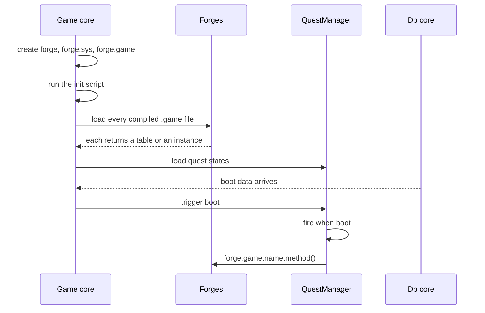

# Forge environments and boot

An environment body runs on its core and returns the module that scripts call. Boot order and calling context determine which operations are safe; see [How Forge works](/foundations/luna/forge/) for the model.

The smallest body returns a table:

```lua
return {}
```

## Environments

| Environment | Loaded by | Lua state | Notes |
| --- | --- | --- | --- |
| `game` | every game core | Shared with the quest manager | Sees `forge.game.*`, `forge.sys.game.*`. |
| `db` | the db core | Its own | Sees `forge.db.*`, `forge.sys.db.*`. `forge.game.*` does not exist there. The halves talk only through messages. |
| `auth` | nobody | none | The compiler accepts `--out_forge_auth`, no core loads these files. Not supported. |

Any other environment name compiles if you give it an `--out_forge_<name>` flag, and is never loaded.

### What an environment must return

Each environment body is a chunk. It must return a table or a class instance. The value is stored as `forge.<env>.<forge name>`, with no copy and no wrapper. If the name contains dots, the loader nests the tables (`a.b` becomes `forge.game.a.b`).

The body runs with its own environment: reads fall through to the globals, writes to undeclared names land in the forge's own table and are invisible to quests and other forges. Three keys are set on it: `__forge_ns` (the forge name), `__forge_id` and `__forge_file`. The engine uses `__forge_ns` to know which forge a call comes from.

## Boot order

The game core loads forges before QuestManager loads quest states and runs boot hooks.



Read it top to bottom: every forge has run before any quest state table exists and before any `when` fires. A `when boot` block can call any forge.

- The init script runs first, then the forges, then the quest states, then `when boot`.
- The load order among forges is the order the file system lists the compiled files. It is not sorted and not guaranteed. A forge must not touch `forge.<env>.<other>` while its environment body runs. Cross-forge calls belong in methods called later, or in `when boot`.
- If one environment fails to load, the load of the whole folder stops. On the game core initialization returns false and the core exits. On the db core the process returns 1. A load error takes the service down.
- A body that returns nothing compiles and fails at boot with `Forge::ExcecuteSources result is nil for forge[<name>]. Each environment should return a table or a class instance`. Always return a table, even if it is `{}`: a failed db half stops the db core.
- A syntax or runtime error in the body fails with `Bridge::LoadCode Error loading code [<path>]: <error>`.
- Changing a forge means restarting the core. There is also no per-forge teardown hook.

## Isolation and require

Each forge gets its own `require`. Its module cache starts as a copy of whatever the global `package.loaded` held when that forge loaded, and every module first required inside a forge is loaded once per forge.

- Two forges that require the same module get two tables. Top-level globals of that module go into the requiring forge.
- Modules the main state loaded before the forges (the Penlight modules `pl.dir`, `pl.path`, the protobuf runtime) are the same table everywhere.
- Shared state across forges goes through `_G`. Reads fall through to the real globals, so a table anchored on `_G` is one physical table for everyone:

```lua
_G.registry = _G.registry or {}
local M = {}
M.registry = _G.registry
return M
```

- A plain global assignment inside a forge (`function example(...)`) lands in that forge's environment. Quests and other forges do not see it.
- `forge_helper` must be required inside the forge, for the reason given in its section.

## Calling context

A forge file runs code in three kinds of place, and what you can do depends on which.

| Where your code runs | Thread | `get_current_id()` | May wait (yield) | May send (`forge.sys.game.send_*`) | May register processors |
| --- | --- | --- | --- | --- | --- |
| Environment body, at load | Main thread | 0 | No | Only through a method | Yes |
| A processor or an event-bus callback | Main thread | 0 | No | Yes | Only if the function was defined in the forge |
| A quest `when` block | Short-lived quest thread, not a bridge coroutine | 0 | No | No, call a forge method | Not directly; a forge method it calls can |
| A coroutine from `bridge.coro.create*` | Its own bridge coroutine | Its id | Yes | Yes, through a forge method | Yes |

The rules behind the table:

- A `when` block runs on a quest thread that is collected as soon as the block returns. Do not create tables, caches or any long-lived state in it. State lives in the environment body, the hook only calls in.
- The quest thread is not a bridge coroutine, because nothing adopts it. `bridge.coro.get_current_id()` returns 0 there, so the helper yields cannot wait. `with_timeout` fails first with `with_timout outside a coroutine`; a bare `yield_db` passes its guard (0 is truthy) and fails in `generate_receipt_token` with `Invalid coroutine_id: cannot be 0`.
- To wait from a hook, start a coroutine and do the waiting inside it. `create_with_player_owner` runs the function right away until its first yield, then returns, and the hook ends while the coroutine waits.
- To send from a hook, call a method of the forge that sends. The `send_*` functions check the environment of the calling function. The hook has none; a method defined in the environment block carries it, so the call works.
- Capture what you need from `pc.*` before the coroutine yields. After a resume, the code runs from an input handler where the quest "current player" is not the hook's player.
- A processor or the environment body is on the main thread and cannot wait either. Start a coroutine with `bridge.coro.create`, add an owner with `bridge.coro.add_owner`, or use `create_with_player_owner`.

Owners decide what dies when. A coroutine owned by a player is closed by the disconnect sequence, and its pending wait resumes with `(nil, false)`. Tie every coroutine that waits on a player to that player, and always set a timeout.

### Logout order

When a player disconnects, in this order:

1. The save event fires on the event bus (`ON_PLAYER_SAVE`).
2. `when logout` runs, while the character still exists.
3. The player's owned coroutines are closed. A wait still pending resumes with `(nil, false)`.

`forge.sys.game.char_manager.find_by_pid(pid)` returns the live character or `nil`. A forge does not check that a stored pointer is still valid. A forge that keeps characters (a table `characters[pid] = ch`) must drop them in `when logout`.

### Errors at a glance

| Situation | Result |
| --- | --- |
| Error while a forge loads | The service stops. |
| Error in a processor, a callback or a hook at runtime | Printed to the error log with a stack trace, the server continues. |
| Compile: two environments with the same name in a forge | Aborts: `duplicate environment <env>`. |
| Compile: `set_state(x)` to a state that does not exist | Aborts: `state name not found : <name>`. |
| Compile: a reserved word (`quest`, `state`, `with`, `when`, `define`, `begin`) used as a name anywhere, environment code included | Aborts with `syntax error : <message>`. The reported line is the end of the environment, not the offending line. |
| Compile: `set_state`, `setstate` or `newstate` anywhere in the file | The preprocessor rewrites the call in the whole file and quotes a non-string argument. Do not use these names for your own methods. |

Next: [forge.sys API reference](./api.md).
