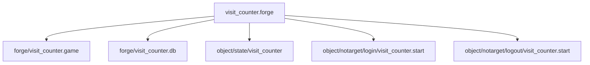

# Forge overview and setup

A `.forge` file defines a stateful Lua module for the lifetime of a core and can include quest hooks in the same file. Use it for state and messages across cores; [How Forge works](/foundations/luna/forge/) explains the model.

## Quick start

One file, one name, a module on the game core, a module on the db core, and the two quest hooks that connect a player to them. `visit_counter.forge` counts logins across all cores in an event flag stored on the db core.

```forge
forge visit_counter begin
    environment game begin
        local forge_helper = require("forge_helper")

        local Counter = {}
        Counter.__index = Counter

        function Counter:new()
            return setmetatable({ online = {} }, Counter)
        end

        function Counter:on_login(pid)
            self.online[pid] = true

            local ch = forge.sys.game.char_manager.find_by_pid(pid)
            if ch then
                ch:chat_packet(forge.sys.game.CHAT_TYPE.INFO, "Welcome back")
            end

            local res, ok = forge_helper.coro.with_timeout(2000,
                forge_helper.sys.game.yield_db, "visit", tostring(pid))
            if not ok then
                sys_err("visit_counter: no answer from the db for pid " .. pid)
                return
            end
            sys_log(0, "visit_counter: login number " .. res)
        end

        function Counter:on_logout(pid)
            self.online[pid] = nil
        end

        return Counter:new()
    end

    environment db begin
        local _M = {}

        function _M.on_visit(peer, message, handler_id, receipt)
            local total = forge.sys.db.get_event_flag("visit_total") + 1
            forge.sys.db.set_event_flag("visit_total", total)
            forge.sys.db.answer_peer(peer, tostring(total), receipt)
        end

        forge.sys.set_peer_processor("visit", _M.on_visit)
        return _M
    end

    state start begin
        when login begin
            local pid = pc.get_player_id()
            bridge.coro.create_with_player_owner(
                function() forge.game.visit_counter:on_login(pid) end,
                pid
            )
        end

        when logout begin
            forge.game.visit_counter:on_logout(pc.get_player_id())
        end
    end
end
```

Add the file to your compiler input, compile it, and restart the cores. Every login shows the player a `Welcome back` line in the chat and writes `visit_counter: login number <n>` to the game core log, and the number keeps growing across cores and restarts. `self.online` is the per-player state: it lives in the module, one entry per player id, and the logout hook removes it.

## Glossary

| Term | Meaning |
| --- | --- |
| Forge | The system that loads and routes forge modules. |
| Environment | A core-specific body in a `.forge` file. |
| Forge name | The declared name, used for modules, quest output, and message routing. |
| Quest table | The global table of state IDs and quest functions. |
| Forge module | The table or instance returned by an environment. |
| Init script | A script run before forges load. |

## File grammar and output

A `.forge` file is a sequence of top-level blocks. Each block starts with `quest` or `forge`; any other first word aborts the compile with `must start with 'quest' or 'forge'`.

```text
forge <name> begin
    environment <env> begin ... end     -- any number, any order
    state <name> begin ... end          -- any number, any order
end
```

- The name is a plain word or a string. It must follow `forge` directly, and `begin` must follow the name (`need 'begin' after forge name`). A forge has no `with` start condition.
- The compiler always creates a quest and a forge from the same name token. The forge name is the quest name: every `state` in the block registers on the quest of that name, the module is published at `forge.<env>.<name>`, and messages the forge sends carry that name as their routing key. The game half and the db half of one forge find each other through it.
- The file name plays no role. `visit_counter.forge` can declare `forge visit_counter`, and its outputs use `visit_counter`.
- `forge` and `environment` are not reserved words, they are plain names the parser compares as text.
- `state` and `environment` blocks may come in any order. Inside `state` the grammar is the classic quest one: `when <event> [or <event>...] [with <condition>] begin ... end` and `function <name>(args) ... end`.
- `define NAME value` lines are allowed only before the first line that starts with `forge ` or `quest `. The substitution is applied to the whole file, environment bodies included.

Two files that declare the same forge name are compiled independently and the later one silently overwrites the outputs of the earlier, so keep names unique.

### What the compiler emits

One compiler run builds `.quest` and `.forge` files together. The diagram shows the outputs of a file with both environments and login and logout hooks:



The environment bodies go to the forge side, the `state` blocks go to the quest side. A forge without an `environment db` body produces no `.db` file.

| Part of the file | Output | Content |
| --- | --- | --- |
| `environment <env>` with a body | `<out_forge_<env>>/<forge name>.<env>` | The body text verbatim, without the `begin` and `end` lines. |
| `environment <env>` with an empty body | nothing | Skipped. |
| Any `state` (once per quest) | `object/state/<name>` | A Lua chunk that assigns the global table `<name>` with the state ids (`["start"]=0`) and the quest functions. Written only if the quest has at least one state. |
| `when <event>` without argument | `object/<target>/<event>/<name>.<state>` | The body. Several `when` blocks for the same event and state are appended into one file. |
| `when <target>.<event>` | `object/<target>/<event>/<name>.<state>` | Target is the part before the dot. An event without a dot gets the target `notarget`. |
| `when <event>` with an argument | `object/<target>/<event>/<name>.<state>.<index>.script`, `.when`, `.arg` | One set per block. |
| `function` inside `state` | the state table | Emitted as `<name>.fn`, so a quest function is called as `<forge name>.fn(...)`. |

The quest table `visit_counter` (global, states and quest functions) and the forge module `forge.game.visit_counter` (your returned value) are two different tables that share a name.

A `when` block with a `with` condition compiles to `if <condition> then <body> return end`. Because blocks for the same event are appended in file order, when the first `when login` block has a `with` condition and it holds, the later `when login` blocks of that forge do not run. Keep conditioned blocks last or put the condition inside the body.

## Installer settings

Each environment body needs an output folder for that environment. A core loads files from one folder whose extension matches its environment; the loader does not recurse and skips directories. The init script runs before the forges. Exact folders and flags depend on how your codebase installs Forge.

| Key or variable | Core | Points to |
| --- | --- | --- |
| `server.luna.forge.base_directory` | game | Compiled forge folder. |
| `server.luna.forge.init_script` | game | Init script. |
| `server.luna.bridge.libs_path` | game | Bridge Lua library path. |
| `LUNA_FORGE_PATH` | db | Compiled forge folder; required. |
| `LUNA_FORGE_INIT` | db | Init script; optional. |
| `LUNA_BRIDGE_LIB_PATH` | db | Bridge Lua library path; required. |

An environment with a body and no output defined aborts compilation with `No output defined for forge environment <env>`. A missing folder logs `Forge::LoadSources Directory does not exist: <dir>. NO FORGE HANDLERS WILL BE REGISTERED`; a db core without `LUNA_FORGE_PATH` exits with `LUNA_FORGE_PATH not set`.

Next: [Forge environments and boot](./environments.md).
