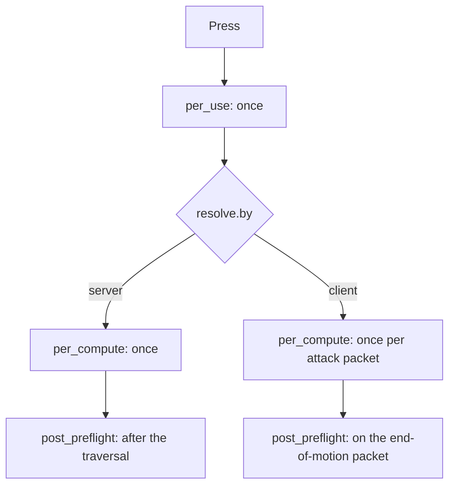

# Skill file reference

A skill is one YAML file. The file says what the skill costs, how far it reaches, who may be hit, and a tree of nodes that does the work. The game cores and the client read the same file, so nothing is authored twice. You reach for this page when you write or change a skill: every key, every node type and every refusal is below.

Why the file is shaped this way is in [One file per skill](/foundations/skills/one-file). The node model and the phases of a cast are in [24 node types and the phases of a cast](/foundations/skills/nodes-and-phases). Who a node reaches is in [collect, accept and targets](/foundations/skills/reach). The formulas inside every `...Poly` key are in [One formula, two evaluators](/foundations/skills/formulas).

## Quick start

This is skill 1 as it ships, a warrior melee skill. The client aims it, the server hits up to six victims with a damage node, and the skill needs a sword or a two-handed weapon.

```yaml
name: Taglio a tre vie
type: CLASS
maxLevel: 40
cooldownPoly: '15'
costType: SP
costPoly: 40+100*skill_k
range: 450
useTimeout: 2500
skillshot: true
weaponLimitation:
- SWORD
- TWO_HANDED
flags:
- ENEMYONLY
- ATTACK_SKILL
- LEVEL_UP_BY_POINT
- NEED_TARGET
client:
  job: WARRIOR
  icon: skill/warrior/samyeon
  motionIndex: 1
  gradeCount: 4
desc:
  vars:
    val:     { ref: node.dmg.amountPoly }
    targets: { ref: resolve.bound.targets }
resolve:
  by: client
  bound: { targets: '6', hitsPerTarget: '3' }
per_compute:
- type: DAMAGE
  id: dmg
  amountPoly: 632*skill_k+(point_TOTAL_PHYS_ATT-point_AURA_PHYS_ATT_BONUS)*1.3
  damageType: MELEE
  ability_scaling: { adder: SAMYEON_ADDER, resist: SAMYEON_RESIST }
  accept:
    of: ENEMY
```

Save it as `1.ucskill.yaml` in the skill config folder and restart the game cores. The loader reads the file at boot and builds the table. Pressing the skill at level 1 costs `40+100*skill_k` SP, starts a 15 second cooldown, and each victim the client's hitbox names takes one `dmg` computation.

## Files and setup

| What | Where | Notes |
| --- | --- | --- |
| Skill file | `Locale/conf/skill/<vnum>.ucskill.yaml` | One file per vnum. The filename is the vnum; there is no `vnum:` key. |
| Handlers | `Locale/conf/skill/<vnum>.lua` | Named by a node's `handler:`. A table of handlers, see [Handlers](#handlers). |
| Policies | `Locale/conf/skill/policies.yaml` | The ids a skill may use under `policies:`. |
| Colocated traits | `Locale/conf/skill/traits/<id>.lua` | Loaded when no other source defines the trait id. |
| Descriptions | `desc:` in the file, text in the client skill description files | See [Skill descriptions that cannot drift](/foundations/skills/descriptions). |

A file whose name does not end in `.ucskill.yaml` is ignored, so the Lua files and the policy list sit in the same folder without a clash. The server mounts the folder as `conf/skill`. The client gets the same folder in its pack as `locale/universal/skill` and walks the vnums 1 to 1000 looking for files. The highest vnum a character can hold is 399, and the skills that ship go up to 396.

Skills are not reloaded one at a time. The folder is read as a whole, at boot and on a proto reload. Names a formula may read are listed in [One formula, two evaluators](/foundations/skills/formulas).

## Top-level keys

Every key is optional unless the table says otherwise. Each key lives at the root of the file, except the `client:` block, which has its own table.

### Identity

| Key | Type | Meaning |
| --- | --- | --- |
| `name` | string | Up to 64 characters. Internal and used in log lines; the player sees the name from the description file. |
| `type` | enum | `CLASS`, `SPECIALIZATION`, `HORSE`, `SUPPORT`, `GUILD`, `PASSIVE`, `MOB`. An unknown value is logged as `unknown type string` and becomes no type. |
| `maxLevel` | int | The highest level the skill reaches. |
| `levelLimit` | int | The character level the skill needs. Server only. |
| `prerequisite` | map | `{ vnum: <skill>, level: <n> }`. Server only. |
| `subject` | enum | `character`, `guild` or `empire`: who owns the cast. Absent means `guild` for `type: GUILD` and `character` otherwise. An unknown value fails the file. |
| `intracore` | bool | Authorize where the key is pressed, execute on every core with nobody performing. Needs a guild or empire subject. See [Intracore skills](#intracore-skills). |

`type: PASSIVE` is what makes a skill eligible for `triggersOn`. `type: HORSE` is also what the client reads as "this is a horse skill"; there is no flag for it, on purpose. Subjects and owners are in [Skills: owned by a character, a guild or an empire](/foundations/skills/owners).

### Cost and cooldown

| Key | Type | Meaning |
| --- | --- | --- |
| `costType` | enum | `SP`, `HP` or `SUBJECT_GOLD`. Absent or empty means no cost, and `costPoly` is not read at all. |
| `costPoly` | poly | The amount. |
| `cooldownPoly` | poly | Seconds. |

Both polys are evaluated with the caster's names only, because nobody has been hit yet when a cost is paid. `SUBJECT_GOLD` is the owner's purse: the guild's money, or the empire's monarch treasury. A character has no shared purse, so it is refused for one. A guild or empire skill with an `SP` or `HP` cost is refused for the same reason, rather than charging the member who pressed.

Both polys are also evaluated by the client from the same file. A name only the server can answer makes the file fail, see [Loader errors](#loader-errors).

### Reach

| Key | Type | Meaning |
| --- | --- | --- |
| `range` | int | One number for both sides. `0` is unbounded. |
| `range_bonus` | point name | A point whose value, times 100, extends the reach. An unknown name fails the file. |
| `useTimeout` | int, ms | How long a use stays in flight. Also the window of a `charge` windup. |
| `weaponLimitation` | list | `SWORD`, `DAGGER`, `BOW`, `TWO_HANDED`, `BELL`, `FAN`, `DOUBLE_SWORD` (an alias of `DAGGER`). Empty or absent means any weapon. |

`range` is a gate and never a collector. The client refuses the press beyond it. The server accepts `range + 300` plus `range_bonus * 100`, where the 300 is latency slack. A splash carries its own radius and never looks at `range`.

A `weaponLimitation` that is not a list, or an entry that is not in the table, is logged and the rest of the file loads.

### Delivery

| Key | Type | Meaning |
| --- | --- | --- |
| `shoot` | bool | The hit arrives on the shoot packet (arrows, talismans, thrown weapons). A normal attack packet must not carry it. |
| `charge` | bool | Two-phase use: the press launches a dash, the arrival lands the hit. The window is `useTimeout`. |
| `skillshot` | bool | Client only. No distance check at all; the hitbox of the motion is the gate. |

`charge: true` and an `AFFECT` node raising `TANHWAN_DASH` are checked against each other at boot, in both directions. A `charge` without the dash affect fails the file, because the client's dash flow would never see it. The dash affect without `charge` fails it too, because the client would run an arrival flow against a server that refuses the arrival. The affect may sit anywhere in `per_use:` or `per_compute:`, children included. The dash itself belongs in `per_use:`.

### `resolve:`

`resolve:` is the only key the loader refuses to boot without.

```yaml
resolve:
  by: client
  bound: { targets: '5', hitsPerTarget: '1' }
```

| Key | Meaning |
| --- | --- |
| `by` | `server` or `client`. Anything else, absence included, fails the file. |
| `bound.targets` | Poly. How many distinct victims one cast may claim. `0` or empty is unbounded. |
| `bound.hitsPerTarget` | Poly. How many times each. `0` or empty is unbounded. |

`by` says who writes the list of victims: the server picks and walks the tree itself, or the client's motion hitbox names each victim in an attack packet. `bound` is the server's cap on what a client may claim. It gates the entry point, not a node; a per-node cap is `accept.ledger`. With `by: server` the bound is still evaluated and readable as `use.bound.targets`, but there is nothing to police. What each choice does at runtime is under [Phases](#phases).

### Flags

```yaml
flags:
- ENEMYONLY
- ATTACK_SKILL
- NEED_TARGET
```

One vocabulary, read from one table by both sides. Which side acts on a flag is a property of the flag, not of the file. An unknown name is logged as `unknown flag` and skipped. No `flags:` means no flag.

| Flag | Read by | Meaning |
| --- | --- | --- |
| `SELFONLY`, `OTHERONLY`, `NPCONLY`, `PCONLY` | server | Who may be the victim of a use. |
| `ALLYONLY`, `ENEMYONLY` | both | The same, and the client will not offer the skill on the wrong side. |
| `NPC_BUFF` | both | An NPC is a legal target if its AI accepts buffs. Read for every collection. |
| `TOGGLE` | server | The skill is a toggle. Also relaxes the "needs a duration" check on `AFFECT` and `AUTO_SHOOT`. |
| `NO_COOLDOWN` | server | No cooldown after a use. |
| `PERSISTENT_COOLDOWN` | server | The cooldown survives a relog. |
| `TARGET_TRIGGER_SUBJECT` | server | A triggered cast is aimed at the other party of the event. |
| `ATTACK_SKILL` | both | An attack: the client refuses the press and the server refuses the packet where attacks are forbidden. |
| `LEVEL_UP_BY_POINT` | both | Opts in to the plus button. Without it the skill cannot be raised by a point. |
| `NO_MANUAL_USE` | client | The interface does not offer it for casting. Not the same fact as `type: PASSIVE`. |
| `NEED_TARGET`, `SEARCH_TARGET`, `NEED_CORPSE`, `CAN_USE_FOR_ME`, `CAN_CHANGE_DIRECTION`, `STANDING_SKILL`, `MOVING_SKILL`, `AFFECT_TOGGLED`, `FAN_RANGE`, `CIRCLE_RANGE` | client | How the press becomes a cast. The server has no opinion about any of them. |

`ENEMYONLY` and the other victim flags are a different question from a node's `accept:`. A flag decides who a use may be aimed at; `accept:` decides who a node reaches once the cast runs. One does not stand in for the other. The three flags that would restate a field (`WEAPON_LIMITATION`, `CHARGE_ATTACK`, `HORSE_SKILL`) do not exist; the field itself is the declaration.

### Other root keys

| Key | Meaning |
| --- | --- |
| `triggersOn`, `triggersOff` | See [Triggers](#triggers). |
| `desc:` | `vars:` map of names a description reads. See [Skill descriptions that cannot drift](/foundations/skills/descriptions). Any fault fails the file. |
| `policies:` | Variants of this skill: a map of policy id to a map of paths and values patched onto a copy of the file. An id that `policies.yaml` does not declare fails the file. See [Loadout, use and skill policies](/foundations/skills/policies). |
| `per_use:`, `per_compute:`, `post_preflight:` | The node tree, see [Phases](#phases). |

There is no `nodes:` key at the root. Only `per_compute:` is read there.

### The `client:` block

Everything in `client:` is presentation. Nothing the server reads may live in it.

| Key | Meaning |
| --- | --- |
| `job` | Which skill list the icon belongs to. Case does not matter. Known values: `WARRIOR`, `ASSASSIN`, `SURA`, `SHAMAN`, `SPEC`, `RAGE`, `ACTIVE`, `SUPPORT`, `GUILD`, `HORSE`, `PASSIVE`, `NONE`. Anything else makes the client drop that one skill. |
| `icon` | Path under the image root. |
| `motionIndex` | The motion. An empty string means no motion. |
| `gradeCount` | How many grade variants. Default 4. |
| `minPgLevel` | The character level the interface gates on. |
| `motionLoopCount` | A poly. |

The client also reads these from the root: `range`, `range_bonus`, `skillshot`, `costType`, `costPoly`, `cooldownPoly`, `maxLevel`, `flags`, `weaponLimitation`, `charge`, `type`, `subject`, `prerequisite`, `desc`, `policies` and `resolve.bound.targets`, which is its target count. A skill with no `client:` block is normal for a mob skill.

### Intracore skills

`intracore: true` runs a cast on every core with no performer, which is how a guild or empire skill reaches members on other maps. The loader refuses what has no meaning without a body. How such a cast is built is in [Skills: one cast across a map or every core](/foundations/skills/every-core).

| Refused | Because |
| --- | --- |
| A `character` subject | Its state is not on every core. |
| A `per_use:` phase | It is seeded with the caster, and there is none. `post_preflight:` still works. |
| No `per_compute:` nodes | The cast would do nothing. |
| A top-level node without `collect.search`, or with `collect.from`, `collect.origin`, `collect.scalePoly` or a caster source | There is no seed and no centre. |
| A top-level node with `of: SELF`, `of: PARTY`, or no explicit `ALLY` or `ENEMY` | Relations need a performer or a roster side. |
| `handler:`, `damageType: RANGE`, `absorb`, `to: caster` | Each needs a performer's body. |

## Phases

A skill's nodes sit in up to three lists. All three are optional, all are sequences of nodes, and they share one node id counter, so a poly in one phase can name a node of another.

| Phase | Runs | Seeded with | Use it for |
| --- | --- | --- | --- |
| `per_use:` | Once per cast, before anything is computed | The caster | A self buff, the dash, a toggle payload, anything the player paid for. A node here never sees a victim. Its own `collect:` may still search the world. |
| `per_compute:` | Once per seed | One victim | The main effect. How many times it runs is decided by `resolve.by`. |
| `post_preflight:` | Once, when every victim is known | The caster | The only place that can read how many victims there were, as `use.victims`. |



With `by: server` the cast is over when the traversal returns, and `post_preflight:` runs right after it. With `by: client` the press runs `per_use:` and then waits. Each victim that arrives in an attack packet is its own `per_compute:` run, and the client sends one more packet when the hit window of the motion closes. That packet runs `post_preflight:`. The server counts victims from its own ledger, so the number in the packet is only logged.

Each attack packet is refused for one of these reasons, checked in this order: the skill is not `by: client`, the skill was never pressed, the character is polymorphed, a victim flag denies the target, there is no victim, the victim is out of range, or `resolve.bound` is reached.

A mob skill is the server-resolved shape: each splash in the mob's table computes at a position, and the phase runs after the last one lands.

A triggered cast runs `per_use:` and then `per_compute:` once, and never reaches `post_preflight:`.

## Nodes

A node is one effect. It sits in a phase list or under another node's `nodes:`, its `collect:` and `accept:` decide who it reaches, and its `type:` decides what it does to them.

```yaml
- type: DAMAGE
  id: bolt
  amountPoly: 100+2*calc_raw_phys_att*skill_k
  damageType: MAGIC
  successPctPoly: '800'
  nodes:
  - type: SLOW
    amountPoly: '30'
    durationPoly: '5'
```

A child runs once for each victim the parent collected, seeded with that victim, and runs its own `collect:` from there. It is "for each of mine, do this", not "then also do this". Traversal descends into children only when the parent's own step returned true. What false means is per type: a failed success roll, a rejected target, a horse skill meeting a player.

### Keys any node may carry

| Key | Meaning |
| --- | --- |
| `type` | Required. An unknown or retired name fails the file. |
| `id` | Optional name. It is what `node.<id>.<stat>` and `desc.vars` refs address, and what names the node's collection ledger. It must be unique in the file, across all three phases. |
| `collect:`, `accept:` | Who the node reaches. See [Collect, accept and targets](#collect-accept-and-targets). |
| `targets:` | `AUTO_SHOOT` and `CONCATENATED_ATTACK` only, where it is mandatory. |
| `nodes:` | Children. Read only on the types marked in the table below; on the others it is ignored. |
| `handler:` | Names a table in the skill's Lua file. See [Handlers](#handlers). |
| `successPctPoly` | A per-mille roll: the node runs when a random number from 1 to 1000 is at most the poly. Absent means it always succeeds. Only on the types marked below. `'800'` is 80 percent. |
| `stopOnCasterDeath` | Only on the timed types. Whether the caster's death ends the run. |
| `upkeep:`, `attach:`, `traits:`, `counters:` | Only on the types that raise an affect. See [Nodes that raise an affect](#nodes-that-raise-an-affect). |

### Which type takes what

| Type | Children | Success roll | Raises an affect | Timed |
| --- | :-: | :-: | :-: | :-: |
| `DAMAGE` | yes | yes | | |
| `HEAL` | yes | yes | | |
| `AFFECT` | yes | yes | yes | |
| `CRUSH` | yes | | | |
| `PULL` | yes | yes | | |
| `TICKER` | yes | | yes | yes |
| `AUTO_SHOOT` | yes | | yes | yes |
| `CONCATENATED_ATTACK` | yes | | | yes |
| `COLLECTOR` | yes | | | |
| `FIRE`, `BLEEDING`, `POISON`, `STUN`, `SLOW` | | yes | | |
| `REMOVE_GOOD_AFFECT`, `REMOVE_BAD_AFFECT`, `REMOVE_BLEEDING` | | yes | | |
| `CUT_POINT` | | yes | | |
| `SPECIFIC_EFFECT`, `POINT_CHANGE`, `TAUNT` | | | | |
| `AMBIENCE_EFFECT`, `GROUND_DECAL`, `IMPACT_EFFECT` | | | | |

### Nodes that raise an affect

`AFFECT`, `TICKER` and `AUTO_SHOOT` all put an affect on someone, so all three take these keys.

```yaml
affect: HOSIN
affectVnum: 328
upkeep:
  point: SP
  amountPoly: '10'
attach: affect
traits:
- id: hosin_ward
counters:
  marked_damage: { event: DAMAGE_TAKEN, from: CASTER }
```

| Key | Meaning |
| --- | --- |
| `affect` | The affect flag the node sets. |
| `affectVnum` | The identity of the affect. Default is the skill vnum. A trait binding is keyed by trait and affect type for the whole process, so two variants of one skill that want different trait numbers must give their nodes different `affectVnum` values. |
| `upkeep` | What the affect drains per tick while it holds. `point` is `SP` or `HP` (`HP` also marks the affect as costing health), `amountPoly` is required. An unknown point or a missing amount fails the file. |
| `attach` | `TICKER` and `AUTO_SHOOT`: `affect` gives the run and the affect one lifetime. It takes only the word `affect`. |
| `traits` | A list of `{ id:, constants:, formulas:, params: }`. The behavior this affect gates. See [Traits reference](/docs/core/traits). |
| `counters` | A map of name to `{ event:, from: }`: running totals the affect keeps. `event` is one of `DAMAGE_TAKEN`, `DAMAGE_DEALT`, `HEAL_TAKEN`, `HEAL_DONE`, `DEBUFF_TAKEN`, `DEBUFF_GIVEN`, `KILL`, `DIED`. `from` is `ANY` (default), `CASTER`, `PC` or `NON_PC`. At most 8 counters per node. Read a total as `node.<id>.<name>`. |

Inside a `traits:` entry, `constants` are polys in the node's own names, evaluated per holder. `formulas` are polys in the trait's names, stored on the binding. `params` map a name to an enum value, and the name must end in `_point` (a point), `_column` (a mob resist column) or `_affect` (an affect flag) to say which enum it reads. `trait:` in the singular, and `constants`, `formulas` or `params` outside a `traits:` entry, are errors. More on affects is in [Affects reference](/docs/building-blocks/affects).

### Node types

#### `DAMAGE`

| Key | Meaning |
| --- | --- |
| `amountPoly` | Required. The attack value before defence. |
| `damageType` | Required. `NORMAL` or `TRUE_DAMAGE` (the same thing, ignores flat defence), `MELEE`, `RANGE`, `MAGIC`, `SPECIALISTIC`, `SPECIAL`. |
| `damageAttribute` | `|`-joined set of `WIND`, `ELECTRIC`, `FIRE`. Only `ELECTRIC` reaches the packet. |
| `penetratePctPoly` | Per-mille roll. On success the hit ignores defence. |
| `ignoreTargetAttRatingPoly` | Per-mille roll. |
| `ability_scaling` | `{ adder:, resist: }` point names. The damage is multiplied by `100 + caster adder - victim resist` percent, floored at 0. |

A `type: HORSE` skill returns false against a player before any of it. Records `damage`.

#### `HEAL`

| Key | Meaning |
| --- | --- |
| `amountPoly` | Required. Scaled by the splash modifier. |

Records `heal`.

#### `AFFECT`

| Key | Meaning |
| --- | --- |
| `point` | The point the affect moves. Optional: without it the affect is a pure flag. A name no point matches fails the file. |
| `amountPoly` | Defaults to `'0'`. Scaled by the splash modifier. |
| `durationPoly` | Seconds. `0` is an infinite affect. Required unless the skill has `TOGGLE`, and always required on a child node. |
| `affect`, `affectVnum` | See above. |
| `affect_class` | List of affect macros this node's affect joins: `IS_GOOD_AFFECT`, `IS_DISPELLABLE_AFFECT`, `IS_PARTY_BUFF_AFFECT`, `IS_UNTARGETABLE_AFFECT` and the rest. Per node, so one skill can carry a good buff node and a bad debuff node. |
| `absorb` | Also apply `-amount` to the caster, with `absorbAffect` as its flag, unless the caster already carries that vnum and point. |
| `setSource` | Stamp the caster's id on the affect. |

A status effect has its own node type: `point: STUN` is not how a node stuns.

#### `CRUSH` and `PULL`

| Type | Key | Meaning |
| --- | --- | --- |
| `CRUSH` | `amountPoly` | Required. The knockback distance, pushed away from the caster, stopped by walls. |
| `PULL` | `amountPoly` | Required. Drags the victim toward the node's centre, never past it. `collect.origin` moves the centre. Players only: for anything else, and for the caster, the step returns false and stops that victim's children. |

#### `TICKER`

Re-runs its children on the same victim, on a clock.

| Key | Meaning |
| --- | --- |
| `countPoly` | How many ticks. Required unless `attach: affect`, where the affect ending is the other way out. |
| `delayPoly` | Required, always, even for a single tick. Seconds between ticks. |
| `delayStartPoly` | Seconds before the first tick. Default `0.1`. |
| `durationPoly` | The attached affect's own lifetime. Empty means as long as the ticks last. |
| `cooldownAfterEnd` | Start the skill's cooldown after the last tick instead of at the cast. |
| `stopOnCasterDeath` | Default `false`. |
| `anchor` | `position` freezes the seed's place at plant time and re-enters the subtree there. The victim becomes irrelevant: it may die, warp or log out and the subtree still runs. |
| `affect`, `affectVnum`, `attach`, `upkeep`, `traits`, `counters` | See above. |

A ticker needs at least one child. An `affect`, `affectVnum` or `durationPoly` without `attach: affect` is an error. `node.<id>.iteration` is 1 on the first tick. With `attach: affect` the lifetime is two-way: a dispel, a cleanse or the caster leaving stops the run, and the run ending removes the affect.

#### `AUTO_SHOOT`

A toggle that fires at a fresh search every interval.

| Key | Meaning |
| --- | --- |
| `fly` | Required. The projectile. |
| `affect` | Required. The affect flag the toggle raises on its holder. |
| `intervalPoly` | Required. Seconds between shots, evaluated every tick. |
| `targetCountPoly` | Required. How many targets one tick takes, evaluated every tick. Write a fixed count as a constant poly. |
| `durationPoly` | Run length. `0` or empty is infinite. Required unless the skill has `TOGGLE`, and always required on a child node. |
| `targets:` | Required, with a `collect.search`. Who the shots hunt. |

The node's own `collect:` and `accept:` say who holds the toggle, normally the caster. The run and its affect share one lifetime whether or not `attach:` is written. `stopOnCasterDeath` defaults to `true`. At least one child is required.

#### `CONCATENATED_ATTACK`

A chain that jumps from victim to victim.

| Key | Meaning |
| --- | --- |
| `fly` | Required. |
| `maxTarget` | Required, above 0. Total hops. |
| `targets:` | Required, with a `collect.search`. `targets.accept.ledger.max_per_victim` is how many times one victim may be hit again; `0` is unbounded. |

Live branches of one chain are capped at 64: `take: 3` over five generations would be 243 leaves, and a typo must not take a core down. `stopOnCasterDeath` defaults to `true`. At least one child is required. Inside a child, `node.<id>.iteration` counts the hop.

#### `COLLECTOR`

Does nothing itself. It owns a `collect:` and `accept:` that several children share: one search, one budget, one ledger. Its step always returns true, so its children always run.

#### `POINT_CHANGE`, `TAUNT` and `CUT_POINT`

| Type | Key | Meaning |
| --- | --- | --- |
| `POINT_CHANGE` | `point` | Required. A name no point matches fails the file. |
| | `to` | `caster` or `victim` (default). |
| | `amountPoly` | Required. Records `amount`. |
| `TAUNT` | `to` | `caster` (default) or `center`. Points a mob's aggro there. On anything that is not a monster or a boss it does nothing and returns true. |
| `CUT_POINT` | `point` | `HP` or `SP` only. |
| | `amountPoly` | Required. Subtracted from the victim. Records `cut`. |
| | `absorb` | Add the same amount to the caster. |
| | `fly` | Projectile drawn from victim to caster with `absorb`. |

Write `to:`, not `on:`: `on` is a YAML 1.1 boolean, so a reader outside the engine's own parser sees the key `true`.

#### Damage over time and status nodes

| Type | Keys | Notes |
| --- | --- | --- |
| `FIRE`, `BLEEDING` | `amountPoly`, `tickAmountPoly` (default `'5'`), `tickFrequencyPoly` (default `'3'`) | `BLEEDING` fails the file with an empty `amountPoly`. `FIRE` has no such check: a `FIRE` node without `amountPoly` loads and deals nothing. |
| `POISON` | none | Only `successPctPoly`. |
| `STUN` | `durationPoly` (required), `ignoreImmune` | |
| `SLOW` | `amountPoly` and `durationPoly` (both required), `ignoreImmune` | The applied amount is `-amount` plus the caster's slow adder, on movement speed. |
| `REMOVE_GOOD_AFFECT`, `REMOVE_BLEEDING` | none | Only `successPctPoly`. |
| `REMOVE_BAD_AFFECT` | `removeDispel` (default `true`), `removeCleansable` (default `true`) | `false` skips the dispel-curse affects, or the cleansable walk and so removes only poison and fire. |

`ignoreImmune: true` swaps the immunity check for a bit nothing sets, so the effect lands on an immune victim. `STUN` and `SLOW` roll nothing of their own at that point: the success roll already happened on the node.

#### `SPECIFIC_EFFECT`

| Key | Meaning |
| --- | --- |
| `effectPath` | Required. The effect file. |
| `bone` | Where it attaches. Empty means the root bone. |

#### Centre-acting nodes

`AMBIENCE_EFFECT`, `GROUND_DECAL` and `IMPACT_EFFECT` act on a place, not on a victim. They run once per collected victim, at that victim's place, and once at the node's own centre when nobody was collected, which is the case they exist for. Under a `COLLECTOR` the centre is each victim's position. Under a `TICKER` with `anchor: position` it is the anchor. A centre with no map is not a location, and the node plants nothing.

| Type | Key | Meaning |
| --- | --- | --- |
| `AMBIENCE_EFFECT` | `effectPath` | Required. An effect the server owns at the centre. |
| | `soundPath` | Optional. |
| | `ttlPoly` | Required. Seconds the server keeps it alive. |
| `GROUND_DECAL` | `shape` | `CIRCLE`, `CONE` or `RECTANGLE`. `CUSTOM` needs a texture the wire does not carry and fails the file. |
| | `width`, `height` | Full extents in world units. Default 300. |
| | `rotation` | Degrees. With `attach: victim` it is an offset from the victim's facing. |
| | `outlinePct` | `0` fills the shape, above 0 draws a band that thick inside the edge. A ring is a circle with an outline. |
| | `coneAngle` | Half-angle in degrees, `CONE` only. Default 45. |
| | `color` | `0xAARRGGBB`. Default `0x80FF0000`. |
| | `ttlPoly` | Required. |
| | `timerPoly` | The countdown the client fills in. `0` is none. A telegraph usually equals the ttl. |
| | `attach` | `victim` makes the decal follow the character the centre came from. |
| `IMPACT_EFFECT` | `rangePoly` | Required. A binary gate on the viewer's distance from the centre: inside it everyone shakes at full power. |
| | `powerPoly` | Required. |
| | `durationPoly` | Required. Seconds. |

`width` is a diameter and `search.radius` is a radius. A circle that telegraphs a `radius: 1000` blast is `width: 2000`. Nothing checks this.

#### Retired names

Four node names no longer parse. Their slots in the type list stay so the numbers below them never change. A file that uses one fails with `unrecognized node type`.

| Name | Say instead |
| --- | --- |
| `COST` | `upkeep:` on the node that raises the affect. |
| `SPLASH` | `collect: { search: ... }`. |
| `CURSE` | A `TICKER` with `attach: affect` and `counters:`. |
| `DPS` | A `TICKER` with `attach: affect`. |

The old `HP_ABSORB` and `SP_ABSORB` effects are `POINT_CHANGE` with `to: caster`. The old aggro flag is a `TAUNT` node.

### Handlers

`handler:` names an entry in `<vnum>.lua`, which returns a table of handlers. A handler implements any of `gate`, `damage_intent` or `applied`. `gate` can veto the node, `damage_intent` reshapes a hit before defence, `applied` runs after an affect landed. A declared handler with no Lua file, a handler name the file does not contain, or a handler with none of the three functions is logged and the node stays inert.

## Collect, accept and targets

Who a node reaches is two questions. `collect:` says what ends up in the list. `accept:` says which of those are allowed. The default `accept:` says nothing, which means the seed the node was handed is already vetted. The mechanism and its traps are in [Collect, accept and targets](/foundations/skills/reach); this is the key list.

```yaml
collect:
  source: inherit
  origin: seed
  from: sectree
  scalePoly: 1-hit_dist/1000
  search:
    radius: 2000
    take: 8
    include_caster: true
    order:
      within: distance
      tiers: [ BOSS, PC ]
accept:
  of: ENEMY
  kind: ANY
  seed: true
  seed_may_be_caster: true
  ledger:
    max_per_victim: 1
    cooldown_per_victim: 0.6
```

A scalar `collect:` is shorthand for the source alone: `collect: caster`.

| Key | Values | Meaning |
| --- | --- | --- |
| `collect.source` | `inherit` (default), `caster`, `position`, `trigger_subject` | Where the population comes from. `caster` replaces it with the caster and runs no search. `trigger_subject` is the other party of a trigger event. |
| `collect.origin` | `seed` (default), `caster`, `computation_seed` | Where the search measures from. Geometry only, it never decides eligibility. |
| `collect.from` | `sectree` (default), `map` | How far the sweep goes. `map` is every character on the map index and ignores `radius`. |
| `collect.scalePoly` | poly of `hit_dist` | What non-seed victims take, on `DAMAGE`, `HEAL`, `AFFECT` and `PULL` amounts. The seed always takes 1.0. |
| `search.radius` | int | World units from the origin. |
| `search.take` | int | How many victims. `0` is unbounded. The seed counts as one when it was processed. |
| `search.include_caster` | bool | The caster is left out of a search unless this is true. |
| `search.order.within` | `distance` (default), `random` | Order inside a tier. |
| `search.order.tiers` | list of `SELF`, `PC`, `BOSS`, `METEOR`, `STONE`, `MONSTER`, `DOOR` | The author's order of preference. What is listed first is taken first, and unlisted kinds sort after. |
| `accept.of` | `ANY` (default), `ENEMY`, `ALLY`, `PARTY`, `TEAM`, `SELF` | The relation. `ENEMY` and `ALLY` are the owner's answer. `PARTY` admits the main target and anyone sharing a party with both the caster and the main target, and neither side may be on a war or arena map. `TEAM` is parsed and behaves like `ANY`. `SELF` is the caster only. |
| `accept.kind` | `ANY` (default), `PLAYER`, `NON_PLAYER` | `NON_PLAYER` means "not a player", the wide meaning a mounted skill needs to keep hitting bosses and metin stones. |
| `accept.seed` | bool, default `true` | `false` skips the victim the node was handed. Only the search finds count. |
| `accept.seed_may_be_caster` | bool, default `true` | `false` processes the seed unless it is the caster. |
| `accept.ledger.max_per_victim` | int, default `0` | How many times this node may collect one victim in a cast. `0` means no opinion. |
| `accept.ledger.cooldown_per_victim` | seconds, default `0` | Time before the same victim is collectable again. Combined with `max_per_victim` it is a rate. |

A strict NPC is never collectable unless the skill carries `NPC_BUFF` and the NPC's AI accepts buffs. That is read off the skill, not off the node.

`targets:` takes the same two clauses for the second population of `AUTO_SHOOT` and `CONCATENATED_ATTACK`: who the shots hunt, or where the chain jumps. Its origin is the mechanic's own and cannot be written.

A node with no `ledger:` is bounded only by `resolve.bound`, which counts client claims at the packet and is recorded but never enforced on a server-resolved cast. Write a ledger when the node has a rule of its own.

The two ledgers are not each other's scope. The entry-point ledger is one per cast, written by an accepted claim or a server seed, bounded by `resolve.bound` and read as `use.victims`. The collection ledger is one per node name, written when a node collects a victim, bounded by `accept.ledger` and read as `node.<id>.victims`. It is named by the node's `id:`, or by its position when it has none.

## Triggers

A trigger is a `type: PASSIVE` skill that runs when a game event happens to its holder, and can turn itself off on another event.

```yaml
triggersOn:
- event: RIDE
  conditions:
  - { type: HP_BELOW, arg: 50 }
  - { type: HAS_AFFECT, arg: [ 94, 328 ], match: ANY }
triggersOff:
- event: UNRIDE
```

Each entry is a map with an `event` and an optional `conditions` list. An entry without `event` is logged as `Trigger entry must be a map with 'event' key` and skipped.

| Event | Fired when | Subject carried |
| --- | --- | --- |
| `RIDE`, `UNRIDE` | The holder mounts or dismounts | none |
| `HP_CHANGED` | The holder's HP changes | the new HP |
| `DEAL_BUFF`, `DEAL_DEBUFF`, `DEAL_HEAL` | The holder gives a buff, a debuff or a heal | the receiver |
| `RECEIVE_BUFF`, `RECEIVE_DEBUFF`, `RECEIVE_HEAL` | The holder gets one | the giver |

A node reaches the carried character with `collect: { source: trigger_subject }`. With the flag `TARGET_TRIGGER_SUBJECT` the whole cast is seeded on it, and is skipped when that character is dead, observing or on another map.

Conditions in a list are ANDed. `match` is the combinator inside one condition that has several args: `ANY` (default) or `ALL`.

| `type` | `arg` | True when |
| --- | --- | --- |
| `HP_BELOW` | percent | HP is above 0 and at most that percent of max HP. |
| `HP_ABOVE` | percent | HP is above that percent of max HP. |
| `SP_BELOW` | percent | SP is at most that percent of max SP. |
| `SP_ABOVE` | percent | SP is above that percent of max SP. |
| `HAS_AFFECT` | affect type, or a list | The holder has one of them (`ANY`) or all of them (`ALL`). |
| `IS_MOUNTED` | none | The holder is riding. |
| `LEVEL_ABOVE` | level | The holder's level is at least `arg`. |
| `LEVEL_BELOW` | level | The holder's level is below `arg`. |

`LEVEL_ABOVE` includes its own bound, and `LEVEL_BELOW` does not.

`triggersOn` needs a level in the skill and a skill that is not in cooldown (a charge arrival is admitted past its cooldown). `triggersOff` needs the skill to have been used, and is registered for every type. `triggersOn` is kept only for `type: PASSIVE`; on any other type it is parsed and dropped with no message. A triggered cast pays no cost and runs `per_use:` and `per_compute:` once. Triggers can chain, with a depth cap of 8.

Events and condition types are not validated at load. An `event:` no site fires never runs, and an unknown condition `type` logs `Unknown trigger condition type: <type>` each time the event fires and never passes. A trigger with no cooldown runs again on every matching event.

## Loader errors

The loader reads every file and reports every broken one in the same pass. If any file failed it logs `There were errors when loading skill table from YAML` and discards the new table. At boot that makes the core exit. On a proto reload the old table stays in force and only the log shows it. Log lines carry the prefix `Skill[<vnum>] <name>:`, and node lines add `node[<n>] <TYPE>:`.

Refused, and the whole load fails:

| What | Log text, or the cause |
| --- | --- |
| The folder is missing | `Skill YAML directory does not exist` |
| A file that is not valid YAML | `Skill YAML: cannot parse file` |
| A filename whose stem is not a number | `cannot parse vnum from filename` |
| No `resolve:` | `` no `resolve:` block `` |
| `resolve.by` not `server` or `client` | `` `resolve.by` must be server or client `` |
| An unparsable `cooldownPoly`, `costPoly` or `resolve.bound` | `syntax error cooldownPoly`, `syntax error costPoly`, `syntax error in resolve.bound` |
| An unknown `range_bonus` | `unknown range_bonus point` |
| An unknown `subject` | `unknown subject` |
| `charge` and the dash affect disagreeing | `` `charge: true` but no AFFECT node raises TANHWAN_DASH ``, or `` raises TANHWAN_DASH without `charge: true` `` |
| A client-evaluated poly reading a server-only name | `which only the server can resolve` |
| An unknown or retired node type | `unrecognized node type` |
| An unparsable poly in a node | `cannot analyze amountPoly`, and the same for every other `...Poly` key |
| A missing required key | `amountPoly empty`, `damageType is mondatory`, `delayPoly empty`, `` countPoly is mandatory unless the ticker is `attach: affect` ``, `fly is mondatory`, `maxTarget is mondatory and must be > 0`, `ttlPoly is mandatory`, and the others in the node tables |
| An `AFFECT` or `AUTO_SHOOT` with no duration | `affect inside a non-toggable cast skil with no duration`, `affect not in root node without douration` |
| A ticker, auto-shoot or chain with no child | `a ticker with no children ticks nothing`, `should have at least one inner node` |
| A timed node without `targets:` | `` a timed node must declare `targets:` with a collect.search `` |
| A ticker affect without `attach: affect` | `` an affect on a ticker needs `attach: affect` to mean anything `` |
| An unknown `point:` on a node that names one | `unknown point` |
| `CUT_POINT` on a point other than HP or SP | `point has to be an instant point` |
| Bad `upkeep`, `counters`, `attach`, `traits` | ``unknown `upkeep.point` ``, `counter '<name>': unknown or missing 'event'`, `'attach' takes only 'affect'`, `'traits' entry without an 'id'`, and the others |
| A trait constant reading a name outside the skill vocabulary | `which the skill poly vocabulary does not resolve` |
| Two nodes with the same `id` | `duplicate node id` |
| Any `desc.vars` fault | The fault is described by the descriptions page. |
| A policy id `policies.yaml` does not declare | `policy [<id>] is not declared by policies.yaml` |
| A policy that restates a node's traits or counters without giving the node its own `affectVnum` | `restates traits at ... without giving that node its own affectVnum` |

Logged, and the file still loads:

| What | Log text |
| --- | --- |
| An unknown flag | `unknown flag` |
| An unknown or non-list `weaponLimitation` | `unknown weaponLimitation`, `weaponLimitation must be a list` |
| An unknown `type` on the skill | `unknown type string` |
| An unknown token in `collect:` or `accept:` | `` unknown `collect.source` ``, `` unknown `accept.of` ``, and the same for `origin`, `from`, `kind` and `order.tiers` |
| A `search.radius` with a `collect.from` other than `sectree` | `` `search.radius` is ignored when `collect.from` is not sectree `` |
| A handler without its Lua file | `declares a handler but ... is missing`; the node stays inert |
| A trait id that resolves to no native, Lua or colocated trait | `resolves to no native, Lua or colocated trait` |

## Examples

### A single-target bolt with a cooldown and a cost

The smallest server-resolved attack. The player selects an enemy and presses the skill: the target of that press is the one seed, `per_compute:` runs once on it, and `bound` of 1 and 1 states the same on the client's side. `ENEMYONLY` refuses a friendly target before anything is paid, `NEED_TARGET` tells the client to ask for one, and `cooldownPoly` starts only after the cost was taken.

```yaml
name: Bolt
type: CLASS
maxLevel: 20
cooldownPoly: '10'
costType: SP
costPoly: 20+5*skill_k
range: 1200
useTimeout: 2500
flags:
- ENEMYONLY
- ATTACK_SKILL
- LEVEL_UP_BY_POINT
- NEED_TARGET
client:
  job: SHAMAN
  icon: skill/shaman/jeongeop
  motionIndex: 19
desc:
  vars:
    val: { ref: node.dmg.amountPoly }
resolve:
  by: server
  bound: { targets: '1', hitsPerTarget: '1' }
per_compute:
- type: DAMAGE
  id: dmg
  amountPoly: 100+60*skill_k+point_TOTAL_MAGIC_ATT*0.5
  damageType: MAGIC
```

### A passive that turns on while mounted

A horse passive. `RIDE` raises two affects for 60 years and `UNRIDE` removes them. `NO_MANUAL_USE` keeps the interface from offering it as a button, and `NO_COOLDOWN` lets it fire on every mount.

```yaml
name: Pestone di cavallo
type: PASSIVE
maxLevel: 20
triggersOn:
- event: RIDE
triggersOff:
- event: UNRIDE
flags:
- NO_COOLDOWN
- NO_MANUAL_USE
client:
  job: HORSE
  icon: skill/common/horse/charge
desc:
  vars:
    crit:    { ref: node.buff_crit.amountPoly }
    dmgcrit: { ref: node.buff_critdmg.amountPoly }
resolve:
  by: server
per_compute:
- type: AFFECT
  id: buff_crit
  point: MOB_CRITICAL_PCT
  amountPoly: min(10, skill_level)
  durationPoly: '1892160000'
- type: AFFECT
  id: buff_critdmg
  point: MOB_CRITICAL_DMG_MULTIPLIER
  amountPoly: min(10, max(0, skill_level-10))
  durationPoly: '1892160000'
```

### A mob skill with no victim

A boss self-buff with no `client:` block and no cost. The whole tree is `per_use:` because nobody is seeded. The toggle fires every 3 seconds at a random enemy within 1000 units, players first.

```yaml
name: SKILL_BOSS_AUTOATTACK
type: MOB
maxLevel: 40
cooldownPoly: '30'
useTimeout: 2500
resolve:
  by: server
# The whole tree is the cast itself -- a mob self-buff has no victim to be seeded with.
per_use:
- type: AUTO_SHOOT
  affect: MUYEONG_ICE
  fly: ICE_SPIRIT
  intervalPoly: '3'
  targetCountPoly: '1'
  durationPoly: '30'
  targets:
    collect:
      search: { radius: 1000, order: { within: random, tiers: [PC, BOSS, METEOR, STONE, MONSTER, DOOR] } }
    accept:
      of: ENEMY
  nodes:
  - type: DAMAGE
    amountPoly: 5*skill_k*point_TOTAL_PHYS_ATT
    damageType: MELEE
    accept:
      of: ENEMY
```

### A mark that pays out when it ends

A specialisation skill that hits, then marks the victim. The mark counts the damage the caster deals to it, and a single tick explodes 10 seconds later, for more the more damage was dealt. `attach: affect` makes a cleanse cancel the payback.

```yaml
name: War Incursore da Lancio
type: SPECIALIZATION
maxLevel: 40
levelLimit: 90
prerequisite:
  vnum: 233
  level: 20
cooldownPoly: '40'
costType: SP
costPoly: 30+90*skill_k
range: 1800
useTimeout: 2500
shoot: true
weaponLimitation:
- SWORD
- TWO_HANDED
flags:
- ENEMYONLY
- PERSISTENT_COOLDOWN
- ATTACK_SKILL
- NEED_TARGET
client:
  job: SPEC
  icon: skill/spec/spec4malus
  motionIndex: 117
  gradeCount: 4
  minPgLevel: 90
desc:
  vars:
    val:        { ref: node.dmg.amountPoly }
    debufftime: { ref: node.mark.delayStartPoly }
    extrabase:  { ref: node.payback.amountPoly, with: { node.mark.marked_damage: 0 } }
    extrapct:   { ref: node.payback.amountPoly, delta_at: { node.mark.marked_damage: 100 } }
resolve:
  by: client
  bound: { targets: '1', hitsPerTarget: '1' }
per_compute:
- type: DAMAGE
  id: dmg
  amountPoly: (1.2*calc_raw_phys_att+0.826*calc_raw_phys_att*skill_spec+0.226*calc_raw_phys_att*skill_k)
  damageType: SPECIALISTIC
  accept:
    of: ENEMY
- type: TICKER
  id: mark
  # The mark is the affect; the payback is what the tick delivers when it runs out.
  # `attach` is what makes a cleanse -- or the caster leaving -- cancel the payback.
  attach: affect
  # The old curse paid nothing out if its caster was dead by the time it landed:
  # battle_is_attackable refused a dead dealer. Said outright now.
  stopOnCasterDeath: true
  affect: ATTACKER_THROW
  # SHARED ON PURPOSE, and it is the mechanism rather than a copy-paste: one affect slot
  # for all four Incursore skills means a second curse REPLACES the first, whoever cast it
  # and whatever class it came from. Giving each skill its own vnum would let four marks
  # stack on one victim.
  affectVnum: 188
  # NO durationPoly, deliberately: the affect is ENDLESS and the TICK is the clock.
  #
  # `attach` is two-way -- the affect ending stops the run, the run ending removes the
  # affect -- so giving the affect its own deadline puts two clocks on one mark. At 8
  # against a tick at 7.9 they collapse into the same pulse, the affect is processed first,
  # and the run is killed before it pays out: the mark lands, the explosion never comes.
  # With no deadline there is nothing to race. countPoly 1 means the single tick at
  # delayStartPoly IS the terminator, and it takes the affect down with it.
  countPoly: '1'
  delayStartPoly: '10'
  # Unused at countPoly 1 -- there is no second tick to space -- but the loader demands it.
  delayPoly: '10'
  # The old curse's trackTaken + trackOnlyCaster, said as what it is: count the damage
  # this victim takes, but only the damage I dealt it.
  counters:
    marked_damage: { event: DAMAGE_TAKEN, from: CASTER }
  accept:
    of: ENEMY
  nodes:
  - type: DAMAGE
    id: payback
    amountPoly: 500+(node.mark.marked_damage*0.15)
    damageType: SPECIAL
```

## Pitfalls

**A node does nothing and the log is quiet.** A key a type does not read is ignored without a message: `nodes:` on `POISON`, `successPctPoly` on `TICKER`, `upkeep:` on `DAMAGE`, `stopOnCasterDeath` on `DAMAGE`. Check the type table in [Which type takes what](#which-type-takes-what) before debugging the poly.

**`take` is zero and nothing is collected.** A `collect.search` that names `order:` must also name `take:`. With an order declared, zero iterations collect nothing, where with no order zero means unbounded. The `targets:` search of an `AUTO_SHOOT` is exempt, because its count comes from `targetCountPoly`.

**`successPctPoly: '80'` fires 8 percent of the time.** The roll is per mille. `'800'` is 80 percent. A node without the key always succeeds.

**A ticker with one tick still needs `delayPoly`.** The loader refuses a ticker without it, and a one-shot never reads it. Give it the same value as `delayStartPoly`.

**An attached ticker and its affect race.** With `attach: affect`, giving the affect a `durationPoly` that lands in the same pulse as the last tick leaves the order undefined, and if the affect wins the run dies before it pays out. Leave headroom between the two or give the affect no duration.

**The decal is half the size of the blast.** `width` is a diameter and `search.radius` is a radius. Draw a 1000 radius with a width of 2000. The half of the blast that lands outside the picture is the half a player believes he dodged.

**A `post_preflight:` node never runs for a triggered cast, and may never run for a client-resolved one.** A trigger runs `per_use:` and `per_compute:` only. For a client-resolved cast, if the end-of-motion packet never arrives there is no timeout. Put nothing a player paid for in `post_preflight:`; put it in `per_use:`.

**A heal in `per_compute:` lands once per victim.** Every attack packet is its own run, and a node that reads `use.victims` overwrites itself with each one. Read the count in `post_preflight:`, where one value is computed once.

**Two skills share an affect and their traits collide.** A trait binding is keyed by trait and affect type for the whole process, and every binding on an affect type switches on together. Give the nodes of two variants different `affectVnum` values.

**A passive on `triggersOn` never fires.** Only `type: PASSIVE` registers it. Any other type drops the entry without a message.

**Cooldown is the only rate limit of a trigger.** A passive on `HP_CHANGED` with no cooldown runs again on every HP change below its threshold. The shipped specialisation passives set a cooldown of 60 or 100 seconds and `PERSISTENT_COOLDOWN`.

**The war-only rule on skills 151 to 157 still catches the empire skills 154 to 157.** A use policy refuses skills 151 to 157 to a character who is not on a war map. Skills 154 to 157 are empire skills, and the refusal catches them too.

**`client:` holds something the server reads.** The server never reads that block. Put every number the server needs at the root, where both sides read it.

**A skill is missing on the client only.** An unknown `client.job` makes the client discard that one skill and log `names an unknown type`. The server loads the file without complaint, so the log of the game core shows nothing.

## See also

- [One file per skill](/foundations/skills/one-file): why the file is one file, and what each reader takes from it.
- [24 node types and the phases of a cast](/foundations/skills/nodes-and-phases): the node model, the phases and triggers in depth.
- [Collect, accept and targets](/foundations/skills/reach): reach, ledgers and the re-seeding traps.
- [One formula, two evaluators](/foundations/skills/formulas): the names a poly may read.
- [Skill descriptions that cannot drift](/foundations/skills/descriptions): `desc.vars`.
- [Skills: owned by a character, a guild or an empire](/foundations/skills/owners) and [one cast across a map or every core](/foundations/skills/every-core): `subject` and `intracore`.
- [Loadout, use and skill policies](/foundations/skills/policies): the three registries around a skill.
- [Traits reference](/docs/core/traits) and [Affects reference](/docs/building-blocks/affects): what `traits:` and `counters:` bind to.
