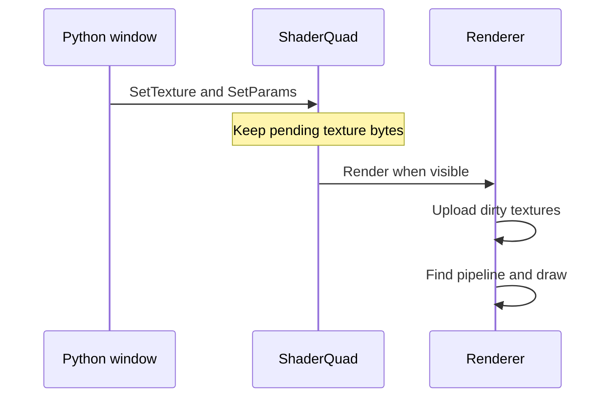

# ui.ShaderQuad

`ui.ShaderQuad` is a client Python window drawn by a pixel shader. Use it for UI that needs procedural shapes or data-driven pixels, such as rings and grids. Python supplies the shader path, up to two textures, and 16 floats; the shader defines what those inputs mean.

## Quick start

The deployment map draws each aura as one quad using the aura shader below: a factory sets the shader and the disc-space UV once, and every circle only sets its position, size and six floats. `self.discs.Next()` hands out a pooled quad; the rest is `ui.ShaderQuad`.

```python
def __Quad(self):
    quad = ui.ShaderQuad()
    quad.SetShader(self.SHADER)
    # Disc space: length(TexCoord) is 1 exactly at the radius, whatever the zoom.
    quad.SetUV(-1.0, -1.0, 1.0, 1.0)
    return quad

def __Disc(self, wx, wy, aura):
    radius = int(self.view.Span(aura["radius"]))
    if radius <= 0:
        return

    cx, cy = self.view.Plan(wx, wy)
    r, g, b = deploymentdata.AuraColour(aura["kind"])

    quad = self.discs.Next()
    quad.SetPosition(cx - radius, cy - radius)
    quad.SetSize(2 * radius, 2 * radius)
    quad.SetParams((r, g, b, self.FILL_ALPHA, self.RIM_ALPHA, self.RIM_PX))
```

With the aura shader packed, each call draws a filled disc of the aura's colour with a bright rim just inside its radius.

## Files and setup

Put a pixel shader in the client files `root` folder under `shaders/ui/`, named `<name>_ps` with the `.hlsl` extension. Pass its full virtual path, such as `shaders/ui/aura_ps.hlsl`, to `SetShader`. The setter does not add a folder or suffix.

Pack the `root` content after adding or editing the shader, then restart the client. The renderer caches pipelines by path for the session, including failures. A corrected shader at the same path is not retried until the client restarts.

Debug builds compile shaders fresh, with cache reads disabled and compiled shader writes enabled. Release builds read precompiled `.cso` files from the pack. The cache name is the shader's path with the entry point appended and the extension `.cso`: for `shaders/ui/example_ps` and entry `main` it is `shaders/ui/example_ps_main.cso`.

For the test board, use a client built with the remote debugger flag. Put `uiTest.py` loose beside the client, define `TestWindow`, and open the board with F10.

Create the quad in Python. There is no quad type in uiscript; an unknown type is skipped. If a layout needs a position for it, use a plain window as a placeholder and parent the quad to that window.

## API

### `ui.ShaderQuad`

The class inherits `ui.Window`. Use the window methods for parenting, position, size, flags, visibility, and clipping. The quad-specific setters return `None`.

| Method | Returns | Effect |
| --- | --- | --- |
| `ShaderQuad(layer="UI")` | A quad window | Creates a window on the named UI layer. |
| `SetShader(path)` | `None` | Stores the shader's virtual path. The renderer requests the pipeline when it draws the quad. |
| `SetTexture(slot, width, height, format, texels)` | `None` | Copies a complete texture into slot `0` or `1` and marks it for upload. |
| `SetParams(params)` | `None` | Converts the iterable to a list and sends up to its first 16 values as floats. Missing values are zero; extra values are ignored. |
| `SetUV(u0, v0, u1, v1)` | `None` | Sets the UV rectangle interpolated across the quad. The default is `(0.0, 0.0, 1.0, 1.0)`. |

Texture sides must each be from 1 to 16384. `texels` must be a Python 2 byte string, in row-major order and little-endian where a texel has multiple bytes.

| Format | Bytes per texel | Shader value |
| --- | ---: | --- |
| `r8` | 1 | Normalized red channel, `0` to `1` |
| `r16` | 2 | Normalized red channel, `0` to `1` |
| `rgba8` | 4 | Normalized RGBA channels, `0` to `1` |

The byte string must contain exactly `width * height * bytes_per_texel` bytes. There is no float texture format or partial texture update.

`OnUpdate(self)` is the window callback for values that change while the window is visible. It takes no arguments beyond `self` and has no return value used by the quad. It does not run while the window is hidden.

### `wndMgr`

The `ui` wrapper passes its native window handle to these functions. Use the wrapper for ordinary Python code.

| Function | Returns | Effect |
| --- | --- | --- |
| `RegisterShaderQuad(po, layer)` | Native window handle | Registers a quad for the Python window object on the named layer. |
| `ShaderQuad_SetShader(window, path)` | `None` | Sets the shader path. |
| `ShaderQuad_SetTexture(window, slot, width, height, format, texels)` | `None` | Sets a complete texture. |
| `ShaderQuad_SetParams(window, params)` | `None` | Sets up to 16 float parameters. |
| `ShaderQuad_SetUV(window, u0, v0, u1, v1)` | `None` | Sets the UV rectangle. |

The generated annotations describe `window` as `ui.Window`; the wrapper passes `self.hWnd`.

## Shader contract

| Input or state | Contract |
| --- | --- |
| Entry | `main` |
| DX11 profile | `ps_5_0` |
| Constants | Pixel-stage constant buffer at `b13`, containing 16 floats. Match the HLSL packing layout to the positions sent by `SetParams`. |
| Textures | Slots `0` and `1` bind to `t0` and `t1`. A slot never set is unbound. |
| Sampler | Linear clamp at `s0`. Use `Load(int3(texel, 0))` when data must be read as exact texels rather than filtered with `Sample`. |
| Pixel input | `SV_POSITION`, `COLOR0`, and `TEXCOORD0`. Color is white RGB with the window alpha; texture coordinates come from `SetUV`. |
| Output and blend | Return straight alpha. Color uses `SrcAlpha` and `InvSrcAlpha`; alpha uses `One` and `InvSrcAlpha`. Multiply by `input.Color` if window alpha should affect the output. |
| Depth and clipping | Depth testing and writes are disabled. Scissoring follows window clipping; `not_clip` bypasses it. |

There is no time, cursor, or size uniform. Send those values through `SetParams` from `OnUpdate` when the shader needs them. `app.GetTime()` supplies seconds. A shader can also use derivatives such as `fwidth` to measure a screen-space edge.

The complete aura shader is a model for a radial quad. Its first six parameter floats are red, green, blue, fill alpha, rim alpha, and rim width in screen pixels.

```hlsl
// shaders/ui/aura_ps.hlsl
// One deployment aura as the AREA it covers: a filled disc with a bright rim just inside it.
//
// TexCoord is disc space -- the quad is set to (-1,-1)..(1,1), so length(TexCoord) is 1.0 exactly
// at the radius whatever the zoom. The rim's width is given in SCREEN pixels and converted through
// fwidth, so it stays one readable line at every zoom instead of thinning away as the map shrinks.

cbuffer ShaderQuadCB : register(b13) {
    float g_R;
    float g_G;
    float g_B;
    float g_FillAlpha;
    float g_RimAlpha;
    float g_RimPx;          // rim width in screen pixels, falling INWARD from the radius
    float2 _Pad;
    float4 _Unused[2];
};

struct PS_INPUT {
    float4 Position : SV_POSITION;
    float4 Color : COLOR0;
    float2 TexCoord : TEXCOORD0;
};

float4 main(PS_INPUT input) : SV_TARGET {
    float d = length(input.TexCoord);
    float px = max(fwidth(d), 1e-5);            // one screen pixel, measured in d

    float inside = 1.0 - smoothstep(1.0 - px, 1.0 + px, d);
    float rimEdge = 1.0 - g_RimPx * px;
    float rim = inside * smoothstep(rimEdge - px, rimEdge + px, d);

    float alpha = saturate(g_FillAlpha * inside + g_RimAlpha * rim);
    if (alpha <= 0.0)
        discard;

    return float4(g_R, g_G, g_B, alpha) * input.Color;
}
```

`SetUV(-1.0, -1.0, 1.0, 1.0)` gives this shader centered disc coordinates. For a grid, `SetUV(0.0, 0.0, float(cellsX), float(cellsY))` gives cell coordinates, so the shader can use `floor` to select a texel. An `r16` sample is normalized; multiply it by `65535.0` to recover an integer index.

Includes resolve through the pack relative to the shader's folder.

## Behaviour

`SetTexture` copies the whole byte string into CPU storage. The next eligible render uploads it. Repeated calls before that render replace the pending bytes. A hidden quad defers the upload; if the size and format match an existing texture, the renderer updates it, otherwise it recreates it. If a specified texture cannot be created, the quad does not draw until another `SetTexture` supplies it.

The path from a Python update to a draw is:



A successful draw flushes the UI primitive and text batches, binds the constants, sampler, and textures, then makes an immediate draw. Many quads therefore mean many batch flushes and draw calls. Prefer one quad for a whole grid or area when one shader can draw it.

The window system handles parenting, visibility, and clipping. Keep a Python reference to the quad. Add `not_pick` when clicks should reach windows underneath it. If a parent manages child visibility through its own pools, hide the quad explicitly when that pool requires it.

## C++ registration

The Python class registers its native window through `wndMgr`. A script author does not register a C++ function to use a quad.

| Script-facing C++ registration | Purpose |
| --- | --- |
| None | `ui.ShaderQuad` calls `wndMgr.RegisterShaderQuad` when the window is created. |

## Examples

### A ring whose width shows progress

The radial menu draws its ring with one quad, parented to the menu, with the picking flag set so clicks reach the slots under it. Its constructor sets the shader, size and a UV in pixels; `OnUpdate` feeds the shader the time since the menu opened, the slot count, the hovered slot and the ring radii through `SetParams`, all 16 floats every frame.

```python
    # The ring is drawn and its slots sit around it: the only parts with no fixed place in the layout.
    self.quad = ui.ShaderQuad("TOP_MOST")
    self.quad.SetParent(self)
    self.quad.AddFlag("not_pick")
    self.quad.SetShader(SHADER)
    self.quad.SetPosition(SIDE, 0)
    self.quad.SetSize(2 * OUTER + 8, 2 * OUTER + 8)
    self.quad.SetUV(0.0, 0.0, float(2 * OUTER + 8), float(2 * OUTER + 8))
    self.quad.Show()
    self.quad.SetBehind()

def OnUpdate(self):
    if not self.IsShow() or not self.quad:
        return
    hovered = self.__Pick()
    if hovered != self.hovered:
        self.hovered = hovered
        self.__PlaceLabel()
    self.quad.SetParams((app.GetTime() - self.opened, float(SLOT_COUNT), float(self.hovered), 1.0,
                         float(OUTER + 4), float(OUTER + 4), float(OUTER), float(INNER), float(HUB),
                         0.0, 0.0, 0.0, 0.0, 0.0, 0.0, 0.0))
```

Call `SetProgress` when the value changes. A shader that draws an angular progress arc needs its own parameter contract.

### An indexed data grid

The land map marks a set of cells in one colour with two data textures. Slot `1` holds a one-row `rgba8` palette whose texel 0 is transparent (set once when the layer is built, from the helper below); slot `0` is an `r16` grid with a palette index per cell, rebuilt when the set changes. The UV is the cell range, so the shader reads cell coordinates.

```python
def _Palette(colours):
    """Texel 0 empty, then one texel per colour: index 0 is "no cell here", and a cell's index
    picks which of them it is drawn in."""
    out = bytearray((0, 0, 0, 0))
    for colour in colours:
        out += bytearray(((colour >> 16) & 0xFF, (colour >> 8) & 0xFF,
                          colour & 0xFF, (colour >> 24) & 0xFF))
    return str(out)
```

```python
def __Read(self):
    self.box = None
    if self.cellSize <= 0 or not self.cells:
        self.quad.Hide()
        return

    cx0 = min(c[0] for c in self.cells) - 1
    cy0 = min(c[1] for c in self.cells) - 1
    width = max(c[0] for c in self.cells) - cx0 + 2
    height = max(c[1] for c in self.cells) - cy0 + 2

    # r16 little-endian: a palette index of a few is the low byte and nothing else.
    texels = bytearray(2 * width * height)
    for cx, cy, index in self.cells:
        texels[2 * ((cy - cy0) * width + (cx - cx0))] = index

    self.quad.SetTexture(0, width, height, "r16", str(texels))
    self.quad.SetUV(0.0, 0.0, float(width), float(height))
    self.box = (cx0, cy0, width, height)
    self.OnView()
```

Rebuild the texture strings only when the grid or the palette changes; moving or resizing the quad needs no new texture data.

## Pitfalls

**The quad draws nothing after a shader edit.** Repack `root` and restart the client. A failed pipeline remains cached under its path for the session. Shader failures appear in the client log, not as Python exceptions. Search for these lines, with the path and diagnostic filled in by the client:

```text
DX11 shader compilation failed for '<path>': <diagnostic>
DX11Device: Failed to compile shader '<path>': <diagnostic>
PrimitiveRenderer2D: Failed to load <path>
PrimitiveRenderer2D: Failed to create the pipeline for <path>
```

A missing shader can also log:

```text
Failed to open shader file from VFS: <path>
```

**`SetTexture` rejects the data.** Use a Python 2 byte string, not a list, Unicode string, or `bytearray`. Pack the exact number of bytes for the dimensions and format. An unsupported format raises:

```text
ShaderQuad_SetTexture: format must be r8, r16 or rgba8
```

A slot outside `0` and `1`, an oversized side, or a mismatched byte count can raise:

```text
ShaderQuad_SetTexture: slot or texel count does not match
```

Negative slots, nonpositive dimensions, and wrong argument types take the generic exception path.

**An input disappears from the shader.** Only the first 16 parameter values are sent, and omitted values become zero. Send every value the shader needs in the order and packing layout it declares.

**An animation stops when hidden.** `OnUpdate` stops while the window is hidden, and texture uploads wait for a visible render. Send the values again when the window is shown if the effect needs to reflect elapsed time or changed data.

**Edges are dark or window alpha has no effect.** Return straight RGB and alpha for the configured blend. If the shader accumulates premultiplied color, divide it out before returning. Apply `input.Color` to the result if the window alpha should affect it.

**A grid blends neighboring indices.** `Sample` uses the bound linear sampler. Use `Load` for exact texel reads and do any desired filtering in the shader.

**The shape or input handling is wrong.** UVs start at `0` to `1`; set the coordinate range expected by the shader. Add `not_pick` to a decorative quad so it does not take clicks intended for controls underneath.

## See also

- [RHI](/foundations/rhi)
- [Core](/docs/core)
