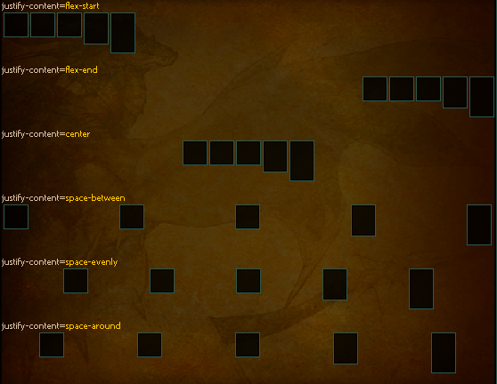
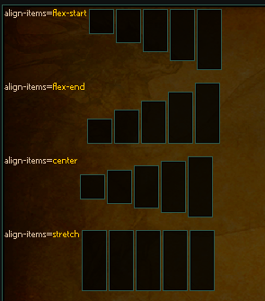

# Common attributes

Every tag takes the base attributes below. The tag pages that follow list only what they add.

## Common Base Attributes

| Attribute         | Description |
|-------------------|-------------|
| **id**            | Unique identifier for anchoring. |
| **display**       | Layout mode; valid values: `"block"`, `"relative"`, `"flex"`. |
| **margin**        | Shorthand for all margins; supports CSS-like values. |
| **margin-x**      | Horizontal margins (left/right). |
| **margin-y**      | Vertical margins (top/bottom). |
| **margin-top**    | Top margin. |
| **margin-right**  | Right margin. |
| **margin-bottom** | Bottom margin. |
| **margin-left**   | Left margin. |
| **padding**       | Shorthand for all paddings; supports CSS-like values. |
| **padding-x**     | Horizontal padding (left/right). |
| **padding-y**     | Vertical padding (top/bottom). |
| **padding-top**   | Top padding. |
| **padding-right** | Right padding. |
| **padding-bottom**| Bottom padding. |
| **padding-left**  | Left padding. |
| **width**         | Element width; can be a number, `"auto"`, `"content"`, or a percentage (e.g., `"50%"`). |
| **height**        | Element height; can be a number, `"auto"`, `"content"`, or a percentage. |
| **align**         | Horizontal alignment; valid values: `"left"`, `"center"`, `"right"`. |
| **vertical-align**| Vertical alignment; valid values: `"top"`, `"center"`, `"bottom"`. |
| **x**             | X-coordinate for relative positioning. |
| **y**             | Y-coordinate for relative positioning. |
| **spacing**       | Gap between items in flex layouts (number). |
| **justify-content** | Flex layout horizontal distribution; valid values: `"flex-start"`, `"flex-end"`, `"center"`, `"space-between"`, `"space-around"`, `"space-evenly"`. |
| **align-items**   | Flex layout vertical alignment per line; valid values: `"flex-start"`, `"flex-end"`, `"center"`, `"stretch"`. |
| **name**          | Optional element name for setting window names/identifiers. |

---

### Display Flex - Deep Dive

Here we will cover more in details how `display=flex` works.  

The main attribute you can use with `display=flex`:
- **justify-content** which controls horizontal positioning.
- **align-items** which controls the vertical alignment of elements in each row.
  
<details><summary>justify-content Examples</summary>

```html
justify-content=<c color="wikititle">flex-start</c>
<inline width="auto" justify-content="flex-start">
    
        <thin-board width="30" height="{{ 10 * (i+1) }}" />
    
</inline>

<spacer></spacer>
justify-content=<c color="wikititle">flex-end</c>
<inline width="auto" justify-content="flex-end">
    
        <thin-board width="30" height="{{ 10 * (i+1) }}" />
    
</inline>

<spacer></spacer>
justify-content=<c color="wikititle">center</c>
<inline width="auto" justify-content="center">
    
        <thin-board width="30" height="{{ 10 * (i+1) }}" />
    
</inline>

<spacer></spacer>
justify-content=<c color="wikititle">space-between</c>
<inline width="auto" justify-content="space-between">
    
        <thin-board width="30" height="{{ 10 * (i+1) }}" />
    
</inline>

<spacer></spacer>
justify-content=<c color="wikititle">space-evenly</c>
<inline width="auto" justify-content="space-evenly">
    
        <thin-board width="30" height="{{ 10 * (i+1) }}" />
    
</inline>

<spacer></spacer>
justify-content=<c color="wikititle">space-around</c>
<inline width="auto" justify-content="space-around">
    
        <thin-board width="30" height="{{ 10 * (i+1) }}" />
    
</inline>
```

 
</details>

<details><summary>align-items Examples</summary>

```html
<inline>
    align-items=<c color="wikititle">flex-start</c>
    <inline width="auto" align-items="flex-start">
        
            <thin-board width="30" height="{{ 32 + 10 * (i) }}" />
        
    </inline>

    <spacer></spacer>
    align-items=<c color="wikititle">flex-end</c>
    <inline width="auto" align-items="flex-end">
        
            <thin-board width="30" height="{{ 32 + 10 * (i) }}" />
        
    </inline>

    <spacer></spacer>
    align-items=<c color="wikititle">center</c>
    <inline width="auto" align-items="center">
        
            <thin-board width="30" height="{{ 32 + 10 * (i) }}" />
        
    </inline>

    <spacer></spacer>
    align-items=<c color="wikititle">stretch</c>
    <inline width="auto" align-items="stretch">
        
            <thin-board width="30" height="{{ 32 + 10 * (i) }}" />
        
    </inline>
</inline>
```

 
</details>
