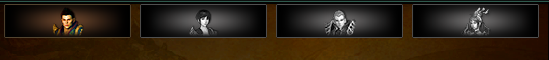
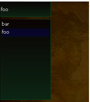
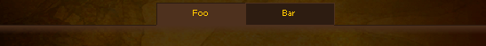

# Filter groups

A filter group writes the picked value into the variable named by `filter-target`, which reloads the page or the reactive zones watching it.

## **`filter-group.buttons`**
| Attribute             | Requirement  | Default       | Constraints/Notes |
|-----------------------|--------------|---------------|-------------------|
| [*Base Attributes*](./components-common.md#common-base-attributes)     | Optional     | N/A           | Inherits all common base attributes. |
| type                  | Required `buttons`    | none             | Defines the filter group type. |
| default               | Required     | none             | Specifies the default filter value. **Must be one of the `<filter>` values** |
| filter-target         | Required     | none             | Specifies the variable that the filter will set. |

:::caution

**Allowed Children:** Only `<filter type="button">` and `<filter type="dynamic-button">`.

:::

---

### **`filter.button`**
| Attribute             | Requirement  | Default       | Constraints/Notes |
|-----------------------|--------------|---------------|-------------------|
| [*Base Attributes*](./components-common.md#common-base-attributes)     | Optional     | N/A           | Inherits all common base attributes. |
| type                  | Required  `button`   | none             | Filter type; should match parent group. |
| filter-value          | Required     | none             | Value for filtering. |
| path                  | Required     | none             | Path template for visual states. |
| tooltip-text          | Optional     | none             | Tooltip text for additional info. |

:::caution

**Parent Constraint:** Must be placed inside a `<filter-group type=buttons>`.

:::

**path** is expected to be a parametrized path to the images used for `normal`, `over` and `clicked` state.  
UCHTML will then substitute `normal` `hover` and `selected` to the parameter of the string.

**Example**:

```
path="d:/ymir work/ui/example/group_b_{}.tga"
```

become

```
d:/ymir work/ui/example/group_b_normal.tga
d:/ymir work/ui/example/group_b_hover.tga
d:/ymir work/ui/example/group_b_selected.tga
```

And each of the images need to exist in order to render the button.

<details><summary>Code Example</summary>

```html
<filter-group display="flex" justify-content="space-evenly" type="buttons" default="packed_query:GROUP_A"
    width="auto" filter-target="query:race">
    <filter type="button" path="d:/ymir work/ui/example/group_a_{}.tga" filter-value="packed_query:GROUP_A">
    </filter>
    <filter type="button" path="d:/ymir work/ui/example/group_b_{}.tga" filter-value="packed_query:GROUP_B">
    </filter>
    <filter type="button" path="d:/ymir work/ui/example/group_c_{}.tga" filter-value="packed_query:GROUP_C">
    </filter>
    <filter type="button" path="d:/ymir work/ui/example/group_d_{}.tga" filter-value="packed_query:GROUP_D">
    </filter>
</filter-group>
```

 
</details>

---

### **`filter.dynamic-button`**
| Attribute             | Requirement  | Default       | Constraints/Notes |
|-----------------------|--------------|---------------|-------------------|
| [*Base Attributes*](./components-common.md#common-base-attributes)     | Optional     | N/A           | Inherits all common base attributes. |
| type                  | Required  `dynamic-button`   | none             | Filter type; should match parent group. |
| filter-value          | Required     | none             | Value for filtering. |
| text                  | Required     | none             | Text displayed on the button. |
| tooltip-text          | Optional     | none             | Tooltip information. |

:::caution

**Parent Constraint:** Must be placed inside a `<filter-group type=buttons>`.

:::

<details><summary>Code Example</summary>

```html
<filter-group display="flex" justify-content="space-evenly" type="buttons" default="foo"
    width="auto" filter-target="query:race">
        <filter type="dynamic-button" height=25 width="70" text="foo" tooltip-text="foo" filter-value="foo"></filter>
        <filter type="dynamic-button" height=25 width="70" text="bar" tooltip-text="bar" filter-value="bar"></filter>
        <filter type="dynamic-button" height=25 width="70" text="check" tooltip-text="check" filter-value="check"></filter>
</filter-group>
```

 
</details>

---

## **`filter-group.list`**
| Attribute             | Requirement  | Default       | Constraints/Notes |
|-----------------------|--------------|---------------|-------------------|
| [*Base Attributes*](./components-common.md#common-base-attributes)     | Optional     | N/A           | Inherits all common base attributes. |
| type                  | Required `list`    | none             | Defines the filter group type. |
| default               | Required     | none             | Specifies the default filter value. **Must be one of the `<filter>` values** |
| filter-target         | Required     | none             | Specifies the variable that the filter will set. |

:::caution

**Allowed Children:** Only `<filter type=item>`.

:::



---

### **`filter.item`**
| Attribute             | Requirement  | Default       | Constraints/Notes |
|-----------------------|--------------|---------------|-------------------|
| [*Base Attributes*](./components-common.md#common-base-attributes)     | Optional     | N/A           | Inherits all common base attributes. |
| type                  | Required `item`    | none             | Filter type identifier. |
| filter-value          | Required     | none             | Value associated with the filter item. |
| text                  | Required     | none             | Display text for the item. |
| tooltip-text          | Optional     | none             | Additional tooltip info. |

:::caution

**Parent Constraint:** Must be placed inside a `<filter-group type=list>`.

:::

---

## **`filter-group.tabs`**
| Attribute             | Requirement  | Default       | Constraints/Notes |
|-----------------------|--------------|---------------|-------------------|
| [*Base Attributes*](./components-common.md#common-base-attributes)     | Optional     | N/A           | Inherits all common base attributes. |
| type                  | Required `tabs`    | none             | Defines the filter group type. |
| default               | Required     | none             | Specifies the default filter value. **Must be one of the `<filter>` values** |
| filter-target         | Required     | none             | Specifies the variable that the filter will set. |

:::caution

**Allowed Children:** Only `<filter type=tab>`.

:::

<details><summary>Code Example</summary>

```html
<filter-group type="tabs" filter-target="query:tab" width="auto" default="info">
    <filter type="tab" height="25" width="100" padding="5" filter-value="info">
        <txt color="wikititle" align="center">Foo</txt>
    </filter>
    <filter type="tab" height="25" width="100" padding="5" filter-value="up">
        <txt color="wikititle" align="center">Bar</txt>
    </filter>
</filter-group>
```

 
</details>

---

### **`filter.tab`**
| Attribute             | Requirement  | Default       | Constraints/Notes |
|-----------------------|--------------|---------------|-------------------|
| [*Base Attributes*](./components-common.md#common-base-attributes)     | Optional     | N/A           | Inherits all common base attributes. |
| type                  | Required `tab`    | none             | Filter type identifier. |
| filter-value          | Required     | none             | Value used for filtering. |
| height                | Required     | none             | Specifies the height of the tab. |

:::caution

**Parent Constraint:** Must be placed inside a `<filter-group type=tabs>`.

:::
