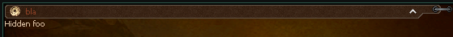

# Layout tags

The tags that arrange other tags. Each section lists the attributes it adds to the [base attributes](./components-common.md#common-base-attributes).

## **`div`**
| Attribute           | Requirement  | Default       | Constraints/Notes |
|---------------------|--------------|---------------|-------------------|
| [*Base Attributes*](./components-common.md#common-base-attributes)   | Optional     | N/A           | Inherits all common base attributes. |
| scrollbar-gap       | Optional     | none             | Used for the scrollable peek window when a fixed height is applied and content overflows. |
| reactive            | Optional     | none             | Comma-separated variable names this zone watches. Needs an `id`. See [Reactive zones](./reactive-zones.md). |

When a `div` has a fixed height (i.e. its height is not set to `"content"`) and its content exceeds that height, a scrollable peek window is created for all rows after the first one.

### Reactive zones

A `div` or `body` with a nonempty `id` and `reactive` attribute is a reactive zone: it rebuilds its children when a watched variable changes. See [Reactive zones](./reactive-zones.md).

---

## **`main`**
| Attribute                    | Requirement  | Default       | Constraints/Notes |
|------------------------------|--------------|---------------|-------------------|
| [*Base Attributes*](./components-common.md#common-base-attributes)            | Optional     | N/A           | Inherits all common base attributes. |
| scrollbar-gap                | Optional     | none             | As in `div`. |
| **height**        | Auto-set     | `"auto"`      | Forces auto height. |
| **width**         | Auto-set     | `"auto"`      | Forces auto width. |
| **id**            | Auto-set     | `"main"`      | Sets the element’s identifier to `"main"`. |
| **padding**       | Auto-set     | `5`         | Default padding value is 5. |

There must be exactly one `main` per page. A host that scrolls to a location, such as the [wiki URL scheme](../wiki/url.md#location), uses `main` as the scroll reference. **Without a `main`, location scrolling and [anchor href](./components-text.md#hreftext) do not work.

---

## **`lazy-div`**
| Attribute           | Requirement  | Default       | Constraints/Notes |
|---------------------|--------------|---------------|-------------------|
| [*Base Attributes*](./components-common.md#common-base-attributes)   | Optional     | N/A           | Inherits all common base attributes. |
| scrollbar-gap       | Optional     | none             | As in `div`, used for scrollable peek window. |
| preload             | Optional     | `0`         | Determines the number of child elements to preload; additional children are queued. |

`lazy-div` is useful if we have a lot of similar content (like a grid of items, or monster cards) and we don't want to freeze the client by loading all in one way.

---

## **`inline`**
| Attribute                 | Requirement  | Default       | Constraints/Notes |
|---------------------------|--------------|---------------|-------------------|
| [*Base Attributes*](./components-common.md#common-base-attributes)         | Optional     | N/A           | Inherits all common base attributes. |
| scrollbar-gap             | Optional     | none             | Same as in `div`. |
| **display**    | Auto-set     | `"flex"`      | Automatically set to `"flex"` to enable horizontal layout. |

Shortcut for `flex` `<div>`.

---

## **`footer`**
| Attribute                      | Requirement  | Default       | Constraints/Notes |
|--------------------------------|--------------|---------------|-------------------|
| [*Base Attributes*](./components-common.md#common-base-attributes)              | Optional     | N/A           | Inherits all common base attributes. |
| **width**           | Auto-set     | `"auto"`      | Sets width to auto. |
| **vertical-align**  | Auto-set     | `"bottom"`    | Aligns the footer at the bottom. |

**Constraints:**  
- **Child Constraint:** Must be a leaf element (no children allowed).

<details><summary>Code Example with scrollbar</summary>

```html
<footer />
```

 
</details>

---

## **`table`**
| Attribute           | Requirement  | Default       | Constraints/Notes |
|---------------------|--------------|---------------|-------------------|
| [*Base Attributes*](./components-common.md#common-base-attributes)   | Optional     | N/A           | Inherits all common base attributes. |
| scrollbar-gap       | Optional     | none             | Provides extra gap for the peek window when height is fixed. |
 
If the `table` has a fixed height and its content overflows, all rows after the first one are inserted in a scrollable peekwindow.

**Constraints:**  
- **Allowed Children:** Only `<tr>` elements.

<details><summary>Code Example without scrollbar</summary>

```html
<table align="center" width="100%">
    <tr>
        <th width="20%">
            -
        </th>
        <th width="60%">
            -
        </th>
        <th width="20%">
            -
        </th>
    </tr>
    <tr>
        <td width="20%">
        </td>
        <td width="20%">
        </td>
        <td width="40%">
            <txt align="center" color="ffdac0a3">
            </txt>
        </td>
        <td width="20%">
        </td>
    </tr>
    <tr>
        <td width="20%">
        </td>
        <td width="20%">
        </td>
        <td width="40%">
            <txt align="center" color="ffdac0a3">
            </txt>
        </td>
        <td width="20%">
        </td>
    </tr>
    <tr>
        <td width="20%">
        </td>
        <td width="20%">
        </td>
        <td width="40%">
            <txt align="center" color="ffdac0a3">
            </txt>
        </td>
        <td width="20%">
        </td>
    </tr>
    <tr>
        <td width="20%">
        </td>
        <td width="20%">
        </td>
        <td width="40%">
            <txt align="center" color="ffdac0a3">
            </txt>
        </td>
        <td width="20%">
        </td>
    </tr>
    <tr>
        <td width="20%">
        </td>
        <td width="20%">
        </td>
        <td width="40%">
            <txt align="center" color="ffdac0a3">
            </txt>
        </td>
        <td width="20%">
        </td>
    </tr>
</table>

<table align="center" width="100%">
    <tr>
        <th width="100%">
        </th>
    </tr>
    <tr>
        <td width="25%">
        </td>
        <td width="25%">
        </td>
        <td width="25%">
        </td>
        <td width="25%">
        </td>
    </tr>
</table>
```

 
</details>

<details><summary>Code Example with scrollbar</summary>

```html
<table align="center" width="100%" height="150">
    <tr>
        <th width="20%">
            -
        </th>
        <th width="60%">
            -
        </th>
        <th width="20%">
            -
        </th>
    </tr>
    <tr>
        <td width="20%">
        </td>
        <td width="20%">
        </td>
        <td width="40%">
            <txt align="center" color="ffdac0a3">
            </txt>
        </td>
        <td width="20%">
        </td>
    </tr>
    <tr>
        <td width="20%">
        </td>
        <td width="20%">
        </td>
        <td width="40%">
            <txt align="center" color="ffdac0a3">
            </txt>
        </td>
        <td width="20%">
        </td>
    </tr>
    <tr>
        <td width="20%">
        </td>
        <td width="20%">
        </td>
        <td width="40%">
            <txt align="center" color="ffdac0a3">
            </txt>
        </td>
        <td width="20%">
        </td>
    </tr>
    <tr>
        <td width="20%">
        </td>
        <td width="20%">
        </td>
        <td width="40%">
            <txt align="center" color="ffdac0a3">
            </txt>
        </td>
        <td width="20%">
        </td>
    </tr>
    <tr>
        <td width="20%">
        </td>
        <td width="20%">
        </td>
        <td width="40%">
            <txt align="center" color="ffdac0a3">
            </txt>
        </td>
        <td width="20%">
        </td>
    </tr>
</table>

<table align="center" width="100%">
    <tr>
        <th width="100%">
        </th>
    </tr>
    <tr>
        <td width="25%">
        </td>
        <td width="25%">
        </td>
        <td width="25%">
        </td>
        <td width="25%">
        </td>
    </tr>
</table>
```

 
</details>

---

### **`tr`**
| Attribute             | Requirement  | Default       | Constraints/Notes |
|-----------------------|--------------|---------------|-------------------|
| [*Base Attributes*](./components-common.md#common-base-attributes)     | Optional     | N/A           | Inherits all common base attributes. |

**Constraints:**  
- **Parent Constraint:** Must be a direct child of a `<table>`.  
- **Allowed Children:** Only `<td>` and `<th>` elements.

---

### **`th`**
| Attribute             | Requirement  | Default       | Constraints/Notes |
|-----------------------|--------------|---------------|-------------------|
| [*Base Attributes*](./components-common.md#common-base-attributes)     | Optional     | N/A           | Inherits all common base attributes. |

:::caution

**Parent Constraint:** Must be placed inside a `<tr>`.

:::

---

### **`td`**
| Attribute             | Requirement  | Default       | Constraints/Notes |
|-----------------------|--------------|---------------|-------------------|
| [*Base Attributes*](./components-common.md#common-base-attributes)     | Optional     | N/A           | Inherits all common base attributes. |

:::caution

**Parent Constraint:** Must be placed inside a `<tr>`.

:::

## **`spacer`**
| Attribute             | Requirement  | Default       | Constraints/Notes |
|-----------------------|--------------|---------------|-------------------|
| [*Base Attributes*](./components-common.md#common-base-attributes)     | Optional     | N/A           | Inherits all common base attributes. |
| **height** | Optional     | `10`        | Default height is 10 if not provided. |
| **width**  | Auto-set     | `"auto"`      | Width is automatically set to auto. |

:::caution

Should not contain any child elements.

:::

---

## **`divider`**
| Attribute             | Requirement  | Default       | Constraints/Notes |
|-----------------------|--------------|---------------|-------------------|
| [*Base Attributes*](./components-common.md#common-base-attributes)     | Optional     | N/A           | Inherits all common base attributes. |
| pattern               | Optional     | none             | Path for the divider pattern; if not provided, a default pattern is used. |

:::caution

Should not have any child elements.

:::

<details><summary>Code Example</summary>

```html
<divider />
```

 
</details>

---

## **`accordion`**
| Attribute             | Requirement  | Default       | Constraints/Notes |
|-----------------------|--------------|---------------|-------------------|
| state                 | Optional     | none             | Identifier for accordion state. |
| text                  | Optional     | none             | Header text. |
| icon                  | Optional     | none             | Icon path if applicable. |
| [*Base Attributes*](./components-common.md#common-base-attributes)     | Optional     | none             | Inherits all common base attributes. |

**Notes:**  
The accordion element manages a header and toggle state for showing/hiding content. Its header reserves space (with injected padding) to accommodate an icon and text.

<details><summary>Code Example</summary>

```html
<accordion width="auto" text="bla" icon="d:/ymir work/ui/game/windows/money_icon.sub">
Hidden foo
</accordion>
```

 
 
</details>

---

## **`carousel`**
| Attribute             | Requirement  | Default       | Constraints/Notes |
|-----------------------|--------------|---------------|-------------------|
| [*Base Attributes*](./components-common.md#common-base-attributes)     | Optional     | N/A           | Inherits all common base attributes. |
| arrows                | Optional     | `"under"`     | Arrow placement; valid values: `"over"` (overlaid on content), `"under"` (below content). |
| page-var              | Optional     | none             | Variable name to sync current page index with the loader context. Enables external page control. |

A container that shows one `<carousel-page>` at a time with left/right arrow navigation. The carousel height is determined by the tallest page, preventing layout jumps when switching pages.

**Arrow placement:**
- `arrows="under"` (default): Arrows appear centered below the content, adding ~25px of extra height.
- `arrows="over"`: Arrows overlay the content on left/right edges, vertically centered. No extra height.

Arrows are automatically hidden when there is only one page. Navigation wraps around (last page → first page and vice versa).

:::caution

**Allowed Children:** Only `<carousel-page>` elements.

:::

<details><summary>Code Example</summary>

```html
<carousel arrows="under" width="auto">
    <carousel-page>
        <h2>Page 1</h2>
        <txt>First page content</txt>
        <slot-item vnum="19" />
    </carousel-page>
    <carousel-page>
        <h2>Page 2</h2>
        <txt>Second page content</txt>
        <slot-item vnum="20" />
    </carousel-page>
    <carousel-page>
        <h2>Page 3</h2>
        <txt>Third page content</txt>
    </carousel-page>
</carousel>
```

</details>

<details><summary>Code Example with page-var</summary>

```html
<carousel arrows="over" page-var="current_tab" width="auto">
    <carousel-page>
        <txt>Tab content A</txt>
    </carousel-page>
    <carousel-page>
        <txt>Tab content B</txt>
    </carousel-page>
</carousel>
```

The `page-var` attribute syncs the 0-based page index with a loader variable. This allows:
- Reading the initial page from the variable on load
- Updating the variable when the user navigates via arrows
- External components to control which page is shown

</details>

---

### **`carousel-page`**
| Attribute             | Requirement  | Default       | Constraints/Notes |
|-----------------------|--------------|---------------|-------------------|
| [*Base Attributes*](./components-common.md#common-base-attributes)     | Optional     | N/A           | Inherits all common base attributes. |

A page within a `<carousel>`. Behaves as a standard `div` container, so any content that can be placed inside a `div` can be placed inside a `carousel-page`.

:::caution

**Parent Constraint:** Must be placed inside a `<carousel>`.

:::

---

## **`board`**
| Attribute             | Requirement  | Default       | Constraints/Notes |
|-----------------------|--------------|---------------|-------------------|
| [*Base Attributes*](./components-common.md#common-base-attributes)     | Optional     | none             | Inherits all common base attributes. |
| **padding**| Auto-set     | `5`         | Default padding is set to 5. |

:::caution

Minimum size is 64x64.

:::

<details><summary>Code Example</summary>

```html
<board width="100" height="100"></board>
```

 
</details>

---

## **`thin-board`**
| Attribute             | Requirement  | Default       | Constraints/Notes |
|-----------------------|--------------|---------------|-------------------|
| [*Base Attributes*](./components-common.md#common-base-attributes)     | Optional     | none             | Inherits all common base attributes. |
| **padding**| Auto-set     | `7`         | Default padding is set to 7. |

:::caution

Minimum size is 32x32.

:::

<details><summary>Code Example</summary>

```html
<thin-board width="100" height="100"></thin-board>
```

 
</details>
