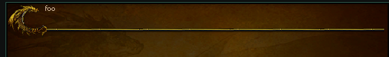
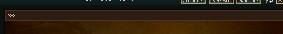
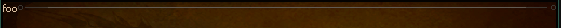
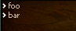
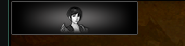
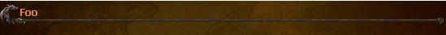

# Text and links

The tags that carry text, and the links that open other pages or game windows.

## **`h1`**
| Attribute             | Requirement  | Default       | Constraints/Notes |
|-----------------------|--------------|---------------|-------------------|
| [*Base Attributes*](./components-common.md#common-base-attributes)     | Optional     | none             | Inherits all common base attributes. |

<details><summary>Code Example</summary>

```html
<h1>foo</h1>
```

 
</details>

---

## **`h2`**
| Attribute             | Requirement  | Default                                          | Constraints/Notes |
|-----------------------|--------------|--------------------------------------------------|-------------------|
| [*Base Attributes*](./components-common.md#common-base-attributes)     | Optional     | none                                                | Inherits all common base attributes. |
| pattern               | Optional     | `"d:/ymir work/ui/pattern/h1"` (or overridden)   | Pattern for header row; can be customized. |

<details><summary>Code Example</summary>

```html
<h2>foo</h2>
```

 
</details>

---

## **`h3`**
| Attribute             | Requirement  | Default                                                       | Constraints/Notes |
|-----------------------|--------------|---------------------------------------------------------------|-------------------|
| [*Base Attributes*](./components-common.md#common-base-attributes)     | Optional     | none                                                             | Inherits all common base attributes. |
| pattern               | Optional     | `"d:/ymir work/ui/quest_re/quest_list_line_small"`            | Pattern for header; can be overridden. |
| pattern_space         | Optional     | `60` (if not provided)                                          | Reserved space on the right for the pattern. |
| scrollbar-gap         | Optional     | none                                                             | Used when a scrollable peek window is required. |

<details><summary>Code Example</summary>

```html
<h3>foo</h3>
```

 
</details>

---

## **Plain Text**

Text not enclosed in any tag counts as text.

---

## **`txt`**
| Attribute             | Requirement  | Default       | Constraints/Notes |
|-----------------------|--------------|---------------|-------------------|
| [*Base Attributes*](./components-common.md#common-base-attributes)     | Optional     | none             | Inherits all common base attributes. |
| color                 | Optional     | none             | Text color; overrides the default font color if specified. |
| font                  | Optional     | none             | Font specification (e.g., `"Tahoma:13"` or `"Tahoma:15b"`). |

:::caution

**Allowed Children:** Only the inline tags: `c`, `hitem`, `hmob`, `hraid`, `hdungeon`, `hquest`, `hmap`, `hhmap`, `hyperlink`, and `br`.

:::

> **color** can be an hex color code, which can be 8 characters for **ARGB** color (e.g., `FF0000` or `FFFF0000`) or one of [Registered color](#registered-color-table).

---

## **`c`**
| Attribute             | Requirement  | Default       | Constraints/Notes |
|-----------------------|--------------|---------------|-------------------|
| color                 | Required     | none             | Specifies the color code for text styling. |

:::caution

Should not contain any child elements.

:::

> **color** can be an hex color code, which can be 8 characters for **ARGB** color (e.g., `FF0000` or `FFFF0000`) or one of [Registered color](#registered-color-table).

### Registered Color table
| Name | ARGB |
| - | - |
| black | (0, 0, 0, 255) |
| white | (255, 255, 255, 255) |
| red | (255, 0, 0, 255) |
| green | (0, 128, 0, 255) |
| blue | (0, 0, 255, 255) |
| yellow | (255, 255, 0, 255) |
| cyan | (0, 255, 255, 255) |
| magenta | (255, 0, 255, 255) |
| silver | (192, 192, 192, 255) |
| gray | (128, 128, 128, 255) |
| maroon | (128, 0, 0, 255) |
| olive | (128, 128, 0, 255) |
| purple | (128, 0, 128, 255) |
| teal | (0, 128, 128, 255) |
| navy | (0, 0, 128, 255) |
| lime | (0, 255, 0, 255) |
| aqua | (0, 255, 255, 255) |
| fuchsia | (255, 0, 255, 255) |
| orange | (255, 165, 0, 255) |
| brown | (165, 42, 42, 255) |
| pink | (255, 192, 203, 255) |
| gold | (255, 215, 0, 255) |
| indigo | (75, 0, 130, 255) |
| violet | (238, 130, 238, 255) |
| chocolate | (210, 105, 30, 255) |
| coral | (255, 127, 80, 255) |
| crimson | (220, 20, 60, 255) |
| darkblue | (0, 0, 139, 255) |
| darkcyan | (0, 139, 139, 255) |
| darkgray | (169, 169, 169, 255) |
| darkgreen | (0, 100, 0, 255) |
| darkmagenta | (139, 0, 139, 255) |
| darkorange | (255, 140, 0, 255) |
| darkred | (139, 0, 0, 255) |
| deepskyblue | (0, 191, 255, 255) |
| forestgreen | (34, 139, 34, 255) |
| lightblue | (173, 216, 230, 255) |
| lightgray | (211, 211, 211, 255) |
| lightgreen | (144, 238, 144, 255) |
| lightpink | (255, 182, 193, 255) |
| lightsalmon | (255, 160, 122, 255) |
| lightyellow | (255, 255, 224, 255) |
| wikidefault | (218, 192, 163, 255) |
| wikititle | (255, 199, 0, 255) |

---

## **`br`**
A self-closing tag that inserts a line break.

:::caution

Consecutive lines of **Plain Texts**, **Hyperlinks**, **`<c>` Texts** and **`<txt>`** are concatenated in the same line.  
To go newline you have to use `<br/>`

:::

---

## **`hitem`**
| Attribute             | Requirement  | Default       | Constraints/Notes |
|-----------------------|--------------|---------------|-------------------|
| vnum                  | Required     | none             | Must provide an item vnum. |

:::caution

Should not contain any child elements.

:::

---

## **`hmob`**
| Attribute             | Requirement  | Default       | Constraints/Notes |
|-----------------------|--------------|---------------|-------------------|
| vnum                  | Required     | none             | Must provide a mob vnum. |

:::caution

Should not contain any child elements.

:::

---

## **`hraid`**
| Attribute             | Requirement  | Default       | Constraints/Notes |
|-----------------------|--------------|---------------|-------------------|
| id                    | Required     | none             | Must provide a raid identifier. |

:::caution

Should not contain any child elements.

:::

---

## **`hdungeon`**
| Attribute             | Requirement  | Default       | Constraints/Notes |
|-----------------------|--------------|---------------|-------------------|
| id                    | Required     | none             | Must provide a dungeon identifier. |

:::caution

Should not contain any child elements.

:::

---

## **`hquest`**
| Attribute             | Requirement  | Default       | Constraints/Notes |
|-----------------------|--------------|---------------|-------------------|
| id                    | Required     | none             | Must provide a quest identifier. |

:::caution

Should not contain any child elements.

:::

---

## **`hmap`**
| Attribute             | Requirement  | Default       | Constraints/Notes |
|-----------------------|--------------|---------------|-------------------|
| id                    | Required     | none             | Must provide a map identifier. |

:::caution

Should not contain any child elements.

:::

---

## **`hhmap`**
| Attribute             | Requirement  | Default       | Constraints/Notes |
|-----------------------|--------------|---------------|-------------------|
| id                    | Required     | none             | Must provide a hunt map identifier. The link opens the hunt map page. |

:::caution

Should not contain any child elements.

:::

---

### **`hyperlink`**
| Attribute             | Requirement  | Default       | Constraints/Notes |
|-----------------------|--------------|---------------|-------------------|
| url                   | Required     | none             | URL to navigate to when clicked. |

:::caution

Should not contain any child elements.

:::

## **`bullet-list`**
| Attribute             | Requirement  | Default                                      | Constraints/Notes |
|-----------------------|--------------|----------------------------------------------|-------------------|
| [*Base Attributes*](./components-common.md#common-base-attributes)     | Optional     | none                                            | Inherits all common base attributes. |
| bullet-path           | Optional     | `"d:/ymir work/ui/wiki/arrow_2.tga"`         | Path to the bullet image; default provided if not specified. |

<details><summary>Code Example</summary>

```html
<bullet-list>
foo
</bullet-list>
<bullet-list>
bar
</bullet-list>
```

 
</details>

## **`href.button`**
| Attribute             | Requirement  | Default       | Constraints/Notes |
|-----------------------|--------------|---------------|-------------------|
| type                  | Required `button`    | none             | Navigation button type. |
| href                  | Required     | none             | URL or anchor target (if it starts with `"#"`, it is treated as an anchor). |
| path                  | Required     | none             | Image path template for the button (with state placeholders). |
| tooltip-text          | Optional     | none             | Tooltip text for the button. |
| [*Base Attributes*](./components-common.md#common-base-attributes)     | Optional     | none             | Inherits all common base attributes. |

**path** is expected to be a parametrized path to the images used for `normal`, `over` and `clicked` state.  
UCHTML will then substitute `normal` `hover` and `selected` to the parameter of the string.

**Example**:

```
path="d:/ymir work/ui/example/group_b_{}.tga"
```

become

```
d:/ymir work/ui/example/group_b_normal.tga
d:/ymir work/ui/example/group_b_hover.tga
d:/ymir work/ui/example/group_b_selected.tga
```

And each of the images need to exist in order to render the button.

<details><summary>Code Example</summary>

```html
<href type="button" href="" path="d:/ymir work/ui/example/group_b_{}.tga"/>           
```

 
</details>

---

## **`href.text`**
| Attribute             | Requirement  | Default       | Constraints/Notes |
|-----------------------|--------------|---------------|-------------------|
| type                  | Required `text`    | none             | Navigation type. |
| href                  | Required     | none             | URL or anchor target. |
| text                  | Required     | none             | Display text for the link. |
| width                 | Optional     | none             | Width specification. |
| [*Base Attributes*](./components-common.md#common-base-attributes)     | Optional     | none             | Inherits all common base attributes. |

<details><summary>Code Example</summary>

```html
<href type="text" href="" text="Foo"/>

```

 
</details>
