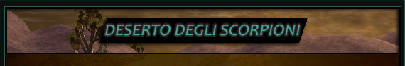
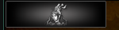
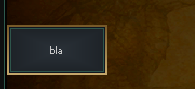
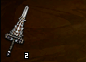
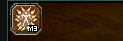
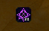
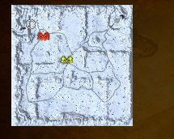
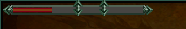
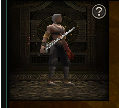

# Widget tags

The tags that draw a picture or a control rather than lay out or write text.

## **`img`**
| Attribute             | Requirement  | Default       | Constraints/Notes |
|-----------------------|--------------|---------------|-------------------|
| path                  | Required     | none             | Path to the image resource. |
| [*Base Attributes*](./components-common.md#common-base-attributes)     | Optional     | none             | Inherits all common base attributes. |

<details><summary>Code Example</summary>

```html

```

 
</details>

---

## **`button.button`**
| Attribute             | Requirement  | Default       | Constraints/Notes |
|-----------------------|--------------|---------------|-------------------|
| type                  | Required `button`    | none             | Button type identifier. |
| target                  | Optional (either `call` or `target+value` must be set)   | none             | The variable the button will set once clicked. |
| value                  | Optional (either `call` or `target+value` must be set)   | none             | The value the button will set to the `target` variable. |
| call                  | Optional (either `call` or `target+value` must be set)   | none             | The function to call when the button is pressed. Function must be registered in the [Jinja Context](./jinja2-context.md)  |
| path                  | Required     | none             | Image path template for button states. |
| tooltip-text          | Optional     | none             | Tooltip text. |
| [*Base Attributes*](./components-common.md#common-base-attributes)     | Optional     | none             | Inherits all common base attributes. |

**path** is expected to be a parametrized path to the images used for `normal`, `over` and `clicked` state.  
UCHTML will then substitute `normal` `hover` and `selected` to the parameter of the string.

**Example**:

```
path="d:/ymir work/ui/example/group_b_{}.tga"
```

become

```
d:/ymir work/ui/example/group_b_normal.tga
d:/ymir work/ui/example/group_b_hover.tga
d:/ymir work/ui/example/group_b_selected.tga
```

And each of the images need to exist in order to render the button.

<details><summary>Code Example</summary>

```html
<button type="button" path="d:/ymir work/ui/example/group_d_{}.tga" target="bar" value="123" />
<button type="button" path="d:/ymir work/ui/example/group_d_{}.tga" call="interfacemodule.OpenSomething('argument') />
```

 
</details>

---

### **`button.dynamic`**
| Attribute             | Requirement  | Default       | Constraints/Notes |
|-----------------------|--------------|---------------|-------------------|
| type                  | Required `dynamic`    | none             | Button type identifier. |
| target                  | Optional (either `call` or `target+value` must be set)   | none             | The variable the button will set once clicked. |
| value                  | Optional (either `call` or `target+value` must be set)   | none             | The value the button will set to the `target` variable. |
| call                  | Optional (either `call` or `target+value` must be set)   | none             | The function to call when the button is pressed. Function must be registered in the [Jinja Context](./jinja2-context.md)  |
| text                  | Required     | none             | Display text on the button. |
| width                 | Required     | none             | Button width. |
| height                | Required     | none             | Button height. |
| [*Base Attributes*](./components-common.md#common-base-attributes)     | Optional     | none             | Inherits all common base attributes. |

<details><summary>Code Example</summary>

```html
<button type="dynamic" height=50 width="100" text="bla" target="foo" value="packed_query:GROUP_D" />
<button type="dynamic" height=50 width="100" text="bla" call="interfacemodule.OpenSomething('argument') />
```

 
</details>

## **`slot-item`**
| Attribute             | Requirement  | Default       | Constraints/Notes |
|-----------------------|--------------|---------------|-------------------|
| vnum                  | Required     | none             | Item identifier. |
| count                 | Optional     | `1`         | Quantity; defaults to 1 if not provided. |
| sockets               | Optional     | none             | Sockets data, evaluated from string to list/tuple if provided. |
| values                | Optional     | none             | Values data, evaluated from string to list/tuple if provided. |
| [*Base Attributes*](./components-common.md#common-base-attributes)     | Optional     | none             | Inherits all common base attributes. |

<details><summary>Code Example</summary>

```html
<slot-item vnum="101", count="2" values="[100, 100, 100, 100]"/>
```

 
</details>

---

## **`slot-skill`**
| Attribute             | Requirement  | Default       | Constraints/Notes |
|-----------------------|--------------|---------------|-------------------|
| vnum                  | Required     | none             | Skill identifier. |
| grade                 | Required     | none             | Skill grade. |
| level                 | Required     | none             | Skill level. |
| [*Base Attributes*](./components-common.md#common-base-attributes)     | Optional     | none             | Inherits all common base attributes. |

**Skill grade-level conversion**

| Grade value | Conventional Level |
| - | - |
| `0` | **1-20** | 
| `1` | **M1-M20** | 
| `2` | **G1-G20** | 
| `3` | **P** | 

<details><summary>Code Example</summary>

```html
<slot-skill vnum="3" grade="1" level="3"/>
```

 
</details>

---

## **`slot-card`**
| Attribute             | Requirement  | Default       | Constraints/Notes |
|-----------------------|--------------|---------------|-------------------|
| image                 | Required     | none             | Image path for the card. |
| level                 | Optional     | none             | Card level. |
| tooltip-text          | Optional     | none             | Tooltip text for additional info. |
| [*Base Attributes*](./components-common.md#common-base-attributes)     | Optional     | none             | Inherits all common base attributes. |

<details><summary>Code Example</summary>

```html
<slot-card align="center" image="d:/ymir work/ui/skill/pet/pet_skill_7.sub" level="20" tooltip-text="Hound" />
```

 
</details>

## **`atlas-info`**
| Attribute             | Requirement  | Default       | Constraints/Notes |
|-----------------------|--------------|---------------|-------------------|
| [*Base Attributes*](./components-common.md#common-base-attributes)     | Optional     | none             | Inherits all common base attributes. |
| scale-x               | Optional     | none             | Scale factor in the x-direction. |
| scale-y               | Optional     | none             | Scale factor in the y-direction. |
| fit-size              | Optional     | none             | Desired size for fitting content. |

:::caution

**Allowed Children:** Only `<atlas-waypoint>` and `<atlas-marker>`.

:::

<details><summary>Code Example</summary>

```html
<atlas-info map="61" scale-x="0.5" scale-y="0.5" margin-x="17" margin-top="10">
    <atlas-waypoint x="250" y="700" tooltip-text="test waypoint" />
    <atlas-marker x="700" y="250" type="DOMAIN" tooltip-text="test something" />
    <atlas-marker x="400" y="400" type="BOSS" tooltip-text="test foo" />
</atlas-info>
```

 
</details>

---

### **`atlas-waypoint`**
| Attribute             | Requirement  | Default       | Constraints/Notes |
|-----------------------|--------------|---------------|-------------------|
| x                     | Required     | none             | X-coordinate position. |
| y                     | Required     | none             | Y-coordinate position. |
| tooltip-text          | Optional     | none             | Tooltip for the waypoint. |
| color                 | Optional     | none             | Color specification. |

:::caution

**Parent Constraint:** Must be placed within an `<atlas-info>`.

:::

---

### **`atlas-marker`**
| Attribute             | Requirement  | Default       | Constraints/Notes |
|-----------------------|--------------|---------------|-------------------|
| x                     | Required     | none             | X-coordinate position. |
| y                     | Required     | none             | Y-coordinate position. |
| tooltip-text          | Optional     | none             | Tooltip for the marker. |
| type                  | Optional     | none             | Type of marker lable: `BOSS`, `DOMAIN`. |
| color                 | Optional     | none             | Color specification. |

:::caution

**Parent Constraint:** Must be placed within an `<atlas-info>`.

:::

## **`progress`**
| Attribute             | Requirement  | Default         | Constraints/Notes |
|-----------------------|--------------|-----------------|-------------------|
| max                   | Optional     | `0`           | Maximum count value for progress. |
| count                 | Optional     | `0`           | Current progress count. |
| color                 | Optional     | `"gauge_bpass"` | Color for the progress indicator. |
| tooltip-text          | Optional     | none               | Tooltip text (should include two `%d` placeholders). |
| [*Base Attributes*](./components-common.md#common-base-attributes)     | Optional     | none               | Inherits all common base attributes. |

:::caution

**Allowed Children:** Only `<progress-checkpoint>`.

:::

<details><summary>Code Example</summary>

```html
<progress width=150 max="10" count="3" tooltip-text="Progress test %d/%d">
    <progress-checkpoint count="5" tooltip-text="Checkpoint at %d"></progress-checkpoint>
    <progress-checkpoint count="7"></progress-checkpoint>
</progress>

```

 
</details>

---

### **`progress-checkpoint`**
| Attribute             | Requirement  | Default       | Constraints/Notes |
|-----------------------|--------------|---------------|-------------------|
| count                 | Required     | none             | Checkpoint count value. |
| tooltip-text          | Optional     | none             | Tooltip info (should contain one `%s` placeholder). |

:::caution

**Parent Constraint:** Must be placed inside a `<progress>`.

:::

---

## **`conflict-bar`**
| Attribute             | Requirement  | Default       | Constraints/Notes |
|-----------------------|--------------|---------------|-------------------|
| left                  | Optional     | `0`           | Integer value of the left side. |
| right                 | Optional     | `0`           | Integer value of the right side. |
| left-color            | Optional     | `gauge_bpass` | Gauge texture of the left side. |
| right-color           | Optional     | `gauge_yellow`| Gauge texture of the right side. |
| tooltip-text          | Optional     | none             | Tooltip text. Up to two `%d` tokens are filled, in order, with the left share and the right share in percent. |
| [*Base Attributes*](./components-common.md#common-base-attributes)     | Optional     | none             | Inherits all common base attributes. |

A tug-of-war bar between two values. The slider sits in the middle when both are equal and the left side fills `left / (left + right)` of the bar; with both at zero it sits at 50%. It is not tied to a feature: any two numbers work. Inside a [reactive zone](./reactive-zones.md) it follows the values when they change.

:::caution

Should not contain any child elements.

:::

<details><summary>Code Example</summary>

```html
<conflict-bar width="auto" left="{{ past_score }}" right="{{ future_score }}" left-color="gauge_yellow" right-color="gauge_blue" tooltip-text="Past {{ past_score }} (%d%%) vs Future {{ future_score }} (%d%%)"/>
```

</details>

## **`model`**
| Attribute       | Requirement | Default | Description |
|-----------------|-------------|---------|-------------|
| mob-vnum    | Optional  | none    | Mob identifier; must be provided if `item-vnum` is not set. |
| item-vnum    | Optional  | none    | Item identifier; must be provided if `mob-vnum` is not set. |
| camera-move   | Optional  | false    | Boolean-like value enabling camera movement. |
| motion-index  | Optional  | 0    | Motion index to set. |
| camera-eye   | Optional  | none    | A tuple of three values representing the camera's eye position. |
| camera-target  | Optional  | none    | A tuple of three values representing the camera's target position. |
| camera-up    | Optional  | none    | A tuple of three values representing the camera's up vector. |
| background   | Optional  | `"d:/ymir work/ui/game/myshop_deco/model_view_background.sub"` | Path to background image/texture. |
| [Base Attributes](./components-common.md#common-base-attributes) | Inherited | none | See common base attributes. |

:::caution

Exactly **one** of `mob-vnum` or `item-vnum` must be provided. 

:::

<details><summary>Code Example</summary>

```html
<model width="100" height="100" item-vnum="109" camera-move="True" />
```

 
</details>

**Motion Index Reference**
The `motion-index` attribute controls the animation of the model being displayed. These values correspond to the `EName` enum in the source code.

| Value | Name | Description |
|---|---|---|
| 0 | NAME\_NONE | No specific motion. |
| 1 | NAME\_WAIT | Waiting or idle motion. |
| 2 | NAME\_WALK | Walking animation. |
| 3 | NAME\_RUN | Running animation. |
| 4 | NAME\_CHANGE\_WEAPON | Changing weapon animation. |
| 5 | NAME\_DAMAGE | Front damage animation. |
| 6 | NAME\_DAMAGE\_FLYING | Front flying damage animation. |
| 7 | NAME\_STAND\_UP | Standing up from front damage animation. |
| 8 | NAME\_DAMAGE\_BACK | Back damage animation. |
| 9 | NAME\_DAMAGE\_FLYING\_BACK | Back flying damage animation. |
| 10 | NAME\_STAND\_UP\_BACK | Standing up from back damage animation. |
| 11 | NAME\_DEAD | Death animation. |
| 12 | NAME\_DEAD\_BACK | Death animation from a back attack. |
| 13 | NAME\_NORMAL\_ATTACK | Normal attack animation. |
| 14-21 | NAME\_COMBO\_ATTACK\_1 to NAME\_COMBO\_ATTACK\_8 | Combo attack animations. |
| 22 | NAME\_INTRO\_WAIT | Intro screen idle. |
| 23 | NAME\_INTRO\_SELECTED | Intro screen selected. |
| 24 | NAME\_INTRO\_NOT\_SELECTED | Intro screen not selected. |
| 25 | NAME\_SPAWN | Spawn animation. |
| 26 | NAME\_FISHING\_THROW | Fishing rod throwing animation. |
| 27 | NAME\_FISHING\_WAIT | Waiting for a bite animation. |
| 28 | NAME\_FISHING\_STOP | Stopping fishing animation. |
| 29 | NAME\_FISHING\_REACT | Reacting to a bite animation. |
| 30 | NAME\_FISHING\_CATCH | Catching a fish animation. |
| 31 | NAME\_FISHING\_FAIL | Failing to catch a fish animation. |
| 32 | NAME\_STOP | Stopping motion. |
| 33 | NAME\_SPECIAL\_1 | Special/NPC motion 1. (skill) |
| 34 | NAME\_SPECIAL\_2 | Special/NPC motion 2. (skill) |
| 35 | NAME\_SPECIAL\_3 | Special/NPC motion 3. (skill) |
| 36 | NAME\_SPECIAL\_4 | Special/NPC motion 4. (skill) |
| 37 | NAME\_SPECIAL\_5 | Special/NPC motion 5. (skill) |
| 38 | NAME\_SPECIAL\_6 | Special/NPC motion 6. (skill) |
| 39 | NAME\_SPAWN\_REMOTE | Server-triggered spawn. |
| 50 | NAME\_SKILL | Skill start. |
| 51+ | NAME\_SKILL\_END | Skill end (variable). |
| 67 | NAME\_CLAP | Clapping animation. |
| 68 | NAME\_CHEERS\_1 | Cheers animation 1. |
| 69 | NAME\_CHEERS\_2 | Cheers animation 2. |
| 70 | NAME\_KISS\_START to NAME\_KISS\_WITH\_SHAMAN | Kissing animations. |
| 74 | NAME\_FRENCH\_KISS\_START to NAME\_FRENCH\_KISS\_WITH\_SHAMAN | French kissing animations. |
| 78 | NAME\_SLAP\_HIT\_START to NAME\_SLAP\_HIT\_WITH\_SHAMAN | Slap hit animations. |
| 82 | NAME\_SLAP\_HURT\_START to NAME\_SLAP\_HURT\_WITH\_SHAMAN | Slap hurt animations. |
| 86 | NAME\_DIG | Digging animation. |
| 87 | NAME\_DANCE\_1 to NAME\_DANCE\_6 | Dance animations. |
| 93 | NAME\_DANCE\_END | Dance animation end. |
| 103 | NAME\_CONGRATULATION | Congratulation motion. |
| 104 | NAME\_FORGIVE | Forgive motion. |
| 105 | NAME\_ANGRY | Angry motion. |
| 106 | NAME\_ATTRACTIVE | Attractive motion. |
| 107 | NAME\_SAD | Sad motion. |
| 108 | NAME\_SHY | Shy motion. |
| 109 | NAME\_CHEERUP | Cheer up motion. |
| 110 | NAME\_BANTER | Banter motion. |
| 111 | NAME\_JOY | Joyful motion. |
| 112 | NAME\_MAX\_NUM | Maximum number of motions. |
