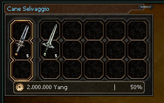
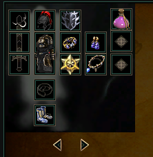
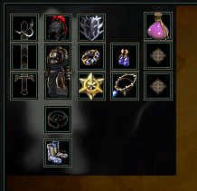
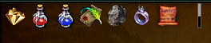
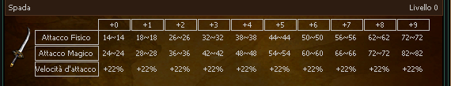
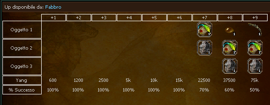
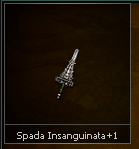

# Item and equipment tags

These tags read the wiki data of the [data namespaces](./data-item.md). They exist only in clients that load that data.

## **`cube-card`**
| Attribute             | Requirement  | Default       | Constraints/Notes |
|-----------------------|--------------|---------------|-------------------|
| [*Base Attributes*](../uchtml/components-common.md#common-base-attributes)     | Optional     | none             | Inherits all common base attributes. |
| cost                  | Optional     | none             | Cost value. |
| pct                   | Optional     | none             | Percentage value. |
| npc                   | Optional     | none             | NPC identifier if applicable. |

:::caution

**Allowed Children:** Only `<cube-result>` and `<cube-material>`.

:::

<details><summary>Code Example</summary>

```html
<cube-card npc="101" cost="2000000" pct="50">
    <cube-result vnum="110" count="5"></cube-result>
    <cube-material vnum="121" count="5"></cube-material>
</cube-card>          
```

 
</details>

---

### **`cube-result`**
| Attribute             | Requirement  | Default       | Constraints/Notes |
|-----------------------|--------------|---------------|-------------------|
| vnum                  | Required     | none             | Identifier for the cube result. |
| count                 | Required     | none             | Count for the result item. |
| **Parent Requirement**| Required     | `"cube-card"` | Must be placed inside a `<cube-card>`. |

:::caution

**Parent Constraint:** Must be placed inside a `<cube-card>`.

:::

---

### **`cube-material`**
| Attribute             | Requirement  | Default       | Constraints/Notes |
|-----------------------|--------------|---------------|-------------------|
| vnum                  | Required     | none             | Identifier for the cube material. |
| count                 | Required     | none             | Count for the material item. |
| **Parent Requirement**| Required     | `"cube-card"` | Must be placed inside a `<cube-card>`. |

:::caution

**Parent Constraint:** Must be placed inside a `<cube-card>`.

:::

## **`multi-equip-window`**
| Attribute             | Requirement  | Default       | Constraints/Notes |
|-----------------------|--------------|---------------|-------------------|
| [*Base Attributes*](../uchtml/components-common.md#common-base-attributes)     | Optional     | none             | Inherits all common base attributes. |

:::caution

**Allowed Children:** Only `<equip-window>`.

:::

<details><summary>Code Example</summary>

```html
<multi-equip-window>
<equip-window>
    <equip-part slot="0" vnum="11570" attrs="[(0, 1, 1600, 0), (1, 54, 17, 0), (2, 56, 17, 0)]"
        sockets="[(0, 28342), (1, 28344), (2, 28341)]" values="[(2, 76), (3, 40)]" />
    <equip-part slot="1" vnum="12470" attrs="[(0, 53, 50, 0), (1, 97, 4, 0), (2, 146, 3, 0)]"
        values="[(2, 58), (3, 26)]" />
    <equip-part slot="2" vnum="15190" attrs="[(1, 54, 16, 0), (0, 1, 1600, 0), (2, 56, 16, 0)]" />
    <equip-part slot="3" vnum="14210" attrs="[(0, 1, 1500, 0), (1, 54, 16, 0), (2, 56, 16, 0)]"
        sockets="[(0, 50633), (1, 50633), (2, 50633)]" />
    <equip-part slot="4" vnum="1210" attrs="[(0, 63, 5, 0), (1, 15, 5, 0), (2, 146, 3, 0)]"
        sockets="[(0, 28337), (1, 28345), (2, 28330)]" values="[(1, 147)]" />
    <equip-part slot="5" vnum="16210" attrs="[(0, 1, 1500, 0), (1, 54, 15, 0), (2, 56, 15, 0)]"
        sockets="[(0, 50633), (1, 50633), (2, 50633)]" />
    <equip-part slot="6" vnum="17210" attrs="[(0, 53, 60, 0), (1, 63, 5, 0)]"
        sockets="[(0, 50633), (1, 50633), (2, 50633)]" />
    <equip-part slot="7" vnum="13070" attrs="[(0, 53, 65, 0)]" values="[(2, 88), (3, 45)]" />
    <equip-part slot="8" vnum="100862" />
    <equip-part slot="11" vnum="9071" />
</equip-window>
<equip-window>
    <equip-part slot="0" vnum="11570" attrs="[(0, 1, 1600, 0), (1, 54, 17, 0), (2, 56, 17, 0)]"
        sockets="[(0, 28342), (1, 28344), (2, 28341)]" values="[(2, 76), (3, 40)]" />
    <equip-part slot="1" vnum="12470" attrs="[(0, 53, 50, 0), (1, 97, 4, 0), (2, 146, 3, 0)]"
        values="[(2, 58), (3, 26)]" />
    <equip-part slot="2" vnum="15190" attrs="[(1, 54, 16, 0), (0, 1, 1600, 0), (2, 56, 16, 0)]" />
    <equip-part slot="3" vnum="14210" attrs="[(0, 1, 1500, 0), (1, 54, 16, 0), (2, 56, 16, 0)]"
        sockets="[(0, 50633), (1, 50633), (2, 50633)]" />
    <equip-part slot="4" vnum="2159" attrs="[(0, 63, 5, 0), (1, 15, 5, 0)]"
        sockets="[(0, 28337), (1, 28345), (2, 28330)]" values="[(1, 177)]" />
    <equip-part slot="5" vnum="16210" attrs="[(0, 1, 1500, 0), (1, 54, 15, 0), (2, 56, 15, 0)]"
        sockets="[(0, 50633), (1, 50633), (2, 50633)]" />
    <equip-part slot="6" vnum="17210" attrs="[(0, 53, 60, 0), (1, 63, 5, 0)]"
        sockets="[(0, 50633), (1, 50633), (2, 50633)]" />
    <equip-part slot="7" vnum="13070" attrs="[(0, 53, 65, 0)]" values="[(2, 88), (3, 45)]" />
    <equip-part slot="8" vnum="100862" />
    <equip-part slot="11" vnum="9071" />
</equip-window>
<equip-window>
    <equip-part slot="0" vnum="11770" attrs="[(0, 1, 1600, 0), (1, 54, 17, 0), (2, 56, 17, 0)]"
        sockets="[(0, 28342), (1, 28344), (2, 28341)]" values="[(2, 76), (3, 40)]" />
    <equip-part slot="1" vnum="12610" attrs="[(0, 53, 50, 0), (1, 97, 4, 0), (2, 146, 3, 0)]"
        values="[(2, 58), (3, 26)]" />
    <equip-part slot="2" vnum="15190" attrs="[(1, 54, 16, 0), (0, 1, 1600, 0), (2, 56, 16, 0)]" />
    <equip-part slot="3" vnum="14210" attrs="[(0, 1, 1500, 0), (1, 54, 16, 0), (2, 56, 16, 0)]"
        sockets="[(0, 50633), (1, 50633), (2, 50633)]" />
    <equip-part slot="4" vnum="210" attrs="[(0, 63, 5, 0), (1, 15, 5, 0), (2, 146, 3, 0)]"
        sockets="[(0, 28337), (1, 28345), (2, 28330)]" values="[(1, 119), (0, 97)]" />
    <equip-part slot="5" vnum="16210" attrs="[(0, 1, 1500, 0), (1, 54, 15, 0), (2, 56, 15, 0)]"
        sockets="[(0, 50633), (1, 50633), (2, 50633)]" />
    <equip-part slot="6" vnum="17210" attrs="[(0, 53, 50, 0), (1, 63, 5, 0), (2, 55, 25, 0)]"
        sockets="[(0, 50633), (1, 50633), (2, 50633)]" />
    <equip-part slot="7" vnum="13070" attrs="[(0, 53, 55, 0), (1, 55, 28, 0)]"
        values="[(2, 88), (3, 45)]" />
    <equip-part slot="8" vnum="100862" />
    <equip-part slot="11" vnum="9071" />
</equip-window>
</multi-equip-window>  
```

 
</details>

---

## **`equip-window`**
| Attribute             | Requirement  | Default       | Constraints/Notes |
|-----------------------|--------------|---------------|-------------------|
| [*Base Attributes*](../uchtml/components-common.md#common-base-attributes)     | Optional     | none             | Inherits all common base attributes. |

:::caution

**Allowed Children:** Only `<equip-part>`.

:::

<details><summary>Code Example</summary>

```html
<equip-window>
    <equip-part slot="0" vnum="11570" attrs="[(0, 1, 1600, 0), (1, 54, 17, 0), (2, 56, 17, 0)]"
        sockets="[(0, 28342), (1, 28344), (2, 28341)]" values="[(2, 76), (3, 40)]" />
    <equip-part slot="1" vnum="12470" attrs="[(0, 53, 50, 0), (1, 97, 4, 0), (2, 146, 3, 0)]"
        values="[(2, 58), (3, 26)]" />
    <equip-part slot="2" vnum="15190" attrs="[(1, 54, 16, 0), (0, 1, 1600, 0), (2, 56, 16, 0)]" />
    <equip-part slot="3" vnum="14210" attrs="[(0, 1, 1500, 0), (1, 54, 16, 0), (2, 56, 16, 0)]"
        sockets="[(0, 50633), (1, 50633), (2, 50633)]" />
    <equip-part slot="4" vnum="1210" attrs="[(0, 63, 5, 0), (1, 15, 5, 0), (2, 146, 3, 0)]"
        sockets="[(0, 28337), (1, 28345), (2, 28330)]" values="[(1, 147)]" />
    <equip-part slot="5" vnum="16210" attrs="[(0, 1, 1500, 0), (1, 54, 15, 0), (2, 56, 15, 0)]"
        sockets="[(0, 50633), (1, 50633), (2, 50633)]" />
    <equip-part slot="6" vnum="17210" attrs="[(0, 53, 60, 0), (1, 63, 5, 0)]"
        sockets="[(0, 50633), (1, 50633), (2, 50633)]" />
    <equip-part slot="7" vnum="13070" attrs="[(0, 53, 65, 0)]" values="[(2, 88), (3, 45)]" />
    <equip-part slot="8" vnum="100862" />
    <equip-part slot="11" vnum="9071" />
</equip-window>

```

 
</details>

---

### **`equip-part`**
| Attribute             | Requirement      | Default       | Constraints/Notes |
|-----------------------|------------------|---------------|-------------------|
| slot                  | Required         | none             | Equipment slot number. |
| vnum                  | Required         | none             | Item identifier for the equipment. |
| attrs                 | Optional         | none             | Additional attributes; evaluated if provided. |
| values                | Optional         | none             | Values data; evaluated if provided. |
| sockets               | Optional         | none             | Sockets data; evaluated if provided. |
| **Parent Requirement**| Required         | `"equip-window"` | Must be placed within an `<equip-window>`. |

:::caution

**Parent Constraint:** Must be placed within an `<equip-window>`.

:::

**Slot Index Reference**
Each slot corresponds to a specific part of the equipment layout:

| **Slot** | **Description**     |
|----------|---------------------|
| 0        | Armor               |
| 1        | Helmet              |
| 2        | Boots               |
| 3        | Wrist/Bracelet      |
| 4        | Weapon              |
| 5        | Necklace            |
| 6        | Earring             |
| 7        | Shield              |
| 8        | Slot Item 1         |
| 9        | Slot Item 2         |
| 10       | Slot Item 3         |
| 11       | Artifacts           |
| 13       | Belt                |
| 14       | Manufact (MH)       |

## **`items-grid`**
| Attribute             | Requirement  | Default       | Constraints/Notes |
|-----------------------|--------------|---------------|-------------------|
| vnums                 | Required     | none             | List of item identifiers; provided as a string evaluated to a list/tuple. |
| width                 | Required     | none             | Grid width; can be a number, `"auto"`, or percentage. |
| height                | Required     | none             | Grid height; can be a number, `"auto"`, or percentage. |
| sort-size             | Optional     | none             | If provided, items are sorted by icon height (descending). |
| [*Base Attributes*](../uchtml/components-common.md#common-base-attributes)     | Optional     | none             | Inherits all common base attributes. |

:::caution

ItemsGrid accepts only the following formats for the `vnums` attribute:  

`[[vnum, count], ...]`, `[vnum, ...]`, or `[{'vnum': vnum, 'count': count}, ...]`.

:::

<details><summary>Code Example</summary>

```html
<items-grid width="250" height="32"
        vnums="[50513, 72724, 72728, 25040, 25041, 72001, 100466, [102626, 10], 102599, 90804]" />
```

 
</details>

---

## **`shop-grid`**
| Attribute             | Requirement  | Default       | Constraints/Notes |
|-----------------------|--------------|---------------|-------------------|
| shop                  | Required     | none             | Shop vnum, as keyed in the shop configuration. |
| category              | Required     | none             | Zero-based index of one category of that shop. An index out of range renders an empty grid. |
| width                 | Required     | `auto`        | Grid width. |
| height                | Required     | none             | Grid height. |
| [*Base Attributes*](../uchtml/components-common.md#common-base-attributes)     | Optional     | none             | Inherits all common base attributes. |

Renders the items of one shop category in a grid, priced like the in-game shop.

:::caution

Should not contain any child elements.

:::

<details><summary>Code Example</summary>

```html

    <shop-grid shop="{{ s.vnum }}" category="{{ loop.index0 }}" height="100" width="auto"/>

```

</details>

---

## **`item-stats`**
| Attribute             | Requirement  | Default       | Constraints/Notes |
|-----------------------|--------------|---------------|-------------------|
| vnum                  | Required     | none             | Identifier for the item whose stats are displayed. |
| **width**         | Auto-set     | `"auto"`      | Forces auto width. |
| [*Base Attributes*](../uchtml/components-common.md#common-base-attributes)     | Optional     | none             | Inherits all common base attributes. |

<details><summary>Code Example</summary>

```html
<item-stats vnum="10" width="auto" />
```

 
</details>

---

## **`equip-up`**
| Attribute             | Requirement  | Default       | Constraints/Notes |
|-----------------------|--------------|---------------|-------------------|
| vnum                  | Required     | none             | Identifier for the equipment upgrade info. |
| **width**         | Auto-set     | `"auto"`      | Forces auto width. |
| [*Base Attributes*](../uchtml/components-common.md#common-base-attributes)     | Optional     | none             | Inherits all common base attributes. |

<details><summary>Code Example</summary>

```html
<equip-up vnum="10" width="auto" />
```

 
</details>

---

## **`equip-epic-up`**
| Attribute             | Requirement  | Default       | Constraints/Notes |
|-----------------------|--------------|---------------|-------------------|
| vnum                  | Required     | none             | Identifier for epic upgrade information. |
| [*Base Attributes*](../uchtml/components-common.md#common-base-attributes)     | Optional     | none             | Inherits all common base attributes. |

---

## **`item-card`**
| Attribute             | Requirement  | Default       | Constraints/Notes |
|-----------------------|--------------|---------------|-------------------|
| vnum                  | Required     | none             | Identifier for the item. |
| [*Base Attributes*](../uchtml/components-common.md#common-base-attributes)     | Optional     | none             | Inherits all common base attributes. |

<details><summary>Code Example</summary>

```html
<item-card vnum=72725 />
```

 
</details>

---

## **`item-obtainable-from`**
| Attribute             | Requirement  | Default       | Constraints/Notes |
|-----------------------|--------------|---------------|-------------------|
| vnum                  | Required     | none             | Identifier for the item. |
| width                 | Required     | none             | Width specification for display. |
| [*Base Attributes*](../uchtml/components-common.md#common-base-attributes)     | Optional     | none             | Inherits all common base attributes. |

<details><summary>Code Example</summary>

```html
<item-obtainable-from width="auto" vnum=72725 />
```

 
</details>
