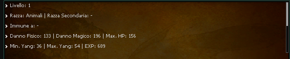
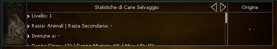
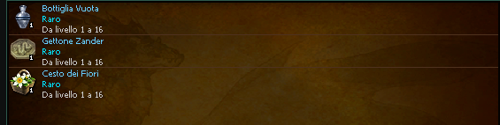
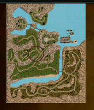
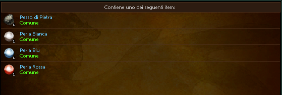
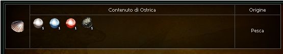

# Monster and chest tags

These tags read the wiki data of the [data namespaces](./data-core.md).

## **`monster-stats`**
| Attribute             | Requirement  | Default       | Constraints/Notes |
|-----------------------|--------------|---------------|-------------------|
| vnum                  | Required     | none             | Monster identifier. |
| width                 | Required     | none             | Display width. |
| height                | Required     | none             | Display height. |
| [*Base Attributes*](../uchtml/components-common.md#common-base-attributes)     | Optional     | none             | Inherits all common base attributes. |

<details><summary>Code Example</summary>

```html
<monster-stats width="auto" height=100 vnum=101 />
```

 
</details>

---

## **`monster-card`**
| Attribute             | Requirement  | Default       | Constraints/Notes |
|-----------------------|--------------|---------------|-------------------|
| vnum                  | Required     | none             | Monster identifier. |
| tab                   | Optional     | `stats`             | The tab shown as default. Admitted values are `stats` and `drop` |
| [*Base Attributes*](../uchtml/components-common.md#common-base-attributes)     | Optional     | none             | Inherits all common base attributes. |

> This element internally uses `mob origin` which can be [configured](../wiki/configuration.md#item_origin_locale_mapping--mob_origin_locale_mapping) in the `config.yaml`.

<details><summary>Code Example</summary>

```html
<monster-card vnum=101 />
```

 
</details>

---

## **`monster-drop`**
| Attribute             | Requirement  | Default       | Constraints/Notes |
|-----------------------|--------------|---------------|-------------------|
| vnum                  | Required     | none             | Monster drop identifier. |
| **width**         | Auto-set     | `"auto"`      | Forces auto width. |
| [*Base Attributes*](../uchtml/components-common.md#common-base-attributes)     | Optional     | none             | Inherits all common base attributes. |

<details><summary>Code Example</summary>

```html
<monster-drop width="auto" vnum=101 />
```

 
</details>

---

## **`monster-spawn`**
| Attribute             | Requirement  | Default       | Constraints/Notes |
|-----------------------|--------------|---------------|-------------------|
| vnum                  | Required     | none             | Monster spawn identifier. |
| [*Base Attributes*](../uchtml/components-common.md#common-base-attributes)     | Optional     | none             | Inherits all common base attributes. |

<details><summary>Code Example</summary>

```html
<monster-spawn vnum=101/>
```

 
</details>

---

## **`chest-content`**
| Attribute             | Requirement  | Default       | Constraints/Notes |
|-----------------------|--------------|---------------|-------------------|
| vnum                  | Required     | none             | Identifier for the chest content. |
| **width**         | Auto-set     | `"auto"`      | Forces auto width. |
| [*Base Attributes*](../uchtml/components-common.md#common-base-attributes)     | Optional     | none             | Inherits all common base attributes. |

<details><summary>Code Example</summary>

```html
<chest-content width="auto" vnum="27987" />
```

 
</details>

---

## **`chest-card`**
| Attribute             | Requirement  | Default       | Constraints/Notes |
|-----------------------|--------------|---------------|-------------------|
| vnum                  | Required     | none             | Identifier for the chest card. |
| [*Base Attributes*](../uchtml/components-common.md#common-base-attributes)     | Optional     | none             | Inherits all common base attributes. |

> This element internally uses `item origin` which can be [configured](../wiki/configuration.md#item_origin_locale_mapping--mob_origin_locale_mapping) in the `config.yaml`.

<details><summary>Code Example</summary>

```html
<chest-card width="auto" vnum="27987" />
```


</details>
