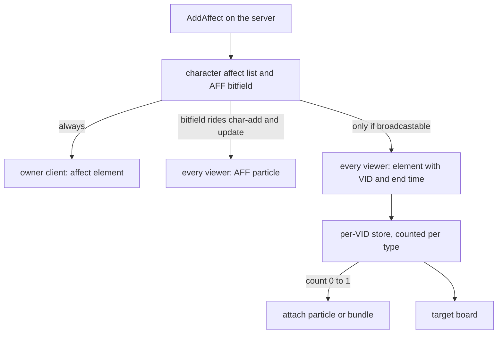

## The limits: every visible state was a change to the source

An affect is a timed state on a character: a buff, a poison, a stun, a quest bonus, an item blend. In the inherited engine it lived in three places at once. Its behavior was `#define` macros and `switch` lists in the server (does it save, does it survive death, is it good or bad). Its visibility was an AFF bit in a fixed bitfield, a particle row in a client table, and server code that set the bit. Its icon was a table in the Python UI. A new visible state touched all of them, in two languages.

I asked myself which limit hurt most, and the answer is all of them:

- The count of `AFF_` bits. The field is a fixed array of 32 bit words. Vanilla had two of them, and we widened it to three. Today 91 of the 95 usable flags are taken and 4 remain.
- The fact that I had to change the source. Every effect on a character was an edit to the server enum, the client enum and a particle row, then a build of both.
- The effect artist could not do any work without me. They could author the particle, but binding it to a state was C++.
- The target window. Other players saw only the bit, not the affect, so a target board needed its own side table. It had seven entries and a duration that restarted on every retarget.
- Copies that drifted. The same answer to "is this a debuff" was written in several lists, and the lists disagreed.

Broadcast was not built for the arena. The arena was the first client that justified it, and the mayhem augments were the first content to use it. The reason was the old bitmap and every pain it carried. What follows is how each of these was closed, in the order the data flows.

## Two channels to the client

The server holds each affect as an element: a type, one point change, a duration, an optional source, and optionally one AFF bit. The type is the identity. Skill vnums sit below 400, engine ids start at 400, quest affects start at 1000, and content ids such as 3010 come after. Several affects of one type can coexist in a character's list.

The client hears about an element through two channels that never touch.

| | AFF bitfield | Affect element |
| --- | --- | --- |
| Carries | one bit per flag, no duration, no source | type, point, value, end time, source |
| To the owner | inside char-add and char-update | affect add and remove packets |
| To everyone else | inside char-add and char-update | only if the type is broadcastable: the same add and remove, tagged with the VID |
| Client draws | a particle from a C++ table at `EFFECT_AFFECT` plus the flag index | a particle or bundle registered at `EFFECT_BROADCAST_AFFECT` plus the type |
| Self-healing | yes, it rides every update | no, pure deltas |

Before broadcast, the second row was the whole story for viewers: the full element went to the owner only. The inherited code in `AddAffect` shows it. The bits go to everyone through `UpdatePacket`; right after it, for a player, `SendAffectAddPacket` sends the element to the owner's descriptor and to nobody else:

```cpp
if (pkAff->dwFlag || wMovSpd != GetPoint(POINT_MOV_SPEED) || wAttSpd != GetPoint(POINT_ATT_SPEED))
    UpdatePacket();

StartAffectEvent();
```

In April 2023 a workaround put pairs of affect and AFF bit into the target packet: a table that started with five entries (poison, fire, stun, slow, bleeding), grew to seven with one skill and one buff by May, and sent each with the raw remaining duration. The client restarted the countdown from full on every retarget. The table lived 14 months, until June 2026.

Broadcast sends the element itself to the character's viewers, and the sender is short:

```cpp
static bool ShouldBroadcastAffect(LPCHARACTER ch, uint32_t dwType)
{
    return AffectManager::instance().IsBroadcastableAffect(dwType);
}

static void SendAffectAddPacketAround(LPCHARACTER ch, CAffect* pkAff)
{
    TPacketGCAffectAddByVID p;
    p.bHeader       = HEADER_GC_AFFECT_ADD_VID;
    p.dwVID         = ch->GetVID();
    p.lEndTime      = (pkAff->lDuration >= INFINITE_AFFECT_DURATION) ? 0 : static_cast<int32_t>(get_global_time() + pkAff->lDuration);
    p.dwType        = pkAff->dwType;
    p.bApplyOn      = pkAff->bApplyOn;
    p.lApplyValue   = pkAff->lApplyValue;
    p.unSourceVid   = pkAff->unSourceVID;
    ch->PacketAround(&p, sizeof(p));
}
```

## Broadcast is a state channel

The packet carries an absolute end time, not a remaining duration. The client compares it against its own estimate of server time, so a retarget no longer restarts the countdown, and a duration of 0 means infinite.

The server sends deltas at the places where the affect list changes: add, remove, expiry, the bulk clear, the end of login, and the moment a new viewer sees the character, when the whole broadcastable list is replayed to that one viewer. Nothing repeats. That is the price of a delta channel: if a packet is lost the client is wrong until the next change. The AFF bitfield heals itself on every update. Broadcast does not.

The client keeps a store per VID. It upserts an element by type, point and source, and it counts elements per type. The particle is attached when the count goes from 0 to 1 and detached when it goes from 1 to 0, so two affects of one type drive one particle:

```cpp
const uint32_t effectKey = EFFECT_BROADCAST_AFFECT + dwServerType;
const auto bundle = ms_astAffectBundlePath.find(effectKey);
if (bundle != ms_astAffectBundlePath.end()) {
    AttachBundle(bundle->second, "broadcast_affect:" + std::to_string(dwServerType));
    return;
}
// AttachEffect early-returns when no effect is registered, so a UI-only affect attaches nothing.
__EffectContainer_AttachEffect(effectKey, 0, 1.0f, EFFECT_KIND_AFFECT, EFFECT_NOTATION_AFFECT);
```

An actor created after its affects arrived reattaches the stored types, and an actor that leaves purges its entry. The target board reads the same store through `net.GetBroadcastAffectsByVID(vid)` and is the main character's affect shower pointed at another VID.

The server AFF bit has no such count:

```cpp
if(pkAff->dwFlag)
{
    if(!bAdd)
        m_afAffectFlag.Reset(pkAff->dwFlag);
    else
        m_afAffectFlag.Set(pkAff->dwFlag);
}
```

If two live affects carry the same flag, removing either clears the bit for every viewer while the other still runs. Broadcast counts per type, so it does not fail this way.

The particle is the part the effect artist now owns. A broadcast type binds its effect from Python with `RegisterEffect` under `EFFECT_BROADCAST_AFFECT`, and a bundle path can be edited in the editor's bundle pane. It still needs a client pack rebuild, but no C++ and no new AFF bit. Since August 2021 the AFF particles are rows in a C++ table; before that they were Python registrations, and the move to C++ was a client loading-speed change.



## Classes are data: the affect manager

The affect manager is the server object that answers the questions the macros used to answer. It holds four sets, and the file `affect_config.yaml` fills them:

- no-save: the type is never written to the database;
- no-clear-on-death: the type survives a death;
- broadcastable: the type is sent to viewers;
- macros: named sets that other entries and the engine refer to.

Entries are numbers, names resolved through the name map, ranges with `to_inclusive` or `to_exclusive`, or the name of another macro. A circular macro or an undefined name is a named, fatal error. The file loads after the quest system has initialized, because Lua may add names, and a broken file stops the game core.

```yaml
BROADCASTABLE_AFFECTS:
- 296
- 150 # Luce Stellare: every viewer draws the sanctuary's aura on its holders
```

The classification questions are macros in the same file: good, bad, party buff, untargetable, curse, and two removal sets. Good and bad answer "does this count as a buff" for assists and triggers. They do not answer "can a dispel tear it off", which is a separate set, because the two diverge in both directions. A buff can be good and survive a dispel; a debuff-like state can be dispellable without counting as a buff for assists. The cleanse set shows how deliberate the split is:

```yaml
## Removal set: what a CLEANSE strips (CHARACTER::RemoveBadAffect, the
## REMOVE_BAD_AFFECT node). Poison and fire are cleansed too, but by their own
## removers — each owns a tick event that has to be cancelled with the affect,
## so they are not listed here. Bleeding is absent for the same reason plus a
## design one: it is lifted only by REMOVE_BLEEDING.
IS_CLEANSABLE_AFFECT:
- STUN
- SLOW
- PARALYZE
```

A skill file declares its own classes with `affect_class`, and the skill loader adds the skill's affect to those macros when it loads. Thirty skill files do it today, so a new skill does not edit a central list. The engine affects stay listed in the YAML.

Two traps live here. Runtime registration and the YAML file meet at boot: Lua and the skill loader may have registered entries before the YAML loads, so the load merges into the sets and does not replace them. It used to replace, and Lua registrations vanished. The second trap is the order of macro expansion. A macro name used inside the no-save or no-clear list is expanded when the YAML loads. A skill that registers into that macro later changes the macro, not the list that already took a copy.

## The lifecycle: where the bugs were

Most of the bugs in this system were not in the idea. They were in the moments when a character is not what the code assumes.

**Adding before the character is ready.** At login the database list of affects arrives, and other systems add affects of their own around the same time. The load starts by clearing the list, so until June 2025 an affect added before it was wiped unless it survived death. Now `AddAffect` on a player who has not finished loading puts the affect in a pending list in the affect manager, and returns `nullptr`. A caller that uses the returned pointer on a loading player gets a null.

**The login race.** The inherited code polled once a second until the player reached the game phase, then loaded the affects. Revive and inventory load waited on it, and in September 2025 a revive was still not applied instantly on login because the event was still loading. The load now buffers every database element through `AddAffect`, and `EnterGameAffect` finalizes it: it replays the pending list, strips good and bad affects on PvP arena maps, starts the affect event, refills HP and SP, and then sends the broadcastable affects to the viewers who saw the character appear with an empty list. It is called from both orders, whichever of the database list and the game phase comes last. A viewer who arrives later gets the replay from the view insert.

**Durations.** The server counts down once a second in relative terms. The wire carries an absolute end time. Real-time affects count while the player is offline, so the load subtracts the logoff interval, and a negative result expires on the first tick. That path took three fixes in seven months, from November 2024 to June 2025: a default that was true instead of false, calls from Lua that did not set the flag, and infinite affects keeping it. A TODO to store an absolute end time and drop the subtraction is still open.

**Point identity.** `AddAffect` with override looks for an existing affect of the same type. For years it matched the type, and the source if there was one. A node with no point then found a valued sibling raised a moment earlier by the same skill and overwrote it. In August 2026 the point became part of the identity: a skill that declares four affects was raising three, and losing the attack-speed bonus its own description advertised. The argument that asks for the exact point is `bMatchApplyExactly` in C++, and the Lua stub of the character method still carries an inherited name for the argument in that position, `is_cube`.

**Death.** Death clears affects except the no-clear-on-death ones, plus skill-tree and priv affects. The vanilla rule also kept every no-save affect. The 2024 manager dropped that clause, so the two lists became independent, and a type that must survive death is listed under no-clear itself. That is why the YAML repeats names across the two lists. Quest affects lost their blanket rule in the same change: the 2016 macro kept every id from 1000 up, and the YAML entry `QUEST_START_IDX` keeps only 1000, so a quest affect survives death only if its own id is listed. Nobody decided that; it fell out of the translation. Battle royale states the rule it wants in content, for the augments a player picks.

**Expiry and removal.** Expiry still runs a handful of hardcoded side effects (toggle skills, mob ambience, blessing, autohunt, casual mode) and tells the viewers. Traits are notified after the walk over the list, never inside it, because a deactivate hook can touch the list the walk holds an iterator into. The skill end events are drained after the update for the same reason, to avoid a double delete when a toggle turns off.

**The double free.** In May 2024 a guard was added against freeing an affect twice, after a crash on death. It looped over the list and advanced the iterator twice per pass. A second commit the same day fixed it. The guard compares pointers from a pool, so a slot freed and reused by a new affect would still pass it. It logs `trying to double free affect` when it triggers.

**Saved but not sourced.** The save at logout skips affects that have a source, and the save at add time does not, and the database row has no source column. A sourced affect written at add time reloads with source 0.

## Both doors, and who uses which

Registration is open from both sides. Lua has `affect.add_name_definition`, `affect.add_no_save`, `affect.add_no_clear_on_death`, `affect.add_broadcastable`, `affect.add_to_macro` and `affect.is_in_macro`. C++ calls the same public methods on the affect manager. A wrong argument type is logged and ignored. `is_in_macro` did not work at all until July 2026, because its arguments were inverted.

A forge registers what its content needs while the quest system loads, before the YAML does, and the sets live in the manager, not in the forge. The block below is an example written for this page, the registration rage needs, taken from its forge. Run inside a forge's init, it registers the names and sets once:

```lua
affect.add_name_definition("RAGE_CHARGE", 618)
affect.add_broadcastable(affect.name_map.RAGE)
affect.add_broadcastable(affect.name_map.SUB_RAGE)
affect.add_no_save(affect.name_map.RAGE)
affect.add_no_save(affect.name_map.SUB_RAGE)
affect.add_no_clear_on_death(affect.name_map.RAGE_CHARGE)
```

The post [Rage in a forge](/blog/rage-in-a-forge) tells that story. The registry pattern behind both doors is the same as in [policies](/foundations/policies/).

| What | Registered natively from C++ today | Registered from Lua today |
| --- | --- | --- |
| Macro membership | the skill loader, from `affect_class` in 30 skill files | available |
| No-save | nobody | rage, arena augments and traits, mystery, ball-em-up, battle tower, battle royale, mannequin, trait test |
| No-clear-on-death | nobody | the same files except trait test |
| Broadcastable | nobody | 15 calls in 6 files: arena augments and traits, ball-em-up, battle tower, battle royale, rage |
| Name definitions | nobody | settings, quests and systems that need an id the engine does not know (54 calls) |
| YAML | the one load at boot | |

The C++ door exists and nothing ships through it, except the skill loader. Engine ids still live in a static name map in C++, which the generated `affect.name_map` stub mirrors. A new engine-known id, such as the cheater malus of April 2026, still takes a C++ edit. Content ids go through `add_name_definition` and take none.

The reference for every function is [Affects](/docs/building-blocks/affects).

## The parallel channel and the double-draw trap

Broadcast does not replace the AFF bitfield. The bitfield still drives status state: invisibility, sleep, the glow of a few items, resist-fallen. It also draws the legacy particles, from keys that do not collide with broadcast keys, since `EFFECT_BROADCAST_AFFECT` is 1,000,000 and the AFF particles sit at `EFFECT_AFFECT` plus an index.

That is exactly the trap. If a broadcastable type also drives an AFF flag with a legacy particle, both draw the particle, and there is no runtime guard. The check is config discipline: a type that is broadcastable carries `dwFlag` of 0 unless you want the bit for its status meaning. Two more silent failures: a broadcast type without an entry in the client's affect data shows no target icon, and one with no registered effect shows no particle. Nothing logs either.

New visible states should take the broadcast road. The bitfield is a hard ceiling of 4 flags, and it was already widened once.

## How it grew: from the inherited code to today

The vanilla engine had the AFF bits in two dwords, the element sent to the owner only, behavior as macros and switches, and a polling event to load affects at login. By the 2016 import, the fork had three dwords and bits up to 83. Rage was already there.

- 2019: the skills rewrite added the affect node in skill files and `unSourceVID`, the source of an affect. Quest affects got an id per quest. A duplicate guard in the quest `affect.add` still looks only at id 1000, so for quest index above 0 the guard "if the affect is already applied it will not be added again" does not hold.
- August 2021: the AFF particle table moved from Python into client C++.
- April 2023: the seven-entry target table.
- 2023: item affects, moved to their own manager in July 2024. In November 2023 a commit realigned client and server AFF effects by hand, 59 lines in the client enum and 60 in the client table, which is what drift looks like.
- May 2024: the double free.
- June 2024: the affect manager. The classification macros became `affect_config.yaml` and the Lua APIs appeared, 27 files changed.
- November 2024 to June 2025: real-time durations and their fixes.
- June and September 2025: the pending list and the buffered login load.
- November 2025: three config bugs in a row: a trailing comma, a name that resolved to the wrong id, and an affect added with wrong arguments in a map call.
- May 2026: runtime registration from Lua and C++, and a fix so the YAML merges. The same month a hardcoded check in the affect code rejected every auto-potion affect and broke the arena.
- June 12, 2026: broadcast. The target table was removed in the same change. Traits had shipped the day before, and the mayhem augments were the first client: ids 3010 to 3030. Same day fixes: virtual characters no longer gated, and an upsert bug when an affect was replaced.
- July 2026: classes as data. Good, bad, party, untargetable, dispel and cleanse moved from C++ switches into macros, because the switches had drifted from the parallel dispel arrays and grew per skill with no owner.
- August 2026: point identity.
- October 2026: rage, a C++ subsystem since the 2016 import, became an affect and a forge, 1,422 lines of C++ deleted.

Layered on top, not replaced: the manager answers save, death, broadcast and class, and broadcast runs beside the AFF bits.

Before and after, for one of the classification macros. The inherited line:

```cpp
#define IS_NO_CLEAR_ON_DEATH_AFFECT(type) (IS_BLOCK_CHAT_AFFECT(type) || ((type) == AFFECT_BLOCK_VOTE_FOR_BAN) || ((type) >= 500 && (type) < 600) || ((type) == AFFECT_RAGE) || ((type) == AFFECT_PET_BONUS) || ((type) >= GUILD_SKILL_START && (type) < GUILD_SKILL_END) || (type) == AFFECT_SRD_DEBUFF || (type) == AFFECT_PG_CHOOSE || (type) >= AFFECT_QUEST_START_IDX)
```

became a section of the YAML file shown above, and `IsGoodAffect` became one macro lookup.

## What is still in the engine

- The AFF bitfield itself: 96 bits, 91 used, sent in char-add and char-update, with 25 places in the server that test a flag. The set and clear have no count.
- Its particles: 65 `EFFECT_AFFECT` rows in a C++ client table, and the `AFFECT_*` enum on the client.
- The static name map for engine-known ids.
- Expiry side effects: toggle skills by type below 400, mob ambience, blessing, autohunt, casual mode. Also the auto-recovery item check in `AddAffect`, block-chat messages, premium durations, and the PvP arena strip in `EnterGameAffect`.
- Relative durations and the logoff subtraction.
