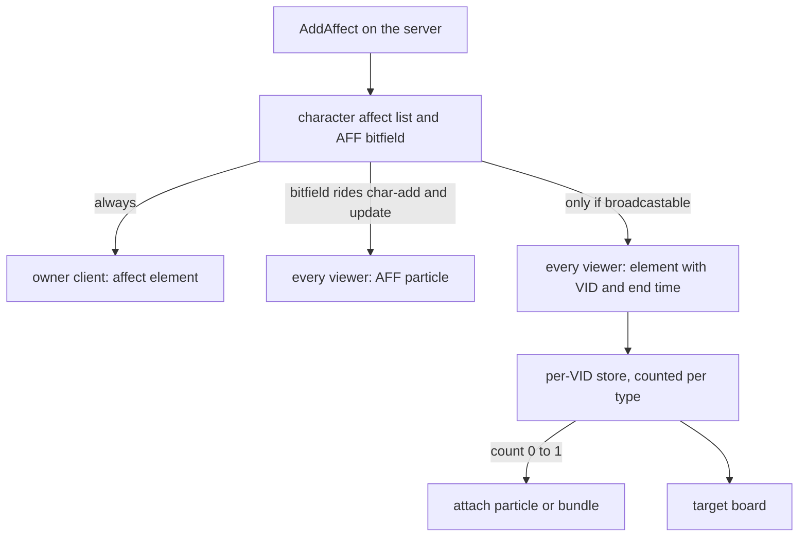

## Affects hold character state

An affect is a timed state on a character: a buff, poison, stun, quest bonus, or item blend. In the Metin2 mainline engine, behavior uses server macros and switches, while visibility uses an AFF bit, a client particle table, and a separate Python icon table. A visible state requires changes across those representations.

The affect manager classifies states as data, and broadcast sends the affect element to viewers. This gives the client the state and its duration without allocating an AFF bit or maintaining a separate target table. The fixed bitfield has 95 usable flags, of which 91 are taken.

## Two channels to the client

The server holds each affect as an element: a type, one point change, a duration, an optional source, and optionally one AFF bit. The type is the identity. Skill vnums sit below 400, engine ids start at 400, quest affects start at 1000, and content ids such as 3010 come after. Several affects of one type can coexist in a character's list.

The client hears about an element through two channels that never touch.

| | AFF bitfield | Affect element |
| --- | --- | --- |
| Carries | one bit per flag, no duration, no source | type, point, value, end time, source |
| To the owner | inside char-add and char-update | affect add and remove packets |
| To everyone else | inside char-add and char-update | only if the type is broadcastable: the same add and remove, tagged with the VID |
| Client draws | a particle from a C++ table at `EFFECT_AFFECT` plus the flag index | a particle or bundle registered at `EFFECT_BROADCAST_AFFECT` plus the type |
| Self-healing | yes, it rides every update | no, pure deltas |

The bitfield reaches viewers through character updates. The owner receives affect elements directly; broadcastable elements also reach viewers with the character's VID.

The character update carries the bitfield when a flag or movement speed changes.

```cpp
if (pkAff->dwFlag || wMovSpd != GetPoint(POINT_MOV_SPEED) || wAttSpd != GetPoint(POINT_ATT_SPEED))
    UpdatePacket();

StartAffectEvent();
```

The sender includes the element and its end time in the packet sent around the character.

```cpp
static bool ShouldBroadcastAffect(LPCHARACTER ch, uint32_t dwType)
{
    return AffectManager::instance().IsBroadcastableAffect(dwType);
}

static void SendAffectAddPacketAround(LPCHARACTER ch, CAffect* pkAff)
{
    TPacketGCAffectAddByVID p;
    p.bHeader       = HEADER_GC_AFFECT_ADD_VID;
    p.dwVID         = ch->GetVID();
    p.lEndTime      = (pkAff->lDuration >= INFINITE_AFFECT_DURATION) ? 0 : static_cast<int32_t>(get_global_time() + pkAff->lDuration);
    p.dwType        = pkAff->dwType;
    p.bApplyOn      = pkAff->bApplyOn;
    p.lApplyValue   = pkAff->lApplyValue;
    p.unSourceVid   = pkAff->unSourceVID;
    ch->PacketAround(&p, sizeof(p));
}
```

## Broadcast is a state channel

The packet carries an absolute end time, not a remaining duration. The client compares it against its own estimate of server time, so retargeting does not restart the countdown, and a duration of 0 means infinite.

The server sends deltas at the places where the affect list changes: add, remove, expiry, the bulk clear, the end of login, and the moment a new viewer sees the character, when the whole broadcastable list is replayed to that one viewer. Nothing repeats. That is the price of a delta channel: if a packet is lost the client is wrong until the next change. The AFF bitfield heals itself on every update. Broadcast does not.

The client keeps a store per VID. It upserts an element by type, point and source, and it counts elements per type. The particle is attached when the count goes from 0 to 1 and detached when it goes from 1 to 0, so two affects of one type drive one particle:

```cpp
const uint32_t effectKey = EFFECT_BROADCAST_AFFECT + dwServerType;
const auto bundle = ms_astAffectBundlePath.find(effectKey);
if (bundle != ms_astAffectBundlePath.end()) {
    AttachBundle(bundle->second, "broadcast_affect:" + std::to_string(dwServerType));
    return;
}
// AttachEffect early-returns when no effect is registered, so a UI-only affect attaches nothing.
__EffectContainer_AttachEffect(effectKey, 0, 1.0f, EFFECT_KIND_AFFECT, EFFECT_NOTATION_AFFECT);
```

An actor created after its affects arrived reattaches the stored types, and an actor that leaves purges its entry. The target board reads the same store through `net.GetBroadcastAffectsByVID(vid)` and is the main character's affect shower pointed at another VID.

The server AFF bit has no such count:

```cpp
if(pkAff->dwFlag)
{
    if(!bAdd)
        m_afAffectFlag.Reset(pkAff->dwFlag);
    else
        m_afAffectFlag.Set(pkAff->dwFlag);
}
```

If two live affects carry the same flag, removing either clears the bit for every viewer while the other still runs. Broadcast counts per type, so it does not fail this way.

The particle can be configured by the effect artist. A broadcast type binds its effect from Python with `RegisterEffect` under `EFFECT_BROADCAST_AFFECT`, and a bundle path can be edited in the editor's bundle pane. It still needs a client pack rebuild, but no C++ and no new AFF bit.



## Classes are data: the affect manager

The affect manager is the server object that answers the questions the macros used to answer. It holds four sets, and the file `affect_config.yaml` fills them:

- no-save: the type is never written to the database;
- no-clear-on-death: the type survives a death;
- broadcastable: the type is sent to viewers;
- macros: named sets that other entries and the engine refer to.

Entries are numbers, names resolved through the name map, ranges with `to_inclusive` or `to_exclusive`, or the name of another macro. A circular macro or an undefined name is a named, fatal error. The file loads after the quest system has initialized, because Lua may add names, and a broken file stops the game core.

```yaml
BROADCASTABLE_AFFECTS:
- 296
- 150 # Luce Stellare: every viewer draws the sanctuary's aura on its holders
```

The classification questions are macros in the same file: good, bad, party buff, untargetable, curse, and two removal sets. Good and bad answer "does this count as a buff" for assists and triggers. They do not answer "can a dispel tear it off", which is a separate set, because the two diverge in both directions. A buff can be good and survive a dispel; a debuff-like state can be dispellable without counting as a buff for assists. The cleanse set shows how deliberate the split is:

```yaml
## Removal set: what a CLEANSE strips (CHARACTER::RemoveBadAffect, the
## REMOVE_BAD_AFFECT node). Poison and fire are cleansed too, but by their own
## removers — each owns a tick event that has to be cancelled with the affect,
## so they are not listed here. Bleeding is absent for the same reason plus a
## design one: it is lifted only by REMOVE_BLEEDING.
IS_CLEANSABLE_AFFECT:
- STUN
- SLOW
- PARALYZE
```

A skill file declares its own classes with `affect_class`, and the skill loader adds the skill's affect to those macros when it loads. A new skill does not need to edit a central list. The engine affects stay listed in the YAML.

Two traps live here. Runtime registration and the YAML file meet at boot: Lua and the skill loader may have registered entries before the YAML loads, so the load merges into the sets and does not replace them. The second trap is the order of macro expansion. A macro name used inside the no-save or no-clear list is expanded when the YAML loads. A skill that registers into that macro later changes the macro, not the list that already took a copy.

## The affect lifecycle

**Loading.** At login the database list of affects arrives while other systems may add affects. `AddAffect` on a player who has not finished loading puts the affect in a pending list in the affect manager and returns `nullptr`. A caller must account for that null return.

The load buffers database elements through `AddAffect`. `EnterGameAffect` finalizes the load when both the database list and the game phase have arrived: it replays the pending list, strips good and bad affects on PvP arena maps, starts the affect event, refills HP and SP, and sends broadcastable affects to viewers who saw the character appear with an empty list. A later viewer receives a replay on view insert.

**Durations.** The server counts down once a second in relative terms; the wire carries an absolute end time. Real-time affects count while the player is offline, so the load subtracts the logoff interval. A negative result expires on the first tick. An open TODO proposes storing an absolute end time instead of subtracting the interval.

**Point identity.** `AddAffect` with override looks for an existing affect of the same type and, when present, source. The point can also be part of the identity, so a node without a point does not overwrite a valued sibling. The exact-point argument is `bMatchApplyExactly` in C++; the Lua stub calls the argument in that position `is_cube`.

**Death.** Death clears affects except those in no-clear-on-death, plus skill-tree and priv affects. No-save and no-clear-on-death are independent, so a type that needs both properties must be in both lists. `QUEST_START_IDX` names only 1000: a quest affect survives death only if its own id is listed.

**Expiry and removal.** Expiry runs hardcoded side effects for toggle skills, mob ambience, blessing, autohunt, and casual mode, and tells viewers. Traits are notified after the list walk because a deactivate hook can touch the list held by the iterator. Skill end events are drained after the update for the same reason, avoiding a double delete when a toggle turns off.

**Double free guard.** The guard logs `trying to double free affect` when it detects a repeated free. It compares pointers from a pool, so a slot freed and reused by a new affect can still pass the guard.

**Saving sources.** Saving at logout skips affects with a source; saving at add time does not. The database row has no source column, so a sourced affect written at add time reloads with source 0.

**Quest duplicate guard.** The quest `affect.add` duplicate guard checks only id 1000. For a quest index above 0, it does not prevent the same quest affect from being added again.

## Registration from Lua and C++

Registration is open from both sides. Lua has `affect.add_name_definition`, `affect.add_no_save`, `affect.add_no_clear_on_death`, `affect.add_broadcastable`, `affect.add_to_macro` and `affect.is_in_macro`. C++ calls the same public methods on the affect manager. A wrong argument type is logged and ignored.

A forge registers what its content needs while the quest system loads, before the YAML does, and the sets live in the manager, not in the forge. The following example registers the sets rage needs. Run inside a forge's init, it registers the names and sets once:

```lua
affect.add_name_definition("RAGE_CHARGE", 618)
affect.add_broadcastable(affect.name_map.RAGE)
affect.add_broadcastable(affect.name_map.SUB_RAGE)
affect.add_no_save(affect.name_map.RAGE)
affect.add_no_save(affect.name_map.SUB_RAGE)
affect.add_no_clear_on_death(affect.name_map.RAGE_CHARGE)
```

The post [Rage in a forge](/blog/rage-in-a-forge) tells that story. The registry pattern behind both doors is the same as in [policies](/foundations/policies/).

## Native registrations

The skill loader registers macro membership from `affect_class` in skill files. The manager loads YAML at boot. C++ exposes the same registration methods as Lua; content registers no-save, no-clear-on-death, broadcastable types, and names through Lua.

Engine ids live in a static name map in C++, mirrored by the generated `affect.name_map` stub. A new engine-known id takes a C++ edit. Content ids use `add_name_definition`.

The reference for every function is [Affects](/docs/building-blocks/affects).

## The parallel channel and the double-draw trap

Broadcast does not replace the AFF bitfield. The bitfield still drives status state: invisibility, sleep, the glow of a few items, resist-fallen. It also draws the legacy particles, from keys that do not collide with broadcast keys, since `EFFECT_BROADCAST_AFFECT` is 1,000,000 and the AFF particles sit at `EFFECT_AFFECT` plus an index.

That is exactly the trap. If a broadcastable type also drives an AFF flag with a legacy particle, both draw the particle, and there is no runtime guard. The check is config discipline: a type that is broadcastable carries `dwFlag` of 0 unless you want the bit for its status meaning. Two more silent failures: a broadcast type without an entry in the client's affect data shows no target icon, and one with no registered effect shows no particle. Nothing logs either.

New visible states should take the broadcast road. The bitfield has 4 usable flags remaining.

## Engine responsibilities

- The AFF bitfield itself: 96 bits, 91 used, sent in char-add and char-update, with 25 places in the server that test a flag. The set and clear have no count.
- Its particles: 65 `EFFECT_AFFECT` rows in a C++ client table, and the `AFFECT_*` enum on the client.
- The static name map for engine-known ids.
- Expiry side effects: toggle skills by type below 400, mob ambience, blessing, autohunt, casual mode. Also the auto-recovery item check in `AddAffect`, block-chat messages, premium durations, and the PvP arena strip in `EnterGameAffect`.
- Relative durations and the logoff subtraction.
