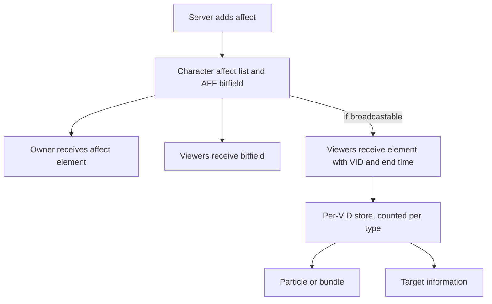

## Affects hold character state

An affect is a timed state on a character: a buff, poison, stun, or quest bonus. In the Metin2 mainline engine, behavior depends on server macros and switches, while visibility depends on an AFF bit and separate client tables. A visible state crosses several representations, and the fixed-size bitfield is finite.

The affect manager classifies types as data. Broadcast sends affect elements to viewers, so a client can show a state and its duration without allocating another AFF bit. The [overview](/docs/core/affects/overview) covers the representation and setup; this page explains the decisions behind it.

## Glossary

| Term | Meaning |
| --- | --- |
| Affect type | The identifier for a kind of state. Several elements of the same type can coexist. |
| Affect element | One entry on a character, with a type, point change, duration, optional source, and optional AFF flag. |
| Point | The character property changed by an element. An apply identifies a change that resolves to a point. |
| AFF flag | A bit used for status checks and some client effects. It is separate from the affect type. |
| Virtual character | An avatar represented by a character on the server; its affects reach viewers like any character's and are saved to the session cache. |

## Two channels carry different state

The server keeps affect elements in the character's list. The owner receives the elements directly. Viewers receive the AFF bitfield with character data and, for broadcastable types, receive affect elements tagged with the character's VID.

| | AFF bitfield | Broadcast affect element |
| --- | --- | --- |
| Carries | Flags, without duration or source | Type, point, value, end time, and source |
| Reaches viewers | With character insertion and updates | On changes and on replay to a later viewer |
| Drives | Status checks and flag-based particles | Per-type particles or bundles and target information |
| Recovers from a missed change | A subsequent character update carries the bitfield again | A later replay or relevant change can restore state; ordinary updates do not resend the list |

A character update is sent when an affect changes a flag or movement speed. The two channels can describe the same state, but neither substitutes for the other: a flag supports engine checks, while an element carries the detail needed to show a duration and distinguish sources.

The flow below follows an element from the server list to the two client representations.

## Broadcast is a state channel

The server sends an absolute end time. The client compares it with its estimate of server time, so changing targets does not restart a countdown. An end time of zero means infinite duration. Additions, removals, expiry, and bulk clears send changes as they happen. At the end of login, broadcastable affects are sent to viewers who may have seen the character before its list was ready. A viewer who arrives later receives a replay of the whole broadcastable list.

Between replays, broadcast is a delta channel. If a change packet is lost, an already present viewer can hold the wrong state until a relevant change or replay corrects it. The bitfield instead rides character updates, so a subsequent update can repair a missed flag change. A replay is useful synchronization, but it does not turn every update into a full affect snapshot.

The client stores elements per VID, keyed by type, point, and source. It counts elements per type: the first attaches the type's particle or bundle, and the last removal detaches it. An actor created after its affects arrive attaches the stored types; when the actor leaves, its entry is purged. Target information reads the same store. The [client reference](/docs/core/affects/client) describes the registrations and interfaces.

AFF flags have no equivalent count. If two live elements carry the same flag, removing either clears that bit even while the other element remains. The broadcast count avoids that particular problem for the visual attached to a type.

## Classification is data

The affect manager holds sets for no-save, no-clear-on-death, and broadcastable types, as well as named sets used for classification and removal. This puts decisions about a type in registrations instead of scattering each decision across a switch. The sets are independent: a state that must survive death and remain absent from the database needs both properties.

Classification and removal answer different questions. A good affect can survive a dispel, and a dispellable state need not count as a buff. Keeping those sets separate lets the engine ask the question it actually needs instead of treating every beneficial state as removable by the same operation.

Registrations from Lua and the skill loader can exist before the configuration loads. The load merges them into the manager's sets rather than replacing them. Named sets used by the no-save or no-clear lists are expanded when configuration loads: adding a member to the named set later does not update the list that already copied it. A missing name or circular definition stops the load rather than leaving a partially understood classification. See [registration](/docs/core/affects/registration) for the configuration and registration interfaces.

## The affect lifecycle

A player can receive an affect while its database list is still loading. The manager queues that addition until loading and entry into the game are both ready. A caller adding an affect during that interval must handle a null return; it cannot assume the element is already in the character's list. Once loading finishes, pending additions are replayed, the affect event starts, and viewers receive the broadcastable state.

The server counts durations down in relative time, while the client sees an absolute end time. Real-time affects also count time spent offline: loading subtracts the interval since logout, and an element whose time has run out expires on the next tick. Removal and expiry update the list and notify viewers. Some affect types also have engine-owned side effects on expiry, so removing an entry is more than deleting a row.

Override makes identity important. The lookup considers type and, when present, source; the point can also be required to match. Without an exact point match, an override can replace the first element of that type on a different point. That matters when a single type contains both a marker and a point change. The [behavior reference](/docs/core/affects/behaviour) describes matching, loading, death, and expiry in detail.

Source identity has a persistence limit. Logout saving skips sourced affects, while an affect saved when added can reach the database without its source: the stored row has no source field. On reload that source is zero. Do not depend on source identity surviving a save and load cycle.

## The two channels can draw twice

A broadcastable type with an AFF flag can drive both a broadcast particle and a flag-based particle. There is no runtime guard against drawing both. Use a zero flag for a broadcast visual unless the flag is also needed for its status meaning, and check the client registrations for both paths. A missing affect-data entry can leave the target icon absent; a missing effect registration leaves the particle absent. The [pitfalls](/docs/core/affects/pitfalls) and [examples](/docs/core/affects/examples) show the checks, and the [Lua API](/docs/core/affects/lua-api) covers script operations.
