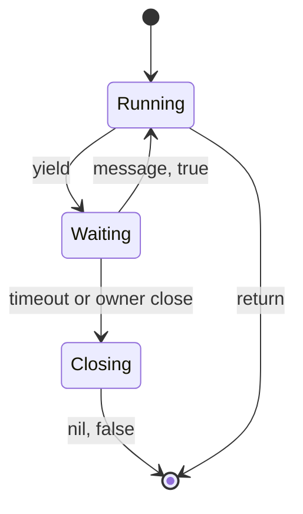

## The bridge and QuestManager

The Lua bridge owns the Lua VM used by Luna and provides a boundary between C++ and Lua. In the Metin2 mainline engine, quest execution centers on quest threads. The bridge adds tracked coroutines, persistent references, and dispatch context for work that crosses into Lua.

Luna runs parallel to QuestManager. QuestManager owns quest state, drives login and logout quest events, and dispatches `when` blocks. C++ obtains the bridge through QuestManager, and both use the Lua state and native bindings. That connection does not give the bridge responsibility for quest state.

QuestManager does not automatically adopt its quest threads. `bridge.coro.adopt` registers the non-main thread that calls it with the bridge; it rejects the main thread. A quest action is therefore not a tracked bridge coroutine merely because QuestManager dispatched it. The [Forge setup](/docs/core/luna-forge/setup) and [API reference](/docs/core/luna-forge/api) cover the script-facing interface.

## Coroutine table and creation

The bridge keeps a table of coroutine records, keyed by an ID, and a mapping from Lua threads back to those IDs. A record holds the thread and the information needed to manage its lifetime, including owners and timeout state. A running thread can ask for its bridge identity; an untracked thread has ID zero. This distinction lets the bridge find a suspended thread when an answer arrives without treating every Lua thread as a managed wait.

Creating a bridge coroutine starts it immediately. The call runs the entry function synchronously until its first yield, return, or error. If it returns or fails before yielding, there is no suspended work to keep in the table. If it yields, control returns to the creator and the bridge retains the record for a later resume. Starting a coroutine therefore does not defer all of its work: side effects before the first yield happen before creation returns.

An adopted thread gets a bridge record for the thread already running. Adoption and creation both establish identity, but adoption does not start a new entry function. The [calling rules](/docs/core/luna-forge/events) explain which contexts can wait.

## Owners, waits, and receipts

An owner identifies a lifetime by type and ID. A coroutine may have owners, and closing an owner finds and closes its associated coroutines. A player-owned wait can consequently end when that player disconnects, even if the remote answer never arrives. A timeout gives an unanswered wait a separate time limit. Without either a suitable owner or a timeout, a suspended coroutine can remain in the table indefinitely.

The flow shows the values delivered at the wait boundary.



A normal resume gives waiting code `(message, true)`. A timeout or owner close gives `(nil, false)`: the flag is the second value. After a failed wait the bridge removes the coroutine, even if the resumed code yields again. A second wait after failure cannot be resumed.

A receipt token connects a response to the wait without exposing the coroutine itself. The bridge stores the token with a coroutine ID and an owner type and ID. On an answer it checks the token and owner together before resuming the coroutine. A foreign owner cannot use the token to resume that wait. Tokens are removed when used or when their coroutine is removed, so a late or duplicate answer is dropped. This is a routing and lifetime check, not a promise that a remote peer will answer. The [API reference](/docs/core/luna-forge/api) describes the wait and timeout operations.

## Environments and namespace

Each forge has a private environment in the shared VM. Reads can fall through to the global environment, while assignments belong to the forge. Functions retain their defining environment even when a different thread calls them. The [Forge model](/foundations/luna/forge) explains the module cache and load order.

The environment also carries the forge namespace. A callback or bridge coroutine can carry that namespace into a dispatch scope, so a log or error can be attributed to the forge whose code is running. The namespace is significant for routing as well: code that lacks a Forge environment cannot supply the same attribution as a method defined inside one. A quest action can call such a method without acquiring its own Forge environment.

## Pinning callbacks

C++ may retain a Lua callback after the thread that registered it has finished. A reference tied only to that short-lived thread is not a safe basis for a later call. The bridge pins the Lua object on the global state, then retrieves it there when the callback runs. Pinning keeps the Lua object reachable; it does not extend the lifetime of a native object captured by that callback.

The following invariant ties the pin to the lifetime of the C++ handle: its deleter releases the pinned object.

```cpp
            std::shared_ptr<uint64_t> PinScoped(const sol::object& obj) {
                auto id = PinObject(obj);
                return std::shared_ptr<uint64_t>(
                    new uint64_t(id),
                    [this](uint64_t* p) { UnpinObject(*p); delete p; });
            }
```

The shared handle keeps the pin until its last owner releases it. A long-lived callback can therefore survive the registering quest thread, while destroying the callback also releases its reference to Lua. Subscriptions use this distinction: their lifetime must be managed explicitly, as the [event bus](/foundations/luna/event-bus) explains.

## Dispatch scope and errors

A dispatch scope surrounds a C++ call into Lua. It carries the forge namespace, dispatch kind, detail, and player ID on a thread-local stack. A nested call pushes another scope; returning restores the previous one. An observer can attach ambient state to the active scope, letting logs and diagnostics identify the Lua work responsible for the call.

The scope has a precise boundary. C++ work performed after the callback returns no longer has that callback's scope. Protected calls capture Lua errors and can return a fallback to C++ rather than letting the error cross the boundary unchecked. The context makes a failure attributable to a forge and dispatch, while the protected call controls how the caller continues. See [creating bindings](/docs/core/luna-forge/bindings) for the binding interface and error handling.
