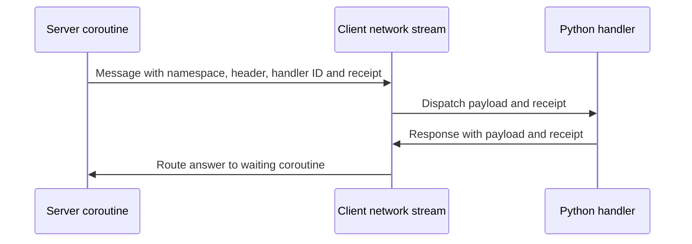

## The client boundary

The `luna` Python extension connects Python handlers to the network stream. It routes server messages by namespace and header, with a handler ID identifying a particular recipient. Python code interprets the serialized payload and controls the interface; the C++ network layer carries the bytes. The [transport page](./transport.md) explains the server side, and the [Forge API](/docs/core/luna-forge/api) describes the server messaging surface.

Luna runs parallel to QuestManager on the server. QuestManager owns quest state, login and logout quest events, and dispatch of `when` blocks; the bridge runs alongside it. Client messages enter a Forge processor through the transport rather than changing who owns quest dispatch.

## Routing a message

The sequence separates a window's handler ID from the receipt used to answer a waiting server coroutine.

The handler ID selects a Python recipient; the receipt identifies a pending server wait. A message need not be a request waiting for an answer. When it is, returning from the Python callback does not itself send the response: the response must travel through the network stream with the receipt.

A normal answer resumes the waiting server code with `(message, true)`. Timeout or owner close resumes it with `(nil, false)`. The second value is the success flag. A delayed client response can arrive after that wait has expired, so a client action and a server wait do not have identical lifetimes.

The extension stores registrations by namespace and header, with a list of IDs and callbacks for each key. The callback receives the payload and receipt; it parses the payload as the expected message type before acting. An outgoing message supplies routing keys and bytes, while a response uses the receipt to address the waiting request.

Handlers are registered under namespace and header, with an ID to distinguish recipients. The names have to match the sender's routing keys. A window handle is available during window initialization and can serve as the ID; a windowless object can use its own stable ID. The ID used for removal must match the one used for registration.

## Handler lifetime

Registration holds a Python reference to the callback. This lets the network layer call it when a message arrives, but it also means that ordinary loss of a Python reference does not necessarily release the registered callback. Explicit unregistration removes the network layer's reference and prevents later delivery to an object being torn down.

Window teardown can have a Python-side `Destroy` phase before the window handle itself is destroyed. Remove registrations at teardown as well as final cleanup, using the same ID in each case. Otherwise a callback may reach a window whose children or other state have already been cleared. Registration should happen once the handle exists and before the window depends on receiving messages.

A window handle already exists during window initialization. Register at that point, before loading the UI script, to avoid a gap in which messages can arrive before the handler exists. Callback wrappers matter for both network handlers and UI buttons: button event setters store the callable directly, so instance methods need the UI method wrapper at the call site.

A windowless recipient has no window handle. Its identity and lifetime still need to be stable for as long as it is registered. A catch-all client dispatch can also route messages to a non-window object; that path has its own lifetime and routing responsibilities.

## Protobuf and failure boundaries

The sender and receiver agree on a protobuf schema independently of the transport's routing keys. The Python side receives bytes and decodes them into the expected message type. A header that routes correctly does not prove that the bytes parse, or that the sender used the expected schema.

Luna message schemas use proto2 field rules, and generated bindings supply the message classes for Python and Lua. Python imports the feature's generated module and the serialization utilities explicitly; the package alone does not expose the utility functions. The sender and receiver must use corresponding generated types.

The serialization and deserialization helpers return `None` on failure after logging the error. Check the result before sending or reading fields. Passing a failed serialization result to an operation expecting bytes raises an exception; reading fields from a failed parse cannot produce a valid response. Empty payloads remain distinct from failed serialization.

The network stream drops messages queued during the connection-in-progress phase. This applies to both messages and responses; the client cannot use that interval as a reliable queue. The interface should wait until it can communicate and handle a request that never receives an answer. Server waits also need a timeout and an appropriate owner, as explained in the [events guide](/docs/core/luna-forge/events).
