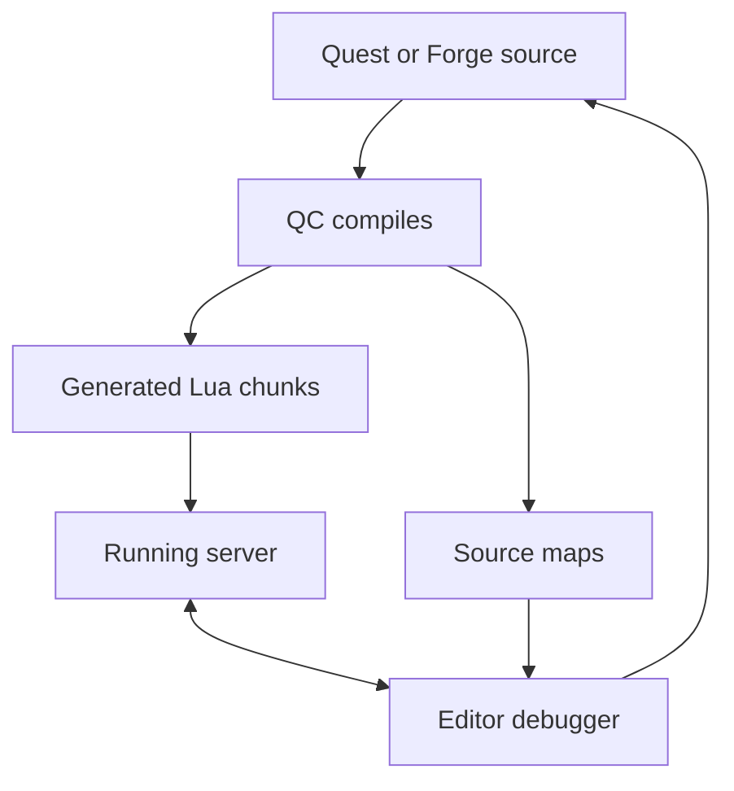

## From quest source to running Lua

QC turns quest and Forge source into the Lua chunks the game loads. A single source can contain Forge environments and quest states; the compiler separates their output. QuestManager loads quest states and dispatches their `when` blocks. Luna runs parallel to QuestManager: it does not take over quest state, login or logout quest events, or quest dispatch. The bridge runs alongside it.

The quest grammar includes a `define` preprocessor that replaces identifiers globally, so a definition can affect every matching use rather than a single Lua scope. QC can check input without writing output, accept several inputs, and target selected Forge environments; the [setup guide](/docs/core/luna-forge/setup) covers the Forge compilation workflow.

The compiler also produces source maps that connect generated code to the original source. This matters because the debugger sees the chunks that run, while you place breakpoints in the source you edit. The [Forge setup guide](/docs/core/luna-forge/setup) covers compilation and installation; the [environment guide](/docs/core/luna-forge/environments) covers boot order.

The flow shows where the map is used.

The server runs the generated chunks. The editor extension reads the maps and translates locations between those chunks and the original source; the server does not use the maps to execute the code. A map is meaningful only for the compiled output from the same source revision.

## Source locations and breakpoints

A breakpoint starts as a location in the original source. The extension translates it to a generated location before it communicates with the debug server. When execution stops, the reverse translation lets the editor display the corresponding source line. The mapping is necessary because compiler output does not have the same layout as the source.

Paths are a separate part of the problem. The server reports the path by which it loaded a chunk, while the editor opens a local workspace. Path mappings connect those two views. If they do not describe the same files, a valid line mapping cannot identify the correct local source. Remote and local roots can differ without changing the code, but the debugger must know the relationship.

QC writes a JSON map per script when source-map output is enabled. Its source-map working directory establishes the original-source base for the debugger's workspace; a separate remote working directory describes execution paths when deployment differs. The extension's map search location must point to the maps produced by that compilation, and its path mappings must match the roots reported by the server.

A pre-launch compile task can keep maps and generated chunks aligned before attaching. It must produce and deploy the same output the server runs; regenerating a map alone cannot make old running code match edited source.

Source, compiled chunks, and maps must stay together. Editing source without compiling leaves the server running the prior chunks and the debugger using the prior map. Inserting lines above a breakpoint shifts the source location without shifting the running instruction. Recompile and deploy matching output and maps before attaching again; merely reconnecting cannot repair a stale map.

## The embedded debugger

The game and database servers embed LRDB listeners. An editor debugger attaches to the listener for the process being inspected. Each process needs a distinct reachable port; a listener assigned an ephemeral port cannot be attached using port zero as though it were the assigned port. The Universal Core editor extension adds source-map translation to the LRDB connection.

The server initializes its configured listener at boot. The editor's `uc-lrdb` configuration attaches to the matching host and nonzero port, and its source-map and path settings tell the extension where to find and translate the maps. The extension also supplies its language-server integration for quest files.

The client Python debug build starts a debugger listener at boot on the first available local port from 3000 through 3049. The debugger attaches to that listener; application scripts do not need to start it themselves.

The listener exposes a running process to a remote debugger. Enable it only in an environment intended for debugging, not on a production server. The client Python debugger likewise belongs in a debug build: that build disables client process hardening and must not ship.

A debug client also resolves Python modules differently. Loose modules beside the executable can override packed modules and be reread when their modification time changes. A regular client uses packed files instead. This distinction explains why an edit visible in a debug session may not be present in a packaged client.

## What compilation can and cannot tell you

QC parses the quest grammar and emits the pieces that QuestManager and Forge load. A successful compile establishes that the compiler accepted the source; it does not prove that a runtime event reaches the intended block or that a remote process answers a request. A breakpoint in a QuestManager-dispatched `when` block tests that path at runtime. The [Forge examples](/docs/core/luna-forge/examples) provide a neutral visit counter for such a flow.

The compiler stops at the first critical error, so a later error may only become visible after the earlier one is fixed. State names are assigned CRC32-based indices. Identical names are deduplicated, while distinct names with the same hash require a different available index. On a collision, the compiler increments the hash until it finds an unused index and emits a warning. A collision can therefore make an index depend on the other names compiled with it; the state name is the meaningful identity in source.

For editor completion and type information, the language server reads generated Lua stubs. They describe bindings rather than executing them. [Lua annotations and the generated stubs](./lua-annotations.md) explains that boundary.
