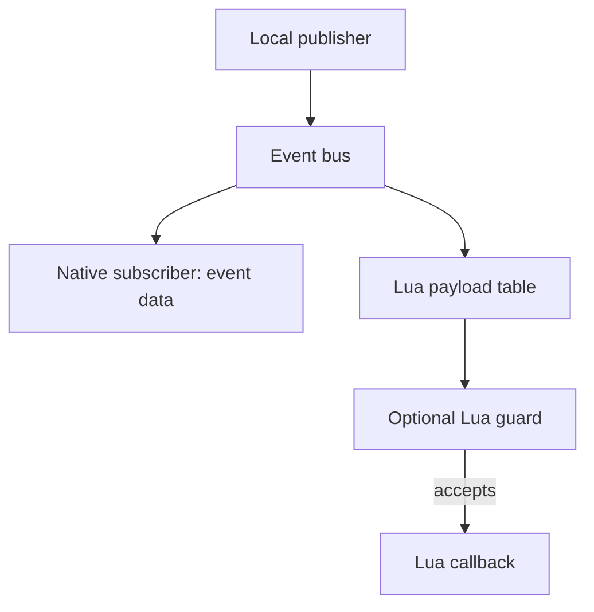

## Local dispatch

The event bus lets C++ and Lua react to events within one server process. In the Metin2 mainline engine, a native event needs explicit paths to its consumers; the bus provides a local subscription boundary. Each game or database process has its own bus. Publishing on one core does not deliver to subscribers on another core.

Luna runs parallel to QuestManager. QuestManager owns quest state, drives login and logout quest events, and dispatches `when` blocks. The event bus is a separate local subscription mechanism, not a replacement for those actions. The [events guide](/docs/core/luna-forge/events) covers subscriptions, available events, and usage.

## Subscription and delivery

A subscription associates an event name with a callback and receives an ID. The bus keeps subscribers under that name and calls them synchronously when the event is published. IDs increase as subscriptions are added, and the bus walks subscribers in ID order. Native and Lua listeners participate in that same order; the bus does not group all native listeners ahead of Lua listeners. The publisher continues after dispatch returns.

A listener therefore observes the event at the point where the publisher raises it, not at an independent scheduled time. A slow listener delays the publisher and the listeners after it. Ordering between subscribers follows registration order, but that does not establish a cross-process order or make a local event into a message to another core.

The flow shows the representations delivered during one local dispatch.

A guard runs before its own callback and sees the same Lua payload. A false result suppresses that callback, not the event's other subscribers. The guard itself is Lua code, so the payload has already crossed the boundary before it can filter anything.

## Payload conversion

A native publisher provides typed event data. If there are no subscribers, the bus returns before converting it. If there are native subscribers but no Lua subscribers, it passes the native data without constructing a Lua table. Once at least one Lua subscriber exists, the bus serializes the data and builds a table for Lua listeners. The same table is passed through the Lua side of that dispatch.

A Lua publisher supplies its table directly to Lua listeners. The bus also converts it into native event data for native listeners, using a known event's data type or a generic representation for other names. This lets the two kinds of listener receive the form they understand, but conversion is a real boundary: native fields must use supported types to appear in the Lua representation. The [events guide](/docs/core/luna-forge/events) and [binding guide](/docs/core/luna-forge/bindings) describe the supported interface.

The cost follows subscription, not whether a guard accepts a particular occurrence. A Lua subscriber to a frequent native event causes table construction for each occurrence before its guard runs. Filtering in C++ before publishing a lower-frequency event avoids crossing the boundary for every discarded occurrence. Payload shape matters too: conversion probes field types, and nested structures require more shape work than flat data.

## Player save and logout

During a player disconnect, the game core publishes the player-save event before asking QuestManager to run logout quest actions. The save subscriber therefore runs while that disconnect sequence is still before `when logout`. The core avoids publishing the same save event again from the subsequent standard save path in that sequence.

This order matters when a save listener and a logout action touch related state. The listener sees the state at the save event; it cannot observe changes that the later logout action has not made yet. A save event can also occur outside logout, so receiving one alone does not mean the player is leaving. QuestManager's logout action remains the place for quest logout behavior; the bus does not dispatch it.

## Subscriber lifetime

The bus retains a subscription until it is removed. For Lua listeners the callback is pinned so it can survive the thread that registered it. The optional guard is retained with the callback. Returning from a quest action does not remove the subscription, and losing the subscription ID does not remove it either. Any Lua values captured by the callback can remain reachable for the same period.

Removing a subscription releases its callback and reduces the count of Lua listeners for that event. When the last Lua listener is removed, native publishes no longer need a Lua table for that event unless another Lua listener is registered. A forgotten listener thus has two costs: retained state and repeated conversion on every publish. Pinning preserves a Lua callback, but it does not keep a native object referenced by that callback alive.

The [events guide](/docs/core/luna-forge/events) shows how to retain the ID and unsubscribe. Cross-process communication uses Forge messaging instead; see the [API reference](/docs/core/luna-forge/api).
