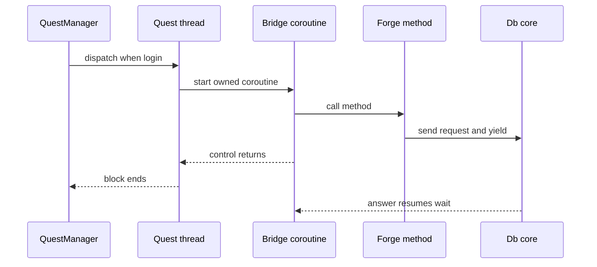
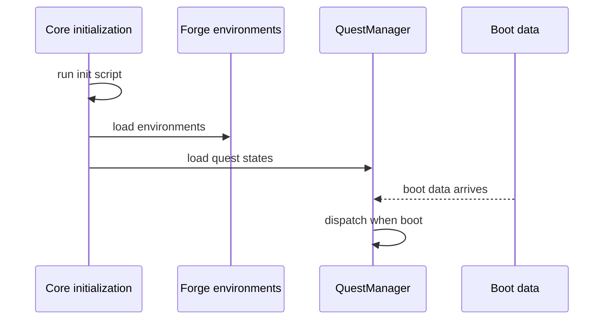

## Mental model

Forge gives Lua process-lived modules alongside quest hooks. In the Metin2 mainline engine, a `when` block runs as a quest action. Forge adds an environment that can retain state and expose behavior across actions, without making that state part of a quest thread.

Luna runs parallel to QuestManager. QuestManager owns quest state, drives login and logout quest events, and dispatches `when` blocks. A hook can call a Forge module; the module does not take over the quest or its dispatch. The [Forge docs](/docs/core/luna-forge/setup) describe how to write and load one.

## Glossary

- **Forge environment:** the private global table and module cache for one forge on one core.
- **Quest thread:** the thread on which QuestManager runs a quest action.
- **Bridge coroutine:** a thread tracked by the bridge for its lifetime and waits.

## One file, two halves

A `.forge` file can contain a module and quest hooks under the same forge name. The module defines the persistent behavior; the hooks give QuestManager actions that can call it. This keeps the point where a quest event enters the module close to the behavior it invokes, while each part still runs in its own calling context.

The module returns a value to expose its behavior. A quest hook can call that value after loading is complete. The [setup guide](/docs/core/luna-forge/setup) owns the file grammar and compilation steps.

A forge can have game and database environments. They run in separate processes, with separate Lua states and separate instances. A shared name routes messages between them; it does not make their tables or local variables shared memory. See the [API reference](/docs/core/luna-forge/api) for the message interface.

## Execution model

The defining environment and the executing thread answer different questions. A Forge method retains the environment in which it was defined, but runs on its caller's thread. Calling it from a quest action does not move execution onto a persistent Forge thread.

The sequence shows a login hook starting work that can wait while QuestManager's action finishes.

The quest action ends independently of the waiting coroutine. A normal resume supplies `(message, true)`; a timeout or owner close supplies `(nil, false)`. The flag is the second value. The [bridge](/foundations/luna/bridge) explains ownership and receipts.

## Lifecycle

On a game core, initialization prepares bindings and runs the init script, then loads Forge environments. QuestManager registers and runs quest states after those environments. It dispatches `when boot` later, once boot data arrives. The database core also runs its init script before loading its Forge environments, without the game quest-state phase.

The sequence shows the dependency boundary between loading modules and QuestManager's boot actions.

A successful environment returns the value placed under its forge name. The loader stores that value directly, so calls through the exposed name reach the same object rather than a copy. A nil result or an error during environment loading fails the load and stops core initialization. A missing directory is handled separately; the [environment guide](/docs/core/luna-forge/environments) describes the load rules.

The order among forge environments is not guaranteed. One environment cannot rely on another having already returned its value while its own body runs. A later call or QuestManager's boot action happens after all successful loads. Forges have no per-forge teardown hook; their process-lived state ends with the process.

## State and isolation

Each forge gets a private environment table. Assignments to globals in that environment land in its table; reads that are absent there fall through to the shared global environment. Native bindings and shared tables remain visible, but an accidental global assignment in `counter` does not become a global in `roster`.

Functions keep their defining environment even when called from another thread. That is why a Forge method called by a quest can access its module's state and namespace, though the call itself still executes on the quest thread. The returned module is an explicit way to share behavior and state with other scripts on the same core.

Each environment also gets its own module cache. When a module is first required inside each of two forges, its loader runs in each environment and returns two separately cached tables. A later require in the same forge gets its cached table. The cache starts with entries copied from the main state's already loaded modules, however, so a module loaded there first can be shared by all forges. This distinction matters for modules whose functions need a forge namespace.

A forge can deliberately share a table through `_G`: the environment's lookup of `_G` reaches the shared global table, so each forge reads and writes the same object there. This bypasses per-forge cache isolation and makes changes visible to all users of that object on the core. It does not share data across processes. The [environment guide](/docs/core/luna-forge/environments) covers module loading and the practical rules.

## Calling context

| Code | Execution and consequence |
| --- | --- |
| Environment body | Main Lua thread during load; it cannot wait on a bridge coroutine. |
| Message processor | Main Lua thread when a message arrives; work that waits needs a bridge coroutine. |
| QuestManager's `when` action | A short-lived quest thread; values held only by the action do not persist after it finishes. |
| Bridge coroutine | A tracked thread that can suspend and resume while its owner and timeout govern its lifetime. |

A `when` block can call a Forge method, but that call alone does not turn the quest thread into a bridge coroutine. QuestManager does not automatically adopt its quest threads. `bridge.coro.adopt` instead registers the non-main thread that calls it; it rejects the main thread. Adoption is explicit, not a request made by QuestManager. Login and logout actions must still finish, so a separate owned coroutine is the appropriate place for a wait. See [quest events and coroutines](/docs/core/luna-forge/events).

A long-lived module also does not extend the life of a native character or item. Keeping a reference past the native object's lifetime can leave a dangling reference. Store a stable identifier and resolve the object when needed; use QuestManager's logout action to clear any state that depends on the live character.

## Traps and their causes

| Symptom | Cause by design | Guidance |
| --- | --- | --- |
| A wait from a hook or processor fails | Neither the ordinary quest thread nor the main thread is a tracked bridge coroutine. | [Calling context](/docs/core/luna-forge/environments) |
| A direct send from a quest hook fails | The hook does not carry the Forge environment and namespace needed for routing. | [API reference](/docs/core/luna-forge/api) |
| Another forge is absent during load | Environment load order is unspecified. | [Environments and boot](/docs/core/luna-forge/environments) |
| Two users of a module see different tables | Each forge caches a module first loaded in its own environment. | [Module isolation](/docs/core/luna-forge/environments) |
| A retained character reference becomes invalid | The module can outlive the native character. | [Quest events](/docs/core/luna-forge/events) |
| A wait never finishes | An unanswered wait without an owner or timeout has no automatic completion. | [Coroutine API](/docs/core/luna-forge/api) |
