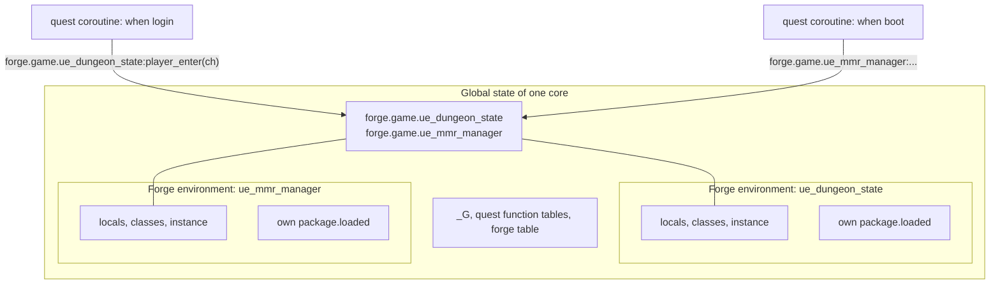
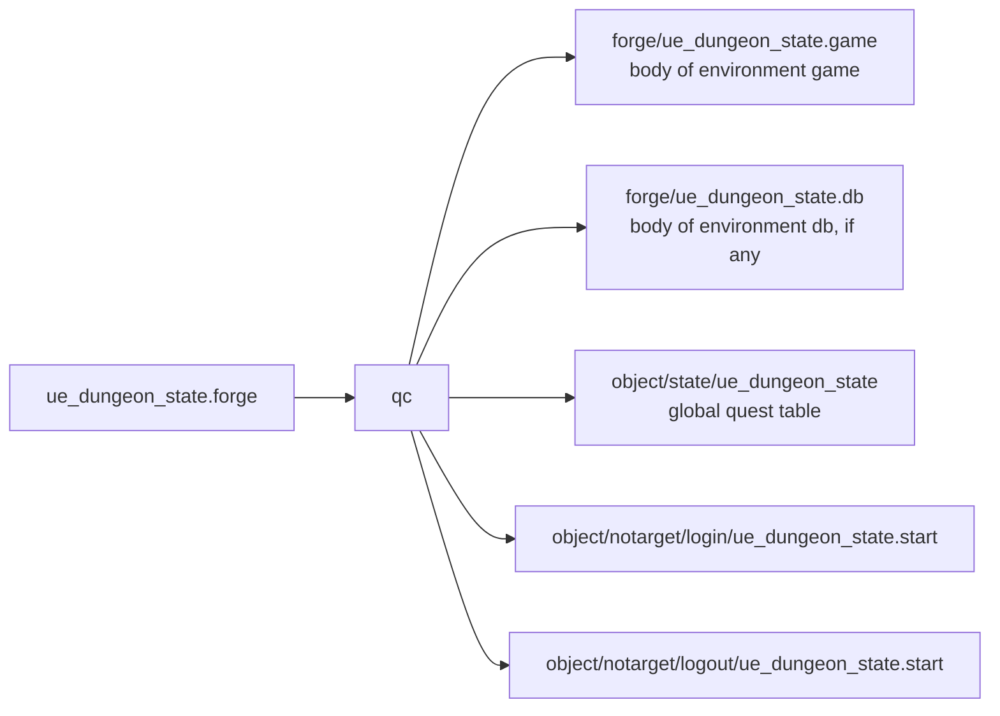
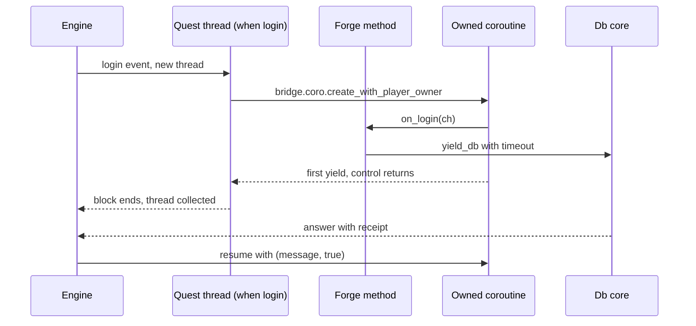

## Mental model

A forge is a Lua module that the server loads once at boot and keeps alive until the process exits. It replaces the places where gameplay used to live in C++: a manager class, a registry, a private event map. It holds state, it can talk to the other cores and to the database, and the rest of the scripts reach it as `forge.<env>.<name>`.

Three layers of Lua state exist at runtime, and most mistakes come from mixing them up.

- The global state is shared by everything on a core: every forge, every quest hook, `_G`.
- A forge environment is one forge's private table of globals and its private `require` cache. It reads through to the global state and writes to itself.
- A quest coroutine is a short-lived thread that the quest manager creates for one `when` block and throws away when the block returns.

State that must outlive an event belongs in the forge environment. Quest hooks are event handlers that call into it.



Read the picture from the bottom up. The coroutines on the left die after their block. The forge environments keep their locals and the instance the file returned, and the `forge` table in the global state points at those returned values.

Rule of thumb for choosing: a quest when the logic is strictly about one player. A forge when it is a subsystem with state, with synchronization between cores, and with a client interface. C++ for hot paths or when you expand what the engine can do. The API itself is on the [Forge reference](/docs/core/luna-forge/).

## One file, two halves

A `.forge` file is one source that holds two things under one name: the forge module (the `environment` blocks) and the quest hooks (a `state` block with `when` blocks). One compiler, `qc`, reads the file and writes both. You author the module and the hooks that feed it side by side, and the forge name is the only name involved.

The grammar is small. A file is a sequence of top-level blocks, each starting with `quest` or `forge`. Inside a `forge <name> begin` block you can write, in any order and any number, `environment <env> begin ... end` and `state <name> begin ... end`. A forge has no `with` start condition. `forge` and `environment` are ordinary names to the lexer, compared as strings, while `quest`, `state`, `with`, `when`, `define` and `begin` are reserved everywhere in the file, environment code included.

This is a whole real file. The environment returns a plain table, the state block holds the hooks that do the work and call into other forges.

```lua
forge ue_season_manager begin
    environment game begin
        local ranked_competition_name = "ranked_competition"

        return {
            ranked_competition_name = ranked_competition_name
        }
    end

    state start begin
        when boot begin
            season.register("global_rankings")
            season.register(forge.game.ue_season_manager.ranked_competition_name)
            if season.is_master() then
                season.add_auto_season("global_rankings", "0 0 0 1 * ?", "0 59 23 L * ?", true)
            end
        end

        when global_rankings.season_change begin
            if season.is_master() then
                local event = season.get_current_season_event()

                if event == "END" then
                    notice_all(locale.seasons.global_rankings_close)
                elseif event == "START" then
                    notice_all(locale.seasons.global_rankings_open)
                elseif event == "CANCEL" then
                    notice_all(locale.seasons.global_rankings_canceled)
                end

                forge.game.ue_ranking_manager:on_global_season_change(event)
            end
        end

        when ranked_competition.season_change begin
            local event = season.get_current_season_event()
            if season.is_master() then

                if event == "END" then
                    notice_all(locale.seasons.ranked_season_close)
                elseif event == "START" then
                    notice_all(locale.seasons.ranked_season_open)
                elseif event == "CANCEL" then
                    notice_all(locale.seasons.ranked_season_canceled)
                end

                forge.game.ue_ranking_manager:on_ranked_season_change(event)
                forge.game.ue_mmr_manager:on_ranked_season_change(event)
            end
            -- All cores need to react and open/close the queues
            forge.game.pvp_arena_queue:on_change_season(event)
        end
    end
end
```

The `when boot` hook reads the module's table, and the two `season_change` hooks forward the event to three other forges. The module is the data and the hooks are the wiring.

### One name, three meanings

The compiler creates a quest for every file, and for a forge it creates the forge as well, both from the same name token. There is no second name to mismatch. The file name plays no role: `dungeon_state.forge` declares `forge ue_dungeon_state`, and every output and every runtime lookup uses `ue_dungeon_state`.

The same word then does three jobs at runtime: the name of the quest (its states and quest functions live in a global table called `ue_dungeon_state`), the name of the module (`forge.game.ue_dungeon_state`), and the routing key of every message the forge sends, which is how the game half and the db half of one forge find each other. The quest table and the module are two different tables with the same name. Quest functions you declare with `function` inside a `state` block are called as `ue_dungeon_state.name(...)`, never through `forge.game`.

If two files declare the same forge name, each is parsed alone and the compiled outputs are opened with truncation, so the later file in the list silently overwrites the earlier one. Pick unique names.

### What the compiler emits

Each environment with a body becomes its own file, named after the forge and the environment, with the body copied verbatim and the `begin` and `end` lines dropped. The quest part becomes a state table and one script per event.



The deployment runs one `qc` invocation over a list that mixes `.quest` and `.forge` files, with one output directory for forges and one for quest objects. An environment with a body but no output directory configured for it aborts the compile, an empty environment emits nothing, and two environments with the same name in one forge are an error. For `dungeon_state.forge` the quest table comes out as `ue_dungeon_state={["start"]=0}` (one state, no quest functions), and the two `when` bodies are written as they are. A `when` with a dotted event such as `global_rankings.season_change` goes under the part before the dot, an event without a dot under `notarget`. Several `when` blocks for the same event and state are appended into one script.

Two behaviors of the shared grammar catch people:

- A `when` with a `with` condition is emitted as `if <cond> then <body> return end`. When the file has two `when login` blocks and the first has a condition that holds, the second does not run.
- The compiler rewrites any `set_state(...)`, `newstate(...)` or `setstate(...)` call over the whole file, environment code included, and wraps a non-string argument in quotes. A forge method with one of those names would be mangled, so do not use them.

Nothing checks `forge.game.<name>` inside a `when` at compile time. A typo is a runtime Lua error in the hook.

### How a hook calls into the module

A `when` chunk runs on a quest thread in the global environment, so it sees the global `forge` table. It calls `forge.game.<name>:method(...)` when the file returned an instance, or reads a field when the file returned a plain table (the season manager reads `forge.game.ue_season_manager.ranked_competition_name` this way).

The method you call is not running in the forge's main thread. It is a function defined inside the environment block, so it carries that forge's environment, but it executes on the thread of the caller: the short-lived quest coroutine. That has two consequences you can read straight off the engine.

First, the quest thread is not a bridge coroutine, so `bridge.coro.get_current_id()` is `0` there, and nothing that needs a coroutine can wait. To wait for something, the hook starts an owned coroutine and returns:

```lua
state start begin
    when login begin
        local ch = forge.sys.game.char_manager.find_by_pid(pc.get_player_id())
        bridge.coro.create_with_player_owner(
            function() forge.game.player_timers_manager:on_login(ch) end,
            pc.get_player_id()
        )
    end

    when logout begin
        local ch = forge.sys.game.char_manager.find_by_pid(pc.get_player_id())
        bridge.coro.create_with_player_owner(
            function() forge.game.player_timers_manager:on_logout(ch) end,
            pc.get_player_id()
        )
    end
end
```

The new coroutine runs immediately until its first yield, then the hook returns and the quest thread is collected. Inside the coroutine `on_login` waits for the db with a timeout, and the player owner means the wait is cancelled if the player disconnects first.

Second, the environment of the calling function matters for sending. Every send function checks that the calling code carries a forge namespace and refuses otherwise, so a hook that calls `forge.sys.game.send_db` itself fails, while a hook that calls a forge method that sends works.

## Execution model

Three places run your Lua, and each allows different things.

| Where | Thread | `get_current_id()` | Can yield on the bridge |
| --- | --- | --- | --- |
| Environment body, at boot | main thread | `0` | no |
| Message processors (`set_main_processor`, `set_p2p_processor`, `set_db_processor`) | main thread | `0` | no |
| `when` block, and forge methods it calls | short-lived quest thread | `0` | no |
| A coroutine created with `bridge.coro.create` or `create_with_player_owner` | bridge coroutine | its own id | yes |

`get_current_id()` never returns nil, and `0` is truthy in Lua. A guard written `if not id` never fires. The engine fails one step later: with `with_timeout` the error is `with_timout outside a coroutine`, with a bare `yield_db` the receipt step rejects the zero id with `Invalid coroutine_id: cannot be 0`. Test `id == 0`.



Look at who is waiting. The quest thread never waits; it hands the job to a coroutine the bridge owns and ends. A yield cannot be resumed from a quest thread because the quest manager adopts none of them. This is also why you cannot create tables or other long-lived state in a `when` block and expect them to be visible later: the thread and everything bound to it is collected when the block returns. The engine itself guards against this when a handler is registered from a `when boot`: it re-anchors the function on the global state, because a function bound to the quest thread would later be called on a freed stack.

What the yielding code sees when it resumes: `(message, true)` when the answer arrived, `(nil, false)` when the timeout expired or the owner was closed. After either failure the coroutine is removed, even if it yields again, so code that waits a second time after a failed wait is never resumed. A late answer is dropped. Collect always waits the full timeout and then returns `(table, true)`.

## Lifecycle

On a game core the order is fixed by `CQuestManager::Initialize`. The forge system creates the `forge` and `forge.sys` tables and all its bindings first. The quest function tables, the quest library and the locale are loaded. Then the init script runs, then every forge environment loads. Last, every compiled file in the quest state directory is registered and run. `when boot` fires later still, when the boot data has arrived from the db core.

So every forge environment has already run before any quest table exists and before any `when` fires. A `when boot` block can call any forge.

The engine calls the init script `Finalize`, and the name is misleading. It runs before the forges are loaded, not at shutdown. Its job is to prepare the Lua side the forges will need; the deployed game one loads module folders and defines a log alias:

```lua
load_modules("locale/italy/libs/forge_extensions/global")
load_modules("locale/italy/libs/forge_extensions/game")

game_log = forge.sys.game.log
```

The db core follows the same order: bindings, init script, then the forge load.

### Loading one environment

For each compiled file whose extension matches the core's environment (`game` on a game core, `db` on the db core), the loader:

1. creates a new environment table whose `__index` is the global state, so reads fall through to `_G` and writes to undeclared names land in the forge;
2. stamps it with the forge namespace, an id and the file path;
3. installs the isolated `require` (next sections);
4. runs the file as a chunk in that environment;
5. stores whatever the chunk returned at `forge.<env>.<name>`.

The return value is stored as it is, no copy and no wrapper. If the name has dots the loader nests it. A nil return is an error: `result is nil for forge[<name>]. Each environment should return a table or a class instance`. The same applies on the db side, and a refused db half takes the whole db core down:

```lua
-- Every environment hands its table back: the loader refuses a nil, and a refused db
-- half crash-loops the db core, which takes the dbcache and every login with it.
return { on_save = on_save, on_load = on_load }
```

### Order, errors, reload, teardown

The loader walks the forge directory in whatever order the filesystem lists it, with no sort. Load order is not guaranteed, so no forge may depend on another being loaded first. A forge may not touch `forge.<env>.<other>` while its own body runs; that value might not exist yet. Cross-forge calls belong in methods called later and in `when boot`, which runs after every forge is loaded.

An error while loading, a syntax error, a runtime error in the body or a nil return, stops the whole load: the remaining forges are not loaded, initialization returns false and the process exits. On a game core that is `could not load Forge: [<dir>]`; on the db core `could not load forge: [<path>]`. An error after boot, inside a processor or a hook, is printed with a stack trace to the system error log and the server keeps running. A missing forge directory is not fatal either: it is logged and no forge handlers are registered.

Forges cannot be reloaded at runtime. No code path does it. There is also no per-forge teardown hook; the forges end with the process.

## State and isolation

The environment table is the isolation. Every forge gets its own, so a global variable or function you assign inside a forge (`function dispatch_notification_event(...)` without `local`) lands in that forge's table. Quests and other forges cannot see it. Reads fall through to the global state, so every forge sees the engine's functions, `forge`, `bridge`, `pc`, the quest function tables and `_G`.

What is shared on a core:

| Shared | Isolated per forge |
| --- | --- |
| `_G` and every global the engine defined | globals you assign in the forge body |
| the `forge` table and all returned instances under `forge.<env>.<name>` | your `local` variables and classes |
| the `bridge` and `pc` tables | the module cache seen by `require` |
| modules the main state loaded before the forges | modules first required inside a forge |

The two halves of one forge, `environment game` and `environment db`, are not shared at all. They run on different processes, each with its own Lua state, and `forge.game.*` does not exist on the db core. They talk only through messages routed by the forge name. The `auth` environment compiles but no core loads it.

The instance a forge returns is the supported way to share behavior. Other forges and quest hooks call `forge.game.<name>` and get the same object. When many scripts need the same data without owning it, an instance is the right shape; a bare `_G` table is the workaround described next.

## Modules and require

Inside a forge, `require` is not the standard function. The engine gives each forge a new `package` table with its own `loaded`, and its own `require` that resolves through that cache. The first require of a module inside a forge runs the module's loader, with that forge's environment set on it, and caches the result in that forge's `loaded`. A second forge requiring the same module runs the loader again and gets a second table. A module's top-level globals land in the forge that required it.

The cache does not start empty. It is pre-seeded with a copy of every entry of the main state's `package.loaded` at the moment the forge loads. A module the main state loaded before the forges is therefore the same table in every forge, while a module first required inside a forge is one table per forge. Which modules are pre-seeded depends on what the core's init code required before the forges ran, and the boot log prints the list per forge.

This explains the warning at the top of `forge_helper`:

```lua
--[[
    forge helper is a convinient helper module which DO NOT GETS REQUIRED BY THE MAIN STATE.
    Requiring it in the main state will "cache" the code in the main thread and any
    caller forge will use the functions initializated inthe main state, where no forge environment and
    id are set. Leading to the impossibility to send messages.
]]
```

If the main state loads it, every forge receives that single pre-seeded copy, which carries no forge namespace, and every send fails. Require it inside the forge environment.

To share one table between forges, go around the per-forge cache and write through `_G`. A forge's `_G` reads fall through to the real globals, so everyone gets the same physical table. The augments config registry does this:

```lua
-- Stored on _G so the registry is invariant to any per-forge module-cache
-- scoping: writes from a consumer (avatar.augment_extension) and reads from
-- the engine forge always reference the same physical table.
_G._AUGMENT_CONFIGS = _G._AUGMENT_CONFIGS or {}

local M = {}
M.configs = _G._AUGMENT_CONFIGS
```

The module search path is set at core start and is relative to its working directory, so `require("augments.configs")` resolves into the forge's system folder.

## Why it is built this way

The old QuestManager was built to script simple quests, and it does that well. It has run Metin2 scripting for two decades and I do not want to undersell it. It was never enough once a feature became UI-rich, stateful, collaborative or server-wide, and every time we, or another project, had to build one, we ended up in the C++ engine.

The flaw that mattered was the design of the quest run itself: one global Lua state, and a short-lived coroutine for each `when` block. There is no place for a module to keep state and no isolation between scripts. I did not weigh alternatives. The QuestManager was not suitable by design, so the only way out was to move gameplay up from the engine into a structured, deliberately limited scripting language.

The pain before that was rarely in the QuestManager itself. It was the engine, polluted over the years by developer-flavored hooks and approaches, and by bugs and crashes that came with them. Anything more complex than "go there, kill this, drop that, take it" had to go to C++. The typical failures were new subsystems regressing older ones, SIGSEGVs, inconsistent design, and, many times, reentry bugs I created in the QuestManager without even touching it.

I did try to stretch quests. For dungeons I exposed the open and close events to quests so scripters could set the opening and closing times instead of hardcoding them. The result was a system with no clear boundary: some logic available to high-level scripters, some hidden. Nobody understood how it really worked and nobody had an overview of the behavior. The first feature I moved was dungeon rejoin. Before, it was a quest flag and a poor quest-script rejoin that did not work across cores and was very fragile.

The hardest part of Luna was yields and coroutine continuation. `bridge.coro` and the forge events were the most difficult pieces, and `bridge.coro.adopt` is a leftover from that try-and-break era.

Forge is what I got by keeping the quest and adding a module beside it. Classes and instances are exposed directly, without current-instance globals such as `CurrentCharacter`. A forge keeps state for the life of the process. Quests remain, and a forge file still carries quest states, so the hooks stay where people already look for them. The price is that a script must handle nil instances, because Forge does not guarantee that an instance stays valid. That one cost explains most of the traps below.

## Traps and their causes

Each trap follows from a choice above. The fix, with working code, is in the [Forge reference](/docs/core/luna-forge/).

- **Waiting from a `when` block or a processor.** The quest thread and the main thread are not bridge coroutines, so `get_current_id()` is `0` and a yield has nothing to suspend. Fix: start an owned coroutine from the hook.
- **Sending from a `when` block directly.** The send functions refuse code without a forge namespace, and the `when` chunk lives in the global environment. Fix: call a forge method that sends.
- **State in a `when` block.** The block runs on a thread that is collected when it returns, so anything held only there is gone. Fix: declare it in the environment and call into it.
- **Raw pointers across time.** The forge lives for the process, characters and items do not. A stored `LPCHARACTER` dangles after logout and the core crashes when it is used. There is no local logout event on the event bus; the hook is `when logout` in the forge file, which fires while the character still exists and before the player's coroutines are closed. Fix: drop the reference there, keep the player id, and take a fresh pointer from `forge.sys.game.char_manager.find_by_pid` when needed.
- **`when login` is not a one-time event.** It fires on player load, and a player load happens again on a core change. A broadcast or one-time init placed there repeats. Use `when boot` for server-wide setup.
- **Referencing another forge during boot.** Load order is the directory listing, so the other forge may not exist yet. Fix: cross-forge calls after boot.
- **Shared module tables.** Two forges requiring one module hold two tables unless the main state loaded it first. Fix: the `_G` registry, or call through a forge's returned instance.
- **A forge that returns nil.** The loader refuses it and the process stops.
- **A waiting coroutine with no owner and no timeout.** Nobody resumes it if the answer never comes, and it outlives the player. Fix: `create_with_player_owner` or `add_owner`, and a timeout on every wait.
- **`forge_helper` required in the main state.** Every forge shares one copy with no forge namespace, so no message leaves.
