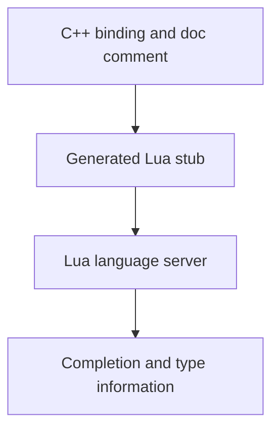

## What the editor reads

Lua scripts call functions exposed by C++ bindings, but the language server cannot infer their Lua signatures from the running server. Generated EmmyLua stubs describe those functions, types, parameters, and return values in a form the editor can read. They provide completion, documentation, and type checking while you write a script.

A stub is a description of an API, not its implementation. It does not register a function or run on the server. A binding can work at runtime without appearing in editor completion if its documentation is missing or the stubs are out of date. Conversely, a stale stub can describe a function that has changed. When the editor and runtime disagree, check that the generated stubs match the bindings installed with the server.

The editor extension supplies the generated quest metadata to the Lua language server. The stubs cover the Lua surface available to scripts, including QuestManager's quest API and Luna bindings. Luna runs parallel to QuestManager: QuestManager retains quest state, login and logout quest events, and dispatch of `when` blocks; the bridge runs alongside it.

## From binding to completion

Every binding carries a documentation comment describing its Lua surface. The generation process turns those comments into stubs grouped by namespace, and the language server reads the result. The path from implementation to editor is shown below.

Extraction has two stages: Doxygen turns binding comments into XML, then a parser finds the Lua documentation markers, removes escaping, and groups blocks into one metadata stub per namespace. Ordinary namespaces receive a class declaration and table initialization. The global namespace instead describes global functions and supplies the generic array type, so it must have a documentation block even when no other global binding needs one.

The extraction filter controls which binding sources Doxygen sees. A new binding in a source that matches no configured pattern is omitted even if its annotation is correct; the filter must include it before regeneration can produce its stub. Regenerate after changing or removing bindings so the editor does not retain obsolete declarations.

The comment records the signature and the meaning of its values close to the binding. This lets the editor show more than a name: it can distinguish parameters, return values, and documented types. Multiple return values are especially sensitive to order because Lua assigns them by position. A description that reverses them may look plausible in completion while leading the script to interpret a payload as a flag.

Doxygen escaping is part of the pipeline. Unescaped commands can become structured XML instead of flat text; the parser recovers child text and warns, but properly escaped annotations avoid ambiguous output. Its line splitting also treats triple dashes specially, so literal triple dashes use the dedicated escape directive.

For overloads, consecutive emitted signatures share the preceding documentation. That works only when the documented parameter names match each signature; different names need separate documentation. A new class or field block before a signature has its own documentation and does not inherit the earlier preamble.

A dummy class can describe the keys of a returned table or the individual indices of a fixed array. When such a class has no emitted Lua declaration, a line-break directive closes the block so later annotations do not run into it. The [binding guide](/docs/core/luna-forge/bindings) gives the annotation form.

Stubs also describe objects and enums exposed to Lua. Their declarations help the language server understand members and accepted values; they do not extend the lifetime of the underlying C++ objects or validate runtime state. The binding and its runtime contract remain authoritative.

For the comment form and how to document a binding, see [Creating bindings](/docs/core/luna-forge/bindings). The [Forge API](/docs/core/luna-forge/api) documents the callable surface and its return values.
