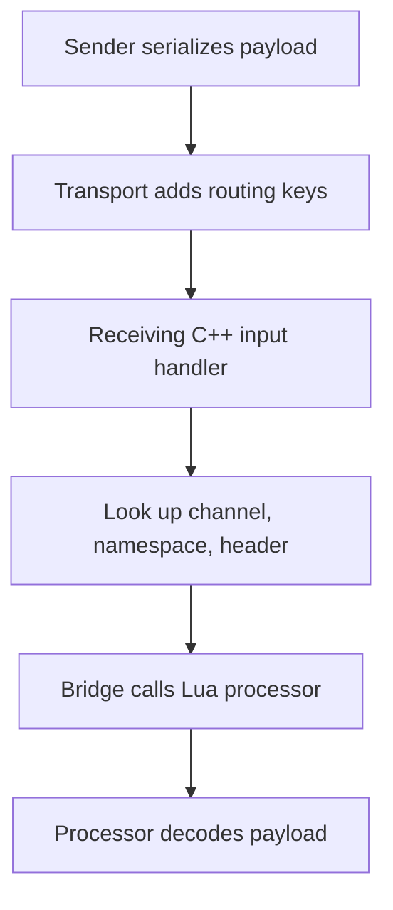
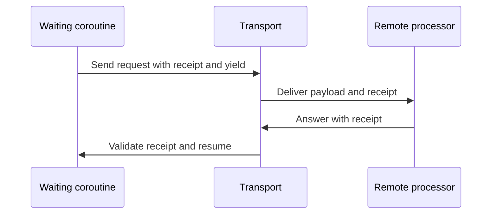

## One transport across process boundaries

Luna routes messages between the client, game cores, and database core through one transport model. A message carries a namespace and a header alongside its payload. The namespace identifies the Forge; the header identifies the kind of message within it. Together with the input channel, they select the receiving processor. This keeps two forges free to use the same header without sharing a handler.

The transport moves serialized bytes. Protobuf provides a schema that both ends can use to encode and decode those bytes, but routing does not depend on the contents of the schema. Sender and receiver must agree on the message type: a successful route does not establish that the payload has the meaning the receiver expects.

Luna runs parallel to QuestManager. QuestManager owns quest state, login and logout quest events, and dispatch of `when` blocks. The bridge manages its own coroutines (a script thread joins them only by calling `bridge.coro.adopt`); the transport uses those coroutines for waits without taking over quest dispatch.

For processor registration, send functions, and signatures, see the [Forge API](/docs/core/luna-forge/api). A complete request is in the [Forge setup](/docs/core/luna-forge/setup).

## Glossary

| Term | Meaning |
| --- | --- |
| Namespace | Forge name carried with a message to select its recipient. |
| Header | Message kind within a namespace and input channel. |
| Processor | Lua function registered to receive a routed message. |
| Receipt | Token that associates an answer with a waiting coroutine and its expected owner. |
| Handler ID | Identifier that directs a client response to a particular registered handler. |

## From packet to processor

The path below separates packet routing from the payload's interpretation.

The lookup selects a processor before Lua decodes the payload. The sender object and routing identifiers accompany the bytes, so the receiver can identify the connection or character involved and, when appropriate, answer a request. Game-to-game, game-to-database, and client-to-game messages enter through different input channels; the same namespace and header on different channels do not identify the same registration.

The sender differs by input channel: client input supplies a character, game peer and database input supply a descriptor, and database peer input supplies a peer. A database response may also carry a descriptor handler to identify the client connection that initiated the round trip; that identifier is distinct from both the client window handler and the receipt. The [API reference](/docs/core/luna-forge/api) lists the values available on each channel.

Game-to-game sending broadcasts to connected game cores, while game-to-database sending targets the database core. The database can address one game peer or broadcast, optionally limiting the channel or excluding a peer. These choices determine which processes receive a message; the header still selects a processor at each recipient.

The database transport reads its packet using a different framing convention from the other channels: its input starts after the packet header. The transport handles that difference, so feature code passes serialized payloads rather than constructing network packets.

A processor runs on the main thread. It can handle a message immediately or start a bridge coroutine for work that must wait. Its return value does not itself travel back across the network. An answer is a separate message, and a request that expects one needs a way to connect the two.

Forge supplies the namespace from the calling environment. That context matters: a quest hook does not itself carry a Forge environment, so a transport operation belongs in a method defined by the Forge. QuestManager dispatches the hook, and that method crosses into the transport. The [environment guide](/docs/core/luna-forge/environments) describes the calling contexts.

## Requests, receipts, and ownership

A receipt makes an asynchronous exchange look like a wait to a coroutine without holding up the main thread. The sequence shows the roles of the processor and the waiting coroutine.

The diagram shows a successful answer. The receipt identifies the wait and the expected owner of the answer. Validation prevents an unrelated sender from completing it. Once a wait expires or its owner closes, a late answer cannot resume that coroutine. An answer is not a guarantee that the remote operation did or did not happen before the timeout; application state must account for that uncertainty.

A normal resume returns `(message, true)` to the waiting code. A timeout or owner close returns `(nil, false)`: the success flag is the second value. Collection is different from a single-answer wait: it gathers replies until its timeout and returns a table of answers. See the [API reference](/docs/core/luna-forge/api) for the precise return values and the [events guide](/docs/core/luna-forge/events) for owned waits.

Ownership ties a coroutine's lifetime to an entity such as a player or peer. A player-owned wait can finish when the player disconnects instead of retaining work indefinitely. A timeout also bounds a wait when a remote process never answers. After a failed wait the coroutine is removed, so it cannot rely on a second wait being resumed in the same coroutine.

## Client routing and payloads

A server response can carry a client handler ID in addition to its namespace and header. The client uses it to choose a registered Python recipient. A receipt serves a different purpose: it connects a reply to a server coroutine waiting for it. Confusing the two can deliver a message to a window without completing the wait, or complete a wait without addressing the intended window.

A player save also has a lifetime boundary. Virtual players can represent offline state without writing it to the real database. The virtual-player save cache intercepts such saves and retains their state instead of executing the database send; if the character cannot be resolved, the save must be skipped. See [player virtualization](/docs/core/player-virtualization/overview) for that contract.

The helper module must be loaded inside a Forge environment. Loading it in the main state caches functions without the Forge namespace, so later sends lack the context needed for routing. The [environment guide](/docs/core/luna-forge/environments) explains the module boundary.

The [Python client page](./client.md) explains handler lifetime and decoding. The same payload contract applies on both sides: serialization can fail, a received payload can be malformed, and a compatible routing key alone does not validate its contents. A receiver must handle decoding failure before using the result.
