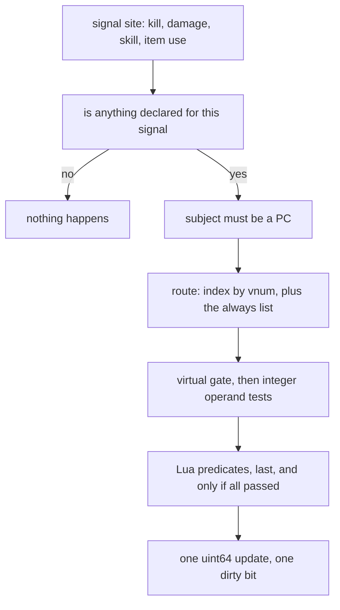

## A shared catalog of measurements

Player metrics give a character's history shared names. A metric is a per-character `uint64` or a set of keys, declared in a data file. Signals and pushes update it once; consumers can ask their own questions of the result. Thresholds, labels, and rewards belong to consumers, not the counting machinery.

Feature-owned counters make cross-feature questions depend on separate stores and read paths. A shared catalog lets multiple consumers use the same measurement without putting their vocabulary in the engine.

## What the engine owns

Two things in the engine are fixed. One is the schema: the engine reads `metrics.yaml` itself, in the phase that loads the locale tables, and validates every entry. The other is the machinery that makes counting cheap: the signal sites, the prefilter, the per-character blocks, the dirty queue and the persistence. Everything else is Lua: predicates, content pushes and every consumer.

A declaration is one line. These are real lines from the shipped file:

```yaml
kill.metin:        { from: kill, where: { type: [STONE] }, agg: count }
kill.dog:          { from: kill, where: { vnum: [101, 102, 103] }, agg: count }
boss.slain:        { from: kill, where: { rank: [BOSS] }, agg: distinct, key: vnum,
                     domain: { kind: mob, max_keys: 256 } }
```

`from` is required and names a signal or `custom`. `agg` is one of five monotone folds: `count`, `sum`, `max`, `min` and `distinct`, which counts the members of a key set. Monotone is the point. Nothing in the engine decrements a metric, so a counter cannot be walked back by a late event, and a bad push cannot be undone without touching the database. The shipped catalog uses `count` 27 times, `distinct` 11, `max` 10, `sum` 4 and `min` never.

`where` filters a signal on its operands, and `predicate` names Lua functions the filter calls last. A `distinct` metric names which operand becomes the key and bounds the set with `domain.max_keys`.

Boot order is the part to get right:

1. The forges initialize inside the quest manager. They fill the global `METRIC_PREDICATES` table. Nothing is declared yet.
2. The engine loads the locale tables and reads `metrics.yaml`. Predicate names in `where` resolve here, which is why it has to come after the forges.
3. The quest manager raises `when boot`. Consumers bind their metrics now, and validate their own names with `declared`.

The engine refuses a bad declaration at boot. A misspelled `from:`, an unknown operand, an unknown token, a duplicate name or a predicate nobody registered each log a `[metrics] declare [<name>]: ...` line naming the metric, and the load fails. A refused catalog fails the quest-side boot and the game core does not start. The reasoning is plain: a metric is a public name with rows in the database, and a half-loaded catalog would count silently wrong. 

There is no backfill. Rows are keyed by name, and a metric added in a later release starts at zero for the whole existing population. Under-declaring is the mistake that cannot be recovered, and an unused slot costs almost nothing, so the shipped file declares a few metrics that no consumer reads yet. Examples include: `damage.max`, `damage.total`, `death.count`, `item.used`, `kill.any` and `raid.prism.peak`.

## Signals and pushes

Four signals exist, and the list is short on purpose: `kill`, `damage`, `skill` and `item_use`. The operands each carries are the ones the call site already had in scope.

| Signal | Operands |
| --- | --- |
| `kill` | `vnum`, `type`, `rank`, `is_pc`, `empire`, `map_index`, `level_delta` |
| `damage` | `damage`, `type`, `skill_vnum`, `flags`, `critical`, `pierce`, `death_blow`, `rank` of the victim |
| `skill` | `vnum`, `level`, `grade`, `type`, `target_flags` |
| `item_use` | `vnum` |

A signal is a C++ change. There is no Lua door for one. Deriving a new metric from an existing signal is a data change; a new signal is a new emit site. The damage emit shows why a site is placed with care:

```cpp
// char_metrics: the `damage` signal. Here rather than at the HP-reduction
// line further down, because that one sits inside a guard excluding raid
// mobs, immortal characters and armada flags -- it would miss every hit on
// a raid boss. `dam` is already final at this point; the overkill clamp is
// applied here, the same MIN the stats competition applies internally, and
// GetHP() has not been reduced yet.
//
// But armada victims are excluded, which that later guard would have done
// for free and this site has to do by hand. They cannot die: the training
// dummies standing on the public harbour map carry 9,999,999 HP and one of
// them is rank BOSS, so without this test every damage metric -- totals,
// crit counts, damage-to-boss, biggest-hit-ever -- is AFK-farmable in town,
// with the overkill clamp never biting because their HP never drops.
if (CCharMetricsManager::Active(metrics::SIGNAL_DAMAGE) && !IsArmada() && !IsArmadaFlag())
{
    const int32_t metricDam = std::min(dam, std::max(0, GetHP()));
    CCharMetricsManager::instance().OnDamage(pAttacker, this, metricDam,
        (int)type, skill_vnum, wFlag, IsCritical, IsPierce, IsDeathBlow);
}
```

The kill signal fires from two places, the PvE half in the reward path and the PvP half in the death path, so a kill metric inherits the exclusions of the reward path. Quest items do not fire `item_use`: use `when <vnum>.use` and push from there.

A native push is the other way in, for a cold site that has no signal and no Lua owner:

```cpp
// The native-push API: one line at a cold C++ site, no enum, no payload
// struct, no routing entry.
struct Metrics
{
    static bool     Add   (LPCHARACTER ch, const char* name, uint64_t delta);
    static bool     AddKey(LPCHARACTER ch, const char* name, int32_t key);
    static uint64_t Get   (LPCHARACTER ch, const char* name);
};
```

Fishing is a real one:

```cpp
// char_metrics, native push: fishing is a cold site with no Lua
// owner at all. The length is in 1/100 cm, and fish_log calls
// the same quantity "size".
metrics::Metrics::Add(ch, "fish.catch", 1);
metrics::Metrics::Add(ch, "fish.size.max", nLength);
```

## Native registrations

| Registration | C++ |
| --- | --- |
| Catalog | The 52 metrics in `metrics.yaml` are read at boot. |
| Signals | `kill`, `damage`, `skill`, and `item_use` have 5 emit sites; `kill` has two halves. |
| Pushes | `mh.coin.peak`, `war.plaque.peak`, `raid.prism.peak`, `artifact.maxed`, `fish.catch`, `fish.size.max`, and `marriage.count`, once per spouse. |

The C++ declaration API is available, but no native code consumes a metric. Lua content pushes custom metrics and registers the `in_war`, `low_hp`, and `wearing_costume` predicates. Signals are C++ only.

## One counter for two languages

The YAML file and the Lua `declare` function end in the same validator. The engine parses the file with a C++ YAML library, converts each entry into a Lua table, and calls the function the Lua binding calls:

```cpp
// YAML -> sol, so the declaration file feeds the SAME validator the Lua front end does. Two parsers would be two
// chances to disagree, and the one that is not exercised by the suite is the one that drifts. `type: ["TRUE"]`
// names the TRUE_DAMAGE token, while bare TRUE is the YAML boolean and the engine refuses it.
using luna::YamlToLua;
```

Producers have the same property. `Metrics::Add` from C++ and `forge.sys.game.metrics.add` from Lua both end in one manager call, with the same distinct check, the same virtual gate and the same aggregation. The header says why a metric has no language:

```cpp
// There is deliberately no script/native distinction. Which language the
// call site happens to be written in is a property of that call site, not of
// the metric: moving a producer from C++ into a quest changes nothing about
// the metric, so nothing about the metric should have to be edited. Where a
// producer lives is answered by grepping the metric name, exactly and
// without ever going stale.
```

Moving a producer from C++ into a quest, or the other way, edits nothing about the metric. The marriage counter pushes from C++ and both spouses are counted, because the quest that runs the ceremony runs once, on one of them:

```cpp
// Both halves, not just the caller: the quest runs this once, on one
// of the two, and the other would never be counted.
metrics::Metrics::Add(ch, "marriage.count", 1);
if (LPCHARACTER other = CHARACTER_MANAGER::instance().FindByPID(pMarriage->GetOther(ch->GetPlayerID())))
    metrics::Metrics::Add(other, "marriage.count", 1);
```

The C++ names a measurement rather than a consumer.

From Lua, the surface is twelve functions in `forge.sys.game.metrics`: `declare`, `add`, `add_key`, `get`, `is_seeded`, `keys`, `info`, `names`, `declared`, `flush`, `pending_save` and `report`. None of them yields. They are listed in the [Player metrics reference](/docs/core/player-metrics).

A quest push with a flag that resets and a metric that remembers the best run:

```lua
when kill begin
    local n = pc.getqf("kill_streak") + 1
    pc.setqf("kill_streak", n)
    -- The BEST run ever, not a latch at one threshold. Pushed on every
    -- kill of the run so the metric can see it grow; `max` keeps the
    -- high-water mark, so a second achievement can ask for 250 without
    -- another push site and the panel gets a real bar.
    local __ch = forge.sys.game.char_manager.find_by_pid(pc.get_player_id())
    if __ch then forge.sys.game.metrics.add(__ch, "kill.streak.best", n) end
end
```

A quest counts each melt attempt once, whether it succeeds or fails:

```lua
---- Refine Part
-- Counted per ATTEMPT, success or failure, exactly as the legacy flag
-- did -- pushed once above the branch rather than twice inside it.
local __ch = forge.sys.game.char_manager.find_by_pid(pc.get_player_id())
if __ch then forge.sys.game.metrics.add(__ch, "melt.attempts", 1) end
```

## Persistence

A character's block is a pure value owned by the manager and keyed by player id. Nothing is keyed by the character pointer, and mobs carry no metric block.

Each block holds the values, a publish mask, a persist mask and a seeded mask. Saving sends only the metrics in the persist mask, on the same path as the quest-flag save, to the database core, which writes `player_stat` for values and `player_stat_set` for key sets. A distinct metric sends only the keys added since the last save. On login the database core sends the rows back and the block is seeded without being dirtied.

The stored key is the name, not the id. Ids are dense and assigned in declaration order at boot, because they index a live array, so they cannot be persistent. The cost is that a name is a public interface:

```cpp
for (uint32_t i = 0; i < count; ++i) {
    // The NAME is the persistent key, so a row whose metric is no longer
    // declared is dropped rather than guessed at. That is the cost of names
    // being a public interface, and it is the cheap direction: the value
    // stays in the table for whenever the declaration comes back.
    const uint16_t id = FindId(rows[i].szMetric);
    if (!id) {
        sys_log(0, "[metrics] load pid {}: no metric named [{}], row ignored",
            rows[i].dwPID, rows[i].szMetric);
        continue;
    }
    block->Seed(id, rows[i].qwValue);
}
```

A renamed metric orphans its rows, logged as `[metrics] load pid <pid>: no metric named [<name>], row ignored`. The value stays in the table for the day the declaration comes back.

Metrics live in the memory of one core. The database row is the only shared state.

## The hot path

A signal can fire for every hit in the world, so the cost per fire is the design. In order:



A static bit mask answers the first question: a bit is set at declaration only if some metric uses the signal. For the vnum-shaped signals the route is an inverted index from the index operand to the metrics that care, so a kill of a monster no metric names costs a hash miss. Integer operand tests run before anything else, by binary search or by bit mask. Lua is entered only by a `where.predicate` list, and only after every operand test ahead of it passed. A predicate that raises is a non-match. After 16 failures it is disabled for the process, and the metric that used it matches nothing until restart.

Only `damage` carries a measured value. `sum`, `max` and `min` on the other signals add 1, which is why `sum` equals `count` there and on every custom metric. A non-positive measurement is ignored by `sum`, `max` and `min`.

## The change event

Nothing publishes on every increment. A write sets a dirty bit and, if the character is not queued yet, puts the player id on a queue. The game heartbeat drains it once per pass, right after the Luna event queue, in first-in order, up to a budget of 100 characters per pass (`server.player.metrics_drain_size`). The queue holds 8,192 characters; when it is full the character is dropped with `[metrics] dirty queue full (<n>), dropping pid <pid>`.

One pass publishes one batched `ON_METRICS_CHANGED` event, with the player ids, how many names each one moved, and the names concatenated in the same order. The payload is on the [event bus](/foundations/luna/event-bus/) page. The publish is synchronous, and the order inside the drain matters:

```cpp
// CLEAR BEFORE PUBLISHING, NEVER AFTER. The publish below is synchronous
// and a subscriber may push a metric on this same character -- an unlock
// granting an item is enough. Clearing afterwards would wipe that new dirty
// bit while the already-queued flag still blocked re-enqueue, and the
// character would sit dirty and unqueued until some unrelated later event.
```

A subscriber can push a metric on the same character, a grant of an item is enough. Clear after publishing and that new dirty bit is wiped while the queued flag still blocks a re-enqueue, so the character would sit dirty and unqueued.

A rarely moved metric would be published by nobody if the character logs out between passes, so `Disconnect` forces one sweep for that character first, and `flush` does the same from Lua. The event does not carry what moved while the player was offline. Consumers re-evaluate everything at login: the achievement forge checks every achievement then, so one added over an already-counted metric completes at the next login or the next move of the metric.

## Virtual sessions

A character in a virtual session, in the sense of player virtualization, is wearing granted gear and standing on a granted loadout. Signals fire on whatever the character currently is, so a signal-derived metric would count a granted sword's kills as the player's own. Everything is monotone, so the damage could never be taken back.

So a virtual subject is refused by default, and the default fails closed. `allow_virtual: true` exists only for `custom` metrics whose value is the virtual episode itself, pushed by the referee that owns the episode. A signal-derived metric cannot set it, and the declaration says `allow_virtual is for referee pushes, not the [<signal>] signal`. A push from a virtual character without the opt-in returns false and logs nothing. The GM command prints the reason, but the Lua call does not.

Four metrics opt in: `arena.win`, `arena.entered`, `arena.win.nodeath` and `arena.mayhem.played`, pushed by the arena referee.

## Subscribers to the change event

The achievement forge subscribes to `ON_METRICS_CHANGED` and keeps a reverse index from metric to achievements, so it evaluates only those touched by a batch. `achievements.yaml` defines each achievement with an id, category, task `{ metric, count, label }`, and rewards. Thresholds are absolute lifetime totals. `supersedes` links tiers for display and does not gate evaluation, so a player above both thresholds completes both steps together. `awarded: true` marks a punctual fact awarded directly by a call site. A bad entry is dropped with an `[achievement]` log line while the server continues.

The Master Hunt codex also subscribes to the metric sweep. Completing a mission awards 10 map levels and records its ordinal in the map's codex metric. The 9 codex metrics use `distinct` with `max_keys: 16`. A generic name, value, and keys transport rides the Master Hunt channel, sent whole at login and patched from the sweep; the wire does not name a mission.

## Traps, by cause

- A typo in `metrics.yaml` stops the core. Boot failure is the fail-closed answer to a public name. A typo in `achievements.yaml` does not: the entry is dropped with `[achievement] <id>: task names undeclared metric '<name>' - ignored`.
- A Lua `declare` at forge load claims the name first. The forges run before the engine reads the YAML, so the YAML entry for the same name is refused as a duplicate and the core does not start. First declaration wins. A declaration after boot is meant to be supported, but ids and block arrays are sized at boot: a metric declared later counts for blocks created after it and silently not for those that already exist.
- `get` on an unknown name returns 0 with no log. Validate a config name with `declared`.
- Bare `TRUE`, `YES`, `ON` in a token list is a YAML boolean. Write `["TRUE"]` for pure damage.
- `sum` is `count` everywhere except `damage`. Use `count` for a hit threshold such as `damage.critical`.
- A predicate must not mutate, and an erroring predicate disables its metric for the process after 16 failures.
- Map-domain keys are normalized, for private maps the index divided by 10,000, at the kill emit and on `add_key`, not in the operand tests.
- A `distinct` metric at `max_keys` logs a line per further key and drops it.
- A new metric starts at zero, and nothing seeds history. The metrics file's own header says so. A seed SQL for `level` and fish catches is written in the how-to, and no migration in the repository ships it.
- An unused metric can retain its push: `raid.prism.peak` is still fed even though nothing reads it.
- A kill metric inherits the reward path's exclusions, so a kill that gives no reward is not counted. And the damage signal skips the unkillable training dummies on the public harbor map: without that test every damage metric is farmable by hitting a 9,999,999 HP dummy in town.

## Counters that stay in the engine

The battle pass counts separately because its progress is windowed and per-pass. The stats and competition family, war, raid and domain statistics, and the ranking helper also keep their own stores and read paths. Traits retain per-activation counters.
