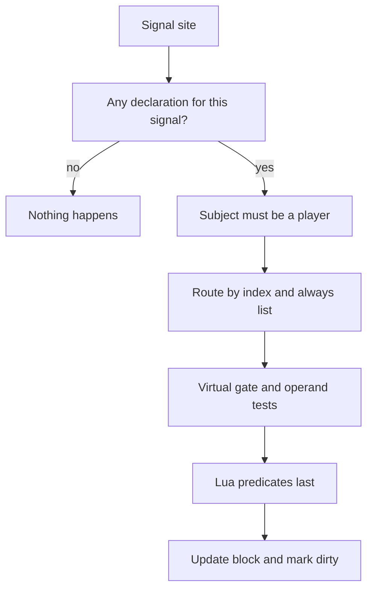

## A shared catalog of measurements

Player metrics give per-character measurements shared names. In the Metin2 mainline engine, separate counters need separate storage and read paths. Here a declaration defines how a metric is collected, and a catalog holds the declarations. A consumer can read a value or subscribe to changes without giving the counting machinery its own vocabulary.

## Glossary

| Term | Meaning |
| --- | --- |
| Declaration | A named metric's source, aggregation, and options. |
| Catalog | The collection of declarations. |
| Seeded | The metric was ever written for this character. |
| Block | The per-character record of metric values. |
| Dirty queue | The queue of characters with unpublished changes. |
| Heartbeat | The periodic game-core tick. |
| Sweep | The pass that drains the dirty queue each heartbeat and publishes the change event. |
| Virtual session | A session described in [player virtualization](/docs/core/player-virtualization/overview). |
| Predicate | A Lua function named in `where.predicate` that is called last. |
| Signal | A native event with operands that can feed metrics. |
| Push | A call that supplies a value or key to a metric. |
| Consumer | Code that reads metrics or subscribes to changes. |

## Declarations fix the meaning of a name

The engine reads and validates `metrics.yaml` at boot. Forges load first and register predicates in the global `METRIC_PREDICATES` table, so the validator can resolve them. A refused file declaration fails boot rather than leaving a partially loaded catalog that counts incorrectly.

These declarations show the difference between filtering a signal and supplying keys through custom pushes:

```yaml
metrics:
  kill.stone: { from: kill, where: { type: [STONE] }, agg: count }
  region.visited: { from: custom, agg: distinct, domain: { kind: map, max_keys: 256 } }
```

A metric stores a scalar or a set of integer keys. Aggregations retain counts, sums, extremes, or distinct membership; they provide no reset operation. The seeded state distinguishes an unwritten value from a written zero, which matters for a minimum. A bad push cannot be undone through the metrics API.

The YAML and Lua declaration paths share a validator. Custom metrics can be pushed from either C++ or Lua; signals come only from C++. Predicates and every consumer are Lua. Moving a custom push between languages does not change the metric's declaration. The [declaration reference](/docs/core/player-metrics/declare) and [API](/docs/core/player-metrics/api) cover the available fields and calls.

## Native registrations

The native sites provide signals and direct pushes. A signal lets several declarations filter the same event; a push names the custom metric directly.

| Registration | Native site |
| --- | --- |
| `kill` | A qualifying death. |
| `damage` | A qualifying hit. |
| `skill` | A skill use. |
| `item_use` | A successful item use. |
| Three push sites | Currency handling pushes peak balances. |
| One push site | A crafting site records an attempt. |
| One push site | A catch counter records a catch. |
| One push site | A pair-forming site records a pair. |

The kill signal follows the reward path for non-player targets, so its exclusions affect the resulting counts. The damage signal excludes targets such as fixed training dummies. Quest items do not emit `item_use`. The [signal reference](/docs/core/player-metrics/declare#native-signals) describes their operands.

## The hot path

The route eliminates work before entering Lua; the diagram follows a signal from its native site to a changed block.



A signal mask skips dispatch when no declaration uses that signal. An inverted index routes indexed operands to matching declarations, alongside a list that always runs. Integer tests precede predicates, avoiding Lua calls for events already rejected by a filter. A predicate error is a non-match; after 16 errors that predicate is disabled for the process.

Only `damage` supplies a measured signal value. Other signals supply one. A custom push supplies its own delta, so its `sum` and `count` both add that delta.

## Persistence

The manager owns blocks by player ID, not by character pointer. Each block tracks values, seeded state, changes to publish, and changes to persist. Publication and saving are independent. Saving sends changed values and newly added distinct keys; loading restores rows without marking them dirty.

Dense IDs index the in-memory arrays, but the persistent key is the metric name. Renaming a declaration leaves its old rows under the old name. Undeclared rows are logged and ignored on load, while remaining in storage. A new metric has no automatic backfill, so an unwritten value reads zero. Blocks live on one game core; database rows provide persistent storage.

## The change event

A changed value marks its block dirty and queues the character once. Each sweep drains characters in order up to a budget and publishes one synchronous `ON_METRICS_CHANGED` batch containing player IDs and changed metric names. A consumer subscribes to `ON_METRICS_CHANGED` and re-evaluates only what the batch touched; its own config naming an undeclared metric is that consumer's error, not the core's.

The sweep clears the queued flag and dirty bits before publishing. A consumer can push during the synchronous event, so clearing afterward would erase the new change and prevent it from being queued correctly. Disconnect and `flush` publish pending changes for a character; the event does not replay offline changes. The [event reference](/docs/core/player-metrics/api#change-event) describes the payload and queue limits.

## Virtual sessions

Signals observe the character as it is during a virtual session. Counting those events as ordinary lifetime measurements would retain values produced under the session's temporary conditions. The default gate therefore refuses virtual subjects.

Only a custom metric can opt in with `allow_virtual: true`. Use it when the value describes the virtual episode itself and the code that owns the episode makes the push. A refused virtual push returns `false` without a log.

## Traps, by cause

- A metric declared after boot returns `false` from `add` and `add_key` for characters already online, with no log, because their block was sized at boot. See [declaration order](/docs/core/player-metrics/declare#declaration-order).
- Prefer `metrics.yaml`. Lua `declare` is safe only from a forge at load, before the engine reads that file, and only for a name absent from it. A name in both is a duplicate and fails boot.
- `get` returns zero for an unknown name as well as an unwritten value. Use `declared` to validate names and `is_seeded` to distinguish an unwritten value.
- A predicate must not mutate state. Errors disable it after 16 failures, leaving its metric unable to match it.
- A distinct set at `max_keys` drops further keys and logs the refusal. Size the domain for the expected keys.
- The dirty queue has a finite capacity. If it fills, the engine logs the dropped character; another change is needed to enqueue that character again.
