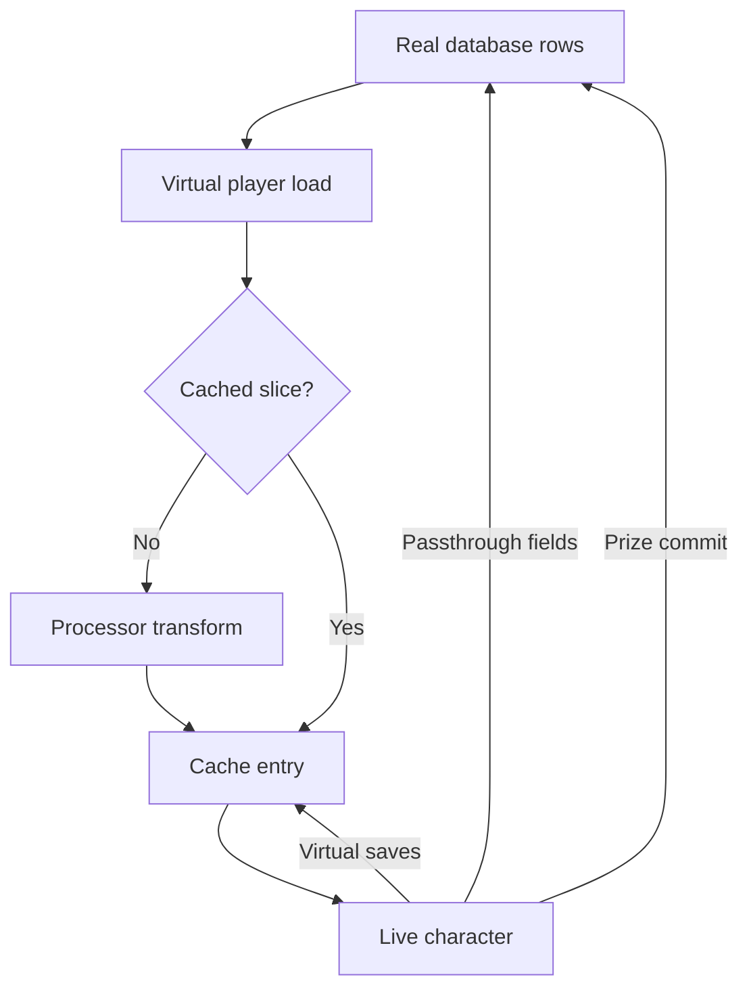
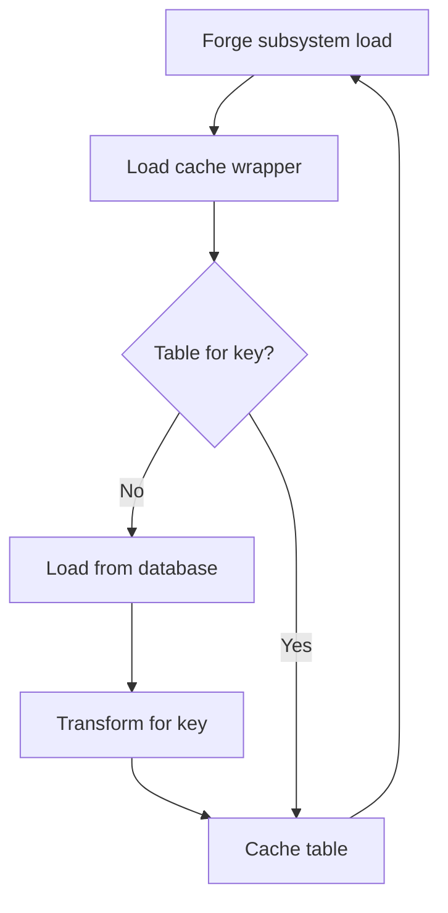

## A temporary character on a map

In the Metin2 mainline engine, a character loads from persistent rows and normal saves write its state back. Player virtualization lets you change a character for a mode without writing that temporary progression over the real rows.

A **processor** is a set of hooks registered for a map index that transforms loaded data. A **virtual session** is a character's session on a map with a processor. A **prize commit** is an explicit write of a selected result to real data; a small set of fields also stays real throughout the session. Start with the [overview](/docs/core/player-virtualization/overview) for setup.

## A processor on a map index

The load path checks the exact map index for a processor. A private map has its own index, so register its processor before a player loads there. A **cache entry** holds the virtual state for one player and map index in memory. A **slice** is a portion of that state, such as items or quest flags.

On the first load of a slice, the processor can transform the real input and the result is cached. On a cache hit, the stored state is restored without another transform. Reconnecting to the same map while the entry lives resumes that state. The real player row is also retained for fields that must remain real.

The diagram follows the load and save paths across the cache boundary; the prize commit is a separate explicit write.

The entry hook runs when the client reaches the game phase; the exit hook runs on disconnect before the save chain. Entry runs again on reconnect, so one-time grants need the hook's fresh-hydration signal. Destroying a private map clears its cache; explicit clearing and a core restart also clear entries. A base map keeps its entries until explicitly cleared or the core restarts. Unregistering a processor does not end active sessions, which retain their reference to it.

## What stays in memory

The bulk player load carries the player table, items, quest flags, affects, and skill trees. Their virtual changes go to the cache. The quest data has separate character and account slices; the quest hook runs once for each slice per cache entry.

On save, the engine copies live virtual state into the cache. It builds the database player row from the retained real row and copies only the **passthrough** fields from the live character. Passthrough means keeping data unchanged across a boundary; here those fields continue to follow the real character. The other slices have their own save redirections. There is no save transform: a processor shapes the input on load, and later saves preserve the resulting session state.

## Custom transformers: data that is not in the player load

A processor cannot transform data the bulk load never hands it. A pet is loaded lazily at summon, per pet vnum, through a native C++ load hook. A **forge subsystem** is a Forge module that owns its own state and database table; it loads through a key-routed wrapper instead of the bulk player load.

For a forge subsystem, `with_load_cache` calls `transform_forge_load` on a cache miss. A C++ processor can route a key to a handler with `RegisterForgeLoadHandler`. The cache holds a pet record per vnum and a forge table per key. Pet saves and forge saves through `with_save_cache` are redirected to the cache, with no save transform. A subsystem can instead opt out by skipping its load and save when the character is virtual; the battle pass does this. The shipped cached Forge instances are character titles and a hunting progression subsystem.

The wrapper path shows why a subsystem's own storage still needs a door into the cache.

See [custom transformers](/docs/core/player-virtualization/custom-transformers) for the wrappers and load hooks, and [Forge setup](/docs/core/luna-forge/setup) for the runtime.

## The boundary contract

The **fixed overlay** is the set of real player fields copied over the transformed player table on load. On save, those fields are copied from the live character onto the retained real row. They include position, exit location, play time, inventory lock and password, and UI settings. A processor cannot override this boundary. Other player fields, including balances, can remain virtual.

A **stash** holds items committed for delivery on a later non-virtual load. Stash rows are removed from virtual item loads. Safebox loads are refused and its saves are dropped. The reward enabler remains available and grants its drop and PvP affects; the corresponding eligibility commands are refused. The client shows the `VIRTUAL_SESSION_BLOCKED` popup for blocked client features.

Isolation also needs gates at integrations with shared or external state. Quest dispatch can be restricted by configuration. Metrics are dropped by default, though a custom metric can opt in; the code that owns the episode must push it. Logs mark virtual activity, and rankings read the real character. See [player metrics](/docs/core/player-metrics/declare) and the [overview](/docs/core/player-virtualization/overview) for the boundary details.

## The transformers

Each processor hook receives a slice and can keep, filter, or replace its contents. A missing hook uses passthrough. The fixed overlay still applies after the player transform. Processors compose through Lua inheritance.

| Slice | Load hook |
| --- | --- |
| Player table | `transform_player_load` |
| Items | `transform_item_load` |
| Character and account quest flags | `transform_quest_load` |
| Affects | `transform_affect_load` |
| Skill trees | `transform_skill_tree_load` |

A C++ processor can override the same hooks; Lua processors use an adapter. There is one registration slot per map index, and replacement is refused while sessions are active. See [hooks and records](/docs/core/player-virtualization/hooks) for signatures and return rules.

## The prize commit is a narrow path back

Writing a whole virtual slice to the real character would also persist temporary levels, items, and flags. A prize commit writes only a selected quest flag, account flag, or item. Items go to the stash for delivery on the next non-virtual item load. The commit is not a merge of the session state.

A flag commit writes to the database rather than the live session copy. If the session must read the new value, it must update its own copy too. Commits are unacknowledged: a closed database connection can lose the write. See [prize commit](/docs/core/player-virtualization/prize-commit) for ownership and delivery rules.

## Traps, by cause

- **A failed hook can admit real data.** The adapter falls back to passthrough and caches the input. Check errors and test the boundary of each transform.
- **Registration after load is too late.** Virtuality is decided at load, so register the exact map index before players enter.
- **Clearing a live cache breaks its lifetime assumption.** Clear entries after the affected players leave; unregistering alone does not disconnect them.
- **A new external store needs its own gate or redirection.** The cache only isolates integrations that participate in it.

See [examples and pitfalls](/docs/core/player-virtualization/examples) for recipes and failure cases.

## Glossary

- **Processor:** hooks registered for a map index that shape virtual loads.
- **Virtual session:** a character's session on a map with a processor.
- **Slice:** a portion of character data handled as a unit.
- **Cache entry:** the in-memory virtual state for one player and map index.
- **Passthrough:** keeping data unchanged across a boundary.
- **Fixed overlay:** real fields copied over the transformed player table on load.
- **Stash:** storage for committed items awaiting a non-virtual load.
- **Prize commit:** an explicit write of a selected result to real data.
- **Forge subsystem:** a Forge module that owns state and its database storage.
