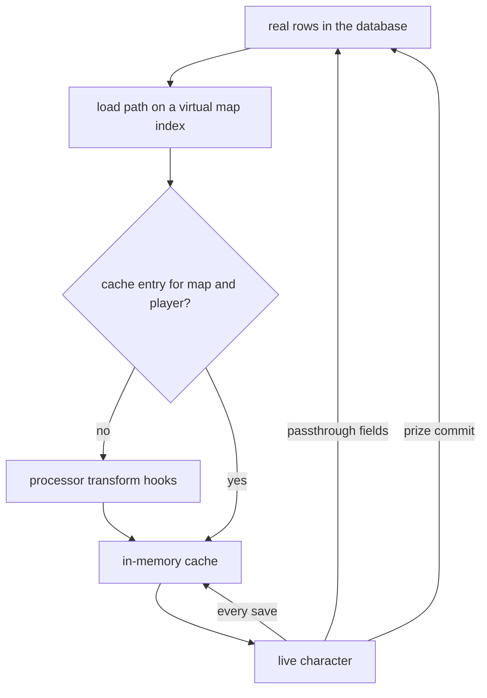

## A temporary character on a map

In the Metin2 mainline engine, the live character loads from persistent rows and normal saves write its state back. Player virtualization lets you play with a temporary character state without writing its progression over those rows. You register a processor on a map index; a character loading there plays on an in-memory copy. Explicit prize commits return selected rewards to real state, while a small set of fields remains real throughout the session.

## A processor on a map index

Virtuality is one question, asked by the load path: is a processor registered on this exact map index?

```cpp
bool CPlayerVirtualManager::IsVirtualMapIndex(int32_t mapIndex)
{
    return m_processors.find(mapIndex) != m_processors.end();
}
```

The key is exact. A processor on a base map does not apply to its private copies, and a private map index (10000 and above) is a key of its own. An arena that creates a private map registers the processor on the new index before it warps anyone in.

When the database core answers a player load and the map is virtual, the engine binds the processor and a cache entry to the character before anything else is built. The cache is keyed by map index and player id, and lives in memory only. Then:

- **Cache miss.** The entry is seeded. Each load of a slice (player table, items, quest flags, account flags, affects, skill trees) calls the matching `transform_*` hook of the processor once, and the transformed result is stored.
- **Cache hit.** The stored state is restored and the hooks do not run. A player who crashes and reconnects to the same map index while the cache lives resumes the virtual state, not a fresh one.

The real player row is kept next to the cache on every load, because a few fields must always stay real (next section).

The first look at the whole path is this diagram. Read it from the top: the database feeds the load path, the cache feeds the character, and only two arrows go back to the database.



The enter and exit hooks wrap the session. `on_player_enter` fires when the client has reached the game phase, not at load time, because at load the client is still on the character select screen. Once it has fired, the client is told it is in a virtual session. `on_player_exit` fires on disconnect, before the save chain, so the processor sees the final live state and may commit a prize.

The cache is cleared when the private map is destroyed, by the `clear` function, or when the core restarts. A processor on a base map is never destroyed by the engine, so its cache entries stay until `clear` or a restart. Unregistering a processor does not end running sessions: each character holds its processor through its own reference. A player still mid-login when the private map is destroyed is disconnected.

## What stays in memory

Everything a processor can transform, and everything the live character changes afterward, goes to the cache and not to the rows: level, experience, gold, HP and SP, stats, skills, quickslots, equipment parts, currencies (guild coin, raid prism, master hunt coin), the master hunt rank, items with their inline flags, character and account quest flags, affects, skill trees, pets, and the tables of forge subsystems such as the character titles and the master hunt.

The save path does not call the processor. When the character saves, the engine copies the live state verbatim into the cache, builds a row for the database from the real row captured at load, overlays only the passthrough fields, and sends that. Items, quest flags, account flags, affects, skill trees and pets each have the same redirection at their own save site: in a virtual session they write to the cache, not to the database. There are no save transforms. Filtering belongs at load time, on the cache miss.

## The boundary contract

### Always real

Some fields are never virtual. They are copied from the live character onto the real row on every save, and from the real row into the cache on every load, and no processor can override either direction:

```cpp
inline void ApplyVirtualPassthroughFields(TPlayerTable& dst, const TPlayerTable& live)
{
    dst.x             = live.x;
    dst.y             = live.y;
    dst.z             = live.z;
    dst.lMapIndex     = live.lMapIndex;
    dst.lExitX        = live.lExitX;
    dst.lExitY        = live.lExitY;
    dst.lExitMapIndex = live.lExitMapIndex;
    dst.playtime      = live.playtime;

    // player_new passthrough subset
    dst.player_new.bInventoryStatus = live.player_new.bInventoryStatus;
    memcpy(dst.player_new.szInventoryPsw, live.player_new.szInventoryPsw, sizeof(dst.player_new.szInventoryPsw));
    memcpy(dst.player_new.jSettings,      live.player_new.jSettings,      sizeof(dst.player_new.jSettings));
}
```

Position, the exit location, play time, the inventory lock and its password, and the UI settings. Position and exit location are what let a player walk out of the arena and find themselves where they entered. The currencies are not on this list: they are virtual, so a processor can hand a player test funds without touching the real balance.

### Dropped or refused

- The safebox: its save is dropped for a virtual player, and its load is refused.
- STASH rows, the window the prize commit writes to, are stripped from every virtual item load.
- Battle pass: never loaded and never saved for a virtual player.
- Guild skill sync is skipped.
- The offline shop and the biologist manager are refused on the server, and the drop-eligibility and PvP-arena-eligibility commands too, because their state is shared and a per-player cache cannot represent it. The client greys the same features and shows "Function not available while you use an Avatar."
- The reward enabler gives a virtual session the drop and arena affects it needs and does not touch maps or flags.
- Achievements may measure and may record in a virtual session, but a claim is refused. A virtual session may not hand anything over.
- Quests: a quest listed in the quest category configuration with a third column of `0` does not trigger in a virtual session. Not listed means allowed. Every listed row has `0` in that column, so every listed quest is dormant there. The gate covers login, kill, click, timer, item and custom events. It does not cover the NPC `chat` menus, so a listed quest's chat option can still appear.
- Metrics: dropped for a virtual player unless the metric declares `allow_virtual`. Four do: `arena.win`, `arena.entered`, `arena.win.nodeath` and `arena.mayhem.played`, because the referee owns the episode and is the only thing that knows the match was real. Signals cannot opt in.
- Logs are marked virtual, not dropped. Rankings read the real character.

### Writes outside the virtual cache

The prize commit is the only explicit path for virtual rewards and progression to reach the real character. The passthrough fields are saved separately on every save. Content can also write to stores keyed by player id outside the character rows: opted-in metrics, rankings and logs.

## The transformers

A processor is a table of optional hooks. Each hook receives the character and the slice as it was loaded from the real rows, and returns what the virtual session should see. A hook that is missing is passthrough.

```lua
---@field transform_player_load? fun(self, ch: LPCHARACTER, player: TPlayerTable): TPlayerTable?
---@field transform_item_load? fun(self, ch: LPCHARACTER, items: TPlayerItemEx[]): TPlayerItemEx[]?
---@field transform_quest_load? fun(self, ch: LPCHARACTER, quests: TQuestTable[], is_account: boolean): TQuestTable[]?
---@field transform_affect_load? fun(self, ch: LPCHARACTER, affects: TPacketAffectElement[]): TPacketAffectElement[]?
---@field transform_skill_tree_load? fun(self, ch: LPCHARACTER, trees: TPlayerSkillTree[]): TPlayerSkillTree[]?
---@field transform_pet_load? fun(self, ch: LPCHARACTER, pet: TPetPlayerTable): TPetPlayerTable?
---@field transform_forge_load? fun(self, ch: LPCHARACTER, key: string, data: table): table?
---@field on_player_enter? fun(self, ch: LPCHARACTER, fresh_hydrate: boolean)
---@field on_player_exit? fun(self, ch: LPCHARACTER)
```

| Slice | Hook | Back to real |
| --- | --- | --- |
| Player table: level, stats, HP and SP, job, skill group, skills, quickslots, parts, gold, currencies | `transform_player_load`, then the passthrough overlay | passthrough fields only |
| Items, with their inline flags | `transform_item_load` | `commit_stash_item` |
| Quest flags, character and account | `transform_quest_load`, called twice: `is_account` false, then true | `commit_quest_flag`, `commit_account_flag` |
| Affects | `transform_affect_load` | none |
| Skill trees | `transform_skill_tree_load` | none |
| Pets | `transform_pet_load`, once per pet vnum, on the first summon | none |
| Forge subsystem state | `transform_forge_load(key)`, through `with_load_cache` | none; `with_save_cache` caches verbatim |
| Entry grants: skills, blessing, collect affects, items, a pet, the builder | `on_player_enter(fresh)`, additive | none |
| Last mile | `on_player_exit` | may commit |

Each load transformer runs once per cached slice, on its first load. `on_player_enter` runs on every entry, with `fresh` true only the first time, so grants go behind `if not fresh then return end`. Every shipped processor does this. A reconnect without the guard grants twice.

Because every hook sees the whole slice and returns the whole slice, "some items pass, some stats pass" needs no extra mechanism. Filter the array, or leave fields alone. What passes in the shipped modes is small: the identity fields the base processor leaves alone (race, gender, job, skill group), the real pet record levelled up, and, in the guild war mode, the two flags that cap how many coins a member can still earn. No shipped mode lets a real item through. That path is a capability with no user.

The adapter calls hooks with the table first, so define them as `function p:hook(ch, ...)`. For the vector hooks it keeps only the returned entries that are the engine's own record types. A plain Lua table, `{ name = "x", state = "y", value = 1 }`, returned from `transform_quest_load` is silently dropped and the player gets zero quests. Build entries with the record constructors, or filter the input you were given.

### Processor composition

The avatar draft, Mayhem, solo tour, Mystery Hero, Ball-Em-Up, avatar guild war and avatar training ground use processors composed through Lua inheritance. The battle royale uses a separate processor.

## The prize commit is the only road back

The cache is a whole-slice snapshot. Writing a slice back at session end would write level 120 and free gear over the real row, which is what the primitive exists to prevent. So the return path is narrow: a single value that content decides to give at the moment it is earned. It is not a merge. The engine's own header calls it flag-only by design: a real-player flag is the hook that downstream systems use for item awards and progression.

There are three commits, in C++ and in Lua:

| Commit | Writes | Seen by the real character |
| --- | --- | --- |
| `commit_quest_flag(ch, key, value)` | one quest flag, key `name.state` split on the first dot | on the next real load |
| `commit_account_flag(ch, key, value)` | one account-scoped flag; needs a descriptor | on the next real load of any character of the account |
| `commit_stash_item(ch, item, why)` | one item, written to the STASH window of the real character | delivered on the next real login |

The name and the state of a flag must each be under 64 characters, or the commit is dropped with a logged error. A stash commit refuses an item with no id and an item that already belongs to an owner, and returns 0. On success it consumes the item: one save packet with the item id kept, a `STASH_COMMIT` log entry, and the item destroyed without a destroy packet. The Lua handle dangles afterward.

Currency goes as an item. The guild coin is item vnum 5. A virtual change of the guild coin would only mutate the virtual balance, so the arena awards it by staging a vnum 5 item and committing it. The first real item load converts it to the balance.

### Delivery

STASH rows are never handed to a virtual session. The next time the same player loads onto a non-virtual map, after the real inventory is placed, each STASH item goes through the ordinary give-item path (stacking, a free cell, currency shortcuts, ground fallback) and a `STASH_DELIVER` log entry. The player is notified once the client reaches the game phase. The item id is the same from commit to inventory.

The guarantees are the ones a fire-and-forget write has:

- Each commit is one packet to the database core. There is no acknowledgment, no sequence number, and no wait at logout.
- The database core does not report the result of a flag write, and the packet is dropped if the link to the database core is closed at that moment.
- The flag goes straight to the database, not to the live quest state, so the running session still reads the old value. A session that has to see its own commit also sets the session copy with `set_quest_flag`, as the native rate limiter does.
- A plain `set_quest_flag` in a virtual session is not a commit: it lands in the cache and is discarded with it.

Shipped call sites: the avatar draft and the avatar guild war pay guild coins as stash items, Ball-Em-Up pays out the same way, the battle royale commits its rewards, the arena resets the desertion count and sets its pending flags for the battle pass and the weekly event, and the tour commits completed and skipped. Native code commits through it too: every write of the rate limiter, and the GM command `/stash_item <vnum> [count]`.

A short example written for the page puts the pieces together. It builds a private copy of a map, installs a processor that starts the player empty-handed at level 120, pays one prize, and closes the room:

```lua
local PV = forge.sys.game.player_virtual
local SM = forge.sys.game.sectree_manager

local practice = {}

function practice:transform_player_load(ch, player)
    player.level = 120
    player.exp = 0
    player.gold = 0
    return player
end

function practice:transform_item_load(ch, items)
    return {}
end

function practice:transform_quest_load(ch, quests, is_account)
    return {}
end

local function open_room(base_map_index)
    local map_index = SM.create_private_map(base_map_index)
    if map_index == 0 then return 0 end
    if not PV.set_processor(map_index, practice) then
        SM.destroy_private_map(map_index)
        return 0
    end
    return map_index
end

local function pay_prize(ch)
    PV.commit_quest_flag(ch, "practice_room.done", 1)
    local item = forge.sys.game.item_manager.create_item(5, 100)
    if item then
        PV.commit_stash_item(ch, item, "practice_room")
    end
end

local function close_room(map_index)
    PV.unset_processor(map_index)
    SM.destroy_private_map(map_index)
end
```

## Both doors: C++ and Lua

Registration is one function in the manager. Re-registering a map that has active sessions is refused, so a running match cannot have its rules swapped under it:

```cpp
bool CPlayerVirtualManager::RegisterProcessor(int32_t mapIndex, std::shared_ptr<IPlayerVirtualProcessor> p)
{
    if (!p)
    {
        sys_err("CPlayerVirtualManager::RegisterProcessor null processor for mapindex {}", mapIndex);
        return false;
    }

    auto it = m_processors.find(mapIndex);
    if (it != m_processors.end() && HasActiveSessions(mapIndex))
    {
        sys_err("CPlayerVirtualManager::RegisterProcessor mapindex {} has active sessions; refusing re-registration", mapIndex);
        return false;
    }

    m_processors[mapIndex] = std::move(p);
    sys_log(0, "CPlayerVirtualManager::RegisterProcessor mapindex {}", mapIndex);
    return true;
}
```

**C++.** A processor is a subclass of the processor interface. Every method has a passthrough default, so a subclass overrides only the hooks it cares about, and a hook added later does not break a subclass that was written before it. `MarkVirtual(mapIndex)` registers the built-in passthrough processor if the map has none, and never overrides one that exists: it makes a map virtual with no transformation. For forge subsystem state, a C++ subclass registers a load handler per key, which the default forge hook dispatches to:

```cpp
void RegisterForgeLoadHandler(std::string key, ForgeHandler handler)
{
    m_forgeLoadHandlers[std::move(key)] = std::move(handler);
}
```

**Lua.** The Lua door builds a C++ subclass that wraps your table and calls the same function. It pins the table for the lifetime of the registration and passes the namespace of the calling forge to the dispatch point:

```cpp
player_virtual.set_function("set_processor",
    [bridge](LUNA_FORGE_BIND_WITH_ARGS(int32_t mapIndex, sol::table processor_table)) -> bool {
        auto lua_proc = std::make_shared<PlayerVirtualLuaProcessor>(bridge, processor_table, dispatch::NsFromEnv(te));
        return CPlayerVirtualManager::instance().RegisterProcessor(mapIndex, lua_proc);
    });
```

## Native registrations

C++ processor registration is supported; no C++ processor ships. Every shipped processor is registered from Lua and runs through the adapter. Native code uses prize commits in the rate limiter and `/stash_item`, reads the real character for rankings, and cleans up private maps.

How the two coexist:

- One slot per map index. There is no layering or stacking, and the last registration on a map without sessions wins. Composition is Lua inheritance.
- C++ wins on the parts a processor cannot move: the passthrough fields, STASH stripping, the save redirections and the gates.
- A real-scope switch that makes the engine treat a character as real inside a block exists in the C++ manager, and the player check honours it. Nothing calls it and there is no Lua function for it.

The full function list and the hook signatures are on the [Player virtualization reference](/docs/core/player-virtualization).

## The gates

Every subsystem that writes real or shared state must account for virtual characters. The checks are `IsVirtual()` and `IsPlayerVirtual()` for a player id. The design costs a gate or redirection at each relevant integration point: a new subsystem that writes real state must supply its own protection.

## The Avatar Builder is a separate system

The avatar modes let a player build a character inside the session: choose gear, sockets and bonuses from an allowed list. That is the Avatar Builder, and it is not part of virtualization. Its configuration bounds what a player may build inside a session (which bonus ids, which socket ids, which races) and is validated on its own side. It does not transform anything from the real character. Virtualization provides the session the builder runs in, and the builder is one of the entry grants.

## Traps, by cause

- **A failing hook lets the real slice in.** When a hook raises an error, the adapter logs `falling back to passthrough` and uses the untransformed input, which is cached for the session. A bad item hook gives the player their real items in the arena. A non-table return from a vector hook falls back silently. Watch the error log for the line, and keep hooks small.
- **Commits are unacknowledged and invisible in the session.** Reading a flag right after committing it gives the old value. The avatar desertion count is the shipped example: the in-session read is always 0, so the count never passes 1 and the three-strike ban cannot trigger. Set the session copy as well, or pass the flag through `transform_quest_load`.
- **The battle royale's pending rewards live in the memory of the core that hosted the match.** They are lost on a restart and paid only if the player logs in on that same core.
- **Register before the warp.** Virtuality is decided at load, so a processor registered after the player loaded does nothing until the next load. Warping into the map is a reconnect.
- **Re-registration with players inside fails**, and `unset_processor` does not kick anyone. `clear` is not refused with live sessions either: the map form logs an error and clears anyway, the player form says nothing, and the characters keep pointers to a cache that is gone.
- **Base-map processors are forever.** The engine only clears private maps.
- **Pets transform once per vnum per cache**, and a re-summon reuses the cached record.
- **`set_quest_flag` in a virtual session is discarded** with the cache. Use the commit for anything that must outlive the session.
- **The character helpers that max skills or set a specialization act on the live character, ungated.** On a real character they are permanent, the same effect as `all_skill_master`.
