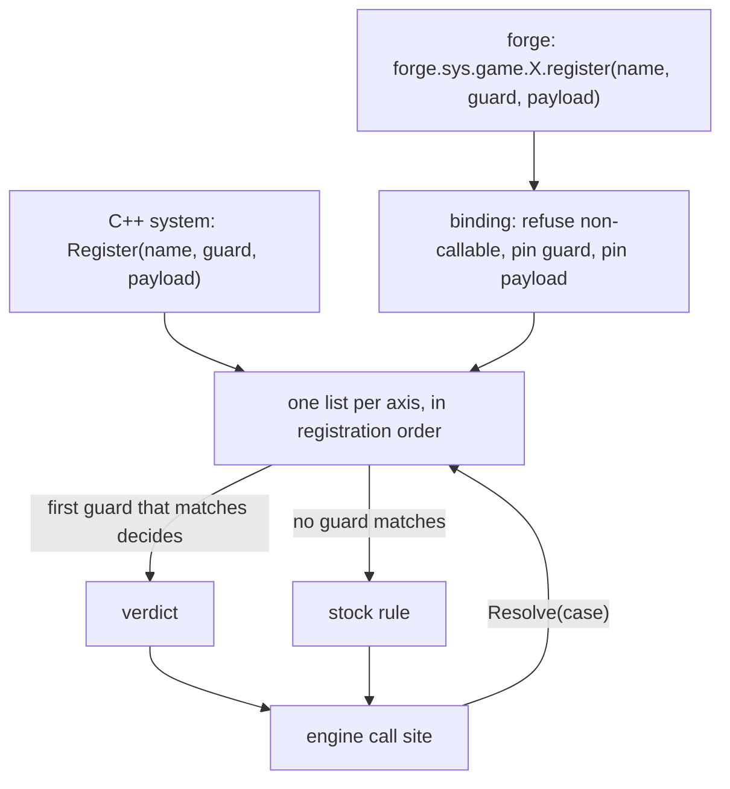
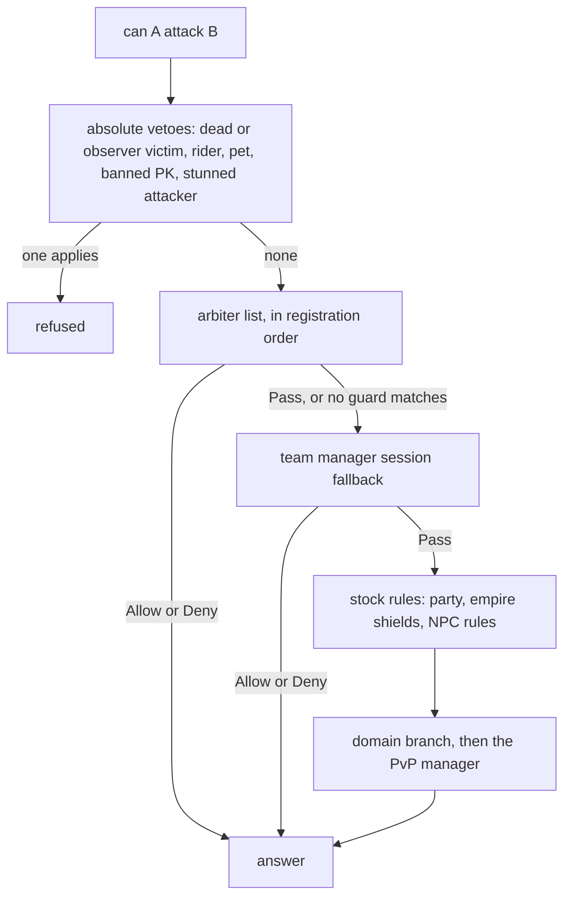

## Decisions belong to registrations

A policy lets the engine ask an ordered list of registrations for a decision. Each registration has a name, a guard, and a payload: the guard says whether the rule applies and the payload supplies its answer. When no rule answers, the engine applies the relevant default. In the Metin2 mainline engine, these decisions are branches in C++.

A mode can own its rule and remove its registration with the mode. Registration order makes the order of decisions explicit, though authors must keep guards scoped to the cases they own.

## How a decision is asked

Eight registries share this shape. Five are covered here: [battle arbiter](/docs/building-blocks/battle-arbiter), [death manager](/docs/building-blocks/death-manager), [item use policy](/docs/building-blocks/item-use-policy), [spectator](/docs/building-blocks/spectator), and [party join policy](/docs/building-blocks/party-join-policy). Three more cover skill use, skill policy, and skill loadout. The [team manager](/docs/building-blocks/team-manager) is not a registry: it holds sessions used as a fallback for attack decisions and tells the client who is on each side.

`Register(name, guard, payload)` returns a handle starting at 1; 0 means registration failed. `unregister(handle)` removes a registration and reports whether it found one. The name is for logging; duplicate names do not affect dispatch. Guards answer a boolean for the case, while payload types vary from a battle verdict to a death profile or a table of policy fields.

C++ and Lua registrations feed the same list for each axis. The engine sees that list at the call site.



The battle registry appends a registration with a handle.

```cpp
handle_t handle = m_next_handle++;
if (handle == INVALID_HANDLE) handle = m_next_handle++;   // wrap-around safety

Arbiter a;
a.name       = std::move(name);
a.handle     = handle;
a.guard      = std::move(guard);
a.can_attack = std::move(can_attack);
m_arbiters.push_back(std::move(a));
```

Resolution walks the list in order. `Pass` lets the next arbiter answer.

```cpp
BattleVerdict CBattleArbiterRegistry::Resolve(LPCHARACTER att, LPCHARACTER vic) const
{
    for (const Arbiter& a : m_arbiters) {
        if (!a.guard(att, vic)) continue;

        BattleVerdict v = a.can_attack(att, vic);
        switch (v) {
            case BattleVerdict::Allow: return BattleVerdict::Allow;
            case BattleVerdict::Deny:  return BattleVerdict::Deny;
            case BattleVerdict::Pass:  continue;   // arbiter declined this call
        }
    }
    return BattleVerdict::Pass;
}
```

Death, spectator, and party join use the first matching guard. Item use and skill use use the first deny. Each axis has its own fallback.

## C++ and Lua share one list

The registries are C++ and contain no Lua; a native registrant pays nothing for the Lua path. A shared binding projects the Lua surface: it refuses a non-callable guard, pins the guard as a predicate that fails closed, pins the payload, registers both, and binds `unregister`. The Lua table name, guard and payload arguments, verdict type, and payload error direction vary by axis.

A Forge registers a battle arbiter through the binding. Its guard scopes the rule to a map and its payload decides the attack.

```lua
local VERDICT = forge.sys.game.battle_arbiter_registry.BATTLE_VERDICT
eve_classic.battle_handle = forge.sys.game.battle_arbiter_registry.register(
    "eve:" .. id,
    function(att, vic) return att:get_map_index() == map_index and vic:get_map_index() == map_index end,
    function(att, vic)
        if not forge.game.ue_eve_manager:is_engaged(id) then return VERDICT.Deny end
        if att:is_pc() and vic:is_pc() and att:get_empire() ~= vic:get_empire() then
            return VERDICT.Allow
        end
        return VERDICT.Deny
    end)
```

C++ registers directly. Land deployment retries registration until it holds a handle, since its constructor can run before the registry exists.

```cpp
void CDeploymentManager::__RegisterArbiter()
{
    if (m_hArbiter || !CBattleArbiterRegistry::instance_ptr())
        return;

    m_hArbiter = CBattleArbiterRegistry::instance().Register("land_deployment",
        [](LPCHARACTER pkAtt, LPCHARACTER pkVic) -> bool {
            return (pkAtt && pkAtt->IsGuildPresence()) ||
                (pkVic && pkVic->IsGuildPresence());
        },
        [](LPCHARACTER pkAtt, LPCHARACTER pkVic) -> BattleVerdict {
            return CDeploymentManager::instance().ResolveAttack(pkAtt, pkVic);
        });
}
```

The domain registers a death profile with a guard for its experience zone.

```cpp
m_death_handle = CDeathManager::instance().Register(
    "domain_exp_zone",
    [](CHARACTER* ch) {
        return CDomainManager::instance().GetDomainByCoords(
            ch, DOMAIN_TYPE_EXP_ZONE, DOMAIN_STATUS_FIGHTING) != nullptr;
    },
    GetProfile_DomainExpZone());
```

## Native registrations

| Axis | Native registrant | Registration lifetime |
| --- | --- | --- |
| Death | `domain_exp_zone`, `domain_boss_zone` | Domain constructor, before Forges load |
| Death | `raid` | Database boot, after Forges; guarded against duplicate registration |
| Battle | `land_deployment` | Constructor, before Forges; retried from entry points until a handle exists |
| Spectator | `pvp_arena`, `guild_war`, `wedding` | Per instance; unregistered when the instance is destroyed |
| Item use, party join | None | C++ registration is available; shipped registrations are Lua |
| Skills | None | The simulator registers a skill policy for tests |

Item use exposes `RegisterItemUse` and `RegisterPotion`; party join exposes `Register`. The battle royale Forge registers battle, death, item use, spectator, and party join rules as well as an activity lock.

## Registration order and guard scope

Each registry appends to one vector, without a priority or origin field. C++ and Lua registrations resolve in registration order. Domain death profiles precede Lua profiles; a matching Forge death profile precedes `raid`. Land deployment precedes Lua arbiters: its guard claims any pair with a guild presence on either side and its verdict never passes. EvE, guild war, and match arbiters register when their modes start, in that order of occurrence.

Correctness depends on guards covering the intended cases. Native guards scope to an instance or map predicate, and shipped Lua guards to their own map or match. Nothing detects overlap or reports which registration answered. Spectator and party join accept a C++ registration without a guard, which matches every case; a guardless spectator rule captures every viewer. Battle and death refuse a null guard, and Lua requires one. Scope a map rule's guard to that map.

A single list avoids a separate priority to maintain, at the cost of making guard scope and registration order significant.

## Lua failure directions

A Lua guard that errors returns false, so the registration does not vote. Payload errors use the verdict's seeded default without decoding a result.

```cpp
return [call = std::move(call)](Args... args) -> typename AxisT::Verdict {
    typename AxisT::Verdict v;
    AxisT::Seed(v, args...);
    if (std::optional<sol::table> t = call(args...))
        AxisT::Decode(v, *t, args...);
    return v;
};
```

| Axis | Lua payload error or missing field |
| --- | --- |
| Battle | `Pass`, so a broken event script cannot deadlock combat |
| Item use and potion | Allowed |
| Party join | Stock rules |
| Spectator | Refused |
| Skill use | Allowed |
| Skill loadout | No plan |
| Death | Profile validated at registration, rather than at death |

A C++ payload returns a verdict and has no Lua error path. Item use fails open: `{}` decodes to allowed. An allowlist that returns `{}` for other items denies nothing. The battle royale item rule has this shape; use `allowed = false` to deny an item.

## Who may attack

Absolute vetoes precede the arbiter. If the registry passes, the team manager's session decision runs, followed by stock rules. A mode can allow party mates to fight while normal play retains the party refusal. The damage path reads the same registry, and the attack query does not set the killer-mode flag.

The attack path asks the registry and the session fallback before the stock party rule.

```cpp
switch (CBattleArbiterRegistry::instance().Resolve(ch, victim)) {
    case BattleVerdict::Allow: return true;
    case BattleVerdict::Deny:  return false;
    case BattleVerdict::Pass:  break;
}

// Session-level fallback — short-circuits to Pass for non-session pairs.
switch (CPvPTeamManager::instance().CanAttack(ch, victim)) {
    case BattleVerdict::Allow: return true;
    case BattleVerdict::Deny:  return false;
    case BattleVerdict::Pass:  break;
}

// --- Default PvP rules (party / guild / empire) ---
if (ch->GetParty() && ch->GetParty() == victim->GetParty())
    return false;
```



The domain attack branch remains after the stock rules and outside the arbiter. The absolute refusals cannot be overridden: a dead or observer victim, a rider or pet, banned PK, and an attacker who is stunned, dead, or observing.

## How a death resolves

A death profile supplies timers and callbacks. The timer is counted from death, giving the client countdown and server restart gate one source. The first matching registration supplies the profile; otherwise auto-hunt revive and normal form the default tiers.

```cpp
DeathProfile ResolveBaseProfile(CHARACTER* ch)
{
    if (auto profile = CDeathManager::instance().Resolve(ch))
        return *profile;

    // Default tier: auto-hunt revive when no zone claimed the death, else Normal.
    if (ch->FindAffect(AFFECT_AUTO_HUNT_ACTIVE))
        return GetProfile_AutoHunt();

    return GetProfile_Normal();
}
```

The hack flag floors the restart cooldown to protect against an exploit path; war maps ignore the flag. See [Death manager](/docs/building-blocks/death-manager).

## What an item may do

The item and potion registries let a mode deny use or adjust recovery. Potion `amount` chains through every matching policy. See [Item use policy](/docs/building-blocks/item-use-policy).

The policy is additive: hard-coded refusals remain for arena maps, war maps, the OX event map, maps 113 and 200, the dungeon, and vnums 27863 to 27883 in a duel when `no_duel_potion` is set. A policy gate runs before consumption and potion checks run at 8 call sites. A policy can deny but cannot lift a hard-coded refusal.

## Who may watch

The spectator manager is the single call site that sets observer mode. Arena, guild war, and wedding instances register their own rules. With no registration, the default permits GMs only. The engine's observer flag remains its truth for invisibility and immunity. See [Spectator](/docs/building-blocks/spectator).

## Who may party

Party join resolves a policy at 5 sites. A mode can lift the empire and level restrictions in its verdict, as this rule does:

```lua
return { max_members = match.team_size, same_empire = false, level_window = 0, bind_to_map = true,
    guild_group = false }
```

Stock checks still apply after policy resolution: the server switch for PC parties, dungeon, observer mode, already joined, the eight-member cap, and the team session gate. A policy refusal is checked before the dungeon, observer, level, party, and session rules, so its reason reaches the player. An arena player cannot invite or request before the policy is asked; the activity lock does not block party admission. The party finder reads only `same_empire` and `level_window`, using the stock verdict when the lobby owner is on another core. See [Party join policy](/docs/building-blocks/party-join-policy).

## Decisions that remain in the engine

Skill use policies run alongside config limiters on every path that would allow use. The limiters can forbid but cannot permit.

`CanWarp` checks the safebox, an open exchange, a shop, refine timers, open windows, and a pending warp. Lua can read its answer but cannot change it.
