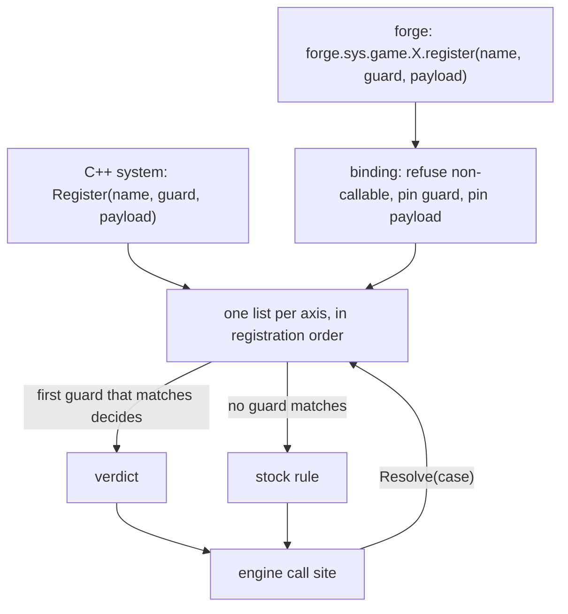
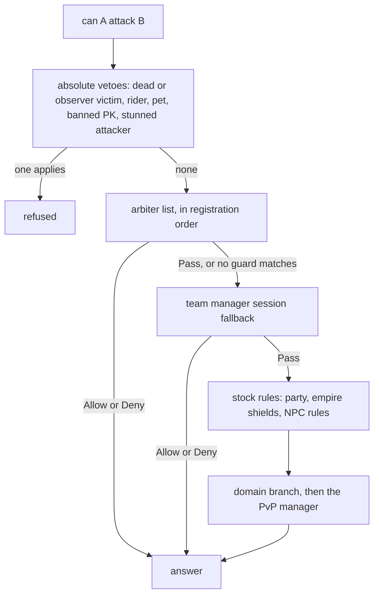

## The limit: every mode added a branch somewhere in the answer

The inherited engine answered "may A attack B?" with a function that every game mode had to edit. An arena, a guild war, a map with its own rules: each one added an `if` at whatever position the developer had in mind that day. The same happened to the death timer, to item use, to who may enter observer mode, and to who may join a party. A decision was literals spread over several functions and files, and a new mode meant a patch to the engine.

A policy closes that limit. The engine still asks the question, but it no longer answers it alone. It asks an ordered list of registrations, each one a name, a guard and a payload. The guard says whether the registration applies to this case. The payload says what it decides. If nothing matches, the stock rule holds.

The result is what I wanted from it:

- Easier: a new mode registers its own rule and touches no engine function.
- More readable: the rule of a mode sits in one place, next to the mode.
- More modular: removing a mode removes its registration and nothing else.
- Less undefined behavior: the position of a rule in the chain is registration order, not wherever the `if` landed.
- Less sibling breakage: a mode cannot regress another mode by editing a shared function, because there is no shared function to edit.

That last point is the one that hurt. My typical bug was a new subsystem breaking an older one, and I forgot pieces around when I retired a subsystem. Any event rule written into the shared attack path, a Christmas rule for example, risked breaking normal gameplay because the code path was free for all.

The arena was the first client of the battle registry. It was not the reason for it. The reason was the shape of the engine functions above.

## One shape on every axis

Eight registries share the shape. Five are the subject of this page, and each has a reference page. The team manager has one too, because it feeds the battle decision:

- [Battle arbiter](/docs/building-blocks/battle-arbiter): may A attack B, and the same list answers damage and buffs.
- [Team manager](/docs/building-blocks/team-manager): not a registry. It holds the sessions that the attack decision falls back to when no arbiter answers, and it tells the client who is on which side.
- [Death manager](/docs/building-blocks/death-manager): the timers and callbacks of a death.
- [Item use policy](/docs/building-blocks/item-use-policy): may this item be used, and how much does a potion recover.
- [Spectator](/docs/building-blocks/spectator): who may watch whom, with what targets.
- [Party join policy](/docs/building-blocks/party-join-policy): who may join whose party and under which limits.

Three more belong to skills: skill use, skill policy and skill loadout.

Every registry exposes the same four things.

- `Register(name, guard, payload)` returns a handle. Handles start at 1, and 0 means the registration failed.
- The guard answers a boolean for the case at hand: the attacker and victim, the dead character, the viewer and target, the leader and guest.
- The payload answers the decision. Its type differs per axis: a three-state verdict for battle, a profile for death, a table with `allowed` and friends for the others.
- `unregister(handle)` removes it and returns whether it found it.

The `name` is for the log. Duplicates are allowed and change nothing about dispatch.

The registries below are plain C++ and include no Lua at all. A registrant written in C++ pays nothing for the Lua path. The Lua surface is projected by one shared binding header, and it does the same five steps for every axis: refuse a non-callable, pin the guard as a predicate that fails closed, pin the payload, hand both to the registry, and bind an identical `unregister`. Only five facts differ per axis: the Lua table name, the arguments of the guard, the arguments of the payload, the verdict type, and which way the payload degrades on a Lua error. Binding the six axes through that header in August 2026 found a bug that six private copies had hidden: a non-callable guard was accepted at register time, because the Lua wrapper reports any non-nil value as valid. The same change found that a fully denied potion was reported as used, and made `sim.reset()` drop policy registrations, which had answered for the next probe after one probe registered them.

Look at one decision going through one registry. Two doors feed the same list, and the engine call site sees only the list.



The battle registry shows the whole mechanism in two short pieces. Register appends. Resolve walks the list in order and stops at the first answer.

```cpp
handle_t handle = m_next_handle++;
if (handle == INVALID_HANDLE) handle = m_next_handle++;   // wrap-around safety

Arbiter a;
a.name       = std::move(name);
a.handle     = handle;
a.guard      = std::move(guard);
a.can_attack = std::move(can_attack);
m_arbiters.push_back(std::move(a));
```

```cpp
BattleVerdict CBattleArbiterRegistry::Resolve(LPCHARACTER att, LPCHARACTER vic) const
{
    for (const Arbiter& a : m_arbiters) {
        if (!a.guard(att, vic)) continue;

        BattleVerdict v = a.can_attack(att, vic);
        switch (v) {
            case BattleVerdict::Allow: return BattleVerdict::Allow;
            case BattleVerdict::Deny:  return BattleVerdict::Deny;
            case BattleVerdict::Pass:  continue;   // arbiter declined this call
        }
    }
    return BattleVerdict::Pass;
}
```

`Pass` is the arbiter saying "not mine after all", and the walk goes on. The other axes resolve in the same spirit, with their own rule for what a match means: the first matching guard wins for death, spectator and party join, and the first deny wins for item use and skill use.

## Both doors, and who uses which

Registration is open from C++ and from Lua, and both land in the same vector. A forge calls `forge.sys.game.battle_arbiter_registry.register`, and the call goes through the binding. A C++ system calls `Register` on the registry directly. A whole content arbiter in Lua is short:

```lua
local VERDICT = forge.sys.game.battle_arbiter_registry.BATTLE_VERDICT
eve_classic.battle_handle = forge.sys.game.battle_arbiter_registry.register(
    "eve:" .. id,
    function(att, vic) return att:get_map_index() == map_index and vic:get_map_index() == map_index end,
    function(att, vic)
        if not forge.game.ue_eve_manager:is_engaged(id) then return VERDICT.Deny end
        if att:is_pc() and vic:is_pc() and att:get_empire() ~= vic:get_empire() then
            return VERDICT.Allow
        end
        return VERDICT.Deny
    end)
```

The guard scopes the rule to one map. The payload is the rule. About ten lines, and nothing in the engine changes.

C++ registrants exist too, and they register at different moments. The domain registers in its constructor, so before any forge loads. The raid manager registers when the database boot data arrives, after the forges. The land deployment manager registers in its constructor and again from every entry point of the land system until it holds a handle, because its constructor may run before the battle registry exists. In the game core the registry is declared first, so the arbiter is in the list before any forge loads. The arena, the guild war map and the wedding map register a spectator rule per instance and unregister it when the instance is destroyed.

Land deployment is the idempotent case:

```cpp
void CDeploymentManager::__RegisterArbiter()
{
    if (m_hArbiter || !CBattleArbiterRegistry::instance_ptr())
        return;

    m_hArbiter = CBattleArbiterRegistry::instance().Register("land_deployment",
        [](LPCHARACTER pkAtt, LPCHARACTER pkVic) -> bool {
            return (pkAtt && pkAtt->IsGuildPresence()) ||
                (pkVic && pkVic->IsGuildPresence());
        },
        [](LPCHARACTER pkAtt, LPCHARACTER pkVic) -> BattleVerdict {
            return CDeploymentManager::instance().ResolveAttack(pkAtt, pkVic);
        });
}
```

And the domain, a C++ system moving its own special case off the engine function and onto the list:

```cpp
m_death_handle = CDeathManager::instance().Register(
    "domain_exp_zone",
    [](CHARACTER* ch) {
        return CDomainManager::instance().GetDomainByCoords(
            ch, DOMAIN_TYPE_EXP_ZONE, DOMAIN_STATUS_FIGHTING) != nullptr;
    },
    GetProfile_DomainExpZone());
```

Who registers natively today:

| Axis | Native registrant | When it registers |
| --- | --- | --- |
| Death | `domain_exp_zone`, `domain_boss_zone` | the domain constructor, at process start, before forges |
| Death | `raid` | at database boot, after forges, guarded against registering twice |
| Battle | `land_deployment` | the manager's constructor, before forges; retried from its entry points until a handle exists |
| Spectator | `pvp_arena` | per instance, unregistered at destroy |
| Spectator | `guild_war` | per instance |
| Spectator | `wedding` | per instance |
| Item use | none | the door exists; nothing ships through it |
| Party join | none | the door exists; nothing ships through it |

The skill registries have no native registrant either, only the simulator registers a skill policy for its tests. For item use and party join, the two C++ doors exist, `RegisterItemUse`, `RegisterPotion` and `Register`, and every shipped registrant is Lua. The battle royale forge alone registers five axes (battle, death, item use, spectator, party join) plus an activity lock.

## One list, no priority field

Every registry keeps one vector and appends to it. None carries a priority or an origin flag, and neither does the binding. A Lua `register` and a C++ `Register` land in the same vector, and the order of registration is the order of resolution.

That makes the order a property of boot, and boot has a few consequences:

- Domain death profiles precede every Lua death profile, because the domain registers in a constructor.
- A forge death profile whose guard matches a raid map wins over `raid`, because raid registers after the forges.
- `land_deployment` registers in a constructor, so it sits ahead of every Lua arbiter. Its guard claims any pair with a guild presence on either side and its verdict never passes, so no Lua arbiter is asked about such a pair. The Lua arbiters of EvE, guild wars and matches register when they start, in whatever order that happens.

Correctness rests on disjoint guards. The native guards scope to an instance or a map predicate, and the shipped Lua guards scope to their own map or match, so no overlap ships today. Nothing detects an overlap, and nothing will tell you which of two registrations answered. Only the spectator and party join registries accept a C++ registration without a guard, and such a registration matches every case, so a spectator rule without a guard captures every viewer. The battle and death registries refuse a null guard, and Lua always has to give one. If you register a rule for a map, scope its guard to that map and nothing else.

This is a cost I accepted. A priority field would have made overlaps resolvable and invented a second thing to keep consistent. One list with disjoint guards kept the engine small and moved the discipline to the guards, where a reader can see it.

## The failure direction is chosen per axis

Scripts fail. The binding decides what a failed script means, and the rule is the same everywhere for the guard: a guard that errors answers false, so a broken guard never applies its rule. That is failing closed, in the sense that a registration with a broken guard simply does not vote.

The payload differs, because the right answer to a broken rule differs by decision. The fallback is the verdict struct's own default, undecoded, so the direction is a property of the verdict and not a third statement of it:

```cpp
return [call = std::move(call)](Args... args) -> typename AxisT::Verdict {
    typename AxisT::Verdict v;
    AxisT::Seed(v, args...);
    if (std::optional<sol::table> t = call(args...))
        AxisT::Decode(v, *t, args...);
    return v;
};
```

| Axis | A Lua payload error, or a missing field, means |
| --- | --- |
| Battle | `Pass`: one broken event script cannot deadlock combat |
| Item use and potion | allowed: the undecoded verdict is already "allowed" |
| Party join | the stock rules |
| Spectator | refused |
| Skill use | allowed |
| Skill loadout | no plan |
| Death | the profile is validated at register time, so it fails there and not at the moment of death |

A C++ payload returns a verdict and has no error path, so these rows are about Lua only.

The table has a trap in it that follows from the direction. Item use fails open, so a payload that returns `{}` decodes to "allowed". An allowlist written as "allow these items, return `{}` for the rest" restricts nothing. The battle royale item rule has exactly that shape: it checks a table of allowed vnums and returns `{}` for everything else, so it denies nothing. Write `allowed = false` where you mean it.

## Before and after, decision by decision

### Who may attack

The 2016 root of the engine had ten content branches between the absolute vetoes and the PvP manager, in one function: a star attack affect, the guild war check, the war map check, two guild maps by index, a decorated arena, the empire shield flags, the Christmas line, the rage dungeon, antimatter and a boss that could only be hit while rooted.

```cpp
if (!war_map_is_attackable(ch, victim))
    return false;

if(victim->IsPC() && (ch->GetMapIndex() == 213 || ch->GetMapIndex() == 214)) // <- guild map
    return false;

if (CDecoredArenaManager::instance().IsArenaMap(ch->GetMapIndex()) == true)
    return CDecoredArenaManager::instance().CanAttack(ch, victim);

if ((ch->GetEmpire() == 1 && victim->IsNoAttackShinsu()) ||
    (ch->GetEmpire() == 2 && victim->IsNoAttackChunjo()) ||
    (ch->GetEmpire() == 3 && victim->IsNoAttackJinno()))
    return false;

if (CMobVnumHelper::IsXmasRateMob(victim->GetRaceNum() && ch->GetEmpire() == victim->GetEmpire()))
    return false;
```

The inherited code below it had its own problems. Killer mode, the flag that marks an attacker as a PK aggressor, was set inside the "can attack" query, at 6 sites. Asking whether you could hit someone changed your state. The mount rule was a switch with 38 mount vnums plus the no-mount case, and an unlisted mount returned true before the empire, party and PK-mode rules ever ran.

Look at the Christmas line. `IsXmasRateMob` takes a vnum and tests it against a range from 3489 to 3497. The call passes `victim->GetRaceNum() && ch->GetEmpire() == victim->GetEmpire()`, which is a boolean, 0 or 1. It is never in the range, so the check is false every time. It has been so since that 2016 file, and it still sits in the stock rules today. I do not document it as a rule. It is the picture of the problem: an event rule written into the shared attack path, where nobody can tell whether it fires, and where the event could break normal play the moment it does.

Retiring a mode meant cutting its branch out of the shared function. In 2019 the second guild map branch went. In April 2020 a new arena branch arrived, and by the end of July the decorated arena, antimatter, the rage dungeon, the boss manager and the camp had been deleted in two large commits. In January 2023 the domain arrived as another branch. Each retirement was a hunt for the pieces around the branch, and I forgot some.

Then came the 2023 refactor of the attack, buff and damage checks, and a week-long chain of fixes in November. One of those fixes, on November 11, put the party check at the top of the function and flipped the guild check from deny to allow:

```diff
    if(victim->IsDead() || victim->IsObserverMode())
        return false;

+   if(ch->GetParty() && ch->GetParty() == victim->GetParty()) {
+       return false;
+       // Cannot attack same party on any pvp model
+   }
+
...
-   CGuild* g1 = ch->GetGuild();
-   CGuild* g2 = victim->GetGuild();
-   if(g1 && g2 && !guild_is_attackable(ch, victim))
-       return false;
+   if(guild_is_attackable(ch, victim))
+       return true;
```

From then until April 2026 the party check ran above the guild war check and the arena branch. Two members of one party standing in an arena were refused before the arena got to answer. That is the sibling breakage in its pure form: a change to the shared function, correct for normal play, silently wrong for a mode whose branch sat further down. The position of each guard had always mattered, "arena above party" and "arena below party" mean different games, and the choice had always been implicit.

On April 30, 2026 the battle arbiter registry arrived, with the team manager in the same change. The arena was its first registrant, in C++. Thirty-six days later its arbiter was gone, replaced by its session, which the team manager answers. In between, the guild war moved to Lua, and since then the battle royale and EvE register their own arbiters. Today the function asks the registry first, then the session fallback, and only then the stock rules:

```cpp
switch (CBattleArbiterRegistry::instance().Resolve(ch, victim)) {
    case BattleVerdict::Allow: return true;
    case BattleVerdict::Deny:  return false;
    case BattleVerdict::Pass:  break;
}

// Session-level fallback — short-circuits to Pass for non-session pairs.
switch (CPvPTeamManager::instance().CanAttack(ch, victim)) {
    case BattleVerdict::Allow: return true;
    case BattleVerdict::Deny:  return false;
    case BattleVerdict::Pass:  break;
}

// --- Default PvP rules (party / guild / empire) ---
if (ch->GetParty() && ch->GetParty() == victim->GetParty())
    return false;
```

The party rule did not go away. It moved below the arbiters, where it is a default: a mode that wants party mates to fight says so with an `Allow`, and normal play keeps the rule. The damage path reads the same registry, and the killer-mode flag is no longer set by the query that asks the question. Arena, guild war, EvE and battle royale add nothing to the engine function.

Follow one attack query down the function as it stands. The arbiters and the session fallback sit between the vetoes and the stock rules, and everything the engine still decides itself is on the same path.



The old order was wrong for a plain reason: adding a mode meant editing the engine file, and a Lua tournament could not register its own rules without a C++ patch.

### How a death resolves

Inherited death had two copies of its timer. The client countdown was computed in one function and the restart gate on the server in another, and between 2020 and 2026 the two disagreed. The display function tested the hack flag first, so its second branch, the arena-specific one, could never run. It keyed the arena on the hack flag while the server gate keyed it on the arena itself. The display looked at any domain, the gate only at the experience zone. A window the player saw was not always a window the server honored. The restart command that handled all of it was 208 lines in the inherited code, and its guard ran almost always because of a `||` where an `&&` was meant.

In April 2026 the timer became a declarative profile counted from the death, so the window and the gate share one source. The profile was still chosen by an if-chain:

```cpp
const DeathProfile& ResolveBaseProfile(CHARACTER* ch)
{
    if (ch->GetWarMap() && !ch->IsObserverMode())
    {
        CWarMap* pMap = ch->GetWarMap();
        if (pMap && pMap->GetGuildOpponent(ch) != 0)
            return kProfile_WarMap;
    }

    if (ch->GetPVPArena() && !ch->IsObserverMode())
        return kProfile_PvPArena;

    if (CRaidManager::instance().IsRaidMap(ch->GetMapIndex()))
        return kProfile_Raid;

    if (CDomainManager::instance().GetDomainByCoords(ch, DOMAIN_TYPE_EXP_ZONE, DOMAIN_STATUS_FIGHTING))
        return kProfile_DomainExpZone;

    return kProfile_Normal;
}
```

Sixteen days later, on April 30, profiles became registrations owned by the subsystems themselves. The domain, the raid and the war map registered from C++. The war map was a native registrant for 33 days, and on June 2 the guild war moved to Lua and the native profile was deleted. The function today is the registry plus two default tiers:

```cpp
DeathProfile ResolveBaseProfile(CHARACTER* ch)
{
    if (auto profile = CDeathManager::instance().Resolve(ch))
        return *profile;

    // Default tier: auto-hunt revive when no zone claimed the death, else Normal.
    if (ch->FindAffect(AFFECT_AUTO_HUNT_ACTIVE))
        return GetProfile_AutoHunt();

    return GetProfile_Normal();
}
```

The restart command is 38 lines. The cost was two rewrites of the same area in 16 days, and the first one ended with the profile still in an if-chain.

### What an item may do

The inherited item code carried 13 arena branches plus its event-flag reads, and every competition added another: arena, guild war, duel. The arena potion block was commented out three different ways, with a developer note saying the line was left there and questioned until the end of time. A Lua-driven competition could not restrict item use at all without a C++ patch.

The breakage here is the quiet kind. In November 2024 the lobby rewrite commented out the live arena potion gates under a lobby TODO:

```diff
-                           if(pkPVPArenaMap && pkPVPArenaMap->GetType() < PVP_ARENA_MAX_NUM && quest::CQuestManager::instance().GetEventFlag("arena_potion_limit_count") <= 0)
-                           {
-                               ChatPacket(CHAT_TYPE_INFO, LC_TEXT("You can't use this in the arena."));
-                               return false;
-                           }
+                           // if(pkPVPArenaMap && pkPVPArenaMap->GetType() < PVP_ARENA_MAX_NUM && quest::CQuestManager::instance().GetEventFlag("arena_potion_limit_count") <= 0)
```

The auto-recovery potion gate went the same way. Both stayed off for about 18 months, until the item use policy arrived on May 14, 2026. Nobody had to be wrong for this to happen: the rule lived in a function the lobby work was rewriting, and the rule's owner, the arena, was not in the room.

Three days after the policy, a second block turned up in another place. An arena check in the affect code rejected every auto potion add:

```diff
-   if(AFFECT_AUTO_HP_RECOVERY == dwType || AFFECT_AUTO_SP_RECOVERY == dwType || AFFECT_AUTO_HP_RECOVERY_INFINITE == dwType || AFFECT_AUTO_SP_RECOVERY_INFINITE == dwType)
-   {
-       if(GetPVPArena())
-           return nullptr;
-   }
```

A veto written for the arena sat in a file that has nothing to do with items. That is what a literal in the wrong place looks like when the rule changes: you remove the obvious copy and the hidden one keeps denying.

The policy gives the arena, or any mode, one place to say what its players may use. The item and potion registries, with the potion `amount` chaining through every matching policy, have their own page, [Item use policy](/docs/building-blocks/item-use-policy).

### Who may watch

The inherited code switched a character into observer mode from 5 different places, and left it again through one if-chain per subsystem in the exit command: a football match, a war map, an arena. Each subsystem got its own patch when its exit went wrong, between 2021 and 2025.

Since October 20, 2026 there is one call site that sets observer mode, in the spectator manager. The arena, the guild war and the wedding register their rule per instance. With nothing registered the default is GM only, not refused for everyone and not open. The reference is [Spectator](/docs/building-blocks/spectator).

### Who may party

The party check had a quirk worth reading closely. The arena refusal, added in April 2020, sat in an `else if` chained off the leader's party until June 2026:

```cpp
else if(pchLeader->GetParty())
{
    if(pchLeader->GetParty()->GetMemberCount() == PARTY_MAX_MEMBER)
        return PERR_PARTYISFULL;
}
else if(pchLeader->GetPVPArena())
    return PERR_PVP_ARENA;
```

The arena ban is not dead code, but it runs only when the leader has no party yet. It guarded the first invite and nothing after. The level window was a function with a base of 30 and two country overrides.

The party join policy replaced the literals with one `Resolve`, called at 5 sites instead of rules repeated around them. A mode lifts the empire and level rules in one return value, as the battle royale does:

```lua
return { max_members = match.team_size, same_empire = false, level_window = 0, bind_to_map = true,
    guild_group = false }
```

The reference is [Party join policy](/docs/building-blocks/party-join-policy).

### The first form

The pattern started small, in March 2026, as a Lua list on a hook. A forge kept rules of the form vnums, guard and check, and a hook walked them to decide whether a skill could be used. The hook was HookChain, an experiment of Luna that I basically never used. That list had two defects you can see at a glance: it walked the rules with `pairs()`, which gives an undefined order, and the hook sent the chat message to the player, so asking "may I?" could talk. Its only rule banned seven skills outside war maps.

On April 30 the same day produced the battle registry and the death profiles, and on May 14 the item policy said so in its message: it uses the same pattern as battle policy and the death manager. The C++ registries were copied, not templated, and the item use and skill policy headers say whose copy they are: "shaped after" the one before. The design note of the item policy calls it a faithful replica of an already blessed pattern, not a new pattern. In August 2026 the skill hook and its 210-line Lua registry were replaced by the skill use policy, and the Lua side of six axes moved onto the shared binding. The August binding work is why a simulator test asserts every axis's failure direction.

## Layered on top versus moved

Not everything left the engine function. Two different things happened, and the difference matters when you wonder why a rule you wrote has no effect.

Moved: the decision left the engine function and the engine now asks the list. Three axes did this.

- Battle competitions. Arena, guild war, EvE and battle royale add nothing to the engine function.
- Death timers. Profiles replaced the if-chain, and the domain and raid moved their own branches onto the registry.
- Spectator entry and exit. One call site sets observer mode.

Layered: the policy runs next to or after hard-coded checks that are still there. Three axes did this.

- Item use is additive. About a dozen hard-coded refusals remain: arena maps, war maps, the OX event map, maps 113 and 200, the dungeon, and the duel range of vnums 27863 to 27883 with the `no_duel_potion` event flag. The policy is one gate before an item is consumed plus a potion check at 8 call sites. It can deny, and it can never lift a hard-coded refusal.
- Party join reads the policy first, then runs the stock rules no mode can lift: the server switch for PC parties, the dungeon, observer mode, already joined, the eight-member cap and the team session gate. A refusing policy is checked before the dungeon, observer, level, party and session rules, so the player is told the policy's reason. A player in an arena cannot invite or request at all, before the policy is asked, and the activity lock does not block party admission. The party finder reads only `same_empire` and `level_window`, and uses the stock verdict when the lobby owner is on another core.
- Skill use runs config limiters on every path that would return true, so they can forbid and never permit.

The guild war potion ban shows what the difference costs. It was removed eight days after the item policy, as a dropped option. It was not migrated onto the policy. The old design note still quotes it as replaced code, which overclaims: a hard-coded rule that someone deletes is not a rule that someone replaced.

## What is still in the engine

The rule I work by is that anything that is not a fundamental ground truth should leave the engine and be exposed as a pluggable policy or hook. The engine defines how people author and express the concept. Party join, deciding whether someone can warp, damage modifiers, skill authoring and bonuses all belong in that class. Party join has arrived. The others are not all there yet.

Warp is still the engine's. `CanWarp` decides from the state of the safebox, an open exchange, a shop, refine timers, open windows and a pending warp. Lua can read the answer and cannot change it.

The domain's attack branch is still in the attack function, after the stock rules and outside the arbiter. The domain registers death profiles on the shared list, but its attack check is a hard-coded branch. The design note for the arbiter once showed a domain arbiter as an example. It was never shipped.

The absolute refusals sit above the arbiter on purpose, and no competition can override them: a dead or observer victim, a rider or a pet, a banned PK, and an attacker that is stunned, dead or observing.

Two more floors sit under the death registry. The auto-hunt revive is the default tier when no registration matches, and the hack flag floors the restart cooldown so that a known exploit path does not become free. On war maps the flag is ignored.

Last, the observer flag. The engine checks `IsObserverMode()` in 55 places across 22 files, against 35 in 15 in the inherited code. It stays the engine's truth for invisibility and immunity, and the spectator manager is the only door that turns it on.
