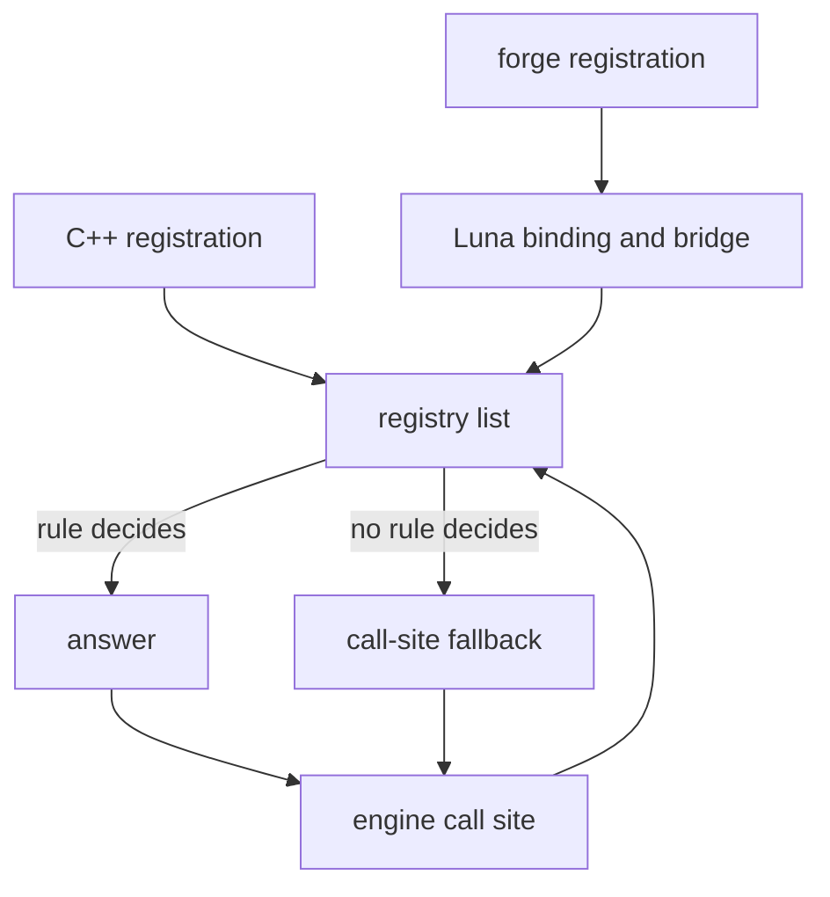

## Decisions belong to registrations

A policy lets the engine ask an ordered list of registrations for a decision. In the Metin2 mainline engine, decisions like these are branches in C++. A registry lets you put a rule beside the system that owns it and remove the registration when that system ends.

Each registration has a name, a guard, and a payload. The guard selects the cases the rule owns; the payload supplies an answer. If no rule decides, the call site applies its fallback. The [Policies glossary](/docs/building-blocks#policies-glossary) defines terms shared by the registries.

## How a decision is asked

Eight registries share this shape: [battle arbiter](/docs/building-blocks/battle-arbiter), [death manager](/docs/building-blocks/death-manager), [item use policy](/docs/building-blocks/item-use-policy), [spectator](/docs/building-blocks/spectator), [party join policy](/docs/building-blocks/party-join-policy), [skill use policy](/docs/building-blocks/skill-use-policy), [skill policy](/docs/building-blocks/skill-policy), and [loadout policy](/docs/building-blocks/loadout-policy).

C++ and Lua registrations enter the same list for each registry. A registration returns a handle that its owner can use to unregister it. The name identifies the rule in logs; it does not determine priority. Payloads and fallback answers differ by registry.

The path below shows where a decision crosses from the engine to a registered rule and back. A forge is a script package, Luna is the Lua runtime beside QuestManager, and the bridge connects Lua calls to C++; see [Luna](/foundations/luna).

A registry owns its native list without depending on Lua. The binding checks and pins Lua callbacks before registering them, so the engine can call them through the same interface as C++ callbacks. This keeps the call site independent of the rule's origin, but callback failures need an explicit fallback.

## Registration order and guard scope

A registry walks its list in registration order within one core. Across forges, registration follows forge load order, which is not guaranteed. There is no separate priority field. Do not rely on one forge loading before another to settle overlapping rules.

The dispatch rule differs by axis: a battle arbiter can pass to the next registration, death, spectator, and party join use the first matching guard, and item use and skill use stop at the first denial. Potion amounts can pass through multiple matching policies. Consult each behaviour page for its exact resolution rules.

Scope guards to the cases their owners control. A broad guard can capture another rule's cases, and the registry does not resolve that conflict for you. Spectator and party join accept a native registration without a guard, which matches every case; battle and death require one, as do Lua registrations. Unregister a rule when its owner ends so that it cannot keep answering for a case it no longer owns.

## Failure directions and engine limits

A Lua guard that errors returns false: its registration does not vote. A payload error uses the axis's default, which may permit or refuse the action. A C++ payload has no Lua error path. These differences matter when a rule is intended to enforce a restriction.

| Registry | Failure direction and call-site limits | Reference |
| --- | --- | --- |
| Battle arbiter | Lua payload errors pass. Absolute refusals run first; if the arbiter passes, the team session fallback runs before stock rules. A session groups participants for team decisions. | [API](/docs/building-blocks/battle-arbiter), [behaviour](/docs/building-blocks/battle-arbiter/behaviour) |
| Death manager | A profile is validated at registration; the first match precedes the auto-hunt and normal fallbacks. | [API](/docs/building-blocks/death-manager), [behaviour](/docs/building-blocks/death-manager/behaviour) |
| Item use policy | Lua payload errors allow use. Engine refusals still apply after a policy permits it. In a duel, the Metin2 mainline engine refuses any potion when `no_duel_potion` is above 0, and always refuses vnums 27863 to 27883. | [API](/docs/building-blocks/item-use-policy), [behaviour](/docs/building-blocks/item-use-policy/behaviour) |
| Spectator | Lua payload errors refuse. With no registration, the default permits GMs only. | [API](/docs/building-blocks/spectator), [behaviour](/docs/building-blocks/spectator/behaviour) |
| Party join policy | Lua payload errors use stock rules. Policy refusal precedes the remaining admission checks; hard checks still apply. | [API](/docs/building-blocks/party-join-policy), [behaviour](/docs/building-blocks/party-join-policy/behaviour) |
| Skill use policy | Lua payload errors allow use. Config limiters can still forbid use on paths that would otherwise allow it. | [reference](/docs/building-blocks/skill-use-policy) |
| Skill policy | Skill decisions use their own resolution rules. | [reference](/docs/building-blocks/skill-policy) |
| Loadout policy | Lua payload errors yield no plan. | [reference](/docs/building-blocks/loadout-policy) |

A permission from a policy is not necessarily the last word. For example, battle's absolute vetoes cannot be overridden, and item use retains map and other hard refusals. The [PvP arena](/docs/building-blocks/spectator/behaviour) is the native arena object, rebuilt from the mainline arena manager; it has its own spectator rule and restrictions at relevant call sites.

## Decisions that remain in the engine

Policies expose selected decisions, not every engine gate. `CanWarp`, for example, checks conditions including an open exchange, shop, or pending warp. Lua can read its answer but cannot change it. When a policy appears to permit an action that still fails, check the call-site order and hard refusals in that registry's behaviour page.
