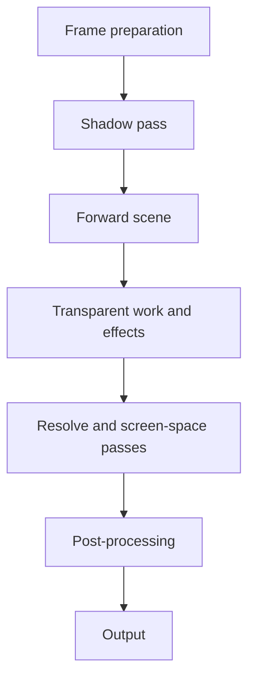
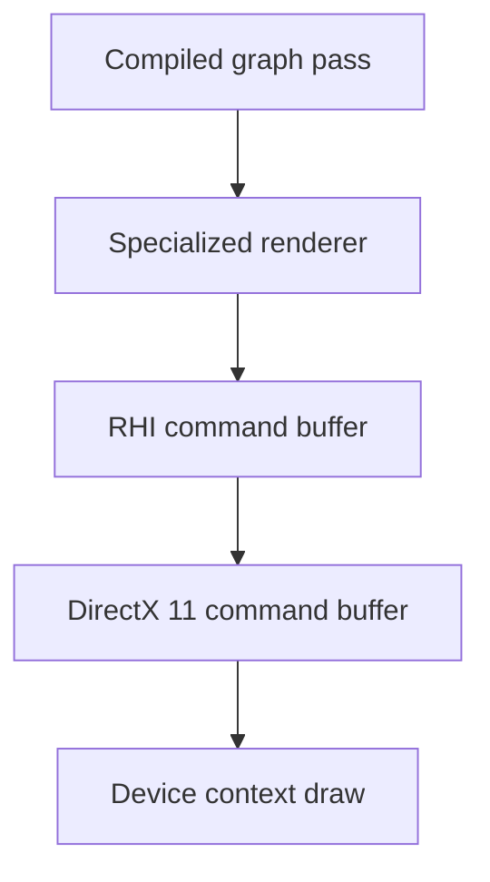

## The render pipeline: three layers between a scene and the GPU

Universal Core’s render pipeline separates the scene’s rendering work from the graphics device. Specialized renderers prepare draws and compute dispatches, the render graph organizes passes and their resources, and the rendering hardware interface (RHI) carries commands to the DirectX 11 backend.

In the Metin2 mainline engine, a caching state manager and direct device calls share responsibility for graphics state, while particles draw one at a time. The RHI gives resource creation and submission a common interface; batching and compute paths let renderers submit work in groups.

The normal forward frame runs through the graph. This overview follows its main outputs; conditional passes and dependencies determine the compiled order.

The server is untouched by all of this. It is a client subsystem with no Lua surface, and work on it is optional: you only need it if you ship your own shaders or materials. Python reaches rendering through graphics options and [`ui.ShaderQuad`](/docs/building-blocks/ui-shader-quad); effect authors use [effects and materials](/docs/building-blocks/effects-and-materials).

## Glossary

- **RHI:** the rendering hardware interface, a device-neutral layer for creating GPU resources and recording commands.
- **Render graph:** the per-frame list of passes, each declaring the resources it reads and writes.
- **Blackboard:** a type-keyed store where graph-building code publishes handles for later passes to find.
- **Transient and persistent resources:** a transient resource lives for one frame and comes from a pool; a persistent one is named and kept across frames.
- **G-buffer:** the textures a deferred renderer fills with surface data before lighting.
- **SSR, SSGI:** screen-space reflections and screen-space global illumination, computed from the rendered frame.

## A frame, pass by pass: forward by default, deferred behind a switch

Before graph construction, the application renders model previews and the map overlay. It then prepares the frame, builds either the forward or deferred graph, compiles it, and executes it on the frame’s command buffer if compilation succeeds.

The normal path is forward lighting. Its graph imports an output texture or the swapchain backbuffer and obtains persistent scene color and depth textures. With the forward HDR target disabled, scene color is `RGBA8_UNORM`; enabling it selects `RGBA16_FLOAT` and activates tone mapping.

The forward builder declares the following work. Declaration order describes the intended sequence; the graph compiler determines which passes survive and their execution order from their resource declarations.

1. **Cascaded shadows**, when enabled and a map is ready, render the shadow maps used by the scene.
2. **Forward scene** writes scene color and depth. It renders the sky, lens-flare preparation, clouds, map, actors, water, snow, and map effects in that order. Effect writer targets are set around this work.
3. **Ground decals** and **transparent map areas** draw against the scene targets. Ground decals load the existing color and depth rather than clearing them.
4. **Forward effects** render effects with distortion and selective-glow writer targets available.
5. **Forward post effects**, terrain overlays, and optional scene overlays add their contributions. Scene overlays can include debug primitives.
6. **Resolve passes**, when needed, resolve multisampled color and depth for later consumers.
7. **Screen-space passes** produce enabled results such as god rays and volumetric scattering. Post-processing reads the scene and the available effect outputs, then writes the output.

The deferred path separates material collection from lighting. It declares shadow work and a terrain composite, then writes albedo, normal, material, emissive, and depth to a G-buffer. A lighting compute pass reads those textures, visible point and spot lights, and available shadow and screen-space inputs, and writes a floating-point accumulation texture. Transparent objects, effects, and overlays still have forward passes after lighting. Deferred lighting is off by default and is subject to a compile-time guard.

## The render graph: declared reads and writes decide what runs

A graph pass combines an execution function with declarations of the resources it reads and writes. Those declarations tell the compiler what must exist before the pass and which results later work depends on. A ground-decal pass, for instance, loads the scene color and depth and writes back to them.

Compilation builds dependencies from reads and writes, propagates references from outputs and passes with side effects, culls unreferenced work, sorts the remaining passes, calculates resource lifetimes, and validates the result. A pass that has an externally visible effect needs that fact declared: a function that executes a draw does not by itself tell the graph why the pass must survive.

If compilation fails, the application skips graph execution and finishes the frame. It does not execute a fallback graph. Diagnose the compilation error before assuming that any of the declared passes ran.

The graph uses three resource lifetimes:

- **Imported resources** wrap physical resources owned elsewhere, such as the swapchain backbuffer.
- **Persistent resources** are named and retained across graph resets. A persistent texture is recreated when relevant descriptor properties, such as dimensions, format, usage, mip count, layers, or samples, change.
- **Transient resources** come from a pool. The compiler calculates first and last use, but execution acquires referenced transients before the pass loop and returns them after it. The pool can reuse a matching texture or buffer on a later acquisition; that lifetime calculation does not by itself imply aliasing between passes in the same frame.

A type-keyed blackboard shares data between graph-building code and passes. For example, deferred construction publishes G-buffer handles and dimensions for screen-space consumers. Putting a handle on the blackboard shares it; the pass must still declare its resource access for dependency tracking.

## The RHI and its DirectX 11 backend: typed handles over one device

The RHI device creates resources including buffers, textures, samplers, shaders, pipelines, render passes, and framebuffers. Descriptors specify the properties the backend needs: a texture’s extent, format, samples, and uses, for example, or a buffer’s size, memory access, and structured-element stride. Pipeline descriptions bring shaders, vertex input, topology, and rasterizer, depth, and blend state together.

The interface names several backend types, but the device factory creates a DirectX 11 device. An enum value for another API does not establish a working backend.

Resources use typed handles that carry an ID and a generation, so a stale handle never resolves to the resource that reused its slot. `IsValid()` only tests for the invalid sentinel; it does not prove the resource is alive.

## Renderers, frame context and pass context: how a draw reaches the device

A renderer receives a command buffer and data for its pass. The base renderer stores them, uploads pass constants, binds them, and calls the specialized renderer’s pass hook. The common graphics convention places frame context at constant-buffer slot `b0` and pass context at `b1`. The 2D shader quad uses `b13` for its own constants. These are conventions for their respective workloads, not a claim that every shader stage reserves the slots globally: particle compute uses its own constants at compute `b1`.

The path from a graph pass to a draw crosses these boundaries:

For a model batch, the renderer binds its textures, vertex buffer, and index buffer, then submits an indexed draw with an instance count and first-instance offset. The backend selects an instanced draw when either there is more than one instance or the first-instance offset is nonzero. The latter matters even for a single instance: it selects the correct position in the instance stream.

The command buffer caches bindings to avoid redundant device calls. It also unbinds shader inputs that conflict with a resource becoming a render target, depth target, or unordered-access output. Resetting its shader-resource cache clears the corresponding device slots as well as the cached records.

A direct device-context call can change state without updating that record. The next RHI bind may then be filtered as redundant even though the device no longer has the expected state. Route bindings through the command buffer and use its invalidation mechanisms when a direct path changes tracked state.

## Shaders and the shader cache: what invalidates a compiled result

The shader manager reads HLSL through the virtual file system, compiles it, and reflects the result. Shader content can live under client content paths such as `shaders/ui/`.

A cached compilation is identified by the source bytes, entry point, profile, define names and values, and debug and optimization flags. Included dependencies have recorded hashes and are validated separately: a missing or changed include causes recompilation. The cache path also includes the entry point, so distinct entry points in one source have distinct cache files.

Cache reading and cache saving are separate controls. Turning off cache reads forces compilation but does not, by itself, stop a successful result from being saved.

When checking an edit to loose shader content, make sure the client is reading that content rather than a packed copy, and check cache behavior as well as the top-level source. A stale compiled result or a different source selected by the virtual file system can make an edit appear to have no effect.

## Shadows: two maps with disjoint casters

Cascaded shadow mapping has capacity for three cascades; the default active count and the application’s configured shadow-map count are two. The two active maps hold disjoint caster sets:

- The **character map** holds nearby characters at finer resolution.
- The **world map** holds terrain, buildings, and trees over a larger area.

The separation gives small character shadows useful resolution while keeping large world casters together. A caster belongs to one set, so it is not rasterized into both maps and combined with a coarser duplicate.

A model shadow pass can collect instance data once for multiple views. Each view gets its own draw list indexing that shared instance buffer, because the instance data is the same while view membership differs.

## Effects, models and the GPU: resident state and compute

Model rendering groups compatible instances into batches. A skeleton’s bone palette remains at a fixed GPU-buffer offset for its lifetime and is rewritten when its pose advances. Single-material rigid meshes can be concatenated at load, reducing the number of separate mesh entries submitted for those models.

The effect renderer can keep particle simulation state resident on the GPU and use compute to generate billboard vertices. The CPU still handles birth, death, and texture-frame bookkeeping. A particle born in the frame supplies its initial state without being integrated immediately, preserving its birth-frame position.

The resident chain dispatches simulation first. It then dispatches billboard generation over both resident-produced state and any CPU-uploaded particle state. GPU billboarding therefore does not require resident simulation. Before graphics consumes the generated buffers, the command buffer unbinds compute resources; the renderer then draws the generated geometry in batches.

If the required GPU billboard resources are unavailable, the effect renderer uses CPU billboarding.

## Settings and what ships on: declaration defaults versus the client settings

Forward lighting is the default. Deferred lighting, screen-space reflections (SSR), and screen-space global illumination (SSGI) ship off. Ordinary graphics options do not switch them on; only a debug build exposes a runtime control.

Declaration defaults are not the whole settings story. Client settings apply volumetric scattering, volumetric rays, SSAO, and bloom after the initial render configuration. The loader’s fallback enables volumetric scattering and SSAO, while bloom’s fallback is off. Volumetric rays additionally require shadows; the unshadowed haze is a separate part of the effect. Bloom enable and intensity are separate ambience controls.

Post-processing executes HDR-stage effects, tone mapping, and then LDR-stage effects. Scene bloom reads the full-resolution scene into a quarter-resolution bright target, then applies horizontal and vertical blur using two targets. Each additional blur iteration adds another pair of quarter-resolution passes.

Selective glow is a separate, writer-fed effect: scene and effect rendering can write its contribution to a target for later post-processing. Its six-level down-and-up chain is distinct from scene bloom’s quarter-resolution bright pass and blur.

## Hardware floor: feature level 11_0

The minimum accepted DirectX feature level is `11_0`. The client rejects a device below it because its shaders require shader model 5; a device reporting only `10_x` is refused at creation, before any effect fallback runs.

## Diagnosing a frame: graph first, then bindings, then the debug layer

Start with the graph: confirm that compilation succeeds, the pass survives culling, and its declared reads and writes match the resources its execution function uses. Check whether the input is imported, persistent, or transient, and whether a persistent target was recreated after its descriptor changed.

For a draw that reaches the backend but produces the wrong result, inspect the bound pipeline, vertex input, buffers, textures, and constant-buffer slots. For compute-produced geometry, also check the transition from compute outputs to graphics inputs and the unbinding of conflicting views.

The DirectX 11 debug layer reports binding and pipeline problems in client log messages marked `[D3D11]`. For a depth-only pass, omit the pixel shader when no clipping is needed, or use a shader with no color output when clipping is required.

In-app RenderDoc loading is opt-in through `UE_RENDERDOC=1`. Its hook replaces the debug layer, so use a run without that hook when you need the normal validation queue. You can also launch the client from RenderDoc for capture.

## Common traps: the failures that log nothing

- **A fullscreen draw uses the previous vertex input.** A pipeline with no vertex input needs a null input layout. Leaving the preceding layout bound can retain its referenced vertex buffers and make the draw depend on unrelated earlier state.
- **A buffer looks valid but compute has no usable view.** A nonzero handle alone does not prove that the required shader-resource or unordered-access view exists. Failed view creation must return an invalid resource handle rather than let a dispatch proceed with a null view.
- **A depth texture cannot also be sampled.** The underlying depth resource must use a typeless format so the backend can create compatible depth and shader-resource views.
- **A pass never executes.** A pass whose writes are not referenced can be culled. Declare the resources its consumers read, and mark genuine side effects so the compiler can retain the work.
