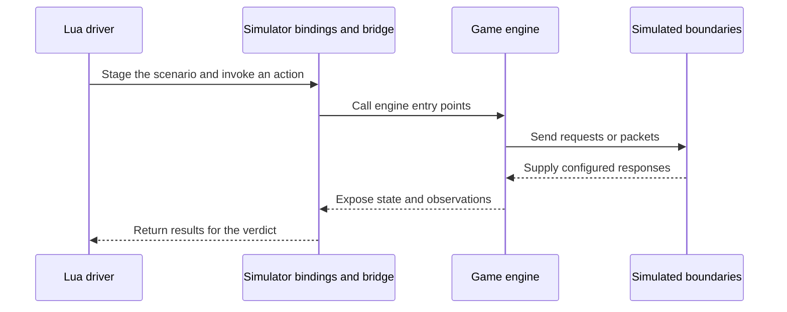

## The simulator runs the game engine without a client

The headless simulator lets you exercise server behaviour through Lua without running a client or connecting a live server. It supports unit, integration and regression tests, as well as calibration against an objective such as a target mob difficulty.

`game_sim` is the game server built a second time from the same sources, with a different entry point. It boots without a socket, a database or a disk map. A Lua driver stages a world and calls real engine entry points, including combat and skill execution.

The Metin2 mainline engine has a test server for testing gameplay in a server environment. The simulator adds a headless level where a driver can construct and observe a scenario directly.

The engine is private, so you cannot run the simulator as a reader. The [simulator reference](/docs/core/simulator) describes its interface, and [Write a cube](/docs/core/simulator-write-a-cube) describes the test harness.

## The driver calls the real engine through Lua

The driver loads after simulator boot. It stages the actors and prerequisites, invokes engine behaviour, observes the result and decides whether the scenario passes. The engine executes its own rules; the driver supplies the world those rules act on.

The call path crosses from the Lua driver into the engine and back through observations.

The simulator substitutes infrastructure around the game, while keeping the gameplay path real.

| Area | Runs for real | Supplied or controlled by the simulator |
| --- | --- | --- |
| Gameplay | Game sources, managers, combat and skill entry points | Actors, fixtures and scenario state |
| Lua and content | Quest VM, forges, bridge and loaded prototypes | Staged artifacts and boot prerequisites |
| Network | Packet construction and engine handlers | Captured buffers by default; real links are opt-in |
| Database | Game-side requests and response handlers | An in-process database supplies configured answers by default |
| Time | Event queue and character updates | The driver advances pulses and global time |
| World | Engine logic acting on the staged world | A scratch world rather than a disk map |

## Forge and bridge carry the scenario into the engine

The simulator stands on the same Forge and bridge machinery that exposes engine managers to Lua. The driver uses native simulator bindings alongside the ordinary Lua-facing manager and processor interfaces. It can deliver messages through engine handlers and inspect the state they change.

A forge can have both a game artifact and a quest object. The game artifact can define a manager while the quest object registers its processors at boot. Loading a populated manager table therefore does not prove that a processor is listening. Stage both artifacts where they are needed, run the quest boot path and assert that the engine holds the expected processor.

Each forge has its own `package.loaded`. A module required by the driver and the same module required by a forge are separate tables. Changing the driver's copy does not change the forge's copy. Set up the condition through the engine and assert the state the engine actually holds.

## Native registrations expose the simulator by area

More than 200 native bindings expose the simulator to Lua. They cover world lifecycle, characters and parties, combat and observation, maps and movement, wire and database operations, forge and quest boot, time, and other engine areas.

The registrations are native engine bindings; a cube does not register them. The driver calls them to construct a scenario and inspect its effects. Their signatures belong in the [simulator reference](/docs/core/simulator).

## Database and peer links can cross a real boundary

By default, the in-process database answers configured game requests and records messages that no handler claims. You can instead opt into a real link to a headless database core. That core runs the DB-side handlers, while a simulated SQL and store layer supplies the database beneath it.

The database core's SQL wall asks a Lua scenario to claim and answer each statement. A statement no rule claims is refused with its own text, rather than receiving an empty result. This makes missing database behaviour visible instead of allowing the core to continue against an invented empty world.

A real peer link is also opt-in. It lets a scenario exercise communication across a peer connection rather than only delivering a message to a handler inside one process. Captured packets and in-process delivery remain useful for inspecting the boundary, but they do not by themselves demonstrate interaction between separate cores.

## Pulses and global time are separate

`sim.step` drives engine pulses, including the event queue and character updates. It does not advance `get_global_time`. A cooldown that reads global time can therefore remain in force even after many pulses.

`sim.advance_time` advances global time one second at a time and drives the corresponding pulses after each increment. Use the clock that the behaviour under test reads: pulses for pulse-driven work, and global time for a deadline based on global time.

## Affect durations use the engine's affect event

Affect durations tick once per simulated second through the engine's own affect event, as they do on the live server. The event must be scheduled and the relevant pulses must be driven for the duration to decrease.

## Differential gates compare behaviour

A differential gate records observations from probes and compares two records. It has no expected value for each measurement: the question is what moved between the records and whether the declared expectations permit that change.

A manifest defines actors, preconditions, actions and observations. The runner resets and stages each probe, observes before and after the action, checks liveness and emits canonical records. A diff classifies the changed keys against declared expectations.

Comparable records need the same fixtures and build flavor. Scenario order matters too: a reset clears the scenario world but does not reset the process's pulse counter. A record must also avoid incidental identities and uncontrolled randomness that can change without a change in the behaviour being measured.

## Cubes assert a specification

A cube uses assertions as its oracle. Its faces stage scenarios and check the behaviour the specification requires. Each face can fail independently, and the harness collects the checks into a verdict.

A cube can exercise gameplay through the same forge and processor paths as the engine. Its assertions need to cover both the intended effect and the prerequisites that make that effect meaningful. Cubes that assert the engine on its own fixtures are kept with the simulator. Cubes that load shipped gameplay assert content that designers change, so they are kept outside the engine repository as local agent tooling. An agent writes the feature and its cubes, runs the sweep and reads the verdict. The [cube guide](/docs/core/simulator-write-a-cube) describes how to write one.

## Calibration measures against an objective

A calibration pipeline uses an objective rather than a reference record. It runs scenarios and adjusts inputs until measurements reach a target range, such as a required mob difficulty. The engine still supplies the behaviour being measured, and the scenario still has to establish that the measurement is meaningful.

## A probe must prove that it measured something

A result is trustworthy because the engine is real. The risk is that the driver sets up the world by hand: the real engine can run over a state nobody plays and produce a plausible result.

A differential probe needs a liveness assertion that fails if its action did not do the work being measured. For example, a skill probe must establish that the cast succeeded and the expected effect landed. A learned buff is not necessarily a cast buff; a character without enough resource may never cast at all.

A negative control checks the other side of the claim. If a conditional multiplier is under test, run a scenario with the condition absent as well as one with it present. If both produce the same observation, the test has reason to suspect that the condition never took effect.

Assert setup through engine-held state before asserting the outcome. A clean diff or a passing negative assertion over an empty world is not evidence that the intended behaviour ran.

## The test server remains in the engine

The test server and its branches remain in the engine. The simulator adds a separate way to drive server logic; it does not cover a client. Client rendering, interaction and other client-side behaviour need their own tests.
