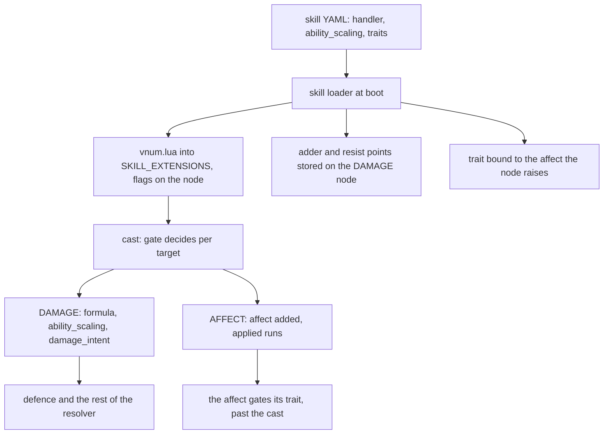

Skills can respond to combat state, shape damage, and attach behavior that lasts beyond a cast. Lua handlers, ability scaling, traits, and native C++ behavior make this one of the most powerful features of the skill system. The Metin2 mainline engine expresses skill-specific interactions as C++ branches keyed by skill.

[Skill formulas](/foundations/skills/formulas) explains evaluation; [nodes and phases](/foundations/skills/nodes-and-phases) explains when a node runs.

| Way | Written in | Who decides | Lifetime |
| --- | --- | --- | --- |
| `ability_scaling` on a DAMAGE node | YAML, applied by C++ | the file | one hit |
| `handler:` naming a table in the skill's Lua file | Lua | the node | one node, one target, one cast |
| `traits:` or `counters:` on an AFFECT or TICKER node | native C++ or Lua | the trait, gated by the affect | as long as the affect |
| the node type itself | C++ | the engine | not applicable |

The test for where a thing belongs is not "is it conditional". It is whether it needs to look at something the config cannot name. `caster[adder] - victim[resist]` does not, so it is data. "From behind" does, so it is a handler. If the answer is "while this buff is up", it is a trait. If it is "when this node fires, look at", it is a handler.

## How a Lua handler loads

A node names its handler with a `handler:` key. The key is parsed on every node type. The handler itself lives in a Lua file named after the skill vnum, next to the skill's YAML in the skill configuration folder: skill 31 has `31.lua`. The file returns a table of handlers, and the node's `handler:` value names one entry.

```lua
-- AMSEOP (Tranello): back hit, stealth and dagger each raise the blow.
local M = {}

---@type DamageNodeHandler
M.amseop = {
    damage_intent = function(intent)
        local m = 1.0
        if intent:is_back_hit(35) then m = m + 0.3 end
        if intent.caster:has_affect_flag("EUNHYUNG") then m = m + 0.25 end
        if intent.caster:weapon_is("DAGGER") then m = m + 0.5 end
        intent.attack = math.floor(intent.attack * m)
    end,
}

return M
```

This is the whole file for Tranello. Each entry may implement three slots: `gate`, `damage_intent` and `applied`.

At boot, after the YAML loaded without a fault, the skill loader walks every skill and every node in all three phase lists. For each node with a `handler:` it loads the skill's Lua file on the main Lua state, the one the forges and quests share, and stores the returned table in the global `SKILL_EXTENSIONS[vnum]`. Then it looks into the named entry and sets three flags on the node, one per slot that is a function. A node with no flag set never calls into Lua.

A policy variant of a skill, a per-mode copy, is a skill in its own right. The same `<vnum>.lua` answers for it, and a node it inherited unchanged still learns whether its handler has a gate. The Ball-Em-Up arena handlers in `78.lua` are used only inside the `ballemup` variants of skill 78.

C++ holds no reference to the Lua functions. Every call looks up `SKILL_EXTENSIONS[vnum][handler][hook]` again. This avoids retaining references beyond the lifetime of the Lua state.



## What each slot sees and may change

`gate` runs for any node type, once per target, before the node does. A false verdict skips the node for that target. It is used on a CRUSH node (the Gungsin knockback) and on COLLECTOR nodes (the arena skill). Its context is a `DamageIntent` with only `caster`, `victim` and `skill` filled in. `attack` and the other fields read 0 or false.

`damage_intent` runs on DAMAGE nodes, with the hit as it stands before defence. It may change four fields: `attack`, `type`, `ignore_defense` and `damage_attribute`. Everything after it, defence, penetration, pierce, the percentage modifiers, consumes those four, so a handler shapes the blow and never edits a result. The context also carries `caster`, `victim` and `skill`, read-only, and `is_back_hit(deg)`.

`applied` runs on AFFECT nodes, once per victim, after the affect was really added. It gets `caster`, `victim`, `skill`, `affect` and `duration`, all read-only. If a stronger good affect is already on the victim the add returns early and `applied` does not fire. The rage skill uses it for the two things that must happen only when the affect lands:

```lua
local M = {}

---@type AffectNodeHandler
M.rage = {
    applied = function(ctx)
        ctx.victim:play_spawn_motion()
        forge.game.rage.consume_charge(ctx.victim)
    end,
}

return M
```

The order inside one DAMAGE hit is: trait pre hooks and bump points, the amount formula, the battle damage, the splash factor, `ability_scaling`, the bow distance falloff for ranged skills, `damage_intent`, the resolver, the skill damage shield, the damage itself, trait post hooks. Bump points and trait hooks are the traits page.

Handlers run synchronously inside the combat path, through a protected call. They are not coroutines and cannot wait.

Why before defence: a multiplier applied after defence gives `(attack - def) x m` where the skill meant `(attack x m) - def`. "+30% from behind" has to mean the blow lands harder, or the bonus shrinks against exactly the enemies it was written for.

## Ability scaling: the data sibling

Per-skill adder and resist points are not conditional, so they are not a handler. A DAMAGE node takes `ability_scaling: { adder, resist }`, two point names, and the engine does the arithmetic:

```cpp
int32_t ApplyAbilityScaling(const TDamage* dmg, int32_t dam, LPCHARACTER caster, LPCHARACTER victim)
{
    const int32_t adder  = (dmg->unAbilityAdderPoint  && caster) ? caster->GetPoint(dmg->unAbilityAdderPoint)  : 0;
    const int32_t resist = (dmg->unAbilityResistPoint && victim) ? victim->GetPoint(dmg->unAbilityResistPoint) : 0;
    return std::max<int32_t>(0, dam * (100 + adder - resist) / 100);
}
```

The result is `max(0, dam * (100 + caster adder - victim resist) / 100)` in integers, applied for every DAMAGE node. It sits right after the splash factor and before `damage_intent`. 31 skill files carry it, for example `ability_scaling: { adder: SAMYEON_ADDER, resist: SAMYEON_RESIST }` on skill 1.

## Traits from a skill node

Anything that must outlive the cast is a trait. A node binds a trait to the affect it raises, and the trait runs as long as the affect lives. `traits:` binds by id; `counters:` binds the native `skill_ledger`. This is the whole binding for skill 64:

```yaml
traits:
- id: terror
  # `power` is the trait's name for it, `skill_power` the skill's; the constant
  # is the bridge, and it is what lets the description read the formula itself.
  constants:
    power: skill_power
  formulas:
    reduction_pct: 5+power/40
```

Both kinds ship. Eight native C++ trait ids are bound by skill nodes (`attack_buff_erosion`, `buff_def_erosion`, `dash`, `hosin_ward`, `mana_shield`, `stealth`, `terror`, `weapon_bound`), plus `skill_ledger` through `counters:`. Two Lua traits sit in the skill configuration folder, `guild_bulwark` on skill 153 and `stellar_ward` on skill 150; `thorns` sits beside them, bound by no skill file. That is 17 content skills. When no native or Lua trait of the given id is defined, the loader looks for `traits/<id>.lua` there.

There is no native C++ handler slot: the invokers only look up Lua. A skill that needs C++ behaviour gets it from a native trait bound to its affect, from `ability_scaling`, or from a node type. Traits are not a skill feature that happens to exist. They serve every affect in the engine, and how they hook, bump points and the native and Lua pair are on [Traits](/foundations/traits/).

## Node types are C++ only

A node type is an entry in a compiled enum: 28 slots, four of them retired placeholders, so 24 live types. Their names sit in a compiled table, and the YAML parser turns the `type:` string into an ordinal with it. Ordinals are appended and never inserted, because the ordinal is what a trace reports and what a record is diffed on.

An unknown name refuses the skill, and a refused skill is a YAML fault, so the game core does not start. There is no registry for node types and no Lua binding that touches them. Adding one means the enum, the name table, a parse case and an execute case in each of the places that switch on the type, about 28 of them.

That wall is deliberate. A handler shapes a node's damage or gates its execution. It does not author new node types, spawn projectiles or drive multi-stage skills: those are node data. The registration picture:

| Door | C++ | Lua | What ships |
| --- | --- | --- | --- |
| node handler | none, the engine only calls Lua | `<vnum>.lua` named by `handler:` | 8 files, all Lua |
| `ability_scaling` | applied by C++ | none, a YAML field | 31 skills |
| skill-bound trait | native registration | Lua definition | 8 native ids plus `skill_ledger`, 2 Lua |
| node type | enum, parser, executor | none | 24 types |

## Traps, by cause

**A handler fault does not stop the boot.** Loading returns nothing and every fault is a log line and a skipped node, so a missing file, a module that is not a table, a wrong handler name, or a table with none of the three slots leaves the node inert while the boot continues. The comment in the loader still says "hard load error"; the code does not do that. The difference from the YAML path is intentional: a config fault is a typo an author can see, a script fault is a runtime condition. A YAML fault makes the skill load fail and the game core exits. Search the log after boot for these lines:

- `declares a handler but`
- `must return a table of handlers`
- `handler '...' not found in`
- `implements none of gate, damage_intent or applied`

**A slot on the wrong node type is ignored.** Flags are set from the table whatever the node is, but `damage_intent` is called only from damage processing and `applied` only from affect processing. A `damage_intent` on an AFFECT node never runs, and nothing says so.

**A gate that returns nothing skips the node.** Only an error fails open. A `nil` return reads as false, so a gate missing its last `return true` turns the node off for every target.

```cpp
bool SkillExt_InvokeGate(uint32_t skillVnum, const char* handler, const SDamageIntentCtx& ctx)
{
    sol::protected_function fn = LookupHook(skillVnum, handler, "gate");
    if (!fn.valid())
        return true;
    sol::protected_function_result r = fn(ctx);
    if (!r.valid()) {
        sol::error e = r;
        sys_err("skill {} gate error: {}", skillVnum, e.what());
        return true;   // fail-open: a broken script never silently drops a node
    }
    return r.get<bool>();
}
```

**A gate sees no damage.** Its `DamageIntent` is built with `caster`, `victim` and `skill` only. `attack` and the rest read 0 or false.

**A failed `damage_intent` can keep half its work.** The header says a failure leaves the context untouched. The context goes in by reference and nothing restores it, so a handler that writes `intent.attack` and then errors keeps the write. Write once, at the end.

**`has_affect` takes a number, `has_affect_flag` and `get_affect_value` take names.** `has_affect("POISON")` is a type error at call time. The whole `damage_intent` fails and is logged, so the dagger bonus in the same handler is lost with it. Use `affect.name_map.POISON`.

**An intracore skill may not declare a handler.** A handler is handed `intent.caster` and an every-core cast has none. This one is a config fault, so it refuses the boot. Intracore casts are in [Skills on every core](/foundations/skills/every-core).

**Handlers are stateless on purpose, and they run per target.** A gate on a COLLECTOR runs for every collected target, so a counter kept in a gate advances per target, not per cast. Content that needs memory across hits keeps it in a Lua global, as the arena handlers do and reset from the referee. Anything that must outlive the cast is a trait.

## Native behavior

Node types and native traits are implemented in C++. Two skill-specific checks in the damage path refuse a horse skill against a player and read the damage shield from a point. Mount and horse use rules are covered by [skill policies](/foundations/skills/policies).
