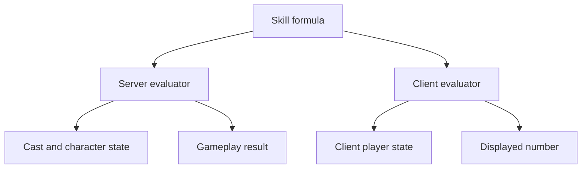

A skill needs numbers, but a formula alone cannot express every decision made during a cast. The Metin2 mainline engine puts skill-specific interactions in C++ branches. Universal Core combines shared formulas with node data and optional handlers, so a skill can describe its numbers and make decisions at the point where they matter.

A **node** is an operation in a skill's execution; a **poly** is an expression evaluated to a number. See the [Skills glossary](/foundations/skills) for these and related terms. [Nodes and phases](/foundations/skills/nodes-and-phases) explains when nodes run. The [skill extension reference](/docs/core/skills/extension) covers the handler API and configuration.

## One formula, two evaluators

A skill file stores an expression once. The server evaluates it for gameplay, while the client can evaluate the same expression for a tooltip. A description variable can refer to a node's expression instead of copying it. Sharing the expression removes one source of drift; it does not guarantee that both sides have the same inputs.

The evaluator parses arithmetic and functions, then asks for the names the expression uses. Each side supplies values from its own state. The server can read the caster, a victim, and state accumulated during the cast. The client reads the player's available state and cannot know the outcome of a hit that has not happened.

The paths share an expression but resolve its inputs independently:

The server resolves caster and victim names in separate passes. Node and cast state are supplied between them. A reference to a node that has not run yet gives zero; an unknown node name remains unresolved. Cost and cooldown have no victim at evaluation time, so a victim value cannot supply a meaningful input there.

A description can pin an input to a chosen value when the client cannot know it, for example to show both outcomes of a target-dependent formula. Some inputs, such as cost and cooldown, are evaluated by the client itself and cannot use server-only names. Validation rejects those expressions and checks description variables for unresolved or unpinned server-only names. See [skill descriptions](/docs/core/skills/descriptions) for the syntax.

## Shared syntax does not guarantee equal results

The server and client resolve their values separately. Even a name available to both can differ if their state or accessor differs. Some point names read a server point map while the client receives a value from a separate accessor. For example, `point_STAMINA` can read zero on the server while the client displays stamina. A valid name is not proof of equivalent values.

The expression evaluator also has failure behavior worth designing around:

- An unknown name in a node formula can read as zero. Description validation does not cover every node formula.
- Division or modulo by zero, an invalid root or logarithm, and a parse error return zero for the whole expression. Guard a divisor when zero is possible.
- The evaluator retains variable values. Skill evaluation uses a fresh copy so an unset name does not inherit a value from a previous evaluation.

The shared vocabulary and its implementations are native code. Adding a derived name requires an implementation on each side that can answer it. A startup check compares the declared names with the client implementation, but it does not compare their results. Test displayed values against server results with representative inputs.

## Choose the boundary for the behavior

A formula computes a number from named inputs. A node selects an operation and its data. Ability scaling is data on a damage node: the engine adjusts damage using an attacker point and a target resistance point. This needs no script because the operation and its inputs are already defined.

A **handler** is a Lua function attached to a node. Use it when a decision needs context or behavior the formula and node data do not express. A gate decides whether a node runs for a target; a damage handler shapes the hit before defense; an applied handler runs after an affect is added. An **affect** is a status applied to a character. The pre-defense position matters: increasing attack before defense produces a different result from multiplying damage after defense.

A handler is called per node and target, synchronously within the cast. It does not define a new node type. Node types are native engine behavior: there are 24 live types, with four retired slots retained separately. Adding a type requires engine changes, while a handler extends an existing operation. The [node reference](/docs/core/skills/nodes) lists the available types.

For behavior that remains active with an affect after the cast, a node can bind a trait to that affect. The affect controls its lifetime. See [Traits](/foundations/traits) for that model.

## Handler loading and execution

A node names a handler in the skill's configuration. At load time the engine loads the Lua module for that skill, finds the named handler, and records which supported functions it provides. During a cast it looks up and calls the function for the appropriate stage. The engine does not retain a Lua function reference across the lifetime of the Lua state.

The gate runs before a node for each target. The damage handler runs only on a damage node, after the formula and ability scaling and before the damage resolver. The applied handler runs only after an affect actually lands. A stronger existing affect can prevent that addition, so an attempted application is not enough to trigger the handler.

A gate sees the caster, victim, and skill, but not a computed damage value. A damage handler can change the pending attack and related damage properties; later defense and modifiers consume those values. These boundaries let a handler change a decision without taking over the whole cast.

## Failures follow the boundary

A malformed skill configuration can refuse the skill load and stop the game core. A missing or invalid handler instead produces a log entry and leaves the affected node without the handler. Check the log after loading changes; a successful boot does not prove the handler was found.

A gate error is logged and fails open, allowing the node to continue. A gate that returns no value is different: its result is false and the node is skipped. A handler function on the wrong node type is also ineffective: a damage handler is called only during damage processing, and an applied handler only during affect processing.

A damage handler receives mutable state. If it changes that state and then errors, its earlier changes can remain. Calculate first and write the result only after the operations that can fail. An intracore cast runs on every core and may have no caster, so its skills cannot declare handlers that require one; see [owners and cores](/foundations/skills/owners-and-cores).
