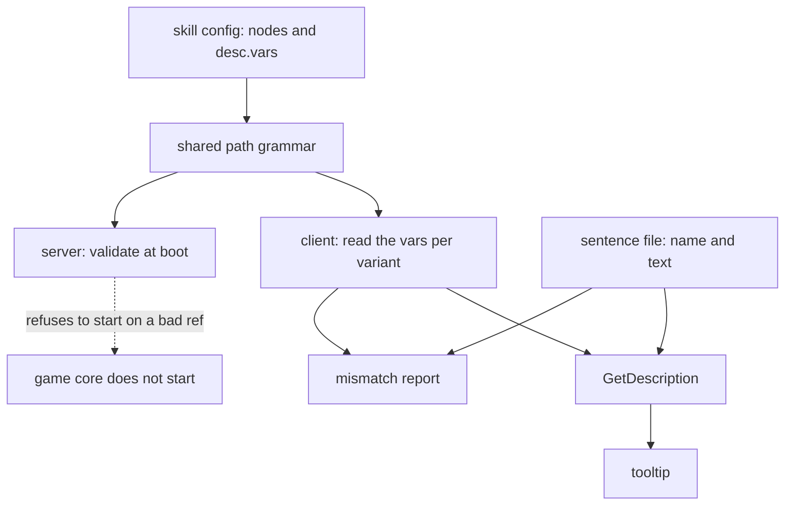
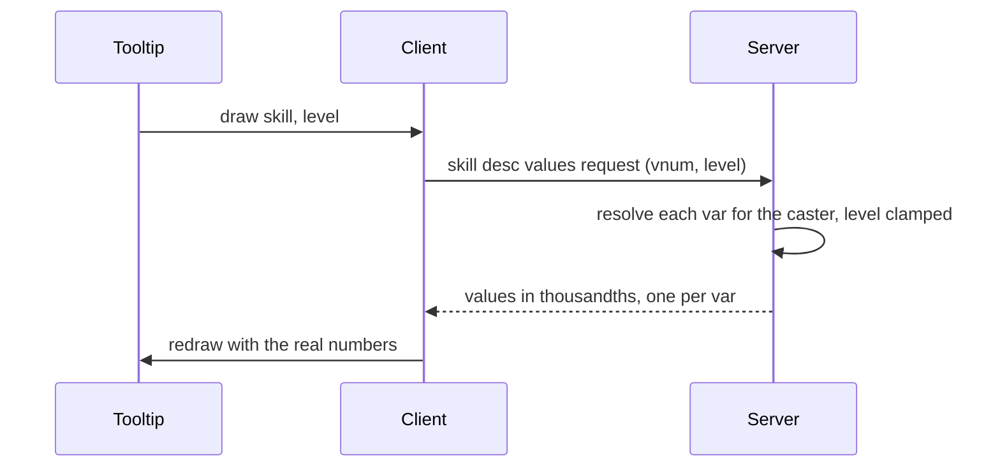

## The limit: the tooltip held a second copy of the formula

A skill tooltip shows numbers: damage, duration, chance, how many targets. Every one of those numbers already exists on the server as a formula. In the inherited engine the client also kept its own text of that formula, so each number was written twice, once where it is computed and once where it is displayed. Nothing tied the two together except a person remembering to edit both.

The inherited client had three copies of a skill's numbers: the server's skill table, a client copy of that table, and the description file with its own formulas per sentence. It knew they disagreed. For the first affect line of each tooltip it overwrote the description's formula with the client table's, per skill number, with a list of exceptions and a hand-added `* 3` for the three-hit skill. The second and third lines of the tooltip stayed hand-copied text.

That patch was the whole defence. Everything after it was copy maintenance, and it never stopped being copy maintenance: from 2019 to July 2026 the description text carried its own formulas, in a tab-separated text file, then a JSON file, then a YAML file. Descriptions are the first client of the idea. The limit it removed is the second copy.

Skill 93 shows what a copy costs. Its tooltip read the burn chance from `(500*skill_k)/10`, which is 50 percent. Its config had said 5 percent since March 2026, when the skill configs left the database. The tooltip promised ten times what the skill did, and both files were valid.

## Two halves, three files

A description is split by who owns what. The numbers live in the skill's own config, the file the server builds the skill from. The words live in client locale content.

```
Locale/conf/skill/<vnum>.ucskill.yaml                       desc.vars:  the numbers
…/skill_desc/<vnum>.ucskilldesc.yaml                        name, description: the words
…/skill_desc/policies.ucskilldesc.yaml                      the variant labels
```

Skill 34, the camouflage skill, shows both halves. In the config:

```yaml
desc:
  vars:
    invtime:  { ref: node.hide.durationPoly }
    bonusdmg: { value: 25 }
```

In the sentence file, the whole of it:

```yaml
name: Camuffamento
description: |-
  Arte dell'ombra.

  Ti rende |cFF03C5FEInvisibile|r per |cFFC7D610$invtime|r secondi.
  Il tuo indicatore sarà occultato sulla minimappa.
  I tuoi effetti (come i luccichii) diverranno anch'essi invisibili.
  Le abilità che prevedono un miglioramento se invisibili vedranno il danno aumentare del |cFF2DFE03$bonusdmg%|r.
  L'abilità può essere attivata in corsa.
```

`$invtime` is a name declared under `desc.vars`. `|cAARRGGBB ... |r` is the client's colour markup. The sentence never contains a formula. The `ref:` points at a poly inside the same config, so the number printed is the number the server computes: change `durationPoly` and the tooltip follows. For how one config holds the whole skill and how polys are evaluated, see [One file per skill](/foundations/skills/one-file) and [Formulas, pulled not pushed](/foundations/skills/formulas).

Skill 1's sentence is a second example:

```yaml
name: Taglio a Tre Vie
description: |-
  Sferra 3 rapidi fendenti consecutivi che colpiscono frontalmente.

  Infligge |cFFDC7B04$val|r danni fisici per ogni colpo.
  Il danno non viene influenzato da Aura della Spada.

  Numero massimo bersagli: |cFF00CB8D$targets|r

```

At the time of writing, 99 of 213 skill configs declare `desc.vars`, 313 vars in total. There are 112 sentence files, plus the label file, 873 lines together. The 13 sentence files beyond 99 are skills whose text quotes no number.

## The five verbs of `desc.vars`

A var has a name and one of two sources, and three optional shapers.

```yaml
desc:
  vars:
    <name>:
      ref:      node.bolt.amountPoly    # a poly IN THIS FILE
      value:    '25'                    # or a stated number. Never both.
      with:     { victim_is_self: 1 }   # pin what the client cannot know
      delta_at: { victim_calc_missing_hp: 1000 }
      as:       (0-value)/10            # reshape what the ref resolved to
```

- `ref:` names a poly in the same config: `node.<id>.<field>`, `cooldownPoly`, `resolve.bound.targets`, a child node, or a trait formula. Path segments after the id are the YAML keys verbatim, so a field added to a node type is referenceable the same day. 311 of 313 vars use it.
- `value:` is a stated number, for the few numbers that live in a Lua handler or in C++ where there is no poly to point at. Skill 34's `bonusdmg` is one. It is the only verb that restates a number, so keeping it true is the author's job. Two exist.
- `with:` pins a name the client cannot know to a constant. One ref can serve two sentences: a defence skill reads `victim_is_self: 1` for the self sentence and `0` for the ally one. Skill 183 pins `use.victims` to 1 three times so that "per enemy hit" becomes a number. Without the pin that config would not boot.
- `delta_at:` reads the ref at a value N and at 0 and prints the difference, a rate. N is the unit of the sentence and nothing else. The result is truncated, so N must be chosen so the rate comes out whole. It is only a rate while the poly is linear in that variable.
- `as:` reshapes what the ref resolved to, in one pass: `value` is the var's own ref, siblings are read by name. Skill 93's burn chance is `firepct: { ref: node.burn.successPctPoly, as: 'value/10' }`, per-mille to percent. A var cannot read another `as:` result.

Between them they cover what the descriptions needed: 67 `with:`, 28 `as:`, 5 `delta_at:`.

## The server never renders, it refuses to boot

The server keeps `desc.vars` for one reason. It validates them while it builds each skill, so a reference that does not resolve fails at boot, in front of the person editing the config, and not on whichever player first opens the tooltip.

Every failure logs a line that starts `Skill[<vnum>] <name>: desc var '<var>'` and then names the rule:

| Rule broken | Tail of the message |
| --- | --- |
| `ref:` and `value:` both | `declares both ref: and value:` |
| neither | `declares neither ref: nor value:` |
| `with:` without a ref | `pins with: without a ref: to pin it into` |
| `value:` is not a number | `value '<v>' is not a plain number` |
| the ref misses | `reference '<r>' does not resolve to a value` |
| the ref is not a poly | `reference '<r>' is not a poly: '<r>'` |
| a name no vocabulary resolves | `reads '<n>', which no vocabulary resolves -- pin it with` ``with:`` |
| a server-only name, unpinned | `reads '<n>', which the client cannot resolve, with no` ``with:`` `pin` |
| a pin the poly never reads | `pins '<n>', which '<v>' does not read` |
| a `delta_at:` the poly never reads | `takes a rate per '<n>', which '<v>' does not read` |
| pinned and rated at once | `both pins and takes a rate per '<n>'` |
| an `as:` that does not parse | `as '<e>' does not parse` |
| an `as:` that names itself | `as '<e>' names itself;` ``value`` `is what its ref resolved to` |
| an `as:` reading an unknown name | `as reads '<n>', which this skill does not resolve` |

A failed build of any skill, or of any policy variant of it, makes the whole skill table fail to load. At boot the call site is:

```cpp
if(!CSkillManager::instance().InitializeFromYaml(szSkillDir))
{
    sys_err("cannot initialize skill table from YAML");
    thecore_shutdown();
    return;
}
```

So one bad desc var in any of 213 configs stops the game core. On a reload the same failure only logs, and the previous skill table stays live.

The refusal of an unknown name is the point of the whole check. The client does not fail on a name it cannot resolve: its state lookup answers true for everything and hands back 0. A tooltip would print a confident wrong number and nothing anywhere would say so. Refusing it on the server puts the failure where an author is looking.

## How the tooltip is rendered

Rendering is the client's job, and the client reads the same configs. It loads the configs first and the descriptions second, because a config is what creates a skill's entry and a description is about a skill that entry already describes. If either load fails, locale loading fails.



The path grammar is one piece of shared code: the server and the client resolve `ref:` the same way, including trait constants and quest-flag names, so they cannot disagree about what a path means. No arrow runs from the server to any rendered text.

When the tooltip draws, the renderer does three things. It evaluates every var's poly with its pins applied, and a `delta_at:` var twice, subtracting. It runs one pass of `as:`. Then it substitutes names into the sentence, longest first: with `$val` and `$value` both declared, substituting the short one first would leave "ue" behind. Numbers print signed and truncated.

There are three modes. Plain prints numbers. Expanded prints the number and then the formula behind it in parentheses. Symbolic prints formulas alone. A player sees plain by default and expanded while holding SHIFT, and the hint line "more information" appears only on skills that have at least one formula to show. The formula text is symbolised from the poly: a pinned name prints its number, a point becomes a marker the Python side turns into the point's display name, and the operators are spelled out. Twenty-two `SKILLVAR_` lines in the game locale file name the remaining variables for the player. Symbolic mode is exported to Python, but no shipped script asks for it.

The expanded view replaced prose. The description file held 105 hand-written lists of the form "the skill is influenced by". The tooltip now asks the poly for its variables and prints them, so the list cannot be wrong.

## Numbers only the server holds

Some numbers depend on state the client does not have. A quest flag is the clean case: the client cannot evaluate `quest_flag.ballemup.balls`. The rule is the same on both sides: a var whose poly reads an unpinned quest flag is marked as resolved by the server.

For such a skill the tooltip asks before it draws.



Until the reply arrives the poly is evaluated with the unread flags at 0. The server clamps the level to the skill's maximum, since answering for a level the player does not have would hand out a preview of a skill they have not paid for. It resolves through the caster's active policy, evaluates a fresh poly per var as the caster, and sends each value times 1,000 as a 32-bit integer.

The reply is positional. Both sides sort the vars by name, so a count mismatch means the client and the server hold different config versions, and the client drops the packet and logs `CPythonSkill::SetServerDescValues - skill <vnum> expected <n> values, got <m>`. The tooltip then shows the flags-at-zero reading.

Only skill 78 uses it today, in its Ball-Em-Up variants, where `interval`, `targets`, `cost` and `chain` read quest flags:

```yaml
policies:
  ballemup:
    desc.vars.chain: { ref: node.chain.maxTarget }
```

The request goes out on every draw, not once per level.

## One sentence, many configurations

A skill can have policy variants: the arena version of a skill changes numbers, not words. The description follows. A variant with no sentence of its own reads the base one, and the vars re-resolve against that variant's own config, so the same sentence prints the arena's numbers without being written twice. Skill 34's arena variant changes only the poly, `max(5,15+8*skill_k-10)` for the hide duration, and the base sentence prints it.

A variant that needs different words gets a `policies.<id>` block in the sentence file, which overrides name and description. Skill 78 has six, sharing one YAML anchor and reading an extra `$chain`. For how variants are merged into a config, see [Skill policies](/foundations/skills/policies).

Which variant the tooltip opens on follows the server's resolution order, first active one wins, so it cannot open on a variant the caster is not using. SHIFT+TAB walks the configurations in the expanded view, because plain TAB is the scoreboard and an arena is where a policy is in force. The row labels come from one small file with seven ids (`arena`, `ballemup`, `ballemup_r1` to `ballemup_r5`). A declared policy without a label logs `CPythonSkill: policy '<id>' has no label in <file>`, and the switcher shows the id.

## A trait's formula, readable from the description

Traits keep their own named formulas, and a description can read one by path: `node.<id>.traits.<trait>.formulas.<name>`. The trait's constants are substituted first, so the formula reads in the skill's terms. Skill 64's terror trait is the only user today:

```yaml
desc:
  vars:
    dmgreduction: { ref: node.buff_reduction.traits.terror.formulas.reduction_pct }
```

with the trait saying `power` is the skill's `skill_power` and `reduction_pct: 5+power/40`. The ref yields `5+(skill_power)/40`. Before August 2026 the skill also carried a point-less amount poly that scaled 1+29*skill_k, while the trait cut by (95-power/40)/100. The tooltip promised 37 percent and 8 percent applied. The dead poly is gone and the reduction is stated once.

## What drifted, and what it cost

The history has three eras.

**Vanilla.** The client loaded two locale files, a description file and a skill table, and each description row carried its own min and max formulas. The inherited code already overwrote the first line from the table, per skill number, as described above. We cannot say from this tree whether the table matched the server data; the pattern is what matters. A number lived in at least two places and a script patched one from the other.

**2019 to July 2026: a copy kept by hand.** In February 2019, as part of the first version of the composable skill system, the two text files became JSON. The new client table carried no damage formula, so the overwrite went away and each description's `polyMap` became the client's only copy. Until March 2026 the server's numbers were edited in a database table with no versioning, and the client's copy was edited by hand in git. In 2025 the JSON became YAML. 112 commits touched the description files before July 2026, with subjects such as "fix atkspeed skill desc" and "a skilldesc had an extra unused poly". In November 2022 we rewrote copied polys by hand to reflect the server.

**July and August 2026: addressable instead of copied.** When the descriptions were rewritten to read from the configs, the single description file carried 281 polys copied from the skill configs, and seventeen had drifted. A reference that does not land became a boot error. Within days, server-held numbers, the `as:` and `delta_at:` verbs, per-skill files and the policy switcher followed. The file went from 2,096 lines to 1,444 when the polys left, to 946 when the hand-written "influenced by" prose went, and was then split into 112 per-skill files and a label file.

The work also found bugs that only a reference could find. A variable missing from the client's vocabulary had nine skills printing a damage figure short by that entire term. A private path scanner split a name at its dots and left 33 pins across 21 skills silently unapplied.

The lesson we took is short: do not synchronise two copies of a number. Delete one of them and make the other addressable.

What was layered on top and what was replaced: the per-skill formula copies, the client skill table, the prose lists and the old `expr:` verb are gone. The tooltip widget, the poly evaluator and the colour markup are inherited and kept. The sentence is still hand-written locale text, and it is the only place a mistake can still be made by typing.

## Traps

- **A sentence and its vars can disagree without stopping anything.** A `$name` with no var renders as the literal text `$name`. A var no sentence reads is computed and thrown away, and if the server resolves it, it also costs a round trip per tooltip. Both are reported, per variant, in the client log as `CPythonSkill: skill <vnum> (<name>) description reads $<name>, which desc.vars does not declare` and `CPythonSkill: skill <vnum> (<name>) declares desc var '<name>', which the description never reads`. Neither refuses to start. Read the client log after editing a sentence.
- **`value:` can drift.** It restates a number, so it is the one verb where the old problem is still possible.
- **A `delta_at:` unit that is too fine prints 0**, because the result is truncated. A falling quantity is negative and needs `as: '(0-value)/...'` to read "drops by X". The renderer used to cast to an unsigned type, and a falling value printed 0 until it was made signed.
- **A policy sentence for a variant that does not exist is ignored.** The client skips it and reports nothing. Skill 33's sentence file carries an arena block reading `$poisdrop` while its config has no such variant: dead text.
- **A server-held var needs both halves.** The pin, or the `delta_at:`, is what keeps an unresolved name from boot-failing, and it must name something the poly really reads.

## What is still in the engine

The renderer is client C++ plus a Python tooltip. The validator is server C++, run while each skill is built. The path grammar they share is core C++. The sentence stays a locale file you edit, the numbers stay in the skill's config, and no hardcoded text of a formula remains for a tooltip to carry. What moved out of it is every number.
