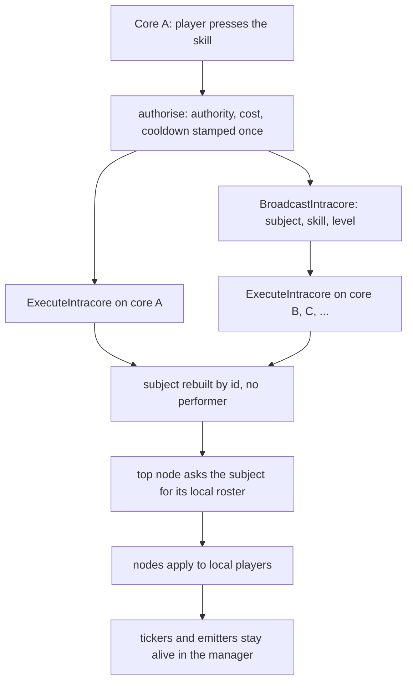

A skill cast used to happen in one body on one core. A guild or an empire does not live on one core: its members are spread over every core of the mesh, and a buff for "every member" could not be computed anywhere, because each core holds only its own players. Two keys close that limit, and they are independent.

| Reach | Key | Declared per | Runs |
| --- | --- | --- | --- |
| The whole map | `collect: { from: map }` | node | on the one core that hosts the map |
| Every core | `intracore: true` | skill | on every core of the mesh, once each |

Who counts as ally or enemy, and whose roster is asked, is the owner of the skill: see [Skill owners](/foundations/skills/owners). How a node chooses its targets before reach matters is in [Skill reach](/foundations/skills/reach). The two keys compose with the owner, not with each other: the map-wide skills 155 to 157 are empire skills, and an intracore skill must be guild-owned or empire-owned.

## What vanilla did

The inherited code had guild skills only, in a fixed range of vnums from 151 to 162, and no empire skills. Using one was refused outside a guild war:

```cpp
if (!UnderAnyWar() || !ch->GetWarMap())
{
    ch->ChatPacket(CHAT_TYPE_INFO, LC_TEXT("<길드> 길드 스킬은 길드전 중에만 사용할 수 있습니다."));
    return;
}
```

Inside a war it called the war map, which walked its own set of characters and ran the caster's `ComputeSkill` on each member of the guild. The loop is this:

```cpp
void CWarMap::ComputeSkill(LPCHARACTER pkCaster, uint32_t dwVnum, uint32_t dwLevel, uint32_t dwGuildID)
{
    FWarComputeSkill f(pkCaster, dwVnum, dwLevel, dwGuildID);
    std::for_each(m_set_pkChr.begin(), m_set_pkChr.end(), f);
}
```

That is the whole reach: one war map, hosted by one core, with the caster's body applying the skill to everyone on it. A guild member logged in on another core, or in another channel, was not part of it.

## What happened to guild skills

In April 2019 the guild skills were removed. They did not fit the skill system we had just written in February 2019, the first version of the composable skill nodes, and we decided to keep them out of the gameplay and plan them for a later update.

They came back in 2026. In March the skill infrastructure was re-enabled with level, cooldown, load, broadcast and client registration, and a guild skill went through the ordinary character path. A code comment from that time says what was wrong with it: the caster owned the skill instance, but the cooldown and the costs belonged to the guild. It still ran in the caster's body on the caster's core.

On 9 August 2026 a single large change added the `subject:` key, the `intracore:` key, the map-wide extent of `collect.from`, and a damage resolver that survives having no attacker. The same day brought place nodes, and 158 became the skill described below; 152 to 157 had been worked since late July and were moved onto the new keys. Those skills were the first clients of the change. The limit it removed was the one above: a cast that could not leave its core.

## Map-wide: one node sweeps the whole map

`collect.from: map` replaces the sector tree around the performer with every entity on the map index. It is parsed as an extent, nothing more:

```cpp
// EXTENT only -- how far the sweep goes, never who is admitted.
static const std::map<std::string, uint8_t> kExtent = {
    {"sectree", COL_EXTENT_SECTREE}, {"map", COL_EXTENT_MAP} };
```

Admission is still `kind`, `of`, the ledger and the rest of the collector, described on the reach page. The sweep chooses its source in a fixed order, and the order is the meaning:

```cpp
// The ORDER is the meaning. A centre outranks the roster: an anchored ticker's subtree
// runs at a place, and taking the roster there would ignore the radius and reach the
// subject's every enemy on the core -- a 1000-unit blast delivered server-wide.
TNodeUseInfo * pkCentre = GetSkillNodeInfo(pkInfo->unNodeID);
if(bWholeMap)
{
    // The whole map, whatever the centre. A cast with nobody performing it still knows
    // which map, because the centre it was seeded with carries one.
    const uint32_t unMapIndex = pkFrom ? pkFrom->GetMapIndex() : pkCentre->unCentreMapIndex;
    if(unMapIndex)
        SECTREE_MANAGER::instance().for_each(unMapIndex, f);
}
else if(bFromCentre)
{
    // From the CENTRE, which is where the radius is measured from anyway.
    if(LPSECTREE pkTree = SECTREE_MANAGER::instance().Get(pkCentre->unCentreMapIndex,
        pkCentre->kMainVIDPos.x, pkCentre->kMainVIDPos.y))
        pkTree->ForEachAround(f);
}
else if(NULL == pkFrom)
{
    const ETargetRelation eSide = (ACC_REL_ENEMY == pkInfo->kPop.kAccept.bOf)
        ? TARGET_RELATION_ENEMY : TARGET_RELATION_ALLY;
    if(m_pkSubject)
        m_pkSubject->Enumerate(eSide, [&f](LPCHARACTER ch) { f((LPENTITY) ch); });
}
else if(pkFrom->GetSectree())
    pkFrom->GetSectree()->ForEachAround(f);
```

In words: a map-wide node sweeps the map; otherwise a position seed sweeps around its place; otherwise a cast with no performer and no centre asks the subject for its roster; otherwise the performer's sector tree. After the source, every path runs the same collector. A map-wide sweep does not read a radius. A `search.radius` next to `from: map` is only logged and the load goes on, and an unknown `from:` value is only logged too, so check the log after editing.

The position seed ranks above the roster for a reason. Before 9 August an anchored subtree with no performer fell through to the subject roster and delivered a bounded blast to the whole core.

The map-wide skills that ship are the three empire skills 155, 156 and 157, all `per_use`, none intracore. They show why map-wide is kept apart from server-wide:

- **156** puts one `AFFECT` with `from: map` and `of: ENEMY` over every enemy on the map and hangs a `DAMAGE` child under it. It is not intracore because the performer is present, so the damage keeps the crit roll, the attacker's bonuses, the trait hooks and a real killer. A fight happens on one map, and nothing in it wants to cross a core.
- **155** collects every ally on the map, then a child `DAMAGE` re-seeded on each ally collects enemies within 700. Its header states the trap: the child sweep is still the performer's sector tree, so an ally on the far side of the map finds nobody. It needs `max_per_victim: 0` on the child, because the default of 1 would cap the whole cast at one hit per enemy and turn the composition into an ordinary area attack.
- **157** plants an `AUTO_SHOOT` emitter on every enemy on the map, and each tick heals up to three allies within 900. It is not intracore because a timed run reads the performer on every tick, so it lives on the core where the fight is.

"The map" is a map index on one core. A map-wide sweep never leaves the core that hosts the map, and a child sweep under a map-wide parent still starts from the performer's sector tree.

## Server-wide: authorise once, execute everywhere

`intracore: true` splits a cast in two. The core where the button was pressed authorises it: authority, cost, cooldown and every other check. Then every core executes it, that core included, through the same entry point and with no performer. This is the call site:

```cpp
// An intracore cast splits in two: AUTHORISE here, where the button was
// pressed (authority, cost, cooldown -- all done above), then EXECUTE on
// every core including this one, through the same entry point, with no
// performer. This core is not privileged: a cast that could read whoever
// pressed would give his core different numbers from every sibling.
if (pkSk->bIntracore)
{
    SIM_TRACE_PICK("intracore");
    pkSkillInstance->UseSkill();

    const uint32_t unLevel = pkSkillInstance->GetUseLevel();
    const uint32_t dwSubjectId = pkSkillInstance->GetSubject()
        ? pkSkillInstance->GetSubject()->Id() : 0;

    CSkillManager::instance().BroadcastIntracore(pkSk->bSubjectKind, dwSubjectId,
        pkSk->unVnum, unLevel);
    CSkillManager::instance().ExecuteIntracore(pkSk->bSubjectKind, dwSubjectId,
        pkSk->unVnum, unLevel);

    m_dwLastSkillTime = get_dword_time();
    return true;
}
```

The pressing core is not special. A cast that could read whoever pressed the button would give that core different numbers from its siblings, so the executing half is not allowed to see the performer at all. The loader proves that when the skill is read (see the boot refusals below).



### The packet

The broadcast is one game-to-game packet to every core the mesh reaches, channels included, because a subject is one entity for the whole server:

```cpp
// The EXECUTE half of an intracore cast, to every core the mesh reaches,
// channels included: a subject is one entity for the whole server. Owned by the
// skill system -- the subject is named, never implied by which subsystem sent
// it. Level travels so a core whose copy of the subject lags still applies the
// one the authorising core resolved.
typedef struct SPacketGGSkillIntracore {
    uint8_t  bHeader;
    uint8_t  bSubjectKind;
    uint32_t dwSubjectId;
    uint32_t dwSkillVnum;
    uint32_t unLevel;
} TPacketGGSkillIntracore;
```

It names the subject kind and id, the skill and the level. Nothing else crosses: a receiving core calls the same `ExecuteIntracore` that the pressing core just called locally.

### What each core does

```cpp
std::unique_ptr<ISkillSubject> pkSubject = MakeSkillSubjectById(bSubjectKind, dwSubjectId);
if (!pkSubject)
{
    // Not an error: no subject here means nothing to apply it to either.
    sys_log(0, "ExecuteIntracore: subject kind {} id {} unknown here, skipping",
        bSubjectKind, dwSubjectId);
    return;
}

ReapIntracoreCasts();

// No performer: the loader has already proved the cast reads nothing else.
auto pkSkill = std::make_unique<CSkill>(dwSkillVnum, (LPCHARACTER) NULL);
pkSkill->AdoptSubject(std::move(pkSubject));
// The authorising core stamped it; stamping again would multiply a shared
// cooldown's fan-out by the size of the mesh.
pkSkill->UseSkill(/*bStampCooldown*/false);
// From the wire, not looked up here: a core whose copy of the subject lags
// still agrees with the rest.
pkSkill->SetLevel(unLevel);

CSkill * pkRaw = pkSkill.get();
m_vecIntracoreCasts.push_back(std::move(pkSkill));

// ONE use, ONE computation, through the same traversal and the same collector
// every other cast uses -- only the population comes from the subject rather
// than from geometry, which is what the NULL seed says.
pkRaw->NewComputation(false);
pkRaw->ProcessSkill(NULL);
pkRaw->RunPostPreflightPhase();

// Kept alive only if a ticker or an emitter came out of it.
ReapIntracoreCasts();
```

Three things in it carry the design.

**The level travels in the packet.** The level is read on the authorising core and applied as sent. A core whose copy of the guild row is a moment behind still computes the number the caster paid for. The level of an intracore skill belongs to the subject (the guild or the empire), not to the character, which is why it is one number for the whole cast.

**The cooldown is not re-stamped.** Using a skill stores the next usable time, announces it and persists it, and all of that is the subject's. For a guild it is a write to the guild row, for an empire a server flag, and both fan out to the database core and the whole mesh. If every receiver stamped it, one cast would multiply that fan-out by the number of cores, so only the authorising core does.

**Each core reaches only its own players.** With no performer, the top node asks the subject for its roster on this core: for a guild, its members online here, with the enemies being the online members of the war opponent; for an empire, the players of that empire on this core. The union over all cores is the whole guild or the whole empire, and nobody is hit twice, because a player is online on exactly one core. The subject's neutral reads (source id, duration bonus, attribution) answer zero on every core, which is also what makes every core agree: a performer's party buffer bonus would otherwise stretch the durations on the pressing core only.

The cast object has no character to own it, so the skill manager keeps it, and drops it when it has no live runs left. A ticker inside an intracore cast therefore outlives the call. The 158 skill relies on this: its strike lands five seconds after the mark.

### Replication is derived

Nothing declares a skill replicable. A cast can be computed identically on a sibling core exactly when the subject's state is present there and its formulas read nothing else. A character's state is on one core only. A guild's state is in the guild row, fanned out to every core. An empire's state is in server flags written through the database core and forwarded to every game core. The loader checks both conditions, so a skill that cannot be replicated does not load.

## A hit with no performer applies only the victim half

An intracore `DAMAGE` has no attacker. The damage resolver guards every read of the attacker, so what applies is the victim half: the victim's own defence stands, without penetration or pierce, and nothing is read off an attacker's sheet. The code comment in the loader puts it as "partial by construction". The resolver, the twelve stat sinks behind it and the mob-skill resist all had to survive a null attacker for this to work.

The cost is attribution. The kill is credited to a killer id, and a cast with no performer has none, so the kill has no owner. The shipped intracore damage skills, 152 and 158, accept players only.

## One pair: 158 against 150

158, the Judgement of the Empire, landed on 9 August 2026 as an empire skill with `intracore: true`. Its top node is a collector with `of: ENEMY` and `kind: PLAYER`, and no `from:`, because a top-level intracore node must not declare one. On each core that selects the empire's enemy players present on that core. Under it, each marked player gets a mark with a five-second timer, and a ticker with `anchor: position` waits five seconds, then collects enemies within 800 of the mark and deals 100000 true damage with `max_per_victim: 0`. The anchored ticker is the case the position-seed rule above exists for. The file header states the contract: dying, warping or logging out between the mark and the ray does not cancel it. Running away does.

150, the Stellar Sanctuary (new on 21 October 2026), is its counterplay and deliberately not intracore. It is a ticker anchored on a position with a radius of 1200: 20 pulses at one second, a heal, two short resistance affects and a cleanse every third pulse. The second affect carries a trait that zeroes the hits of 158. Its header explains the choice: an intracore cast has no performer and so no centre, and this one is nothing but a centre, so it lives on the one core where it was planted. The caster can walk out or die and the pulses go on, but being destroyed by a logout or a warp off the core ends them, because the performer's destructor cancels his runs. The runs of 158 belong to a performer-less cast owned by the manager, so no logout can end them.

So 150 is "one place on one core" and 158 is "every core". Neither is a map-wide skill: the map-wide examples are 155 to 157.

The other shipped intracore skills are 152, damage to the enemy guild's members wherever they are logged in; 153, an affect on every guild member whose trait takes the skill level as a constant (the guild level is replicated, so every core freezes the same number); and 154, a movement speed affect on every player of an empire, the same machinery as a guild skill with one word changed.

## The boot refusals

An intracore skill promises that every core computes the same thing without a performer. The loader checks the promise when the file is read, at the end of building the skill. Each failure is logged with the skill and the node, and the refusals are:

| Refused | Logged as |
| --- | --- |
| subject that is not a guild or an empire | `intracore: true` needs a subject whose state is on every core; a character's is not |
| any `per_use:` phase | `intracore: true` has no `per_use:` phase; it is seeded with the caster, and there is none |
| no `per_compute:` nodes | `intracore: true` with no `per_compute:` nodes does nothing |
| top-level node without `collect.search` | must declare `collect.search`; with no seed it is the only way the node collects anything |
| top-level `collect.from` | declares `collect.from`; a top-level intracore node has nothing to sweep from and takes the subject's roster |
| top-level `collect.origin` | declares `collect.origin`; there is no position to centre on |
| the caster as origin or source, at any depth | names the caster in `collect:`; there is none |
| top-level `collect.scalePoly` | declares `collect.scalePoly`; with no centre hit_dist is meaningless |
| `of: SELF` or `of: PARTY`, anywhere | uses `of: SELF`/`of: PARTY`; those are relations to the PERFORMER, and there is none |
| top-level `of: ANY`, the default | must declare `accept.of` (ALLY or ENEMY); ANY would take the subject's whole roster |
| `PULL`, `CRUSH`, `TAUNT`, `CONCATENATED_ATTACK` | needs a performer's body; an intracore cast is self-applied |
| any `handler:` | declares `handler:`; an intracore cast has no caster to hand it |
| `damageType: RANGE` | uses `damageType: RANGE`, whose falloff measures from the performer |
| `absorb` on `AFFECT` | uses `absorb`, which puts the inverse affect on the caster; a subject has no affect list |
| `absorb` on `CUT_POINT` | uses `absorb`, which credits what it cut to the caster; there is none |
| `to: caster` on `POINT_CHANGE` | uses `to: caster`; there is no character to change a point on |
| any formula that reads the performer | `intracore: true` but node ... reads '...', which needs the performing character -- no core has one |

The last row is the one that bites. Every formula field is walked: `scalePoly`, `successPctPoly`, `upkeep.amountPoly`, the amounts and durations of `AFFECT`, `HEAL` and `POINT_CHANGE`, the count and delays of a `TICKER`, and the constants of a trait.

A victim is local wherever the cast lands, so `victim_*` is fine. The subject's own variables are fine. Anything else names the performer, and the file is refused. Only trait constants cross cores: they freeze from the subject at application time, and the formulas then run on the holder at hit time, so traits needed no change.

Children are walked recursively, with one relaxation. A child is re-seeded with a real local character, so positional keys are legal one level down, and that is how "enemies around each ally" is written. A node that acts at a centre is allowed at any depth, because the centre is a local victim's position and a victim is local to exactly one core, so exactly one core plants it.

A refusal is not a warning. A node failing validation makes the skill build fail, the skill table is not installed, and at boot the game core logs "cannot initialize skill table from YAML" and shuts down:

```cpp
if(!CSkillManager::instance().InitializeFromYaml(szSkillDir))
{
    sys_err("cannot initialize skill table from YAML");
    thecore_shutdown();
    return;
}
```

One invalid intracore skill stops the game core from starting. A live reload ignores the failure and keeps the table that was installed before.

## What stays in the engine, and what the simulator cannot show

Both keys are YAML on native machinery. There is no Lua door for them: `handler:` is refused under `intracore`, and nothing registers a map-wide or server-wide cast from a script. Guild and empire skill use is gated by a policy: see [Skill policies](/foundations/skills/policies).

That policy is where one rule is surprising today. The use policy registered in the guild war forge, `guild_skills:war_only`, covers the skills 151 to 157 and refuses a cast when the caster has no war map. It still catches the empire skill 154 and the map-wide skills 155 to 157 on non-war maps, so today they can be cast only from a guild war map. 150 and 158 are not in the list.

The simulator tests the intracore path with `sim.intracore_deliver`, the exact call the game-to-game input makes when the broadcast arrives. It covers the victim-half damage and the rule that the level travels in the packet: delivered at level 1 while the guild is researched to 7, the affect must carry the level 1 number. Its manifest also states what it cannot show:

```lua
-- Two things the sim cannot model, stated rather than papered over:
--   * guild gold never decreases -- GuildPointChange only ASKS the DB core, and the answer
--     (RecvMoneyChange) never comes. A refusal is provable, a balance is not.
--   * one process is one core, so nothing here shows two cores avoiding a double-apply.
--     That follows from each core enumerating only its own members.
```

That last line is the one to remember. The no-double-apply property is argued from the design, not measured: each core enumerates only its own players. A test that put two cores in one process would be a different simulator.
