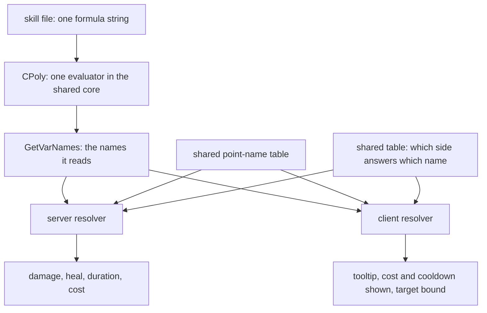

A skill number is a string: `632*skill_k+(point_TOTAL_PHYS_ATT-point_AURA_PHYS_ATT_BONUS)*1.3`. The server evaluates it to deal damage. The client evaluates the same string to print the tooltip. Both use one evaluator and a shared vocabulary. The Metin2 mainline engine maintains separate server and client formulas, which can disagree.

An expression names what it reads, and the resolver answers those names. This page explains how that works, why it was built this way, and what is still hand-kept C++. How the tooltip text is built from these numbers is on [Skill descriptions](/foundations/skills/descriptions). The file these strings live in is on [One file per skill](/foundations/skills/one-file). What a skill can do beyond a formula is on [Extending past the YAML](/foundations/skills/beyond-the-formula).

## One string, two evaluators

A skill file holds its numbers as strings: `amountPoly`, `costPoly`, `cooldownPoly`, `durationPoly`, `intervalPoly`. This is a whole skill, a three-way sword cut:

```yaml
name: Taglio a tre vie
type: CLASS
maxLevel: 40
cooldownPoly: '15'
costType: SP
costPoly: 40+100*skill_k
range: 450
useTimeout: 2500
skillshot: true
weaponLimitation:
- SWORD
- TWO_HANDED
flags:
- ENEMYONLY
- ATTACK_SKILL
- LEVEL_UP_BY_POINT
- NEED_TARGET
client:
  job: WARRIOR
  icon: skill/warrior/samyeon
  motionIndex: 1
  gradeCount: 4
desc:
  vars:
    val:     { ref: node.dmg.amountPoly }
    targets: { ref: resolve.bound.targets }
resolve:
  by: client
  bound: { targets: '6', hitsPerTarget: '3' }
per_compute:
- type: DAMAGE
  id: dmg
  amountPoly: 632*skill_k+(point_TOTAL_PHYS_ATT-point_AURA_PHYS_ATT_BONUS)*1.3
  damageType: MELEE
  ability_scaling: { adder: SAMYEON_ADDER, resist: SAMYEON_RESIST }
  accept:
    of: ENEMY
```

The damage node holds the formula once. The tooltip variable `val` does not copy it: `ref: node.dmg.amountPoly` points at it. Both sides then parse the same string with the same library, and read `skill_k` and the two `point_` names from their own state, the server from the character, the client from the points the server sent it.

The polynomial library, `CPoly`, is a small expression evaluator: arithmetic, powers, `min`, `max`, `floor`, `abs`, `mod`, `sqrt`, `log`, trigonometry and `irandom`. It has no comparison or boolean operators: a predicate is a 0 or 1 you multiply by, as `0.80+0.20*is_mental` does. It lives in the shared core and is linked by the server, the client and a handful of other users (the pet, the skill tree, guilds). It is not a skill-only thing. Two behaviours matter to a skill author:

- Division or modulo by zero, a negative root or the log of a non-positive number returns 0 for the whole expression, not an error. A parse error also returns 0.
- Identifiers may contain dots (`node.dmg.amountPoly`, `quest_flag.ballemup.blood`). A dot only continues an identifier that began with a letter, so `1.5` still lexes as a number.

A poly is also stateful. It keeps each variable's value until someone overwrites it, which is why `ClearVars` exists and why the skill code evaluates a fresh copy per use: a poly shared between evaluations reads, for any name the caller forgets to set, whatever the previous evaluation left there.

## Pull: the expression says what it reads

The consumer names what it reads, and the resolver answers only those names. `GetVarNames()` returns every identifier an expression references, and the server loop is this:

```cpp
void ApplySkillPolyVars(CPoly & poly, const SSkillPolyVarContext & ctx, ESkillPolyVarScope eScope)
{
    if (poly.IsEmpty())
        return;

    const bool bWantVictim = (eScope == SKILL_POLY_SCOPE_VICTIM);

    for (const std::string & strName : poly.GetVarNames())
    {
        if (IsVictimScoped(strName) != bWantVictim)
            continue;

        double dValue = 0.0;
        if (ResolveSkillPolyVar(strName, ctx, dValue))
            poly.SetVar(strName, dValue);
    }
}
```

The context carries the performer, the victim, the subject that owns the cast, the skill level and the skill power. It runs twice per node poly, on a fresh copy of the proto formula each time: once for the caster half of the vocabulary and once for the victim half, with the node-state names answered in between. Cost and cooldown run the caster half only, since no target is known yet, so any `victim_` name reads 0 there.

Between the two passes, the node's own live state is answered: `node.<id>.<stat>` for another node's work in the same cast, `self.<stat>` for the node's own, and `use.*` for the cast. A node id that does not exist leaves the name unresolved. A node that exists but has not run yet answers 0. The nodes and their phases are the subject of their own page; here it is enough that these names are pulled the same way.

A name the resolver does not recognise is left alone, not zeroed. That is deliberate: values another mechanism wrote before survive whatever order the two ran in.



## The vocabulary: rules first, a table second

The server resolves a name in a fixed order:

1. The subject that owns the cast is asked first (see below).
2. `quest_flag.<flag>` reads a quest flag of the caster.
3. `victim_point_<NAME>`, then `point_<NAME>`: a rule over the point names.
4. A small table of derived names, through an enum switch.

The point rule is what keeps the vocabulary open. Every `POINT_*` the engine defines is readable as `point_<NAME>` the day it is added, with no C++ change in the skill code and no per-skill declaration. A new stat appears in a formula by adding the point and its name to the shared point-name table.

The names that are not a plain point read are the table: 28 entries, each tagged as answerable by both sides or by the server only.

| Side | Names |
| --- | --- |
| Both | `skill_level`, `skill_k`, `skill_power`, `skill_spec`, `calc_missing_hp`, `calc_missing_sp`, `calc_precision_rate`, `calc_raw_phys_att`, `calc_raw_magic_att`, `calc_raw_adaptive_att`, `calc_total_adaptive_att` |
| Server only | `subject_level`, `subject_member_count`, `subject_gold`, `calc_horse_level`, `calc_hp_without_defensor`, `calc_def_penetration`, `is_mental`, `is_archer`, `is_assassin`, and eight `victim_*` names |

The table gives each name an enum value, and the resolver switches on that enum with no `default:`. Adding a name to the table and forgetting to resolve it is a build failure, not a silent 0 in a fight.

Two accessor details decide which number a `point_` name returns. By default the rule reads `GetPoint`, which folds in the transient bump a [trait](/foundations/traits/) applies during a damage calculation. Five points (movement speed, critical percent, attack speed, casting speed and IQ) read `GetLimitPoint` instead, the clamped value, to use their clamped values. The two are not interchangeable: resolving everything through the limit accessor would silently drop every active trait bump, the buff erosions included, which is a real damage change. And a few points are not kept in the points map at all, so the resolver overrides them with their accessors: `HP`, `MAX_HP`, `SP`, `MAX_SP` and `LEVEL` (and `LEVEL` substitutes the adaptive level for adaptive mobs). That list matters; see the traps.

## The client answers the same names

The client runs the same evaluator and the same point rule. It reads `point_<NAME>` from the player's status, which the server fills from its points packet, and the names in the shared table from a map of small functions, one per name the client can compute:

```cpp
static const char c_szPointPrefix[] = "point_";
const size_t uPrefixLen = sizeof(c_szPointPrefix) - 1;
if (0 == strncmp(c_szStateName, c_szPointPrefix, uPrefixLen))
{
    uint32_t unPoint = 0;
    if (TryPointFromName(c_szStateName + uPrefixLen, unPoint))
    {
        *pfState = (float)CPythonPlayer::Instance().GetStatus(unPoint);
        return true;
    }
}

auto it = ms_StatusNameMap.find(c_szStateName);
// Unknown variables resolve to 0 - preserved legacy behavior. This is also
// where victim_* and hit_* land: they have no value outside an in-flight
// cast, so a description must not reference them.
*pfState = (it != ms_StatusNameMap.end()) ? it->second(ctx) : 0.0f;

return true;
```

A name only the server can answer reads 0 on the client. So a tooltip must not read one unless it pins a value for it. The engine refuses at boot, not in front of a player, in these places:

- `costPoly`, `cooldownPoly` and `resolve.bound.targets` are evaluated by the client itself. One that reads a server-only name is refused: the error says the client evaluates this poly itself and would read 0.
- A `desc.vars` entry that reads a name no vocabulary resolves is refused, with the hint to pin it with `with:`. One that reads a server-only name with no pin is refused too. A `quest_flag.*` read is allowed: such a variable is resolved by the server and sent over the wire.
- A trait `constants:` entry that reads a name the skill vocabulary does not resolve is refused, because it would evaluate as 0.
- In an intracore skill, every poly must be subject-scoped, a `victim_*` name or a `node.`, `self.` or `use.` name. The refusals and why they exist are on [One file per skill](/foundations/skills/one-file).

A pin is how a predicate only the server knows still gets a tooltip number. Skill 16 changes its damage when the target is mental:

```yaml
desc:
  vars:
    val:      { ref: node.dmg.amountPoly, with: { is_mental: 1 } }
    val_base: { ref: node.dmg.amountPoly, with: { is_mental: 0 } }
```

```yaml
amountPoly: 1400*skill_k+(point_MAX_HP*0.04)+(point_TOTAL_PHYS_ATT*2.6)*(0.80+0.20*is_mental)
```

The tooltip shows both numbers, each with the predicate pinned. The renderer and the pin verbs are on [Skill descriptions](/foundations/skills/descriptions).

When the client starts, it also checks its own map against the shared table and logs, through its trace-error channel, a name tagged as both that it cannot implement and a server-only name it implements anyway. The check is a log line, not a refusal, and it compares names, not results.

## Names that depend on who owns the cast

A cast has a performer, the character who does it, and a subject, who owns it: a character, a guild or an empire. A guild or empire cast has no performer on some cores. The subject is asked first, and answers its own half of the vocabulary:

| Name | Character | Guild | Empire |
| --- | --- | --- | --- |
| `subject_level` | the character level | the guild level | a flag, `empire_level.<e>` |
| `subject_member_count` | 1 | the member count | the count on this core |
| `subject_gold` | the character's gold | the guild money | the monarch's treasury for that empire |
| `subject_flag.<f>` | a quest flag | a guild quest flag | the flag `empire.<e>.<f>` |

The same three names, three storages, so one formula such as `subject_gold` scaling works for any owner. `skill_level`, `skill_k` and `skill_power` count as subject-scoped too; `skill_spec` does not, because it reads the performer whatever its name suggests. How owners, purses and intracore casts work is on its own page.

## The Lua door

Lua reaches the same evaluator through `forge.sys.game.poly.eval(expr, vars)`. The default is the opposite of the skill resolver's: an unset name is an error, and the call returns `nil` and a reason.

```lua
local value, why = forge.sys.game.poly.eval("a+b*2", { a = 1, b = 3 })
if not value then
    print(why)
end
```

This is an example written for the page. The reasons are `"empty"`, `"cannot analyze"` and `"unset variable '<name>'"`. The skill vocabulary is not reachable through this door: the caller supplies every variable. And the vocabulary itself is C++ only: there is no registry to add a named variable from Lua or from a module. A new name is a rule or a table entry in C++.

## Traps, by cause

A name the server accepts can still read 0. The point rule is a lookup in the points map, and some points are not kept in that map. Stamina is one: it lives in a character field of its own, and changing it writes through that field. The resolver's override list covers only `HP`, `MAX_HP`, `SP`, `MAX_SP` and `LEVEL`, so `point_STAMINA` reads 0 on the server, silently. The name is accepted, no boot check fires, and nothing is logged.

The client does not have this problem: the points packet overrides the map with the real accessors, stamina among them. So a tooltip quoting `point_STAMINA` shows the player's stamina while the hit computes with 0, two sides disagreeing on a name both accept. No shipped skill reads it. The same shape holds for the other points the points packet fills from accessors rather than the map: experience, gold, maximum stamina and the coin points. Read them another way, or the engine adds the accessor case.

A typo in a node formula reads 0. The server leaves an unknown name alone and the client returns 0, and the boot checks above cover desc vars, the three client-evaluated polys, trait constants and intracore skills, not every node poly. A `desc.vars` entry that refs the formula catches it.

The names in the shared table are implemented twice, by hand, once per side. The startup check compares that the name exists, not that it computes the same. Two differ: the client's raw physical attack also subtracts a boss attack-bonus point, and its raw magic attack subtracts three boss points the server does not (the raw adaptive attack, the larger of the two, carries both). Those points are written only by mob skills, so on a player the two sides agree. The day a skill or item gives a player one of them, tooltip and hit differ for the 86 formula uses of the two raw names.

A zero division kills the whole expression, not the term. `a/(b-b)+5` returns 0, not 5. Guard the divisor with `max(1, x)`.

`GetPoint` versus `GetLimitPoint` is per point, not per name. `point_ATT_SPEED` is the clamped value and does not include a live trait bump, while `point_TOTAL_PHYS_ATT` does. The name does not tell you which.

`skill_k` is 0 across the guild skill range: the skill power function returns 0 there. Guild casts take their numbers from the subject names above.

## What stays in the engine

The poly library is native C++ in the shared core, with its expression grammar plus dotted identifiers. Nothing about it is scriptable.

The vocabulary is C++ too, in two places. The point-name table and the rule over it are the open part: a new point becomes a name by one table entry. The 28-entry table of derived names and its resolver are closed: each is a C++ function, and each name tagged as both sides is implemented twice, by hand, on the server and on the client. The accessor exceptions, five points that read the limit and five that read an accessor, are a hand list.

The Lua door evaluates an expression the caller fully supplies. Skill formulas cannot get a Lua-defined name.
