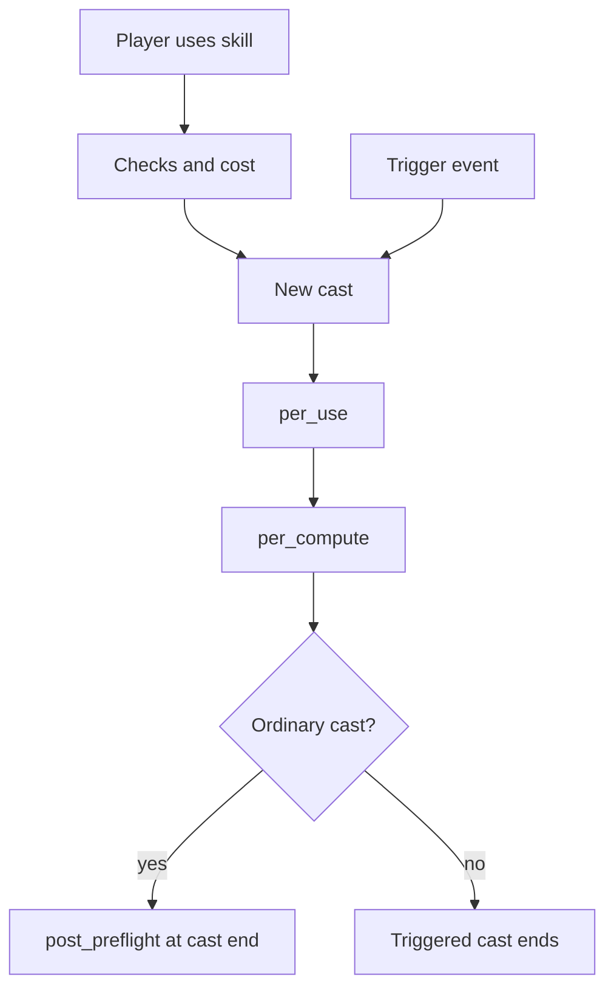
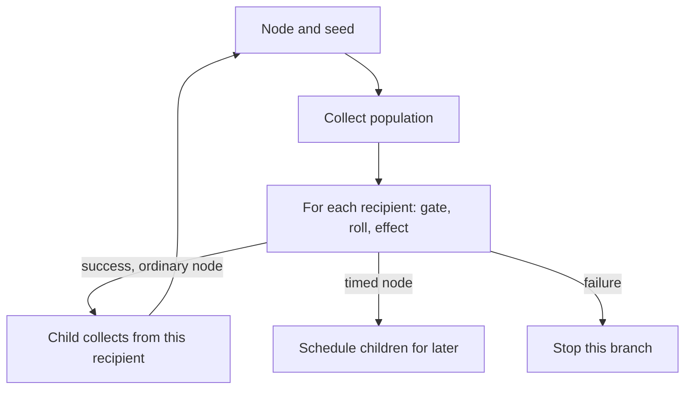

A skill combines effects as a tree of nodes. Each node says what it does and can select who it reaches; a child runs from each recipient of its parent. Universal Core has 24 live node types, including effects, population and timing controls, and visuals.

The Metin2 mainline engine expresses a skill with a small set of point changes and flags; effects beyond those need skill-specific C++. Nodes separate the effect from its population and timing, so a skill can compose behavior without a separate branch for every combination. See the [node reference](/docs/core/skills/nodes) for types and keys, and the [Skills glossary](/foundations/skills) for shared terms.

## A cast has phases

A **cast**, or use, is one execution of a skill. A **computation** is a traversal of nodes from a starting point, called its **seed**. The seed can be a character or, for some traversals, a position. The phase determines when a root node runs and what seed it receives:

- `per_use` runs once for a cast, starting with the caster. A node can still search for others from that seed.
- `per_compute` runs for each computation. A server-resolved player cast has one; a client-resolved cast can have one per accepted attack packet.
- `post_preflight` runs once at the end of an ordinary cast, when the server's record of victims is available. It starts with the caster.

Each phase starts a fresh computation. Otherwise a node could retain a seed from the preceding traversal and fail to run for the next one. Node identifiers are shared across the phases of a skill, so a later phase can refer to an earlier node's records.

The end of a cast depends on its resolution. A server-resolved player cast finishes after its computation. A client-resolved cast waits for the client to report the end of the hit window; the server uses its own victim record, not the count in that report. If the report never arrives, there is no timeout that runs `post_preflight`. A mob cast finishes at its last scheduled splash. Put work that must happen when a player uses the skill in `per_use`, rather than relying on the final phase.

The diagram follows the ordinary player path and the shorter event-triggered path.

## A node collects before it acts

A node's **population** is the set of characters it reaches in one computation. `collect` determines where candidates come from and whether to search around a center. `accept` filters candidates by rules such as their relationship to the caster and character kind. The [collect and trigger reference](/docs/core/skills/collect-and-triggers) lists the fields and defaults.

The seed is the starting point, not necessarily the final population. A node can act on the seed, search around it, or use another source. A search can also choose a different center. For example, a child can be seeded by its parent's recipient while measuring distance from the caster or the computation's original seed.

For an ordinary character-seeded collection, the order matters:

1. A caster source selects the caster directly. Otherwise, the seed is considered first.
2. If the seed is enabled and fails the acceptance test, the node stops; its search does not rescue it.
3. An accepted seed is collected before search results and consumes a slot in the search limit.
4. The search filters and orders candidates, then takes up to the remaining limit.

If the seed should only be the center for a search, disable its acceptance with `accept.seed: false`. With no search, that leaves nobody to collect. The caster is excluded from searches by default; including the caster in a search is a separate choice from allowing the caster as the seed.

Search reach has two parts. The center sets where distance is measured, but the default character-seeded sweep draws candidates from the performer's sector tree, the spatial index for nearby characters, and neighboring sectors. A map-wide collection uses a different sweep. Moving the center far away does not move that sweep, so a distant center can find few or no candidates. A position-seeded traversal sweeps around its position. For wider reach, see [Every core](/foundations/skills/owners-and-cores).

## Children run once per parent recipient

The dispatcher collects a node's population, then processes each recipient. A gate or a supported success roll can stop the node for that recipient. The node's effect runs next; only a successful result allows its children to run.

Each child gets the parent's recipient as its seed and collects its own population. A child without a separate search can act on that recipient. A child with a search can instead find a new population around each parent recipient. The latter can multiply work and reach the same character through more than one parent recipient.

The traversal is depth-first for ordinary nodes. A child's collection state is reset for each parent recipient, so a per-victim collection limit on the child does not impose a single shared limit across all of those child traversals. Nesting describes population as well as order.

This flow shows the distinction between an ordinary child traversal and a timed node that schedules its children.

## Timed nodes keep a cast alive

A timed node hands its children to a run that executes later. Each collected recipient can carry a separate run. The run retains the cast that created it, including the state needed by its nodes, even when the skill instance points at a newer cast. The skill definition itself is shared and read-only.

Some timed nodes need two populations. Their own `collect` and `accept` select the carriers; `targets` defines the population a timed attack searches for as it fires or chains. Those timed attacks require a target search. A carrier is therefore not automatically the character that receives every later effect.

A skill can have several live runs. Ending one does not turn the skill off while others remain. Turning the skill off cancels its live runs and removes its associated caster affect; caster death stops only runs configured to stop on death. An **affect** is a timed state on a character; see [affects](/foundations/affects) for its lifecycle.

## Two ledgers bound different things

The cast keeps an entrypoint ledger for victims claimed through the client attack path. `resolve.bound` limits those claims and hits per victim at that entrypoint. For a server-resolved cast, that bound does not limit the node's search population. Use the search limit when the collection itself must stop at a given number.

A separate collection ledger records what a node collects. Its per-victim count and cooldown can limit repeat collections by that node. A zero count limit expresses no cap from that rule; it does not mean one. The scopes matter: a packet bound, a node's collection limit, and the reset of a child's state per parent recipient answer different questions.

## Triggers enter without a player press

A trigger connects a native game event to a skill. A passive skill can declare conditions for starting a cast, and an off trigger can end an active skill. The event provides context, which can include the other character involved, called the **trigger subject**. A node can collect that subject, or a triggered cast can use it as its computation seed where configured.

The trigger path checks the learned skill, conditions, instance, and cooldown. It does not take the ordinary player-use path, so it does not pay that path's cost or consult its use policy. A triggered cast runs `per_use` and one `per_compute`, but does not run `post_preflight`. An invalid trigger subject can prevent a subject-seeded cast from computing.

A frequently fired event needs an appropriate cooldown if repeated execution is unwanted. Triggered effects can themselves cause events and start other triggers; nesting is capped at 8. An unknown event name can be accepted into the trigger map yet never fire, while an unknown condition fails when evaluated. The reference lists supported events and conditions.

## Load failures protect the skill table

A node type is part of the engine's closed set. An unknown or retired type prevents the new skill table from building. At boot, a failed build stops the core; on reload, the previous table remains in place. This keeps a malformed replacement from leaving a partially loaded table, but it also means one invalid skill can block the whole update.
