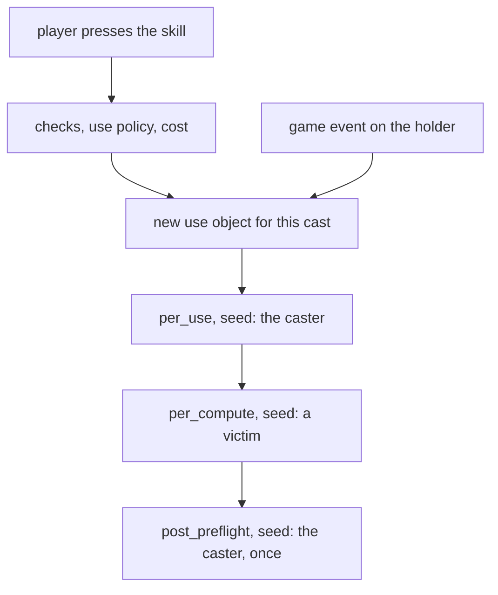
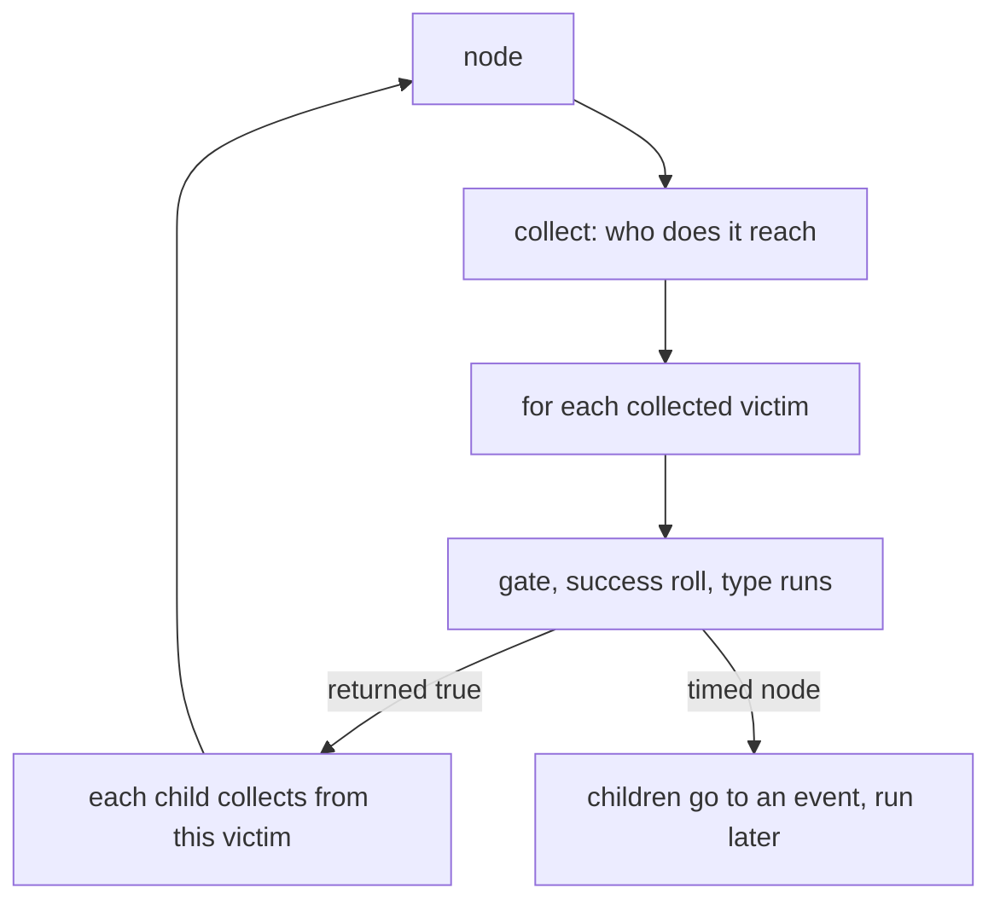

A skill is a list of effects. Each effect is a node with a `type:`, and a node can hold child nodes. There are 24 node types, a cast runs them in three phases, and a passive skill can start a cast by itself when something happens to its holder. This page covers that machine. The file that holds a skill is on [one file per skill](/foundations/skills/one-file), who a node reaches is on [reach](/foundations/skills/reach), and what Lua and polynomials can add to a node is on [beyond the formula](/foundations/skills/beyond-the-formula).

The Metin2 mainline engine expresses a skill with up to three point changes and flags; effects beyond those require C++ keyed by skill. A node tree composes effects and lets children run for each victim their parent reaches.

## The 24 node types

The enum has 28 entries between `SKILL_EFFECT_NONE` and `SKILL_EFFECT_MAX`. Take away `NONE` and four retired slots and 24 are live. A retired name is refused at load, and the slots stay so that every type keeps its number, because the node type is what the trace reports and what a recorded cast is compared on.

```cpp
enum ESkillEffectType
{
    SKILL_EFFECT_NONE,
    SKILL_EFFECT_DAMAGE,
    SKILL_EFFECT_HEAL,
    SKILL_EFFECT_AFFECT,
    SKILL_EFFECT_CRUSH,
    SKILL_EFFECT_AUTO_SHOOT,
    SKILL_EFFECT_CONCATENATED_ATTACK,
    // Two retired types. The slots stay so everything below keeps its number -- the node type
    // is what the trace reports and what a record is diffed on.
    // COST was never a node: it only ever meant "what the affect this node raises drains per
    // tick", which is `upkeep:` on TNodeRaisingAffect. SPLASH is `collect: {search:}`.
    SKILL_EFFECT_COST_RETIRED,
    SKILL_EFFECT_SPLASH_RETIRED,
    SKILL_EFFECT_FIRE,
    SKILL_EFFECT_POISON,
    SKILL_EFFECT_STUN,
    SKILL_EFFECT_SLOW,
    SKILL_EFFECT_REMOVE_GOOD_AFFECT,
    SKILL_EFFECT_REMOVE_BAD_AFFECT,
    SKILL_EFFECT_REMOVE_BLEEDING,
    SKILL_EFFECT_CUT_POINT,
    // Retired: a curse was an attached TICKER with a `counters:` accumulator -- an affect
    // that counts, and a subtree that runs when it ends.
    SKILL_EFFECT_CURSE_RETIRED,
    SKILL_EFFECT_BLEEDING,
    SKILL_EFFECT_PULL,
    SKILL_EFFECT_TICKER,
    SKILL_EFFECT_SPECIFIC_EFFECT,
    SKILL_EFFECT_COLLECTOR,
    // Retired: a DPS was a TICKER with `attach: affect`. Never authored by any config.
    SKILL_EFFECT_DPS_RETIRED,
    // Generic point change: what HP_ABSORB and SP_ABSORB each hardcoded for one POINT.
    SKILL_EFFECT_POINT_CHANGE,
    // Redirect a mob's aggro, which AGGR_MOB did as a side effect of every node.
    SKILL_EFFECT_TAUNT,
    // CENTRE-ACTING nodes. Every type above acts on a VICTIM; these act on the node's
    // centre and never look at the collected set. Appended, never inserted: the ordinal is
    // what the trace reports and what a record is diffed on.
    SKILL_EFFECT_AMBIENCE_EFFECT,
    SKILL_EFFECT_GROUND_DECAL,
    SKILL_EFFECT_IMPACT_EFFECT,
    SKILL_EFFECT_MAX,
};
```

Affect `upkeep:`, `collect: { search: }`, and tickers express cost, splash, curse, and damage over time without separate node types.

The live types fall in four groups.

| Group | Types |
| --- | --- |
| Hit and heal | `DAMAGE`, `HEAL`, `CRUSH` (knockback), `PULL`, `CUT_POINT`, `POINT_CHANGE` |
| Affects and statuses | `AFFECT`, `FIRE`, `BLEEDING`, `POISON`, `STUN`, `SLOW`, `REMOVE_GOOD_AFFECT`, `REMOVE_BAD_AFFECT`, `REMOVE_BLEEDING`, `TAUNT` |
| Structure: populations and time | `COLLECTOR`, `TICKER`, `AUTO_SHOOT`, `CONCATENATED_ATTACK` |
| Visual | `SPECIFIC_EFFECT` on a victim; `AMBIENCE_EFFECT`, `GROUND_DECAL`, `IMPACT_EFFECT` on a place |

`COLLECTOR` collects victims and does nothing itself, so its children are the effect. `TICKER`, `AUTO_SHOOT` and `CONCATENATED_ATTACK` are the three timed runs: they hand their children to an event that fires later. The last three visual nodes are centre-acting: they act on the place the node is centred on, never look at who was collected, and have no children.

Capabilities are composed by inheritance rather than declared per type. Every node is a `TNodeBase`. Ones that may have `nodes:` add `TNodeWithChildren`, ones that roll a per-mille success add `TNodeWithSuccessPct`, ones that raise an affect add `TNodeRaisingAffect` with `affect:`, `upkeep:`, `attach:`, `traits:` and `counters:`, and timed ones add `TRunLifetime`. A damage node can have children and a success roll; a ticker has children and an affect and a lifetime; a collector only has children.

### Adding a type is C++ in four places

The enum, the name table, a parse case when the YAML is read and an execution case in the dispatcher. No Lua binding mentions node types, and there is no registry and no C++ door: the set is closed at compile time. Lua reaches into a node only through `handler:` slots, which is on [beyond the formula](/foundations/skills/beyond-the-formula).

## The phases of a cast

A node sits in one of three lists, or under another node's `nodes:`. The lists are the three phases:

- `per_use:` runs once per cast, before anything is computed, seeded with the caster. A node here never sees a victim. It is the self buff, the dash, the cost-paid payload of a toggle. Its own `collect:` may still search the world.
- `per_compute:` runs once per computation, seeded with a victim. How many computations a cast has is decided by `resolve.by`: one for a server-resolved cast, one per attack packet for a client-resolved one.
- `post_preflight:` runs once, when the cast is finished and every victim is known. It is the only moment a node can read how many victims there were: `per_use` is too early because nothing has been collected, and `per_compute` runs once per victim and only sees its own.

The loader states it in one comment:

```cpp
// Node tree, in three phases. ONE id counter across all of them: node ids are per skill,
// and a query naming a per_use node from a per_compute poly has to find it.
//
// `post_preflight:` runs ONCE when the cast is finished and every victim is known -- which is
// the only moment a node can read how many there were. per_use is too early (nothing has
// been collected) and per_compute runs once per victim and only ever sees its own.
int incrementalID = 0;
const char * c_aszPhase[3] = { "per_use", "per_compute", "post_preflight" };
```

The terms are exact. A use is one cast. A computation is one traversal of a phase list from one seed. A phase is a computation, which means it starts with a fresh one: without that, the nodes of the next phase would keep the first victim of the previous one and silently do nothing.

When the cast ends depends on who resolves it. A server-resolved cast ends when the compute traversal returns. A client-resolved cast ends when the client reports that the hit window of the motion closed. The victim count in that packet is only logged: the phase reads the server's own record. If the packet never arrives, `post_preflight:` for that cast does not run, since there is no timeout. A mob skill ends at its last scheduled splash. So do not put anything a player paid for in `post_preflight:`; put it in `per_use:`.



The player path begins at the top. A trigger enters at the use object from an event and runs the first two phases only, as the next section shows. A cast that runs on every core is on every core.

### How a phase walks the tree

For each root node in the phase list, the node collects its victims first, then the dispatcher goes through them. For each collected victim it skips the dead and the stunned, lets a Lua `gate` skip it if the node declares one, applies the success roll if the type has one, and then runs what the type does. Only if that returned true does it look at the children.

A child is run once for each victim the parent collected, seeded with that victim, and it runs its own `collect:` from there. It is not "then also do this". It is "for each of mine, do this". The children go through this code:

```cpp
// keep traversing only if the current node has
if(bRet) {
    //If the node has children, process them
    TNodeWithChildren* pkNodeWithChildren = dynamic_cast<TNodeWithChildren *>(pkInfo);
    if(NULL != pkNodeWithChildren)
    {
        sys_log(3, "Skill has children: count[{}]", pkNodeWithChildren->GetInnerNodeCount());
        // A timed node hands its children to the event, not to this traversal -- but
        // `continue`, not `return`: every collected victim is a carrier of its own.
        if(pkInfo->usNodeType == SKILL_EFFECT_AUTO_SHOOT ||
            pkInfo->usNodeType == SKILL_EFFECT_TICKER ||
            pkInfo->usNodeType == SKILL_EFFECT_CONCATENATED_ATTACK)
            continue;

        // Clear all children for use because every victim has it's own
        // computation of childnodes
        ClearForUseChildNodes(pkNodeWithChildren);
        for (uint32_t j = 0; j < pkNodeWithChildren->GetInnerNodeCount(); j++)
        {
            TNodeBase* pkInnerNode = pkNodeWithChildren->pkInnerNodes[j];
            sys_log(3, "Handling child: id[{}] type[{}]", pkInnerNode->unNodeID, pkInnerNode->usNodeType);

            CollectAllVictim(pkInnerNode, pkNodeUseInfo->vecThisComputationHit[i]);
            NodeDispatcher(pkInnerNode);
        }
    }
}
```

Two consequences you have to carry into content. Traversal stops on failure: if a parent's success roll fails or its handler returns false, its children never run. And a child is not "after" its parent in time unless the parent is a timed node; it is nested in population.



### A cast is an object

Per-cast state lives on its own object. A timed run holds a reference to the cast that spawned it, preserving its node records, ledgers, and level while the run lives.

Ownership then is simple. The character owns one skill instance per skill. Each instance points at its current cast. Each live timed run points at the cast that made it. The parsed definition of the skill is shared and read-only. A skill is off only when its last run ends, because switching it off drops the caster's affect and cancels every live event, so one of several concurrent runs finishing must not do that on behalf of the others. Caster death ends only the runs that declare `stopOnCasterDeath`.

### Load-time validation

A skill file that fails to build discards the whole new table. At boot that stops the core:

```cpp
snprintf(szSkillDir, sizeof(szSkillDir), "conf/skill");
if(!CSkillManager::instance().InitializeFromYaml(szSkillDir))
{
    sys_err("cannot initialize skill table from YAML");
    thecore_shutdown();
    return;
}
```

On a reload the previous table stays in place and the error is logged. An unknown or retired node type is one such error, with the text `unrecognized node type`.

## Triggers

A trigger is a `type: PASSIVE` skill that runs itself when a game event happens to its holder, and optionally turns itself off on another event. The skill side is data, in YAML, and the event side is native C++. Here is a whole skill, the horse passive that raises two critical bonuses while mounted. The affect has a long duration, and the dismount event ends it:

```yaml
name: Pestone di cavallo
type: PASSIVE
maxLevel: 20
triggersOn:
- event: RIDE
triggersOff:
- event: UNRIDE
flags:
- NO_COOLDOWN
- NO_MANUAL_USE
client:
  job: HORSE
  icon: skill/common/horse/charge
desc:
  vars:
    crit:    { ref: node.buff_crit.amountPoly }
    dmgcrit: { ref: node.buff_critdmg.amountPoly }
resolve:
  by: server
per_compute:
- type: AFFECT
  id: buff_crit
  point: MOB_CRITICAL_PCT
  amountPoly: min(10, skill_level)
  durationPoly: '1892160000'
- type: AFFECT
  id: buff_critdmg
  point: MOB_CRITICAL_DMG_MULTIPLIER
  amountPoly: min(10, max(0, skill_level-10))
  durationPoly: '1892160000'
```

A trigger can carry conditions, an AND list, so it fires only when they hold:

```yaml
triggersOn:
- event: RIDE
  conditions:
  - { type: HP_BELOW, arg: 50 }
  - { type: HAS_AFFECT, arg: [ 94, 328 ], match: ANY }
triggersOff:
- event: UNRIDE
```

The conditions are `HP_BELOW`, `HP_ABOVE`, `SP_BELOW`, `SP_ABOVE`, `HAS_AFFECT`, `IS_MOUNTED`, `LEVEL_ABOVE` and `LEVEL_BELOW`. `match:` is only meaningful when `arg` is a list. The evaluator is this:

```cpp
// Single-character trigger conditions (ctx unused by the current set).
static bool EvaluateCondition(const SkillTriggerCondition& cond, LPCHARACTER ch, const TriggerContext& ctx)
{
    int arg = cond.GetArg();

    if (cond.type == "HP_BELOW")
        return ch->GetHP() > 0 && ch->GetHP() <= ch->GetMaxHP() * arg / 100;
    if (cond.type == "HP_ABOVE")
        return ch->GetHP() > ch->GetMaxHP() * arg / 100;
    if (cond.type == "SP_BELOW")
        return ch->GetSP() <= ch->GetMaxSP() * arg / 100;
    if (cond.type == "SP_ABOVE")
        return ch->GetSP() > ch->GetMaxSP() * arg / 100;
    if (cond.type == "HAS_AFFECT")
        return EvaluateMultiArg(cond, [ch](int a) { return ch->FindAffect(a) != nullptr; });
    if (cond.type == "IS_MOUNTED")
        return ch->IsRiding();
    if (cond.type == "LEVEL_ABOVE")
        return ch->GetLevel() >= arg;
    if (cond.type == "LEVEL_BELOW")
        return ch->GetLevel() < arg;

    sys_err("Unknown trigger condition type: {}", cond.type);
    return false;
}
```

### Registration and firing

At load, every skill's entries go into two process-wide maps, event name to a list of skill and entry, and the maps are swapped in together with the skill table:

```cpp
// Register triggers (supports both old string format and new expressive format)
auto triggersOn = ParseTriggerList(root["triggersOn"]);
auto triggersOff = ParseTriggerList(root["triggersOff"]);

for (auto& entry : triggersOn)
{
    if (pkProto->usType == SKILL_TYPE_PASSIVE)
        mapTriggersOn[entry.event].push_back({pkProto->unVnum, std::move(entry)});
}

for (auto& entry : triggersOff)
{
    mapTriggersOff[entry.event].push_back({pkProto->unVnum, std::move(entry)});
}
```

The comment about the "old string format" is stale: a bare string in the list is rejected and skipped with `Trigger entry must be a map with 'event' key`.

An event site calls the firing function with the event name, the character and a small context. Here is the whole function:

```cpp
bool CSkillManager::TriggerSkill(const std::string& event, LPCHARACTER pkChar, const TriggerContext& ctx)
{
    sys_log(3, "CSkillManager::TriggerSkill {} {}", pkChar->GetName(), event);

    // Re-entrancy guard: a triggered skill that itself fires an event (e.g. deals
    // a debuff) can re-enter TriggerSkill; cap the depth so it can't loop forever.
    static const int MAX_TRIGGER_DEPTH = 8;
    if (m_nTriggerDepth >= MAX_TRIGGER_DEPTH)
    {
        sys_err("TriggerSkill: max trigger depth reached for event {}, skipping", event);
        return false;
    }
    struct DepthGuard { int& d; ~DepthGuard() { --d; } } depthGuard{ ++m_nTriggerDepth };

    auto itOn = m_mapTriggersOn.find(event);
    if (itOn != m_mapTriggersOn.end())
    {
        for (const auto& binding : itOn->second)
        {
            if (!pkChar->GetSkillLevel(binding.skillVnum))
                continue;

            if (!EvaluateAllConditions(binding.entry.conditions, pkChar, ctx))
                continue;

            LPSKILL pkSkillInstance = pkChar->GeSkillInstance(binding.skillVnum);
            if (nullptr == pkSkillInstance)
                continue;

            // A charge arrival is admitted past its cooldown here too: the trigger
            // path reaches the same skill instance, so it asks the same question.
            if (pkSkillInstance->IsInCooldown() && !pkSkillInstance->AdmitsWindupUse(pkChar))
                continue;

            pkSkillInstance->TriggerOn(ctx);
            if (pkSkillInstance->IsInCooldown())
                pkChar->SendSkillCoolTime(binding.skillVnum, pkSkillInstance->GetCooldown());
        }
    }

    auto itOff = m_mapTriggersOff.find(event);
    if (itOff != m_mapTriggersOff.end())
    {
        for (const auto& binding : itOff->second)
        {
            if (!EvaluateAllConditions(binding.entry.conditions, pkChar, ctx))
                continue;

            LPSKILL pkSkillInstance = pkChar->GeSkillInstance(binding.skillVnum);
            if (nullptr == pkSkillInstance)
                continue;

            if (!pkSkillInstance->HasBeenUsed())
                continue;

            pkSkillInstance->TriggerOff();
        }
    }
    return true;
}
```

The events come from nine native sites, in the mount code (`RIDE`, `UNRIDE`), in the HP change code (`HP_CHANGED`, carrying the current HP, and only while the character is alive), and in three announcement functions called when a debuff, a buff or a heal lands (`RECEIVE_DEBUFF` and `DEAL_DEBUFF`, `RECEIVE_BUFF` and `DEAL_BUFF`, `RECEIVE_HEAL` and `DEAL_HEAL`). The announcements carry the other party as the subject of the event. The same functions announce the landed effect to the trait hooks, on purpose: the skill trigger and the trait hook are two audiences for one event, and announcing them together is what stops a new site from wiring one and forgetting the other ([traits](/foundations/traits)).

So a trigger is data on the skill side and native on the event side. There is no Lua door to add an event or to fire one, and no C++ registration either: to add an event, you add a call at a native site.

### What a triggered cast does

A triggered cast makes a new cast object, the same as a press. With `TARGET_TRIGGER_SUBJECT` it seeds on the other party of the event and is skipped if that party is dead, observing, or on another map. Then it runs `per_use:`, opens a fresh computation, runs `per_compute:` once, and stamps the cooldown. It never reaches `post_preflight:`.

Turning it off removes the caster's affect for that skill, drops attached affects, cancels every live run and resets the cast. A toggle skill uses the same pair: it turns on if the caster lacks the affect and off if the caster has it, and an expiring toggle affect calls the off side a moment later.

### Traps, by cause

- A trigger is a cast without the press. `TriggerSkill` checks the skill level, the conditions, the instance and the cooldown. It does not call the path a player press takes, so as the code reads it a triggered cast pays no cost and is not asked the use policy.
- The cooldown is the only rate limit. A passive on `HP_CHANGED` with no cooldown would run again on every HP change below its threshold. The shipped specialisation passives all set a cooldown of 60 or 100 and the `PERSISTENT_COOLDOWN` flag.
- `triggersOn` is kept only for `type: PASSIVE`. On any other type it is parsed and dropped without a word. `triggersOff` registers for any type: a horse skill ends itself that way when the rider dismounts.
- `post_preflight:` never runs for a triggered cast, since the trigger path runs `per_use` and `per_compute` only. Put what has to count victims somewhere else.
- Events and condition types are not validated at load. An `event:` that no site fires sits in the map and never runs. An unknown condition `type` logs `Unknown trigger condition type: <type>` each time the event fires and the skill never triggers.
- `TARGET_TRIGGER_SUBJECT` re-seeds the compute phase on the other party of the event, the one who buffed, debuffed or healed. If there is no valid subject on the same map the cast is skipped, after the new cast object was already made. A node can also reach that party with `collect: { source: trigger_subject }`.
- Triggers can chain. A triggered skill that lands a debuff fires `DEAL_DEBUFF` and may start another. The depth is capped at 8, and at that depth the log says `TriggerSkill: max trigger depth reached for event`, and the event is skipped. The counter belongs to the singleton skill manager, so it counts across everything on the process.
## Mob skills and specialisations as examples

Mob skills and specialisations are simple content over this system, and they show it better than a list of types does.

A specialisation passive is a trigger plus a payload. The defender specialisation fires on `HP_CHANGED` when HP falls below 60 percent and puts a physical defence bonus on the caster in `per_use:`, with a cooldown of 100. The cleric fires on `HP_CHANGED` below 50 percent and runs a ticker of five pulses in `per_use:`, each pulse a collector of up to five allies within 400 with a `HEAL` child. That one file shows a trigger, a timed node, a collector and a child re-seeded per ally.

A mob skill is the same proto, the same nodes and the same phases, entered by a third dispatcher. A boss skill, whole:

```yaml
name: BOSS_MAGIC_SKILL
type: MOB
maxLevel: 40
cooldownPoly: '20'
range: 600
useTimeout: 6000
flags:
- ENEMYONLY
resolve:
  by: server
  bound: { targets: '1', hitsPerTarget: '1' }
per_compute:
- type: DAMAGE
  amountPoly: 5*skill_k*point_TOTAL_MAGIC_ATT
  damageType: MAGIC
  collect:
    search: { radius: 525, take: 15 }
  accept:
    of: ENEMY
- type: CRUSH
  accept:
    of: ENEMY
  amountPoly: '600'
```

The mob path sets the skill level itself, because a cast reads the level off the character's learnt skills, which is 0 for a mob, then runs `per_use:` and one computation per splash entry of the mob. `post_preflight:` runs at the last scheduled splash. Whether a mob may use a skill is asked of the use policy, after the coin flip.
