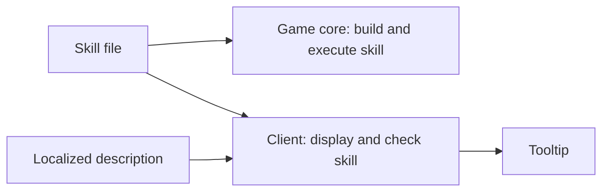

One skill file gives the server and the client a shared definition. The Metin2 mainline engine keeps skill data in separate server and client records, so values such as cost and range can disagree. A shared file puts those values in one place while leaving each side responsible for its own decisions.

A **vnum** is the numeric identifier of a skill. Its definition lives in `conf/skill/<vnum>.ucskill.yaml`. The [Skills index](/foundations/skills) has a glossary of the terms used throughout this series. For the keys and authoring details, use the [skill file reference](/docs/core/skills/file).

## One definition, two readers

The file describes the skill's rules and the work it performs. Its root holds shared values such as range, cost, and cooldown. The `client:` block holds presentation information such as the icon and motion. The server does not read that block, so a rule placed only there cannot govern a cast.

A **node** is an operation in the skill's execution tree. The server builds the tree and runs it during a cast; the client does not execute it. The file also describes how targets are resolved. [Nodes and phases](/foundations/skills/nodes-and-phases) explains how the tree runs.

The same definition crosses a deployment boundary: the game core loads it from its configuration, and the client reads a copy in its pack. Shared formula and flag handling give both readers a common vocabulary, but they do not make the copies update together. A server-only deployment can leave the client displaying and checking old values.

The diagram follows the definition to its two readers and the separate words used by the tooltip.

## Requirements need both spellings

A prerequisite is a skill and level required before another skill can be learned. The server reads the root `prerequisite: {vnum, level}` and enforces that requirement. The client does not read `prerequisite`: it reads the flat root keys `preSkill` and `preSkillLevel` to set its requirement UI.

When the requirement must appear in the client UI, write both forms with matching skill and level values. Writing only the client keys can display a requirement that the server does not enforce; writing only `prerequisite` enforces it without setting that client UI.

## Loading keeps the server table whole

Each game core loads the skill directory and builds a replacement table. If a file fails validation, the replacement is rejected as a whole. At boot, failure stops the core. On reload, the previous table remains in use and the error is logged. A reload that appears to have no effect may therefore have failed; check the log before assuming the edited values are active.

The client loads its own copy and reads only the parts it needs. A malformed client entry can be dropped even when the server accepts the file, because the two readers do not consume identical fields. A valid server load is not proof that the client's icon, requirements, or checks are correct.

The client searches for skill files by vnum within a fixed range, while the character's skill storage has its own limit. A definition that the server can load is not necessarily discoverable by the client or grantable to a character. The [file reference](/docs/core/skills/file) gives the limits and loader errors.

## Description values follow the definition

A **poly** is a formula evaluated using skill and character values. A tooltip can show a number derived from a poly in the skill file instead of carrying a second copy of the formula. The localized description supplies the words; named description variables connect those words to values in the definition. This lets a formula change without requiring the same change in each translation.

The server validates description variables when it builds the skill, including whether a reference resolves and whether the client can evaluate the needed inputs. The client uses the variables to render the tooltip. Some values require server-held state and are resolved by the server for display. The [descriptions reference](/docs/core/skills/descriptions) covers the authoring and delivery details.

The connection prevents a copied formula from drifting, but it does not prove that the sentence describes the number correctly. A literal value still needs manual maintenance, and a mismatch between a sentence's variable names and the definition can leave text or values unused. Check the tooltip and client log after changing either side.

## Variants share the model

A **policy** selects a variant of a skill definition for a context. The selected variant can change values while retaining the same localized description; its description variables resolve against that variant. When more than one policy is active, selection follows registration order. See [skill policies](/foundations/skills/policies) for how variants are selected.

Sharing a definition removes copies of the rules, not the need to verify each reader. Keep the server and client copies aligned, author both prerequisite forms when the UI needs them, and inspect the rendered description as well as the server load result.
