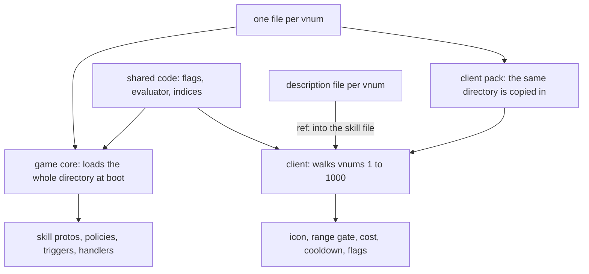

One file per skill gives the game core and client a shared definition. The Metin2 mainline engine keeps skill data in separate server and client records, so the same values can disagree.

This series covers [nodes and phases](/foundations/skills/nodes-and-phases), [extending past the YAML](/foundations/skills/beyond-the-formula), [reach](/foundations/skills/reach), [formulas](/foundations/skills/formulas), [descriptions](/foundations/skills/descriptions), [owners](/foundations/skills/owners), [every core](/foundations/skills/every-core), and [policies](/foundations/skills/policies). The [skill file reference](/docs/core/skill-file) describes the format.

## The shared file

One file per vnum, and the filename is the vnum: `conf/skill/1.ucskill.yaml`. They live in the locale configuration folder alongside Lua handlers, skill policies, and traits. Skill 1, whole:

```yaml
name: Taglio a tre vie
type: CLASS
maxLevel: 40
cooldownPoly: '15'
costType: SP
costPoly: 40+100*skill_k
range: 450
useTimeout: 2500
skillshot: true
weaponLimitation:
- SWORD
- TWO_HANDED
flags:
- ENEMYONLY
- ATTACK_SKILL
- LEVEL_UP_BY_POINT
- NEED_TARGET
client:
  job: WARRIOR
  icon: skill/warrior/samyeon
  motionIndex: 1
  gradeCount: 4
desc:
  vars:
    val:     { ref: node.dmg.amountPoly }
    targets: { ref: resolve.bound.targets }
resolve:
  by: client
  bound: { targets: '6', hitsPerTarget: '3' }
per_compute:
- type: DAMAGE
  id: dmg
  amountPoly: 632*skill_k+(point_TOTAL_PHYS_ATT-point_AURA_PHYS_ATT_BONUS)*1.3
  damageType: MELEE
  ability_scaling: { adder: SAMYEON_ADDER, resist: SAMYEON_RESIST }
  accept:
    of: ENEMY
```

Read it from the top. Identity, cost, range, flags and weapons sit at the root, and both sides read them. `client:` holds what only the client needs: the job, the icon, the motion. The rule for the block is that nothing the server reads may live in it, because that is what let `client.castRange` and `targetRange` disagree. `desc.vars` points into the tree, and the tooltip reads the number from there instead of copying it. `resolve:` says who authors the list of targets and how many. `per_compute:` is the node tree, and it belongs to [nodes and phases](/foundations/skills/nodes-and-phases). Mob skills mostly do not have a `client:` block.

Both sides read the same file, and they also run the same code. The flag table, the formula evaluator, the variable names and the skill index enum live in the code the client and server share, so that a name resolved there cannot mean two things.



## How the game core loads it, all or nothing

Every game core reads the directory by itself. The database core does not carry skills. The loader takes each regular file whose name ends in `.ucskill.yaml` and parses the vnum from the name; a name that does not parse is logged as `Skill YAML: cannot parse vnum from filename: {filename}` and counts as an error.

The new table replaces the old one only if no file raised an error. Otherwise the temporaries are freed and the log carries `There were errors when loading skill table from YAML`. At boot the caller treats a false return as fatal:

```cpp
/*
 * SKILL (loaded from YAML on game cores)
 */
{
    char szSkillDir[256];
    snprintf(szSkillDir, sizeof(szSkillDir), "conf/skill");
    if(!CSkillManager::instance().InitializeFromYaml(szSkillDir))
    {
        sys_err("cannot initialize skill table from YAML");
        thecore_shutdown();
        return;
    }
}
```

That is deliberate. A skill that half-loaded is a fight that goes wrong hours later, so a bad file stops the core. What the loader refuses includes an unparsable cooldown, cost or bound formula, a skill with no `resolve:`, an unknown range bonus point, a bad node, a description variable that does not resolve, an undeclared policy id and a duplicate node `id:`. What it only logs is an unknown flag name or an unknown weapon in `weaponLimitation`.

A proto reload behaves differently. The same loader runs, and its return value is ignored:

```cpp
/*
 * Skill (reload from YAML)
 */
{
    char szSkillDir[256];
    snprintf(szSkillDir, sizeof(szSkillDir), "conf/skill");
    CSkillManager::instance().InitializeFromYaml(szSkillDir);
}
```

A broken file leaves the previous table in force and the reason in the log. Then the reload recomputes the points of every player and clears the skill instance of every character. If a reload seems to do nothing, read the log before you read the file.

## How the client loads it

The client build copies the same directory into its pack. The client cannot list a directory inside a pack, so it walks the vnums from 1 to 1000 and asks for each file. A miss is the normal answer and is only counted. A vnum above 1000 therefore loads on the server and never on the client, and a vnum at or above 400, the size of the per-character skill array, cannot be granted at all. The highest shipped vnum is 396.

Skill configs load first and descriptions second, and each failure fails the locale load:

```cpp
// Configs FIRST: a config is what creates a skill's entry, and a description --
// including a policy's -- is about a skill that entry already describes.
if (!rkSkillMgr.RegisterSkillConfigs(szSkillDirName))
{
    TraceError("LoadLocaleData - RegisterSkillConfigs(%s) Error", szSkillDirName);
    return false;
}
```

What the client takes from the file is a subset. From the `client:` block it reads the job, icon, motion index, grade count, minimum level and motion loop count. From the root it reads the range, the range bonus, the skillshot flag, the cost, the cooldown, the maximum level, the target count from `resolve.bound`, the prerequisite skill, the flags, the weapon limitation, the subject, the descriptions and the policies. It never reads the node tree. A config this side cannot parse is dropped whole rather than half-filled, because a half-filled entry would answer range and cooldown questions wrongly.

## Shared values and permissions

The shared flag table gives both sides the same vocabulary. Permission flags let the client refuse a press and the server refuse the packet, including weapon and no-PK area checks. For how range and its latency allowance work, see [reach](/foundations/skills/reach).

## Traps, by cause

- A broken skill file stops the core at boot and does nothing at reload. The loader is all or nothing by design, and the reload path ignores its result. After a reload, check the log for the error line before assuming the new numbers are live.
- The two sides fail differently. An unknown flag name is logged and survived by both. An unknown `client.job` makes the client drop the whole skill while the server, which never reads `client:`, loads it without complaint.
- A vnum above 1000 is invisible to the client, and one at or above 400 cannot be granted. Both are consequences of how the client finds files and how the per-character array is sized.
- A change to a skill file is a client pack change too, because the directory is copied into the pack. A server-only deploy leaves the client with the old range, cost and icons.
- Anything the server reads must be at the root. The `client:` block is presentation, and a rule in it never reaches the server.

## Native rules

Some rules remain in C++ by skill vnum, including horse and sub-skill ranges, skill books, and a per-job buff table used by auto hunt. Node types are native: a new kind of node requires C++, while the file combines existing types. [Extending past the YAML](/foundations/skills/beyond-the-formula) explains the extension mechanisms.
