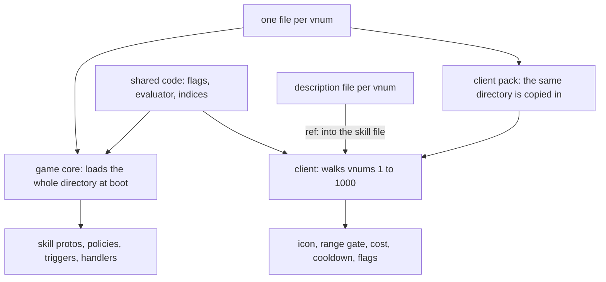

This is the first of nine pages on the skill system. It tells where a skill lives and who reads it. The others cover the node tree and its phases ([nodes and phases](/foundations/skills/nodes-and-phases)), who a skill can reach ([reach](/foundations/skills/reach)), the formula language ([formulas](/foundations/skills/formulas)), the tooltips ([descriptions](/foundations/skills/descriptions)), empire, guild and character owners ([owners](/foundations/skills/owners)), casts that run on every core ([every core](/foundations/skills/every-core)), the three skill policies ([policies](/foundations/skills/policies)), and what a formula cannot say ([beyond the formula](/foundations/skills/beyond-the-formula)). The file format itself is in the [skill file reference](/docs/building-blocks/skill-file).

## The limit: three copies and a C++ branch per vnum

In the inherited engine a skill existed in three places that nobody kept in step except by hand. The server row was a record in the `skill_proto` database table, read by the database core and sent to every game core in the boot packet. The client had a table with cost, cooldown, formulas and flags, and a second file with the name, the tooltip text and its own copy of the formula. The flags were written twice in two vocabularies: row 1 says `ATTACK,USE_MELEE_DAMAGE` on the server side and `ATTACK_SKILL|NEED_TARGET|WEAPON_LIMITATION` in the client description.

The server row could say very little. The database core selected about thirty columns from `skill_proto`: name, type, maximum level, splash range, cooldown, cost and duration formulas, and three groups of `szPointOn`, `szPointPoly` and `szDurationPoly`.

A skill could change at most three points, `szPointOn`, `szPointOn2` and `szPointOn3`, each with a formula and a duration, plus a set of flags. Anything else lived in C++, keyed by the skill's vnum: a `case` for the skill, a range test for the sub-skills, a list of the stun skills. In the server tree we started from we count 286 references to skill names in 13 files, about 270 if you leave out four names that look like later additions. Nothing in the database row showed them. To know what skill 7 did, you read the row and then searched the server for `SKILL_` plus its name.

That is the limit this page is about: a skill was three hand-kept copies, and every rule the row could not express was code. Making the skill one file that both sides read removed the copies. Moving the rules out of C++ is the work of the other pages in the group, and it is not finished.

## The inherited data already disagreed with itself

The three copies drifted from the first day. In the vanilla client data we inherited, the Italian skill table and skill description files carry two formulas for the same skill, and they do not match for three of the first four skills:

| Skill | In the skill table | In the description |
| --- | --- | --- |
| 1 | `-(1.1*atk+(0.5*atk+1.5*str)*k)` | `(1.1*MinATK + (0.1*MinATK + 1.5*STR)*SkillPoint) * 3` |
| 2 | `-(3*atk+(0.8*atk+str*5+dex*3+con)*k)` | `3*MinATK + (0.8*MinATK + STR*6 + DEX*2 + CON) * SkillPoint` |
| 3 | `50*k` | `50 * SkillPoint` |
| 4 | `(100+str+lv*3)*k` | `(100 + STR) * SkillPoint` |

Skill 3 agrees. Skill 1 differs in a coefficient and a factor of three, skill 2 in the weights of strength and dexterity, skill 4 in a level term the tooltip never mentions. With two copies of a number, one of them is wrong in some row, whoever typed it.

## February 2019: the first version of the composable skill system

The engine repository starts in May 2016 with the same model, and for almost three years the skills were not the focus. In February 2019 the model changed. Between the 12th and the 26th we rebuilt skills as a tree of nodes: a skill became a list of typed nodes, damage, affect and the rest, each with its own formula, instead of three point columns and a pile of branches by vnum. That was the first version of the composable skill system. On the 21st the commit message says all the nodes were implemented and all the old skill handling removed.

The tree had to live somewhere, and the database row was where skills already lived. It went into a new `jEffect` column as JSON. This is the table as the 2019 script created it, and skill 1 as that script inserted it:

```sql
CREATE TABLE IF NOT EXISTS `skill_proto` (
  `dwVnum` int(11) NOT NULL DEFAULT '0',
  `szName` varchar(64) NOT NULL DEFAULT '',
  `eSkillType` enum('CLASS','SPECIALIZATION','HORSE','SUPPORT','GUILD') DEFAULT NULL,
  `bMaxLevel` tinyint(4) NOT NULL DEFAULT '0',
  `bLevelStep` tinyint(4) NOT NULL DEFAULT '0',
  `bLevelLimit` tinyint(3) unsigned NOT NULL DEFAULT '0',
  `prerequisiteSkillVnum` int(11) NOT NULL DEFAULT '0',
  `prerequisiteSkillLevel` int(11) NOT NULL DEFAULT '0',
  `szCooldownPoly` varchar(256) NOT NULL DEFAULT '',
  `szCostType` set('SP','HP','GUILD_SP') NOT NULL DEFAULT 'SP',
  `szCastCostPoly` varchar(256) NOT NULL DEFAULT '0',
  `szFlag` varchar(512) NOT NULL DEFAULT '',
  `dwTargetRange` int(11) NOT NULL DEFAULT '1000',
  `dwUseTimeout` int(11) NOT NULL DEFAULT '2500',
  `szMaxHit` varchar(256) NOT NULL DEFAULT '1',
  `szMaxTarget` varchar(256) NOT NULL DEFAULT '0',
  `jEffect` varchar(5000) NOT NULL DEFAULT '',
  PRIMARY KEY (`dwVnum`)
```

```sql
(1, 'Taglio a tre vie', 'CLASS', 40, 1, 0, 0, 0, '15', 'SP', '40+100*k', 'ENEMYONLY|CLIENT_HIT', 430, 2500, '3', '6', '{\r\n    "nodes": [\r\n      {\r\n           "type": "DAMAGE",\r\n           "amountPoly": "1.65*atk+0.9*atk*k+1.5*str*k",\r\n           "damageType": "MELEE",\r\n          "flag": "ENEMYONLY"\r\n     }\r\n   ]\r\n}'),
```

A whole skill's behaviour in a 5,000 character string in a row. The client followed on the 26th: the two text tables were replaced by a JSON skill table and a JSON description file. They were still copies. The 2019 model changed what a skill could say. It did not reduce the number of places where it was written, and the formula in the description kept its own copy of the numbers.

The specialisations were among the first content to use the node tree, and today 49 skill files are specialisations. They are content over the skill system, the same as the mob skills, and I use them below only as examples. Guild skills went the other way. They were removed in April 2019 because they did not fit the skill system, and we decided to keep them out of the gameplay until a later update. They came back in 2026; the story is in [owners](/foundations/skills/owners).

## Years in a database table

Before the YAML files, skill data was edited in the database table, with no versioning, and that held through the 2019 model until March 2026. There was no diff of a balance change, no review, no way to ask who changed the cooldown of a skill or to put it back. The only history was the one the live database held, and the two snapshots of it that happen to be in git.

The client copies did live in git, and they were edited by hand. 121 commits touch the client skill table or the description file between February 2019 and the beginning of March 2026. A re-sync was a commit of its own: in November 2022 one is titled "skill desc reflects the server". In September 2024 the skill index enum moved to the code the client and server share, so that at least the vnums could not disagree. In July 2024 the name was removed from one of the two client files. In March 2025 the client JSON became YAML. Each of those cut one source of disagreement and kept the three copies.

The migration out of the table was a script that read the table over MySQL, optionally through an SSH tunnel, and wrote one YAML file per skill.

## March 2026: into git, still one reader

On 5 and 6 March 2026 the skills moved out of the database. The database core stopped selecting `skill_proto`, the boot packet lost its skill part, and each game core started to read a `conf/skill` directory by itself. One commit added 211 files. Skill 1 as migrated:

```yaml
name: Taglio a tre vie
type: CLASS
maxLevel: 40
cooldownPoly: '15'
costType: SP
costPoly: 40+100*k
flags:
- ENEMYONLY
- CLIENT_HIT
- COUNT_NODES_HIT
targetRange: 450
useTimeout: 2500
maxTargetPoly: '6'
maxHitPoly: '3'
nodes:
- type: DAMAGE
  amountPoly: 632*k+(atk-AuraPhysicalAtk)*0.92
  damageType: MELEE
  flag:
  - ENEMYONLY
```

This is a storage move. The shape is the 2019 JSON written as YAML, and the client still read its own tables. What changed at once was that a skill change became a reviewable diff, and 70 commits have touched the directory since.

## July and August 2026: the client stops keeping its own copy

On the eve of the change, skill 1 existed three times. The server file said `costPoly: 40+100*skill_k`, the client table said `costAmount: 40+100*k`, and the client description repeated the damage formula as `632*skill_k+(point_TOTAL_PHYS_ATT-point_AURA_PHYS_ATT_BONUS)*1.3` in its own `polyMap`. One cost in two vocabularies.

The changes ran for ten days:

1. On 29 July the descriptions stop carrying formulas and read them from the skill file. The commit message says why: the description file carried 281 polys copied from the skill configs and 17 had drifted. The client also starts reading the `.ucskill.yaml` itself.
2. On 30 July range is declared once and derived into both sides. The same file held `targetRange` and `client.castRange`, two numbers for one concept, and they disagreed on seven skills. Fifteen more had only a client number and 88 only a server bound. The same day a regression restored five client flag lists that a folded YAML scalar had lost.
3. On 4 August flags move to one list at the root. The client's own flag block told it different things from the server on 25 skills for the buffable-NPC flag alone.
4. On 5 August the client reads the skill policies, and the descriptions become one file per vnum.
5. On 6 August the client skill table is deleted, 1,351 lines.

The client tooltips, ranges and flags were the first clients of the single file, and the thing it closed was the limit above: three copies and a rule per vnum in C++.

## The file today

One file per vnum, and the filename is the vnum: `conf/skill/1.ucskill.yaml`. There are 213 of them, 8,663 lines, in the locale configuration folder next to eight Lua handlers, the skill policies file and a `traits/` folder. Skill 1, whole:

```yaml
name: Taglio a tre vie
type: CLASS
maxLevel: 40
cooldownPoly: '15'
costType: SP
costPoly: 40+100*skill_k
range: 450
useTimeout: 2500
skillshot: true
weaponLimitation:
- SWORD
- TWO_HANDED
flags:
- ENEMYONLY
- ATTACK_SKILL
- LEVEL_UP_BY_POINT
- NEED_TARGET
client:
  job: WARRIOR
  icon: skill/warrior/samyeon
  motionIndex: 1
  gradeCount: 4
desc:
  vars:
    val:     { ref: node.dmg.amountPoly }
    targets: { ref: resolve.bound.targets }
resolve:
  by: client
  bound: { targets: '6', hitsPerTarget: '3' }
per_compute:
- type: DAMAGE
  id: dmg
  amountPoly: 632*skill_k+(point_TOTAL_PHYS_ATT-point_AURA_PHYS_ATT_BONUS)*1.3
  damageType: MELEE
  ability_scaling: { adder: SAMYEON_ADDER, resist: SAMYEON_RESIST }
  accept:
    of: ENEMY
```

Read it from the top. Identity, cost, range, flags and weapons sit at the root, and both sides read them. `client:` holds what only the client needs: the job, the icon, the motion. The rule for the block is that nothing the server reads may live in it, because that is what let `client.castRange` and `targetRange` disagree. `desc.vars` points into the tree, and the tooltip reads the number from there instead of copying it. `resolve:` says who authors the list of targets and how many. `per_compute:` is the node tree, and it belongs to [nodes and phases](/foundations/skills/nodes-and-phases). 128 of the 213 files carry a `client:` block; the mob skills mostly do not.

Both sides read the same file, and they also run the same code. The flag table, the formula evaluator, the variable names and the skill index enum live in the code the client and server share, so that a name resolved there cannot mean two things.



## How the game core loads it, all or nothing

Every game core reads the directory by itself. The database core no longer carries skills. The loader takes each regular file whose name ends in `.ucskill.yaml` and parses the vnum from the name; a name that does not parse is logged as `Skill YAML: cannot parse vnum from filename: {filename}` and counts as an error.

The new table replaces the old one only if no file raised an error. Otherwise the temporaries are freed and the log carries `There were errors when loading skill table from YAML`. At boot the caller treats a false return as fatal:

```cpp
/*
 * SKILL (loaded from YAML on game cores)
 */
{
    char szSkillDir[256];
    snprintf(szSkillDir, sizeof(szSkillDir), "conf/skill");
    if(!CSkillManager::instance().InitializeFromYaml(szSkillDir))
    {
        sys_err("cannot initialize skill table from YAML");
        thecore_shutdown();
        return;
    }
}
```

That is deliberate. A skill that half-loaded is a fight that goes wrong hours later, so a bad file stops the core. What the loader refuses includes an unparsable cooldown, cost or bound formula, a skill with no `resolve:`, an unknown range bonus point, a bad node, a description variable that does not resolve, an undeclared policy id and a duplicate node `id:`. What it only logs is an unknown flag name or an unknown weapon in `weaponLimitation`.

A proto reload behaves differently. The same loader runs, and its return value is ignored:

```cpp
/*
 * Skill (reload from YAML)
 */
{
    char szSkillDir[256];
    snprintf(szSkillDir, sizeof(szSkillDir), "conf/skill");
    CSkillManager::instance().InitializeFromYaml(szSkillDir);
}
```

A broken file leaves the previous table in force and the reason in the log. Then the reload recomputes the points of every player and clears the skill instance of every character. If a reload seems to do nothing, read the log before you read the file.

## How the client loads it

The client build copies the same directory into its pack. The client cannot list a directory inside a pack, so it walks the vnums from 1 to 1000 and asks for each file. A miss is the normal answer and is only counted. A vnum above 1000 therefore loads on the server and never on the client, and a vnum at or above 400, the size of the per-character skill array, cannot be granted at all. The highest shipped vnum is 396.

Skill configs load first and descriptions second, and each failure fails the locale load:

```cpp
// Configs FIRST: a config is what creates a skill's entry, and a description --
// including a policy's -- is about a skill that entry already describes.
if (!rkSkillMgr.RegisterSkillConfigs(szSkillDirName))
{
    TraceError("LoadLocaleData - RegisterSkillConfigs(%s) Error", szSkillDirName);
    return false;
}
```

The header of the client loader keeps the "before" in one place:

```cpp
// Load every skill's colocated config: Locale/conf/skill/<vnum>.ucskill.yaml, copied into
// locale/universal/skill/. Replaces skill_table.yaml, which duplicated the server's cost,
// cooldown, max level and target count -- and had DRIFTED from it: skill 34's cooldown read
// 40 against the server's 70, and the guild skills claimed level 40 and a 10s cooldown
// against the server's 7 and 480s.
//
// The vnum range is walked blind. The client cannot enumerate a directory (CDir is
// FindFirstFile, and that sees nothing inside a pak), and the list USED to come from
// skill_desc.yaml -- which quietly made the description file the client's skill
// registry: a skill with no description entry had no client data at all, no range, no
// cooldown, no weapon limitation. Guild skills 151-153 are exactly that case, and
// uiguild.py asks skill.CanUseSkill() about them. A miss is the normal answer here,
// so it is counted rather than logged.
```

What the client takes from the file is a subset. From the `client:` block it reads the job, icon, motion index, grade count, minimum level and motion loop count. From the root it reads the range, the range bonus, the skillshot flag, the cost, the cooldown, the maximum level, the target count from `resolve.bound`, the prerequisite skill, the flags, the weapon limitation, the subject, the descriptions and the policies. It never reads the node tree. A config this side cannot parse is dropped whole rather than half-filled, because a half-filled entry would answer range and cooldown questions wrongly.

## One number, two uses

Range is the clean example of one value serving two readers. The client gates the player on `range` against its copy of the world. The server checks the same cast against its own copy a round trip later, and the two disagree by however far anything moved in between. So the server's bound is the declared range plus a pad:

```cpp
// The client gates the player on `range` against its own copy of the world; the server
// checks the same cast against its copy a round trip later, and the two disagree by
// however far anything moved in between. So the server's bound is the declared range
// plus a deliberately generous allowance. It is latency slack, not reach: unRange gates
// and never collects -- it has no other consumer, and splash carries its own radius.
static const uint32_t SKILL_RANGE_PAD = 300;
```

Before July the client added the bow-range point to every skill and the server to none, so a melee skill grew because the player wore a bow-range item and an archer aimed further than the server would accept. Now a skill declares `range_bonus` if it wants one, and the engine applies it on both sides.

Flags work the same way. The shared flag table opens with the reason it exists:

```cpp
// One shared skill-flag vocabulary for client and server.
//
// Each side used to keep its own enum and its own name table, and a config
// authored the same fact twice -- once in `flags:` for the server, once in
// `client.flag` for the client, under a different word. They drifted: 25
// skills told the client they could target a buffable NPC and never told the
// server, 15 told the client "ally only" while the server let them hit
// anyone, and the three "Difensore AoE" words contradicted their own
// SELFONLY. A name resolved from here cannot drift, because both sides read
// the same bit out of the same table.
//
// A name is authored once, at the root of the skill config, in `flags:`.
// Which side then acts on it is a property of the flag, not of the file --
// the comments below say who reads each one.
```

Each flag in that table is annotated with who reads it. A permission flag is read by both: the client refuses the press, the server refuses the packet.

## What one copy exposed

Having one copy showed the checks the server never made. The client had always refused a cast with the wrong weapon, and the server never did, so the client was the only guard. The same held for an attack skill inside a no-PK area: the client refused it and the server did not, so a client that simply skipped the check could attack in a safe zone. When the file's `weaponLimitation` and the flags became shared, the server gained both checks as permissions. The inherited server code we started from has no weapon check at all.

The audit that went with the work found 25 skills with the buffable-NPC flag on the client only, 15 with an ally-only conflict, 12 disagreements on the plus button, one skill with weapons declared but not the flag that made the client enforce them, and range on 7 of 129. None of it was found by reading. Two spellings of one fact will disagree, and you will not find out by reading.

## Traps, by cause

- A broken skill file stops the core at boot and does nothing at reload. The loader is all or nothing by design, and the reload path ignores its result. After a reload, check the log for the error line before assuming the new numbers are live.
- The two sides fail differently. An unknown flag name is logged and survived by both. An unknown `client.job` makes the client drop the whole skill while the server, which never reads `client:`, loads it without complaint.
- A vnum above 1000 is invisible to the client, and one at or above 400 cannot be granted. Both are consequences of how the client finds files and how the per-character array is sized.
- A change to a skill file is a client pack change too, because the directory is copied into the pack. A server-only deploy leaves the client with the old range, cost and icons.
- Anything the server reads must be at the root. The `client:` block is presentation, and a rule in it never reaches the server.

## What is still in the engine

The skill file replaced the database row and the client's copies. It did not remove the rules that sit in C++ by vnum. Counted the same way as the 286 references in the tree we started from, the engine today has 95 references to named skills in shipped game code, mostly horse and sub-skill ranges, skill books, and a per-job buff table used by auto hunt. Some of them are range markers rather than behaviour. The node types themselves are native only: a new kind of node is C++, and the file can only combine the ones that exist. [Beyond the formula](/foundations/skills/beyond-the-formula) says where that line is.

One limit of the loading remains too. The client finds skills by walking numbers, because a pack cannot be listed.
