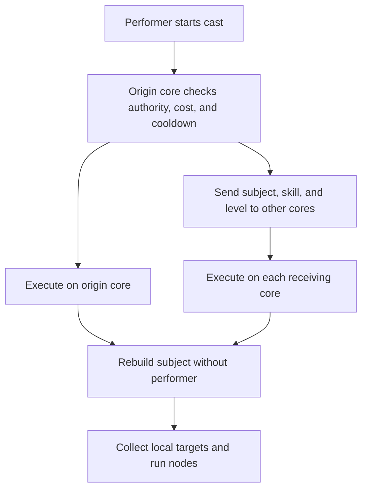

A skill cast needs a body to perform it and an owner to answer for it. For an ordinary character skill these are the same character. A guild or empire skill belongs to a shared owner even when a member presses the button. The Metin2 mainline engine ties the cast to the character; the subject model lets shared skills use shared level, authority, cost, cooldown, and target relations.

The [Skills glossary](/foundations/skills) defines the terms used throughout this series. The [skill file reference](/docs/core/skills/file) covers the keys and their exact rules.

## The performer and the owner answer different questions

The **performer** is the character who starts a cast. The **subject**, or owner, holds the skill and supplies the rules that belong to it. The performer supplies a position and a body when the cast needs them. A subject can be a character, a guild, or an empire.

The skill's `subject` selects the owner kind. If it is absent, a guild skill defaults to a guild subject and other skills to a character subject. The client uses the subject kind to select the store from which it displays the skill level; the server uses it to construct the owner for the cast. A shared skill's level is the owner's level in that skill, not the performer's character skill level.

The owner answers whether the performer may cast, which level applies, where the cooldown is stored, how the cost is paid, and whether a candidate is an ally or an enemy. A guild cast also requires the performer's guild skill authority. An empire cast requires membership and a positive skill level. Shared skills skip character-specific checks such as weapon and skill group, but [use policies](/foundations/skills/policies) can still refuse the cast.

A shared purse is not the performer's purse. Guild and empire subjects pay a shared gold cost; they cannot pay character HP or SP. A character subject cannot use the shared gold cost. Choose a cost compatible with the owner, or the cast is refused.

## Relations and state belong to the owner

Target relation is an owner's answer, not a universal definition of combat permission. A character subject uses the ordinary attack and buff checks. A guild subject treats its members as allies and a guild at war with it as an enemy. An empire subject treats characters of its empire as allies and those of another empire as enemies. A candidate without the relevant affiliation is neutral.

For guild and empire subjects, enemy relation does not apply the ordinary character attack checks. A skill that selects enemies by owner relation therefore needs its use restrictions considered separately. See [skill policies](/foundations/skills/policies).

A character's skill instance holds its level and cooldown. Guild skill levels and deadlines belong to the guild and are distributed to game cores. Empire skill levels and deadlines use shared server flags forwarded to the cores. Shared cooldowns use whole-second deadlines, rounded up, and do not vary with the performer's casting speed. Otherwise two members could disagree about one owner's next usable time.

Shared state also has a cost. Guild gold changes are requested through the database core. An empire skill's purse deduction changes the local core's in-memory balance without propagating that deduction to the other cores or the database. Do not assume that this payment is a synchronized server-wide transaction.

## Map reach and core reach are separate

A game core hosts part of the running world. A map-wide collector searches a map on its hosting core; it does not send the cast to other cores. It changes where a node finds candidates, not which candidates pass its filters. A child node performs its own collection, so a map-wide parent does not automatically give the child map-wide reach. See [nodes and phases](/foundations/skills/nodes-and-phases) for collection and filtering.

An intracore skill instead executes on every game core reached by the server's core-to-core mesh, including the core where it started. It requires a guild or empire subject whose state is available across cores. The authorizing core makes the use decision once; each executing core works with its own local population.

The diagram separates the single authorization from the execution on each core.

The resolved skill level travels with the cast. Each core uses that level even if its copy of the owner's level has not caught up. The origin stamps the shared cooldown once; receivers do not stamp it again. Each core enumerates its local players, so the combined roster covers the shared owner without applying the cast twice to a player who is online on one core.

## Execution without a performer has limits

Every executing core, including the origin, runs an intracore cast without the performer. This keeps the origin from using character data unavailable to the other cores. The subject can enumerate its local allies or enemies; a top-level node must use that roster rather than a position around the performer. A child can use a local target as its new seed, including its position.

The loader checks that an intracore skill can run under those conditions. It rejects performer-dependent formulas, handlers and actions that require a performer's body, as well as invalid top-level collection. It also rejects a `per_use` phase, which normally starts with the caster, and requires `per_compute` nodes. Local victim data and subject data remain available. The [skill file reference](/docs/core/skills/file) lists the authoring rules.

An invalid skill prevents the skill table from loading at boot. A failed live reload leaves the previously installed table in place. A successful reload therefore matters separately from a successful boot.

Damage without a performer has no attacker stats or killer attribution. The victim's defense still applies, but attacker-side penetration and pierce do not. This is a material choice when deciding whether an effect should run on every core or remain with a performer on one core.

A performerless cast is held by the skill manager while it has live delayed runs. A delayed effect can therefore continue after the initial execution returns. Each core owns only its local execution; the broadcast does not move a character or a running effect between cores.
