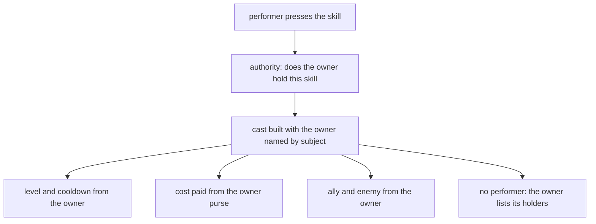

A cast has two parties. The performer is the character who pressed the button: body, weapon, position. The owner is the subject that holds the skill: its level, its cooldown, its purse, the right to cast it, and who counts as ally or enemy. For an ordinary skill both are the same character. For a guild skill the owner is the guild, and for an empire skill it is the empire.

Before August 2026 the owner was always the caster. A guild skill was a character skill with guild branches at every site that read a level, a cooldown or a cost, an empire could own nothing, and "enemy" meant whatever the caster could attack. Now one key in the skill file names the owner, and the engine asks it.

```yaml
# EMPIRE subject, INTRACORE. The same machinery as a guild skill with one word changed --
# which is the point: the engine holds no opinion about what an empire is, it asks the
# subject, and the subject answers "every player of mine on this core".
#
# Its state rides the server event flags (empire_skill.<empire>.<vnum> for the level), which
# the DB core forwards to every game core -- replicated for the same reason a guild's row is.
name: Editto Imperiale
type: GUILD
subject: empire
intracore: true
maxLevel: 7
cooldownPoly: '1800'
costType: SUBJECT_GOLD
costPoly: '1000000'
range: 0
useTimeout: 2500
flags:
- SELFONLY
- CAN_USE_FOR_ME
client:
  job: GUILD
  icon: skill/shaman/jeungryeok
  motionIndex: 203
  gradeCount: 4
desc:
  vars:
    speed: { ref: node.edict_speed.amountPoly }
resolve:
  by: server
  bound: { targets: '0', hitsPerTarget: '1' }
per_compute:
- type: AFFECT
  id: edict_speed
  point: MOV_SPEED
  amountPoly: 5+3*skill_level
  affect: KWAESOK
  durationPoly: '1200'
  collect:
    search: { take: 0 }
  accept:
    of: ALLY
    kind: PLAYER
```

This is a whole empire skill, `154.ucskill.yaml` in the skill configuration folder. It is a guild skill with one word changed, `subject: empire`.

## The owner is a key

`subject:` takes three tokens: `character`, `guild` and `empire`. When the key is absent it is derived: `type: GUILD` gives a guild owner, everything else a character. No shipped file had to change when the key arrived. There is no `player` token, because the player is `subject: character`. An unknown token fails the skill load with `Skill[<vnum>] <name>: unknown subject '<token>'`.

The token rule is shared with the client. Both sides read the same `subject:` out of the same file, the server to build the owner and the client to know which store holds a slot's level. Two copies of the rule would let the client draw a level off the wrong owner.

Nine skills ship with an owner other than a character: 151 to 153 are guild skills, and 150, 154 to 158 are empire skills. Of these, 152 to 157 were written the same night as the owner model, as its first clients.

## What the owner answers

Every question the cast engine used to ask the caster is now asked of the owner. The owner answers these, and nothing else answers them:

| | Character | Guild | Empire |
| --- | --- | --- | --- |
| Level | the character's skill level | the guild's level in that skill | the empire's level in that skill |
| Cooldown stored in | the skill instance, one per character and skill | the guild row, as a deadline | a server event flag, as a deadline |
| Cost | SP or HP, its own | guild gold | the empire purse |
| Ally | the buff check | members of this guild | players of this empire |
| Enemy | the battle check | a guild this one is at war with | any other empire |
| Who is on each side | itself, no opponents | online members, and the war opponent's online members | every player of the empire, or of the others |
| State on every core | no | yes | yes |

The level is the owner's, one question with one answerer. A guild or empire level is the level of that skill in the owner's own table, not the guild level and not an empire rank.

A cooldown held by an owner is a deadline in whole seconds, rounded up, because a value floored to 0 seconds would be no cooldown at all. It is not shortened by casting speed. Two members with different casting speeds would otherwise reach different deadlines for one guild's skill, so the owner answers with the number it was given.

### Authority

Whether this performer may cast at all is the owner's answer too, and it is a function, not a method on the owner, because it needs no instance:

```cpp
bool SubjectMayCast(uint8_t bKind, LPCHARACTER pkPerformer, CSkillProto * pkSk)
{
    if (!pkPerformer || !pkSk)
        return false;

    switch (bKind)
    {
        case SUBJECT_KIND_GUILD:
        {
            CGuild * pkGuild = pkPerformer->GetGuild();
            if (!pkGuild)
                return false;
            if (!pkGuild->CharacterHasGradeAuth(pkPerformer, GUILD_AUTH_SKILL))
                return false;
            return pkGuild->GetSkillLevel(pkSk->unVnum) > 0;
        }
        case SUBJECT_KIND_EMPIRE:
        {
            if (!pkPerformer->GetEmpire())
                return false;
            CEmpireSkillSubject kSubject(pkPerformer->GetEmpire());
            return kSubject.GetSkillLevel(pkSk->unVnum) > 0;
        }
        default:
            return pkPerformer->GetSkillLevel(pkSk->unVnum) > 0;
    }
}
```

`SubjectMayCast` checks the owner's level in that skill. For a guild skill the performer must also be in a grade with the skill authority bit. For an empire skill there is no rank rule: any player of the empire may cast a skill the empire holds. There is no monarch-only check in code.

The guild authority bit had a trap of its own. The master's grade is the one grade the guild window cannot edit, so a bit missing from its default is a bit the master can never hold. The skill bit was missing, which locked the master out of every guild skill, until it was added with the owner model.

A cast the performer does not own skips the checks about what the performer is: skill group, weapon, what he is riding. Those are facts about a body, and the owner's skill has no body. The use policies still run after and can forbid a cast but never permit one; they are in [Skill policies](/foundations/skills/policies).

## Purses

Guild and empire skills pay from the owner's purse, with the cost type `SUBJECT_GOLD`. The name keeps the ordinal of the older guild-gold cost, because configs used to name who pays where they meant "the subject's purse".

A character has no shared purse, and `SUBJECT_GOLD` on a character skill is refused rather than silently charging his own gold, which is a different rule. A guild or an empire has neither SP nor HP, so those cost types are refused for them, and the member is never charged instead.

```cpp
bool Pay(uint16_t usCostType, int64_t llAmount, bool bDryRun, const char *) override
{
    switch (usCostType)
    {
        case SKILL_COST_SUBJECT_GOLD:
            if (CMonarch::instance().GetMoney(m_bEmpire) < llAmount)
                return false;
            if (!bDryRun)
                CMonarch::instance().DecMoney(llAmount, m_bEmpire);
            return true;
        case SKILL_COST_SP:
        case SKILL_COST_HP:
            return false;
    }
    return true;
}
```

The guild takes its gold through the database core, which answers back. The empire takes it from the monarch purse. Today the monarch purse charge changes only this core's purse in memory. The other cores and the database are not told. The game master command that adds empire gold goes through the database for exactly that reason.

## Who is an ally, who is an enemy

The character owner keeps the two tests the cast engine always ran, in the same order: attackable means enemy, buffable means ally. The guild and the empire owners answer with their own predicates.

```cpp
ETargetRelation Relation(LPCHARACTER, LPCHARACTER pkCandidate) const override
{
    if (!pkCandidate)
        return TARGET_RELATION_NEUTRAL;

    // GetGuild() reads m_guildID off ANY character, so one predicate
    // covers a guild players and the NPCs on its land alike.
    CGuild * pkTheirs = pkCandidate->GetGuild();
    if (!pkTheirs)
        return TARGET_RELATION_NEUTRAL;

    if (pkTheirs->GetID() == m_dwGuildID)
        return TARGET_RELATION_ALLY;

    CGuild * pkMine = Guild();
    if (pkMine && pkMine->UnderWar(pkTheirs->GetID()))
        return TARGET_RELATION_ENEMY;

    return TARGET_RELATION_NEUTRAL;
}
```

A guild's enemy is a guild it is at war with. An empire's enemy is any player of another empire, and a candidate with no empire is neutral:

```cpp
ETargetRelation Relation(LPCHARACTER, LPCHARACTER pkCandidate) const override
{
    if (!pkCandidate || !pkCandidate->GetEmpire())
        return TARGET_RELATION_NEUTRAL;
    return pkCandidate->GetEmpire() == m_bEmpire
        ? TARGET_RELATION_ALLY : TARGET_RELATION_ENEMY;
}
```

Guild and empire enemy targeting skips the battle checks. Only the character owner calls the attackable test. A player of a guild at war with yours, or of another empire, is an enemy by relation alone, without the safe-zone, PK mode or battle arbiter checks that gate an ordinary skill. The engine never learns what a war or an empire is, so nothing in the skill code adds them back. The [battle arbiter](/foundations/policies/) page covers what those checks are for.

A cast with no performer and no geometry still needs holders for its affects. The owner names them: a guild lists its online members, or the online members of its war opponent. An empire lists its players, or all others. Each core lists only its own, and the union is the whole roster. How that roster is used by a cast on every core is in [Skills on every core](/foundations/skills/every-core).



## Where the owner's state lives

A guild keeps a level and a cooldown deadline per skill in a JSON column of its row. Changing either does three things: it writes the database, it tells the other cores, and it refreshes every online member's client.

An empire has no object. Its two values per skill are server event flags, `empire_skill.<empire>.<vnum>` for the level and `empire_skill_cd.<empire>.<vnum>` for the deadline. A write goes through the database core, which forwards it to every game core, the asking one included, so nobody gets ahead of the others. That is what makes an empire replicated with no new table. When a flag moves, each core sends the empire's skill info to its players.

A character is unchanged: the skill instance is the store, and a skill marked for it also writes a quest flag so the cooldown survives a relog.

On the client, the guild and the empire each have a store, and the slot is joined at read time rather than copied. The skill's own `subject:` decides which store answers, never "whichever map happens to hold the vnum", because a guild that researched a skill before it became empire-owned still has the row, and it would draw a stale level onto a slot whose real owner has it at 0. Copying levels into the character's own table cannot work: the code that receives the character's levels walks the whole table and writes the character's own level, which is 0 for a skill he does not own. The grade is forced to 0, since a guild or an empire researches levels and master grades are a character's business. The tooltip names the purse from the owner, "Yang di Gilda" or "Yang dell'Impero". The client holds no empire treasury, so only the server refuses an empire cast for gold.

## How a guild or an empire gets a level

No gameplay path grants a guild or empire skill level today. The guild skill points column went away with the March 2026 change, and no quest calls the guild level setters.

Levels are set by a game master with `gskill` and `eskill`:

- `gskill <guild_name> set <vnum> <level>`, `gskill <guild_name> reset`, `gskill <guild_name> cooldown <vnum> <duration>`.
- `eskill <empire 1-3> set <vnum> <level>`, `eskill <empire> cooldown <vnum> <duration>`, `eskill <empire> show <vnum>`, `eskill <empire> gold [amount]`.

A duration is written as 30s, 5m, 1h, 2d, or 0 to clear. From a quest, the guild object has `get_skill_level`, `set_skill_level`, `get_skill_cooldown`, `set_skill_cooldown` and `is_skill_on_cooldown`; no shipped quest uses them. An empire has no dedicated binding, but `game.set_event_flag` writes the same flags `eskill` does.

## Backstory: guild skills in the inherited code

The inherited code had guild skills as a fixed range of vnums, 151 and up, with levels in a byte array on the guild and a guild power pool as the cost. They were war only: `UseSkill` refused outside a guild war, and a skill ran over the characters of one war map, on the caster's body, on one core. There were no empire skills at all.

By the time the repository began in 2016, a second family had been added on top of that. It extended the range to 169, needed a guild level, paid from a second pool, was not war only, and applied to every online member on every core by a packet between cores. So the push to every core is older than the owner model: each member computed the skill on himself. It was hardcoded per vnum, and only for buffs on the guild's own members.

## Backstory: out of gameplay in 2019, back in 2026

In February 2019 the first version of the composable skill system landed. In April 2019 the guild skill code was removed: about 1,200 lines went, among them the guild's use and cross-core handlers and two client windows. Guild skills did not fit the skill system, and we decided to keep them out of gameplay. They were planned for updates. In August 2019 the old guild wars went too, leaving only the skeleton.

The engine kept the remains. In 2023 the skill power for the whole guild range was set to return 0, which it still does.

In March 2026 guild skills came back. A guild kept a table of levels and cooldowns, a packet between cores carried changes, and `gskill` and a guild skill page in the client arrived. Costs and cooldowns moved to the guild, and skill data left the database table, where it had been edited with no versioning, for the YAML files. It was vanilla-shaped: the caster still owned the cast. The code of the time said so itself: "the caster owns the SkillInstance, but cooldown and costs are owned by the guild". Each site that read a level, a cost or a cooldown had a branch on the guild skill type.

In August 2026 the owner became a first-class thing. The branches were replaced by the owner, the guild gold cost type became `SUBJECT_GOLD` with the same ordinal, and the empire became an owner with no new table. The first clients were the six worked guild and empire skills, landed the same night. Skill 158, an empire skill, joined later that day, and Stellar Sanctuary (150) followed in October.

The limit that was closed is that the caster was always the owner. Now a guild skill's enemy is a declared war, an empire skill's enemy is another empire, and the cast engine knows neither word.

The headless simulator carries a test manifest that stages guilds, wars and empires and checks that the owner answers for level, cooldown and cost, that ally means the roster, that enemy means the war, and that a core with no performer computes what the authorising core did. It says what it cannot show: guild gold never decreases there, because the database answer never comes, and one process is one core.

## What is still in the engine

- The skill power function returns 0 for the guild skill range, 151 to 160, which covers the empire skills 154 to 158. The cast recomputes power from the owner's level, and no shipped owned skill reads the power in a cost, so the remainder is latent. A cost formula that read the skill power would see 0.
- The `GUILD_SKILL_*` constants, 151 to 159, are still defined and exported to Python.
- The war-only rule is a use policy, not part of the owner model, and it still catches the empire skills 154 to 157 along with 151 to 153. They are refused outside a guild war with the message that the skill can be used only in war. 150 and 158 are not on the list. See [Skill policies](/foundations/skills/policies).
- Subject level for an empire reads a flag nothing writes, and no shipped skill reads a `subject_*` name; all read `skill_level`.
- A new owner kind is C++ work in three places: the shared enum and token rule, the owner class with its cases in the two builders and the authority function, and a client store with a branch in the join. There is no registry and no Lua door for an owner. Lua's part is data, the `subject:` key, and the setters above.
