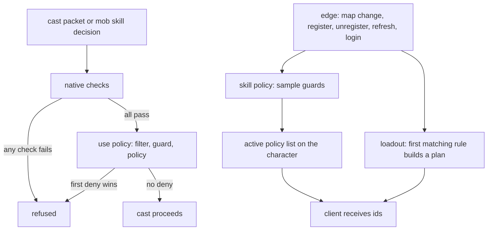

Three registries decide which skills a character holds, whether a cast may happen, and which variant applies. The Metin2 mainline engine expresses loadouts and cast checks in fixed tables and native code.

The skill loadout, skill use policy, and skill policy follow the [policies model](/foundations/policies/): `(name, guard, payload)`, a handle starting at 1 with 0 meaning refusal, and registration order as resolution order. The guard supplies scope. [Skill owners](/foundations/skills/owners) explains who owns a cast.

## Asked at the cast, sampled at the edges

The three registries do not behave alike, and the reason is the client. The use policy is a predicate: the engine asks it on every cast and gets an answer. The skill policy and the loadout are state that the client mirrors: tooltip numbers, icon, cooldown, animation, the slot a skill sits in. A predicate has no edge, so there is no instant at which the server learns that the answer flipped and owes the client a packet. Those two are therefore sampled at edges, and the result is cached on the character.

Read the left lane as one cast, and the right lane as what happens when the rules or the map change.



## The use policy: it can forbid, never permit

The use policy is consulted only after every native check in the cast predicate has passed, so it is additive and deny-only. A verdict with `allowed = true` cannot override a native refusal, because the registry is never reached when a native check fails. The policy also runs on sub skills, horse summons, and guild skills after their native checks.

```cpp
if (!nativeCheck()) {
    return false;
}

// Config limiters -- run on every path that would return true, so they can forbid
// but never permit. The deny message is handed back rather than sent: this is a
// predicate, and do_all_skill_master asks it four hundred times in a row.
auto kVerdict = CSkillUsePolicy::instance().Resolve(
    const_cast<LPCHARACTER>(this), pkSk->unVnum);
if (kVerdict.has_value() && !kVerdict->allowed)
{
    if (pstrDenyKey)
        *pstrDenyKey = kVerdict->strLocaleKey;
    return false;
}
```

The verdict carries a locale key and sends nothing. The caller that was really about to cast shows the message: the cast handler and the attack packet handler. A predicate that sends its own text would spam, because the same predicate is asked speculatively, for instance when a game master command walks all 400 vnums. Return `locale_key` and let the cast path show it.

Resolution walks the list in registration order. The first deny wins; allowed answers do not stop the walk.

```cpp
for (const Policy & c_rPolicy : m_policies)
{
    // The vnum filter first, and deliberately: it is a plain comparison against a
    // handful of numbers, while the guard may be a call into Lua.
    if (!c_rPolicy.vecVnums.empty() &&
        std::find(c_rPolicy.vecVnums.begin(), c_rPolicy.vecVnums.end(), unVnum)
            == c_rPolicy.vecVnums.end())
        continue;

    if (c_rPolicy.guard && !c_rPolicy.guard(ch))
        continue;

    bMatched = true;

    SkillUseVerdict kVerdict = c_rPolicy.policy(ch, unVnum);
    if (!kVerdict.allowed)
        return kVerdict;    // first deny wins
}

return bMatched ? std::optional<SkillUseVerdict>(SkillUseVerdict{}) : std::nullopt;
```

The vnum list is a filter, not a scope. Scope is still the guard, as on every registry. The list exists because this is asked on every cast and on every mob skill decision: a rule about seven skills says so, and the other 393 never reach its guard, which may be a call into Lua. A rule without the list runs its guard on every one of them.

Mob skills go through the same registry. The mob skill decision checks the cooldown, flips its coin, and only then resolves the policy. The order is deliberate: the simulator records golden manifests against the random draw sequence of mob skills, and consulting the policy before the draw would move it. The guard receives the mob as the character, so a rule meant for players needs a guard that says so, or a vnum list.

Failure directions differ by role. A Lua error in the policy fails open, because the default verdict is already "allowed". A Lua error in the guard fails closed: the rule does not apply. With nothing registered, resolution answers nothing and the cast stays allowed after the native checks.

Two rules ship. The first is the war-only rule on the guild skills, registered when the forge boots:

```lua
when boot begin 
    -- Guild skills are a war thing. Held by every guild member everywhere, so the
    -- limit is on USING them rather than on holding them.
    forge.sys.game.skill_use_policy.register(
        "guild_skills:war_only",
        function(ch) return ch:get_war_map() == nil end,
        function() return { allowed = false, locale_key = "CANNOT_SKILL_ONLY_IN_WAR" } end,
        { 151, 152, 153, 154, 155, 156, 157 })
end
```

The second is the rage module, which denies the rage trigger skill while rage is active or the charge is not full. It is the same call with one vnum in the list:

```lua
forge.sys.game.skill_use_policy.register("rage:charge",
    function() return true end,
    function(ch)
        if ch:has_affect(AFFECT_RAGE) then
            return { allowed = false, locale_key = "CANNOT_TRIGGER_RAGE_IN_RAGE" }
        end
        if clamp_charge(ch:get_quest_flag(CHARGE_FLAG)) < CHARGE_MAX then
            return { allowed = false, locale_key = "CANNOT_TRIGGER_RAGE" }
        end
        return { allowed = true }
    end,
    { SKILL_SUB_RAGE })
```

### The war-only rule

The rule names skills 151 to 157, including empire skills 154 to 157. It refuses them outside a guild war map with `CANNOT_SKILL_ONLY_IN_WAR`. Empire skills 150 and 158 are not in the list.

## The skill policy: a named variant of a skill

A skill file can declare `policies:`, a set of overrides keyed by an id. A skill policy registration puts one of those ids in force on every character its guard accepts. The shipped example is the arena rule on one skill: the base skill reads as itself, and the exception says where it applies.

```yaml
policies:
  # What `is_in_arena` used to say from inside the formula: ten seconds less in a duel.
  # The base now reads as the skill it is, and the exception says where it applies --
  # which also means the tooltip prints the arena number when the arena is what you are
  # standing in, instead of the sentence carrying both numbers and a parenthetical.
  arena:
    node.hide.durationPoly: max(5,15+8*skill_k-10)
```

Variants are built when the skill table loads, not merged when a cast looks one up. Each entry is a path-to-value patch applied to a clone of the skill and parsed as a whole skill. A policy that cannot be built is a boot error rather than a fight that goes wrong, and so is a skill that names an id the policy declaration file does not declare. At cast time a character with no active policy gets the base skill, and one with active policies gets a walk over a short list.

The client parses the same `policies:` from the same skill file, and receives only the active ids, so both sides build the same variant from one source. See [one file](/foundations/skills/one-file).

### Sampled at edges

The guard is not asked per cast. It is sampled when the map changes, when a rule is registered or unregistered, when Lua calls `refresh(ch)`, and on entering the game, where the policy packet is sent even if empty because the client may be arriving from a map that had one. The sample covers every character, mobs included, so a policy bound to a map applies to everything standing on it without a per-spawn opt-in.

A guard may therefore read anything that changes at one of those points. A guard whose ground moves silently needs the third edge: change the state, then call `refresh` on the next line. The ball game arena does this after it changes a player's range step, which is why its rules exist once per step.

The sample keeps every matching policy once. Two rules can grant the same policy, an arena and an event inside it, and the policy applies once either way.

When two active policies override the same skill, they do not combine: the first in the character's list answers. The list is built in registration order of the matching rules, and the client walks the list in the order it arrives. The skill documentation and the declaration file say that declaration order decides; the code does not do that. Nothing shipped exercises it, because the policies that could overlap are registered with mutually exclusive guards, and the two skills that declare variants are different skills.

## The loadout: which skills a character holds

The server has no concept of a skill slot. Skill levels are indexed by vnum, and the cast packet carries a vnum. Slots live only in the client, filled at login from a static table. A loadout is therefore two separable things: the levels, which are real server state and what the cast predicate answers from, and the slots, which are presentation shipped to the client. A forged slot map buys a wrong icon, and that is the whole security surface. It is why the held skills can be configuration without opening the cast path.

A registration is a name, a guard and a builder. The builder returns a plan: pages, and the skills on them with slot and level. The first matching rule wins, because a character is under one loadout or none; two plans fighting over one slot has no meaning a player could read. A plan replaces the pages it names whole and leaves the others alone. With nothing registered, a character has no plan, the client keeps its static bar, and nothing goes on the wire.

The arena minigame registers one next to its skill policies, in one referee:

```lua
table.insert(self.handles, { kind = "skill_loadout", id = forge.sys.game.skill_loadout.register(
    string.format("ballemup:%d", arena:get_id()),
    in_arena,
    function(ch)
        return {
            pages  = {
                { id = "ACTIVE", layout = "flat" }, { id = "SPEC", layout = "flat" },
                { id = "SUPPORT", layout = "flat" }, { id = "HORSE", layout = "flat" },
            },
            skills = { { page = "ACTIVE", slot = 1, vnum = SKILL_VNUM, level = 40 } },
        }
    end) })
```

Applying a plan writes levels onto the live character and keeps the previous level of every skill it touched, recorded on first touch only, so a second plan cannot overwrite the restore point with a level the loadout itself wrote. Dropping the plan puts the character back. The slots go to the client first and the levels second, because the client resolves a level through its slot table and drops it when there is no slot.

While a plan is in force, the native skill group rule is lifted for that character. Without a loadout, a character may only use skills in the group it chose.

Edges are narrower than for the skill policy: register, unregister, `refresh(ch)` and entering the game phase, and players only. A map change alone does not resample a loadout. A warp that re-enters the game phase does.

The intended home is a virtual map, where the player virtualization layer never persists the character. Outside one, the loadout's levels are live character state, and a save writes live levels; the restore map is in memory only. Pair a loadout with a virtual session so nothing it grants is written back. The builder must also be a pure function of character state, because it is re-run on every edge: a builder that rolls a random number reshuffles the bar when the player reconnects. A builder that appends to a shared preset grows one player's bar onto everybody else's, which is why the plan helper deep-copies the preset it is given.

The failure direction is closed on both counts. A broken guard means the rule does not apply, and a builder that errors leaves an empty plan, so the character keeps their real skills rather than half a loadout.

The client keeps its static table. It is laid down first, whole, and the plan then replaces the pages it names.

## Registration from C++ and Lua

All three registries are singletons, constructed once at startup, and none of them includes the Lua binding. A C++ system can call `Register` on the registry directly and pays nothing for the Lua path. Two details differ from Lua. A null guard in C++ means every character, where Lua always requires a callable guard. A null policy is refused with a log line.

Nothing native registers. Every registrant in shipped content is Lua, from forge files. In C++ the only caller outside the registries themselves is the simulator, which registers a skill policy through a test hook to probe it. The doors are symmetric, but only one of them is used.

| Registry | Lua registrants |
| --- | --- |
| Skill use | the guild war rule on 151 to 157, the rage charge rule |
| Skill policy | the arena duel rule, one rule per range step in the ball game arena |
| Loadout | the ball game arena, and a test forge |

## What stays in the engine

- The native cast checks: dead and stunned, owner authority, the skill group membership table, riding and the mount whitelist, rod and pick, the weapon limitation, the player kill ban on attack skills.
- The skill group membership table itself. It is the default whenever no loadout is in force.
- The sub skill and horse vnums that always pass. These are hardcoded in the cast predicate.
- The client static bar.
- Owner authority. It is a switch on the subject kind inside the native checks: a guild member with the skill authority and a guild level above zero, an empire with a level above zero, otherwise the character's own level. See [owners](/foundations/skills/owners), and [every core](/foundations/skills/every-core) for how the three kinds of owner cast across cores.
