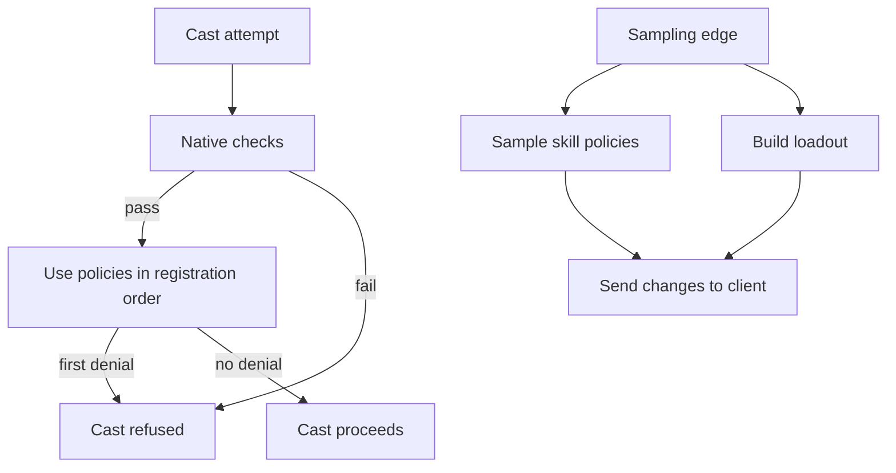

A skill needs more than a formula: a character must hold it, be allowed to cast it, and use the appropriate version. The Metin2 mainline engine makes many of these decisions in fixed tables and native checks. Universal Core adds three registries so rules can select a loadout, restrict use, or choose a skill variant without placing every condition in the cast path.

Each registry follows the [policies model](/foundations/policies): a rule has a name, a guard that decides where it applies, and a payload that supplies the decision. A registration returns a handle used to remove the rule. Registration order determines resolution order. For skill terms, including vnum and character, see the [Skills glossary](/foundations/skills).

## Three decisions at different times

A **loadout** is a plan for the skills a player holds and their client slots. A **use policy** can refuse a cast. A **skill policy** selects a named variant of a skill for a character. These decisions have different lifetimes.

The diagram shows the cast decision separately from the edges that update state shared with the client.

The use policy is a predicate: the engine asks it when a cast is considered. The other two produce state that the client must also see. Their guards are sampled at specific edges, and the result is kept on the character. A condition that changes between edges cannot update that state by itself.

## A use policy can only deny

Native cast checks run before the use policy. If a native check refuses a cast, the registry is not asked; an allowing policy cannot reverse that refusal. The engine walks applicable use rules in registration order. The first denial stops the walk, while an allowing answer leaves later rules free to deny.

The rule can filter by skill vnum before its guard runs. This keeps a rule for a small set of skills from calling its guard for every other skill. The same registry also receives mob skill decisions, so a guard must account for the kind of character it accepts.

The decision carries a message key back to the caller instead of sending a message itself. Cast eligibility can be queried without a cast actually taking place; sending from the predicate would make those queries visible to the player.

A failing guard skips its rule, and a failing Lua policy leaves the cast allowed by that rule. These failure directions matter when a restriction is required. The [skill use policy reference](/docs/building-blocks/skill-use-policy) covers registration, filters, and verdicts.

## A skill policy selects a variant

A skill can define named variants as changes to its base definition. The server builds each variant when the skill table loads. At a sampling edge, it evaluates the registered guards and keeps the matching policy IDs on the character. The client receives those IDs and uses the same skill definitions to select the corresponding variant. The [one-file model](/foundations/skills/one-file) explains the shared definition.

If several active policies override the same skill, they do not merge. The first applicable override in registration order wins; if none applies, the base skill is used. Multiple rules that activate the same ID leave it active only once. If two changes must apply together, define a variant containing both changes.

Sampling happens on map changes, registration, removal, explicit refresh, and entry into the game. It includes mobs as well as players. When a guard reads state that changes without one of those edges, refresh the character after changing that state. Otherwise the server and client keep the previous selection even though the guard would now answer differently.

Sampling avoids calling every guard on each skill lookup, but registration and removal re-sample characters on the core. Keep guards inexpensive and avoid registering rules for each individual cast. See the [skill policy reference](/docs/building-blocks/skill-policy) for the registration and refresh interface.

## A loadout changes held skills and slots

A loadout rule builds a plan for a player. The first matching guard in registration order owns the decision; later matching rules do not contribute to the plan. The plan replaces the client pages it names, leaving other pages alone. With no matching plan, the ordinary client bar remains.

The distinction between a slot and a held skill matters. The server tracks skill levels by vnum and receives a vnum in a cast request; slots are client presentation. Applying a plan changes live skill levels on the server and sends the slot layout to the client before the levels, so the client can place them. The engine keeps the previous levels for restoration when the plan is removed. An active loadout also lifts the skill group and specialization membership checks, while other cast checks still apply.

Loadouts are sampled for players on registration, removal, explicit refresh, and entry into the game. A map change alone does not rebuild one. Refresh after changing any state a guard or builder uses if no sampling edge follows. A failing builder does not hand control to the next matching rule.

The builder is called again at each rebuild, so it should produce a stable plan for the same state. Loadout levels are live character state: a normal save can persist them while the plan is active, and the restoration record is kept in memory. Use an appropriate [player virtualization](/foundations/player-virtualization) arrangement when temporary levels must not be saved. The [loadout policy reference](/docs/building-blocks/loadout-policy) describes plans and their lifecycle.
