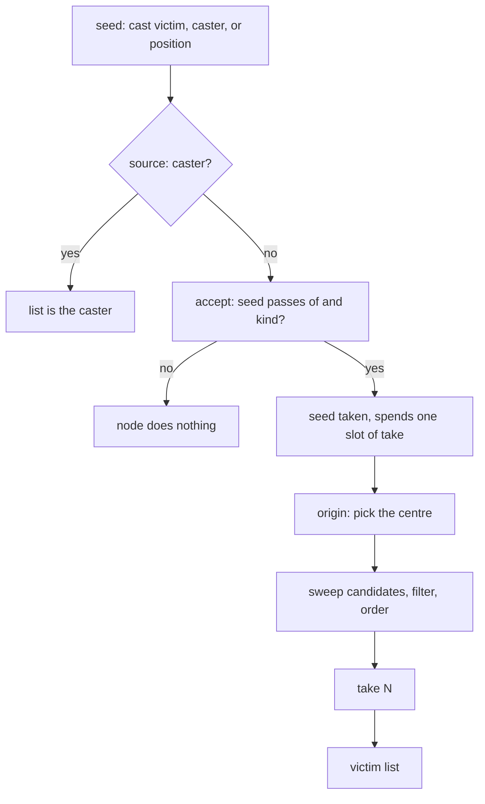

Every node in a skill has to answer one question before it does anything: who is this for. In the inherited engine the answer was a bit and a number. In Universal Core it is two declarations on the node, `collect` and `accept`, and a third, `targets`, on the two node types that run on a timer. This page covers those, the order the victim list is built in, and the ledgers that bound how often the same victim is reached. How nodes nest and run in phases is on [Nodes and phases](/foundations/skills/nodes-and-phases). Reaching the whole map, or other game cores, is on [Every core](/foundations/skills/every-core).

## Two questions on every node

`collect` says what ends up in the list: the source, the geometry, the search. `accept` says which of those are allowed: the relation, the kind, whether the seed counts, the ledger.

```yaml
targets:
  collect:
    search: { radius: 1000, order: { within: random, tiers: [PC, BOSS, METEOR, STONE, MONSTER, DOOR] } }
  accept:
    of: ENEMY
```

The default `accept` says nothing, and that has a meaning: the seed the node was handed is already vetted. Whoever collected it applied their own rule, so there is nothing to re-check.

The keys, with their defaults:

| Key | Values | Default |
| --- | --- | --- |
| `collect.source` | `inherit`, `caster`, `position`, `trigger_subject` | `inherit` |
| `collect.origin` | `seed`, `caster`, `computation_seed` | `seed` |
| `collect.search.radius` | distance in game units | 0 |
| `collect.search.take` | how many victims at most, 0 for unbounded | 0 |
| `collect.search.include_caster` | `true`, `false` | `false` |
| `collect.search.order.within` | `distance`, `random` | `distance` |
| `accept.of` | `ANY`, `ENEMY`, `ALLY`, `PARTY`, `TEAM`, `SELF` | `ANY` |
| `accept.kind` | `ANY`, `PLAYER`, `NON_PLAYER` | `ANY` |
| `accept.seed` | `true`, `false` | `true` |
| `accept.seed_may_be_caster` | `true`, `false` | `true` |
| `accept.ledger.max_per_victim` | repeats per victim, 0 for no opinion | 0 |
| `accept.ledger.cooldown_per_victim` | milliseconds between repeats | none |

The seed is the character the node was handed. For a top-level node on a client-resolved cast it is the victim the player aimed at. For a `per_use` node on a server-resolved cast it is the caster. For a child it is the victim of its parent, which is the next section. `ENEMY` and `ALLY` are not decided by the node: they are the answer of the skill's subject, which is covered with owners. `TEAM` is parsed and has no branch behind it, so today it behaves as `ANY`.

## The order of operations

A node collects once per computation. The steps run in this order, and where one stops, the rest do not run:

1. `source: caster` replaces everything. The caster is the only victim, there is no seed check and no search.
2. With no seed at all, there is no performer to sweep around, and only a node with a `search` can still collect anything.
3. If `accept.seed` is on, the seed is checked against `of` and `kind`. A seed that fails makes the whole node do nothing for that computation, search included. An enemy-only damage node that is seeded with an ally reaches nobody, unless it says `seed: false`.
4. The seed is checked against the collection ledger, then taken. It spends one of the search's slots.
5. The seed becomes the centre the search and its radius measure from, adjusted by `origin`.
6. The search sweeps, filters, orders and takes.



The filter on each candidate runs in a fixed order: the hit budget for the cast, then character type (warps, buildings, horses and pets are out), observers, the excluded character, the caster, the radius, dead or stunned, `of` and `kind`, the collection ledger, and last the skill's per-victim invisible window. The caster is out of every search by default. A self-plus-party buff that must include its own caster needs `include_caster: true` on the search. Eight configs set it today. This is a different switch from `seed_may_be_caster: false`, which governs the seed and not the search; ten configs use it, for client-resolved casts whose seed can be the caster.

`take: N` counts the seed. A processed seed is one of the N. Before that was fixed in August 2026, a `take: 5` node reached six victims and every config had to know it.

## Ordering inside the list

With no `order`, the nearest victims come first. Ties on distance break on the character id, so two processes sorting equal distances give the same list. They used to fall through to a pointer comparison, which is heap order.

`order.within: random` shuffles with a local random stream keyed on the skill, the node, the computation and the caster. It is not the global generator, so a cast is reproducible and the simulator can replay it. An unknown word here is not an error: it silently becomes `distance`.

`order.tiers` is a list of categories, `SELF PC BOSS METEOR STONE MONSTER DOOR`. Position in the list is the priority, and anything not listed sorts after everything that is. The sort is stable, so the order chosen by `within` survives inside a tier. Until the summer of 2026 the engine owned this ranking, as a fixed table with players first and doors last. Since then it is the author's list, and the shipped users are 78, 321 and 329.

Nodes themselves run in file order for top-level nodes, and depth-first per victim for children.

## Children are re-seeded per victim

A child with its own population does not inherit its parent's list. It is run once for each victim the parent took, and each time the victim is its seed. The search then centres on that victim. Skill 94, a party buff, shows the cheap form: the parent collects the party around the caster once, and its child declares no population at all. A child with no population acts on exactly the victim it is run for, so one search serves both nodes. Before the summer 2026 rebuild each of the two nodes carried its own copy of the flags and the splash block, so the party was searched twice.

Skill 155 shows the expensive form, with a parent that collects allies and a child that collects the enemies around each of them. This is the child:

```yaml
- type: DAMAGE
  id: raid_hit
  amountPoly: 150+120*skill_level
  damageType: MAGIC
  collect:
    # Centred on the ALLY this child was re-seeded with.
    search: { radius: 700, take: 0 }
    scalePoly: '1.0'
  accept:
    of: ENEMY
    kind: PLAYER
    seed: false          # the ally is not his own victim
    ledger: { max_per_victim: 0 }
```

`seed: false` is not "skip the seed step". The seed still becomes the centre of the search and the excluded character, so the search cannot pick it up either. With `seed: false` and no `search`, the node reaches nobody.

`origin: computation_seed` pins a child to the seed of the whole computation instead of its parent's victim, and `origin: caster` centres it on the caster. Ten configs use `origin: caster`.

## Where the sweep goes

The candidates for a search come from the sector tree the performer stands in and its neighbours. The radius is measured from the node's centre. These are two different things. `origin` moves only where the radius is measured from, not which characters the sweep hands over. A centre more than about one tree away from the performer is measured against candidates the sweep never produced, so it finds few or none.

This is still the engine from before. The inherited code swept the caster's sector tree for splash skills, the 2019 node system did the same, and so does the node search today. A skill built from allies far from the caster belongs to an empire fighting together. 155 says so in its own header: an ally on the far side of the map finds nobody. Only position-seeded traversals, such as an anchored ticker, sweep around their centre. The map-wide sweep that does not depend on the performer is on [Every core](/foundations/skills/every-core).

## targets: who the timed node hunts

`AUTO_SHOOT` and `CONCATENATED_ATTACK` run over time, so a single list at the start is not enough. They carry a second population, `targets`, written with the same `collect` and `accept`. The node's own `collect` and `accept` say who carries the node. The `targets` population says who the shots hunt, or where the chain jumps next.

`targets` is mandatory on these two types, and it must contain a `collect.search`. A timed node without one is refused when the skills are built, with the message `a timed node must declare `targets:` with a collect.search`.

How many targets come from the node type. `AUTO_SHOOT` evaluates `targetCountPoly` each time, which is why the skill 78 block above has an `order` and no `take`. `CONCATENATED_ATTACK` reads `take` from `targets`. A forking chain is capped at 64 live branches: `take: 3` over five generations is 243 leaves, and a typo in a config must not be able to take a core down.

Every victim a timed node collects is a carrier of its own. The dispatch loop once ended in `return` where it meant `continue`, so only the first collected victim ever carried a timed node. The summer 2026 audit found it and the rebuild fixed it.

## Ledgers

Two ledgers exist, and neither is the scope of the other. Both are keyed by the victim, and both count how often it was collected and how often it landed.

The entrypoint ledger records what a client packet claimed. It belongs to the cast and is bounded by `resolve.bound`: `targets` is how many victims the client may name, `hitsPerTarget` is how many times each. It is checked at the packet, before any collection runs, and a claim past the bound is refused as `refuse:bound_reached`. On a server-resolved cast the one server seed passes the packet and the bound is recorded, not enforced against the collection. That is how skill 322 works today: `bound: { targets: '1' }` with a `search` of radius 525 and `take: 15`.

The collection ledger records what a collector took. It belongs to a node and is named by the node's `id`. A node without an `id` gets one from its position, so two nodes share a ledger only when they share an `id`, and a duplicate `id` is a build error. The ledger is what `accept.ledger` bounds:

- `max_per_victim` is how many times one victim may be collected by this node. Its default is 0, which means the node has no opinion. Repeats are then whatever the packet gate allows.
- `cooldown_per_victim` is the minimum time between two collections of the same victim, in milliseconds.
- The two compose. The count says how many times, the cooldown says how far apart. Either alone is a bound; together they are a rate.

A child's ledger is wiped each time its parent hands it a victim, so one enemy is hit once per ally whatever `max_per_victim` says. Skill 155's header credits the `0` with that; the reset does it.

The readable stats follow the ledgers: `use.victims` is the distinct victims of the entrypoint ledger, `node.<id>.victims` is the distinct victims of that node, and `node.<id>.hits` is the size of this computation's list.

## Traps, by cause

**`max_per_victim` defaults to 0, not 1.** For twelve days in August 2026 the default was 1. A silent node then imposed the tightest cap there is and overrode a laxer `resolve.bound`, so a skill declaring three hits landed one. The fix made 0 mean "no opinion". Some older comments in shipped configs still say the default is 1. On a server-resolved cast a silent node has no per-victim cap, and what bounds it is that a search collects each victim once per computation.

**Typos are logged, not refused.** The population is read by a loader that logs an unknown word and keeps the default. `accept.of: ENEMIES` logs ``unknown `accept.of` 'ENEMIES'`` and stays `ANY`; the skill builds and the node admits allies. `search.radius` is logged and ignored when `collect.from` is not the sector tree.

**`order` makes `take` mandatory.** The plain distance path reads `take: 0` as unbounded. The ordered path loops up to the count, so with `tiers` or `within: random` and no `take` the node collects nobody. Nothing in the loader checks for it. `targets` of an `AUTO_SHOOT` is exempt, because its count comes from `targetCountPoly`.

**A seed that fails `accept` stops the node.** The search never runs. This is by design, since a node that was handed a victim it does not accept has nothing to do, but it surprises authors who expect the search to find someone else.

**The caster is out of every search.** See `include_caster`. A search that must include its own caster has to say so.

**`resolve.bound` is a packet bound.** It does not bound a collection. A node that must stop at N victims says `take: N`.

**Far centres find nobody.** The sweep is the performer's neighbourhood, whatever `origin` says.

## How it got here

In the inherited engine, reach was one bit and one range. A skill with `SKILL_FLAG_SPLASH` swept the sector tree around the caster and hit what was in `iSplashRange`; without the bit it hit the one target. Who counted as an enemy was hardcoded in the battle check, and the number of hits was one counter for the whole cast, blind to which victim it was spent on. Range belonged to the skill, not to the effect: the three affect slots of a skill reused the same range.

In February 2019 the first version of the composable node system gave every node its own splash block, with `maxHit`, a range and an adjust polynomial, and a flag word for the relation: `ENEMYONLY`, `ALLYONLY`, `OTHERONLY`, `CLIENT_HIT`, `COMPUTE_SELF`. The sweep was unchanged, still the caster's sector tree. In 2023 the collector node arrived, a node with no effect of its own that only gathers so that its children act per victim.

That left a node's population spelled three ways at once: a splash block, a word in the flags, and an implicit default that depended on the node type. In August 2026 the area skills were re-declared, about 200 of them, as `collect` and `accept`. They were the first client of the change. The limit it closed was that none of the three spellings could be read and be sure of what it meant. For example, 67 mob skills carried `maxTarget: 1` from a time when it was inert, and boss skill 322 went silent in the live game before anyone worked out why. A splash that collapsed from 5 victims to 1 came down to two constructor arguments passed in the wrong order. The migration was checked by deriving the effective clause from both spellings across 346 nodes and requiring them to be equal.

This is what changed for one horse skill in that rebuild:

```diff
-  flag:
-  - ENEMYONLY
-  - NPCONLY
-  - SKIP_MAIN_TARGET
-  splash:
-    maxTarget: 50
-    splashRange: 700
-    splashAroundAdjustPoly: 1
+  collect:
+    search: { radius: 700, take: 50 }
+    scalePoly: '1'
+  accept:
+    of: ENEMY
+    kind: NON_PLAYER
+    seed: false
```

What was replaced: the splash bit and the per-skill range, the `splash` block and the relation flags, the ranking the engine owned for tiers, the opt-in hit-count flag, and the single counter that mixed claims with collections. What stayed layered: the collector node, now one user of the population among others. What is still in the engine: the sweep is the performer's sector tree, the per-victim invisible window sits beside the ledger, and `TEAM` is parsed without a branch.

Across the 213 skill configs today, `search` appears in 113, `targets` in 20, `seed: false` in 14, and `max_per_victim` is 0 in 20, 1 in 19, 2 in 2 and 3 in 1.
