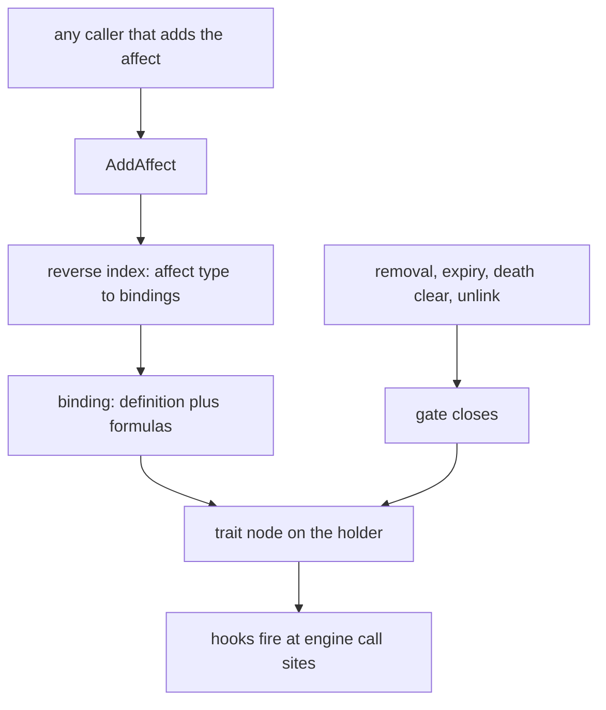
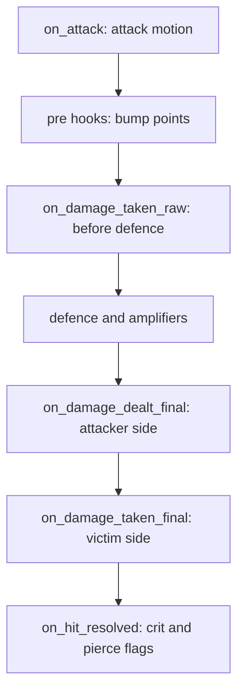

## Mechanics beyond points

A point holds a number. It has no condition, state, or moment at which it applies. In the Metin2 mainline engine, conditional bonuses require branches in the damage path or additional points. Traits add a gate that says when a rule is active, hooks that say where it runs, and state for values that change over its lifetime.

A trait can reduce damage while an affect is active, count damage for a later action, or add a conditional bonus to a point for one calculation.

## The gate is the affect

The affect is the attachment. When it is gained, the trait attaches to the holder. When the last affect of that type ends, the trait detaches. The affect system supplies cleanup, persistence, dispel interaction, and stacking. A trait does not remove its own affect by hand: `end_self` removes the gating affect and the gate closes as a consequence. See [Affects](/foundations/affects/) for the affect lifecycle.

- A trait definition is the behaviour. It carries no gate and no numbers.
- A binding combines a definition, an affect type, and formulas with their numbers. One definition can be gated by several affects, each with its own values.
- Two things create a binding: the skill loader, for a skill node that lists traits, and the Lua `bind` call. Nothing else does.
- Anything that adds a bound affect opens the gate, whether a skill, a mode, or a consumable item. Equipping gear cannot: equipment applies points, not affects.
- When an affect is added, the engine asks a reverse index from affect type to bindings. If nothing is gated on that type, it makes one hash miss and does nothing else.
- The gate closes through one path on removal, expiry, bulk clear at death, and direct unlinking.



Each holder keeps a trigger mask, the OR of the hooks of its active traits. A call site performs a bitwise AND against it, and the engine crosses into Lua only when the mask and the node's active flag agree. Every Lua call goes through one dispatch point. An error is logged as `[traits] <hook> [<id>]: <what>`, and the other traits still fire.

## The bump point

A trait can add a delta to a point for one damage calculation. A transient overlay accumulates the delta and the point read folds it in without changing the stored points, so a recompute never writes a temporary bonus into them. A nestable guard unwinds the overlay; bumps on the same point compose additively, so +40 and -20 both apply and both unwind.

A bump is legal only inside a guard. The melee hit, the shot, and each skill damage node open one, and each fires the attacker's `on_damage_dealt_pre` and the victim's `on_damage_taken_pre` with the settled damage type. Outside a guard the call is refused and logged.

The condition is read at hit time. There is no trigger for a changing value such as health, so the pre hook asks when it matters instead of a toggle that could drift out of sync:

```lua
forge.sys.game.traits["define"]{
    id   = "wounded_edge",
    gate = { affect = affect.name_map.EXAMPLE_EDGE },
    hooks = {
        on_damage_dealt_pre = function(ch, victim, dam_type, ctx)
            if ch:get_hp_pct() < 80 then
                ctx.bump_point(point.ATTBONUS_HUMAN, 15)
            end
        end,
    },
}
```

## Hooks and the damage chain

A definition subscribes by naming hooks; each is a trigger bit in the mask. The 24 hooks fall into groups: gate changes, the two point-bump hooks, transforms inside the formula, observers of a resolved hit, targeting, time, and events such as skill casts, buffs, debuffs, and heals. The full list and signatures are in the [Traits reference](/docs/core/traits/define).

A transform receives the number in `ctx.damage`, or `ctx.amount` for a heal, and writes back the value that continues down the formula. An error or a non-number leaves it unchanged, and a negative result is clamped to 0 so it cannot heal. A hit meets the damage hooks in this order:



## Stage ordering

Several traits can occupy one formula position. `stage` orders them ascending, with 0 as the default. With three invented traits at the same position:

| Stage | Trait |
| --- | --- |
| 0 | `ward_a` |
| 10 | `ward_b` |
| 20 | `bonus_c` |

Native and Lua traits share one list and one walk in stage order. Each transform sees the number the previous one left, so a ward that cuts damage before a later one changes what the later one works on.

## C++ and Lua

A trait is defined in C++ or Lua. Both reach the same formula positions and interleave by stage.

| | C++ | Lua |
| --- | --- | --- |
| Define | a class with an id, a stage and a hook macro per hook, registered at start-up | `forge.sys.game.traits.define{...}` |
| State | none in the object: a stateless singleton, every hook `const` | `ctx.state` per (character, binding), plus counters, cooldowns and schedules |
| Only here | the point limit | none |

Adding a native trait never edits a central switch: the hook macro defines the override and its trigger bit together, because a hook declared without its bit would silently never be dispatched. A native id wins; a Lua `define` with an id a native already owns is refused. The point limit is native only: it is asked on every capped point read, too often for a script call.

## Constants and formulas

A constant is a number the gate resolves and freezes when the affect lands. A formula is evaluated per call with the constants, the gate's `amount`, the damage, and whatever the call site passes. A formula that names something nobody supplies is logged once per binding and returns its fallback. Pass live values as variables, because a constant keeps the value it had when the affect landed.

## Traps

- A persistent gate has no constants after a login: an affect restored from the database at login has no applier to prime them, so the fallback answers. Gate such a trait on a no-save affect, or take one scaled number from `gate_value()`, which persists with the affect.
- A binding is keyed by trait and affect type for the whole process. Sources that raise the same affect cannot carry different traits or formulas.
- Only a bump from a pre hook changes the hit. A bump lasts for one calculation, so an affect is still needed for an icon, a visible flag, or a lifetime between attacks.

More traps and worked examples are in [Examples and pitfalls](/docs/core/traits/examples).
