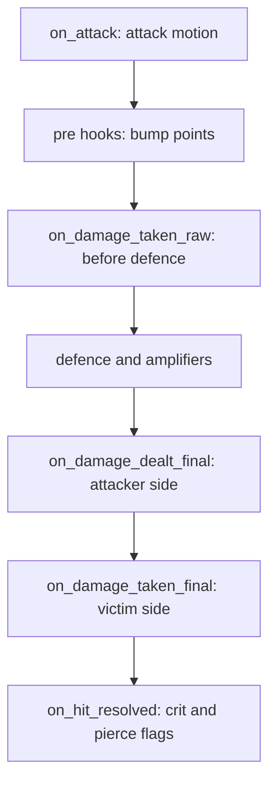

## The limit: a point does nothing on its own

In the inherited engine a bonus was a point. An item applied `POINT_*` deltas, the damage formula read the points, and that was the whole contract. It covers static stat tweaks cleanly. It cannot say "+15 damage against players while my HP is under 80%", "this hit is reduced because a buff is up", or "count the damage and pay it back". A point holds a number. It has no condition, no state and no moment at which it applies.

So every conditional bonus became a branch somewhere in the damage path, written where the developer happened to be. This is the inherited code, two affect-gated rules inside the damage function:

```cpp
if (IsAffectFlag(AFF_TERROR))
    dam = (int32_t) (dam * (95 - GetSkillPower(SKILL_TERROR) / 5) / 100);

if (IsAffectFlag(AFF_HOSIN))
    dam = dam * (100 - GetPoint(POINT_RESIST_NORMAL_DAMAGE)) / 100;
```

The mana shield had its own `IsAffectFlag(AFF_MANASHIELD)` block further down. Item bonuses such as steal HP or kill recovery were read by hand in the same function. When a rule applied to the melee hit, the shot and the skill hit, it was copied into each of them, and the copies drifted. Until July 2026 the damage defence pipeline existed in four copies.

The other answer was a new point. Vanilla Metin2 has about 145 of them. The engine had 191 by 2016 and has 324 today. Among them are 34 `ADDER` points and 33 `RESIST` points, one pair per skill, so that a skill's damage could be tuned on its own. Each new bonus was a pass through the whole engine: the commits that added lifesteal percent, defence penetration, skill damage against monsters and PvP penetration touched 9, 15, 16 and 23 files, mixed with other work, so those counts are upper bounds. The per-skill map that joined an adder to its skill held a key bug for years: the Noejeon entry was keyed by a point where a skill vnum belonged, so it could never match.

Traits are the evolution of that arrangement. They keep the point as the unit of stat and add what a point lacks: a gate that says when, a hook that says where, and state that says how much so far. They are a general layer for mechanics that give bonuses or behave conditionally. Skills use them, but a skill is one gate among many, and the code says so. The native terror trait is skill-scaled, and its header states that nothing in it says "skill":

```cpp
// Its reduction is skill-scaled, but nothing here says "skill": it declares that
// it needs `power`, and whoever gated it resolved that in its own vocabulary
// before the affect landed. On skill 64 the AFFECT node supplies
//   constants: { power: skill_power }
//   formulas:  { reduction_pct: 5+power/40 }
// A quest or an item could gate the same trait and compute `power` its own way.
```

The mayhem arena augments in June 2026 were the first client. The limit they met was the one above, and it was already there.

## The gate is the affect

Every conditional rule in the old code had the same shape: it applied while some affect was on. Mana shield while `MANASHIELD` is up, stealth while `EUNHYUNG` is up, an erosion while the buff is on the victim. So the trait does not check the affect as a condition. The affect is the attachment. When it is gained, the trait attaches to the holder. When the last affect of that type ends, the trait detaches.

That gives cleanup, persistence, dispel interaction and stacking for free, because the affect system already handles them. A trait never removes its own affect by hand; `end_self` removes the gating affect and the gate closes as a consequence. For the lifecycle of the affect itself, see [Affects](/foundations/affects/).

The mechanism is small:

- A trait definition (`TraitDef`) is the behaviour. It carries no gate and no numbers.
- A binding (`TraitBinding`) is a definition, an affect type and the formulas with their numbers. One definition can be gated by several affects, each with its own values. The hosin ward is one definition with two bindings, because two different skills raise the same affect.
- When `AddAffect` runs, the engine asks a reverse index (affect type to bindings). If nothing is gated on that type, that is one hash miss and nothing else happens.
- A holder gets its trait state only when a binding first opens, and the state lives on the character. Nodes keep constants, counters, cooldowns, schedules and a Lua table.
- The gate closes on `RemoveAffect`, on expiry and on the bulk clear at death, all through one path. Since July 2026 it also closes when an affect is unlinked directly, which it did not before: a trait gated on a timed affect never deactivated when the affect simply ran out.
- Activation zeroes the counters. They do not survive from one activation to the next.


Dispatch is gated twice before a script is touched. Each holder keeps a trigger mask, the OR of the hooks of its active traits, and each call site does one bitwise AND against it. Only when the mask and the node's active flag agree does the engine cross into Lua. A trait nobody subscribed to costs nothing. Every Lua call goes through the single dispatch choke point, and an error is logged as `[traits] <hook> [<id>]: <what>` while the other traits still fire.

## The bump point

The old way to make a static bonus conditional was a second point, or a branch. The bump point is a third way: for the length of one damage calculation, a trait adds a delta to a point, and the framework takes it back.

The bump is an overlay, not a write. `ApplyPointBump` accumulates a transient delta, `GetPoint` folds it in, and nothing touches the stored points. The first version wrote into the stored points, and in June 2026 bumps leaked and desynced when a recompute ran in the middle of one. The overlay with a nestable guard replaced it, and bumps on the same point compose additively: +40 from one trait and -20 from another both land and both unwind.

A bump is legal only inside a guard. Three sites open one: the melee hit, the shot, and each skill damage node. Each fires the attacker's `on_damage_dealt_pre` and the victim's `on_damage_taken_pre` with the settled damage type. Outside a guard the call is refused and logged as `[traits] bump_point outside a damage-pre guard (point=..., delta=...) ignored`.

This is a whole trait from the arena augments. `ATTBONUS_HUMAN` is a point vanilla can only grant statically. Here it becomes conditional, with no new point and no new branch:

```lua
-- ============================================================================
-- 3. Silver: COLD BLOOD  (it: Sangue Freddo)
--    "+15 dmg vs players while self HP < 80%"
-- ============================================================================
traits.define{
    id   = "cold_blood",
    gate = { affect = affect.name_map.AUGMENT_COLD_BLOOD },
    hooks = {
        ---@param ch LPCHARACTER
        ---@param victim LPCHARACTER
        ---@param ctx forge.sys.game.traits.CTX
        on_damage_dealt_pre = function(ch, victim, dam_type, ctx)
            if ch:get_hp_pct() < 80 then
                ctx.bump_point(point.ATTBONUS_HUMAN, 15)
                dbg(ch, "cold_blood +15 ATTBONUS_HUMAN (hp_pct=" .. ch:get_hp_pct() .. ")")
            end
        end,
    },
}
```

HP is read at hit time. There is deliberately no "HP changed" trigger, because the HP point changes noisily: gear swaps, buff churn and recomputes all move it. A bonus "while below X% HP" reads the HP in the pre hook and has no toggle to get out of sync.

Two traps come from the same design. The pre hooks fire for the melee auto, the shot and every skill damage node, and the physical ones all read the same attack point, so a bump that does not look at `dam_type` erodes all three. And a bump is not a toggled affect: an affect still wins when the bonus needs an icon, a visible flag or a life between attacks.

## The hooks

A definition subscribes by naming hooks, and each one is a trigger bit in the mask. There are 24. Grouped by what they see:

| Group | Hooks |
| --- | --- |
| Gate | `on_activate`, `on_deactivate` |
| Point bump, around the formula | `on_damage_dealt_pre`, `on_damage_taken_pre` |
| Transforms, inside the formula | `on_damage_taken_raw`, `on_damage_dealt_final`, `on_damage_taken_final`, `on_heal_taken_pre` |
| Resolved hit and observers | `on_hit_resolved`, `on_damage_dealt_post`, `on_damage_taken_post`, `on_attack`, `on_kill`, `on_died` |
| Targeting | `on_target_scan` |
| Time | `on_tick` (1 Hz), `on_scheduled` |
| Events | `on_skill_cast`, `on_debuff_given`, `on_debuff_taken`, `on_buff_given`, `on_buff_taken`, `on_heal_done`, `on_heal_taken` |
| Caps | the point limit, native only |

The transform hooks are the ones that replaced the branches. They receive the number in `ctx.damage` (or `ctx.amount` for a heal), write it back, and what they write continues down the formula. A hook that errors or leaves a non-number keeps the damage unchanged. A negative result is clamped to 0, because nothing downstream re-checks and a negative damage would heal. The full signatures are in the [Traits reference](/docs/building-blocks/traits).

The positions inside the damage function, in the order a hit meets them:



`on_target_scan` sits outside this chain, in target acquisition: it returns true to hide the holder from a finder, which is how stealth works.

## Stage ordering

Several traits can sit on one position. `stage` orders them, ascending, with 0 as the default. The chain at `on_damage_taken_final` today is:

| Stage | Trait | Backend |
| --- | --- | --- |
| 0 | `hosin_ward` | native |
| 10 | `mana_shield` | native |
| 20 | `guard_ward` | native |
| 30 | `thorns` | Lua |
| 40 | `guild_bulwark`, `stellar_ward` | Lua |

Native and Lua traits share one list. Since July 2026 each call site makes one walk that visits both in stage order. In the first backend there were two passes, so a Lua trait could not sit between two native ones. Now `thorns` at 30 runs after the mana shield and before `stellar_ward`, whoever wrote them. Order matters because each transform sees the number the previous one left: a ward that cuts damage before the mana shield soaks changes what the shield soaks.

## Both doors

A trait is defined in C++ or in Lua, and bound to an affect from either. The vocabulary is the same.

| | C++ | Lua |
| --- | --- | --- |
| Define | a class derived from the native trait interface with an id, a stage and a hook macro per hook, registered by one line at start-up | `forge.sys.game.traits.define{ id, gate?, stage?, counters?, keep_state_on_deactivate?, hooks }` |
| Bind | `BindTrait(id, affectType, formulas)` | `gate = { affect = ... }` in `define`, or `forge.sys.game.traits.bind(id, affect_type, formulas)`, which calls the same function |
| State | none in the object: a stateless singleton, every hook `const` | `ctx.state` per (character, binding), plus the shared counters, cooldowns and schedules |
| Only here | the point limit | none of the formula positions |

Adding a native trait never edits a central switch: the hook macro defines the override and its trigger bit together, because a hook declared without its bit would silently never be dispatched. A native id wins. A Lua `define` with an id a native already owns is refused with `[traits] define [<id>]: a native trait already owns this id`, and a second Lua definition of the same id is refused as a duplicate.

Who registers natively today:

| What | Registered natively from C++ today | Registered from Lua today |
| --- | --- | --- |
| Trait definitions | 10 native traits at start-up: `attack_buff_erosion`, `buff_def_erosion`, `dash`, `guard_ward`, `hosin_ward`, `mana_shield`, `skill_ledger`, `stealth`, `terror`, `weapon_bound` | arena augments, battle royale, battle tower, rage, and 3 skill traits |
| Bindings | the skill loader, from the `traits:` and `counters:` keys of skill files | `gate =` in `define` |

The C++ door is open, but only the skill loader walks through it. No other C++ code binds a trait. A mode or an arena that wants a trait writes it in Lua.

The constants and formulas are the other half of a binding. A constant is a number the gate resolved in its own vocabulary and froze when the affect landed: a caster's skill power, say. A formula is evaluated per call with the constants, the gate's `amount`, the damage and whatever the call site passes. A formula that names something nobody supplies is logged once per binding and returns its fallback.

```lua
local reduction = ctx.formula("reduction_pct", 0, { dam = dam })
```

This is an example written for the page, a formula call with a working default. Pass live values as variables: smuggle one in as a constant and it keeps the value it had when the buff landed.

## What Lua reaches

Lua can reach every position except one. A Lua trait can subscribe to `on_damage_taken_raw`, `on_damage_taken_final`, `on_damage_dealt_final`, `on_hit_resolved`, `on_attack`, `on_target_scan` and the heal transform `on_heal_taken_pre`. A native trait can subscribe to the same, and the two interleave by stage. The only native-only position is the point limit, the cap query that `GetLimitPoint` asks on every capped point read. That runs too often for a script call, so it is answered natively without crossing into Lua.

The real cost for Lua at the formula positions is a state crossing per hit. That is why the trigger mask matters most there: it costs nothing until something subscribes.

Shipping content uses most of these positions. `on_damage_taken_final` is the busiest, in the skill traits, the battle royale and the battle tower boons. `on_damage_dealt_final` and `on_hit_resolved` are used by the boons, `on_attack` by the battle royale, and `on_heal_taken_pre` by the battle royale only. `on_damage_taken_raw` has only a test trait on a mannequin, and nothing in Lua uses `on_target_scan` yet. Only the native stealth-style trait does.

## What traits do today

- Augments: the mayhem arena augments and the Ball-Em-Up augments are Lua traits gated by augment affects. Cold blood above is one of them.
- Modes: the battle royale defines its traits in Lua, and rage is a broadcast affect with a rage charge trait.
- Battle tower: the boons are Lua traits, with their numbers in the tower data file.
- Skills: ten native traits ship with the engine, among them the mana shield, terror, stealth, the hosin ward, the two buff erosions and weapon binding. Three skill traits are Lua files that sit next to the skill data: thorns, a guild bulwark and a stellar ward.

The mana shield, terror, stealth and hosin were `IsAffectFlag` branches until July 2026, the erosions and weapon binding until late July. They are the same rules, moved out of the damage function. The buff erosions had been `if` chains and then a table in the damage code.

Between 20 and 24 July 2026 we tried a second interface, one that only skills could use. It was an exploration. Once it was clear that traits superseded it, the work went to traits, and the skill interface was retired.

## Gear-triggered traits: wanted, not built

A set bonus that gates a conditional damage rule is the obvious next client, and I want it. It does not exist. There is no equip trigger among the hooks and no item field that names a trait.

The reason is in the plumbing. Items reach points through `ApplyPoint`, not through `AddAffect`:

```cpp
m_pOwner->ApplyPoint(p->aApplies[j].bType, bAdd ? p->aApplies[j].lValue : -p->aApplies[j].lValue, batched);
```

The gate opens only from `AddAffect`, so equipping an item cannot open a trait gate today. Gear only ends a trait, never starts one: weapon binding removes a skill-gated buff when the weapon is wrong. Which item bonuses move onto traits, and when, is not decided.

## Traps, by cause

- A constant is frozen at the gate. It was resolved in the caster's context when the affect landed, so a value that changes afterward must be a variable passed to the formula.
- A persistent gate loses its constants on reload. Constants live on the in-memory node, and an affect restored from the database has no applier to prime them, so the fallback answers. Skill affects are not saved, so skill gates never see it. Gate such a trait on a no-save affect, or take one scaled number from `gate_value()`, which persists with the affect.
- A binding is keyed by trait and affect type for the whole process. Two skill variants that raise the same affect cannot carry different traits or formulas.
- Only a bump from a pre hook changes the hit; later hooks of the same hit accept a bump the formula no longer reads, and with no hit in progress a bump is refused. An ungated bump hits every delivery.

## What is still in the engine

Traits replaced the affect-gated branches. They did not rewrite the item-point effects, which are read by hand in the damage and kill code:

- Kill recovery of HP and SP.
- Block and dodge.
- Melee reflect.
- Steal HP and steal SP.
- Hit recovery.

About 20 `IsAffectFlag` calls are left in the server, and one rule outside the traits that pairs poison with the mana shield. The point limit is native-only. No promise is made here about which of these becomes a trait next.
