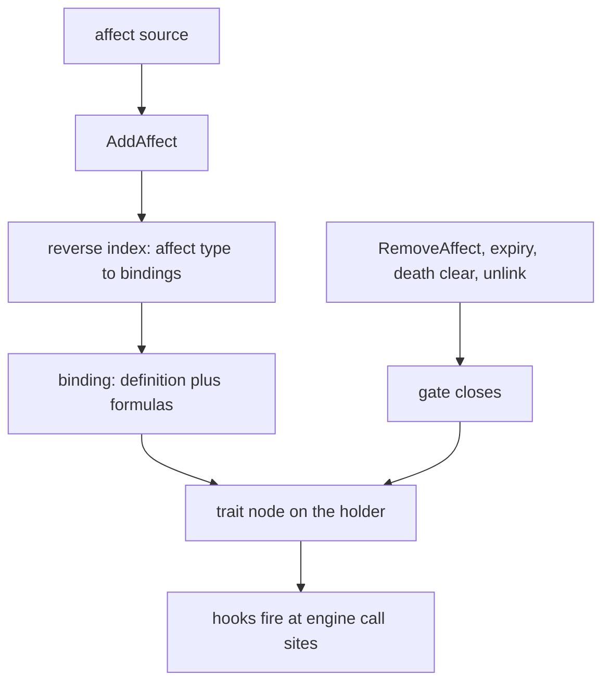
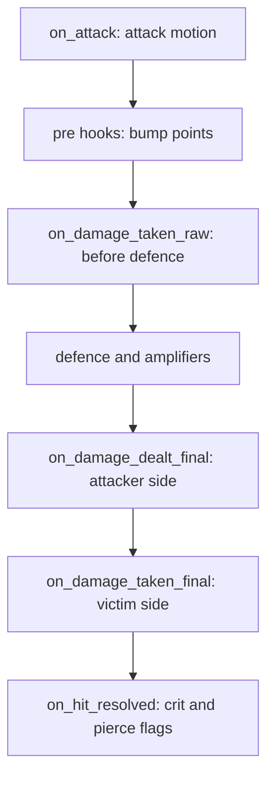

## Mechanics beyond points

A point holds a number. It has no condition, state, or moment at which it applies. In the Metin2 mainline engine, conditional bonuses require branches in the damage path or additional points. Traits add a gate that says when a rule is active, hooks that say where it runs, and state for values that change over its lifetime.

A trait can reduce damage while an affect is active, count damage for a later action, or add a conditional bonus to a point for one calculation. [Skills](/foundations/skills/one-file), modes, and items can bind traits through affects.

## The gate is the affect

The affect is the attachment. When it is gained, the trait attaches to the holder. When the last affect of that type ends, the trait detaches. The affect system supplies cleanup, persistence, dispel interaction, and stacking. A trait does not remove its own affect by hand: `end_self` removes the gating affect and the gate closes as a consequence. See [Affects](/foundations/affects/) for the affect lifecycle.

- A trait definition (`TraitDef`) is the behaviour. It carries no gate and no numbers.
- A binding (`TraitBinding`) combines a definition, an affect type, and formulas with their numbers. One definition can be gated by several affects, each with its own values.
- When `AddAffect` runs, the engine asks a reverse index from affect type to bindings. If nothing is gated on that type, it makes one hash miss and does nothing else.
- A holder gets trait state when a binding first opens. The state lives on the character; nodes keep constants, counters, cooldowns, schedules, and a Lua table. Activation zeroes the counters.
- The gate closes through one path on `RemoveAffect`, expiry, bulk clear at death, and direct unlinking.



Each holder keeps a trigger mask, the OR of the hooks of its active traits. A call site performs a bitwise AND against it, and the engine crosses into Lua only when the mask and the node's active flag agree. Every Lua call goes through one dispatch point. An error is logged as `[traits] <hook> [<id>]: <what>`, and the other traits still fire.

## The bump point

A trait can add a delta to a point for one damage calculation. `ApplyPointBump` accumulates a transient overlay, and `GetPoint` folds it in without changing the stored points. A nestable guard unwinds the overlay; bumps on the same point compose additively, so +40 and -20 both apply and both unwind. The overlay also keeps a recompute from writing a temporary bonus into stored points.

A bump is legal only inside a guard. The melee hit, the shot, and each skill damage node open one. Each fires the attacker's `on_damage_dealt_pre` and the victim's `on_damage_taken_pre` with the settled damage type. Outside a guard the call is refused and logged as `[traits] bump_point outside a damage-pre guard (point=..., delta=...) ignored`.

This trait adds a player damage bonus while the holder's HP is below 80%.

```lua
-- ============================================================================
-- 3. Silver: COLD BLOOD  (it: Sangue Freddo)
--    "+15 dmg vs players while self HP < 80%"
-- ============================================================================
traits.define{
    id   = "cold_blood",
    gate = { affect = affect.name_map.AUGMENT_COLD_BLOOD },
    hooks = {
        ---@param ch LPCHARACTER
        ---@param victim LPCHARACTER
        ---@param ctx forge.sys.game.traits.CTX
        on_damage_dealt_pre = function(ch, victim, dam_type, ctx)
            if ch:get_hp_pct() < 80 then
                ctx.bump_point(point.ATTBONUS_HUMAN, 15)
                dbg(ch, "cold_blood +15 ATTBONUS_HUMAN (hp_pct=" .. ch:get_hp_pct() .. ")")
            end
        end,
    },
}
```

HP is read at hit time. There is no HP-change trigger: gear swaps, buff churn, and recomputes all move the HP point. Reading it in the pre hook avoids a separate toggle that could get out of sync.

## The hooks

A definition subscribes by naming hooks; each is a trigger bit in the mask. There are 24 hooks:

| Group | Hooks |
| --- | --- |
| Gate | `on_activate`, `on_deactivate` |
| Point bump, around the formula | `on_damage_dealt_pre`, `on_damage_taken_pre` |
| Transforms, inside the formula | `on_damage_taken_raw`, `on_damage_dealt_final`, `on_damage_taken_final`, `on_heal_taken_pre` |
| Resolved hit and observers | `on_hit_resolved`, `on_damage_dealt_post`, `on_damage_taken_post`, `on_attack`, `on_kill`, `on_died` |
| Targeting | `on_target_scan` |
| Time | `on_tick` (1 Hz), `on_scheduled` |
| Events | `on_skill_cast`, `on_debuff_given`, `on_debuff_taken`, `on_buff_given`, `on_buff_taken`, `on_heal_done`, `on_heal_taken` |
| Caps | the point limit, native only |

The transform hooks receive the number in `ctx.damage`, or `ctx.amount` for a heal, and write back the value that continues down the formula. An error or a non-number leaves damage unchanged. A negative result is clamped to 0 so it cannot heal. The full signatures are in the [Traits reference](/docs/core/traits).

A hit meets the damage hooks in this order:



`on_target_scan` sits outside this chain in target acquisition. It returns true to hide the holder from a finder.

## Stage ordering

Several traits can occupy one position. `stage` orders them ascending, with 0 as the default. At `on_damage_taken_final`, the chain includes:

| Stage | Trait | Backend |
| --- | --- | --- |
| 0 | `hosin_ward` | native |
| 10 | `mana_shield` | native |
| 20 | `guard_ward` | native |
| 30 | `thorns` | Lua |
| 40 | `guild_bulwark`, `stellar_ward` | Lua |

Native and Lua traits share one list and one walk in stage order. Each transform sees the number the previous one left: a ward that cuts damage before the mana shield changes what the shield soaks.

## C++ and Lua registration

A trait is defined in C++ or Lua and can be bound to an affect from either.

| | C++ | Lua |
| --- | --- | --- |
| Define | a class derived from the native trait interface with an id, a stage and a hook macro per hook, registered by one line at start-up | `forge.sys.game.traits.define{ id, gate?, stage?, counters?, keep_state_on_deactivate?, hooks }` |
| Bind | `BindTrait(id, affectType, formulas)` | `gate = { affect = ... }` in `define`, or `forge.sys.game.traits.bind(id, affect_type, formulas)`, which calls the same function |
| State | none in the object: a stateless singleton, every hook `const` | `ctx.state` per (character, binding), plus the shared counters, cooldowns and schedules |
| Only here | the point limit | none of the formula positions |

Adding a native trait never edits a central switch: the hook macro defines the override and its trigger bit together, because a hook declared without its bit would silently never be dispatched. A native id wins. A Lua `define` with an id a native already owns is refused with `[traits] define [<id>]: a native trait already owns this id`, and a second Lua definition of the same id is refused as a duplicate.

## Native registrations

The engine registers these native trait definitions at start-up: `attack_buff_erosion`, `buff_def_erosion`, `dash`, `guard_ward`, `hosin_ward`, `mana_shield`, `skill_ledger`, `stealth`, `terror`, and `weapon_bound`.

## Constants and formulas

A constant is a number the gate resolves and freezes when the affect lands. A formula is evaluated per call with the constants, the gate's `amount`, the damage, and whatever the call site passes. A formula that names something nobody supplies is logged once per binding and returns its fallback.

This call supplies a default and a live damage value:

```lua
local reduction = ctx.formula("reduction_pct", 0, { dam = dam })
```

Pass live values as variables. A constant retains the value it had when the affect landed.

## Lua and the point limit

Lua and native traits can subscribe to the same formula positions and interleave by stage. The point limit is native only: `GetLimitPoint` asks for the cap on every capped point read, too often for a script call. Lua hooks at formula positions cross the boundary per hit; the trigger mask avoids that crossing when nothing subscribes.

## Traps

- A constant is frozen at the gate. A value that changes after the affect lands must be passed to the formula as a variable.
- A persistent gate loses its constants on reload. Constants live on the in-memory node, and an affect restored from the database has no applier to prime them, so the fallback answers. Gate such a trait on a no-save affect, or take one scaled number from `gate_value()`, which persists with the affect.
- A binding is keyed by trait and affect type for the whole process. Sources that raise the same affect cannot carry different traits or formulas.
- Only a bump from a pre hook changes the hit. Later hooks of the same hit accept a bump the formula no longer reads, and with no hit in progress a bump is refused. Pre hooks fire for melee, shots, and each damage node; physical hits read the same attack point, so check `dam_type` if the bump should not apply to all of them.
- A bump lasts for a calculation. An affect is still needed for an icon, a visible flag, or a lifetime between attacks.
- Equipping an item applies points through `ApplyPoint`, not `AddAffect`, so equipping alone cannot open a trait gate. There is no equip hook or item field naming a trait.

## Mechanics outside traits

Item-point effects are read by hand in the damage and kill code: kill recovery of HP and SP, block and dodge, melee reflect, steal HP and SP, and hit recovery. A rule outside traits also pairs poison with the mana shield. The point limit remains native only.
